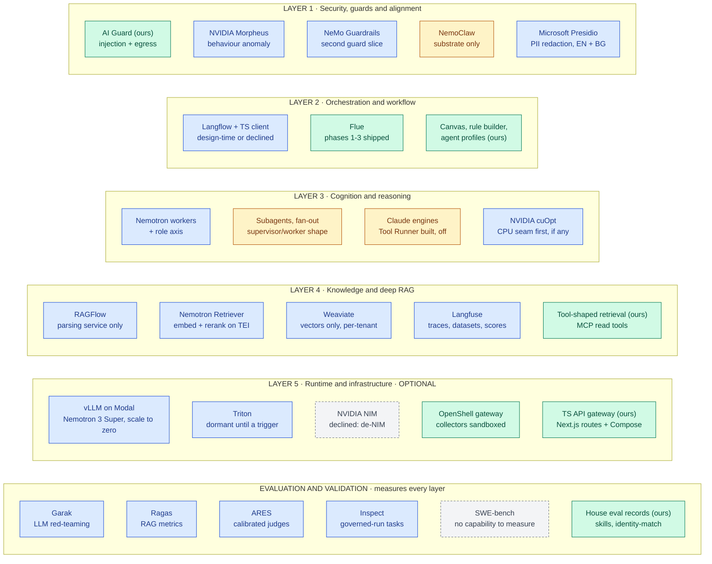
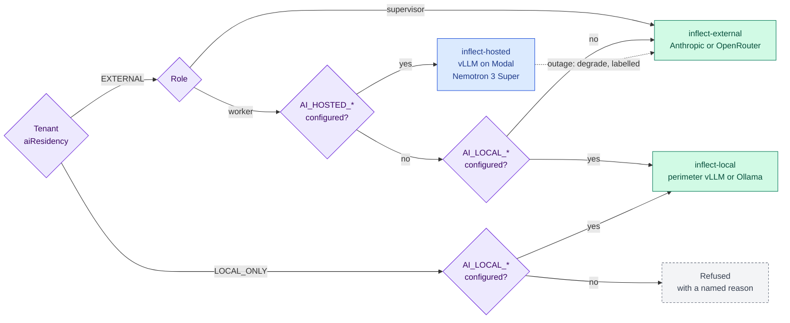
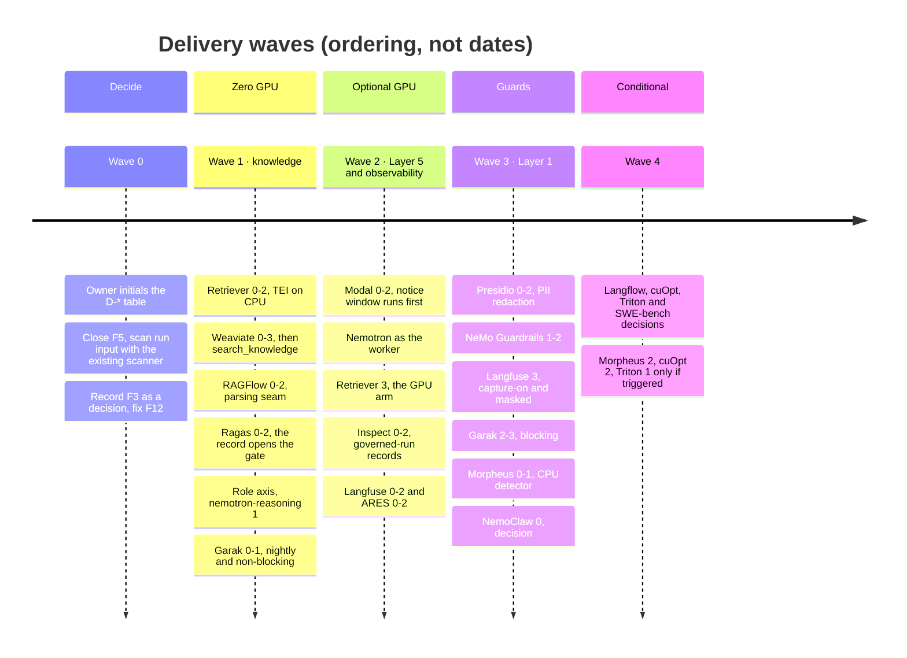
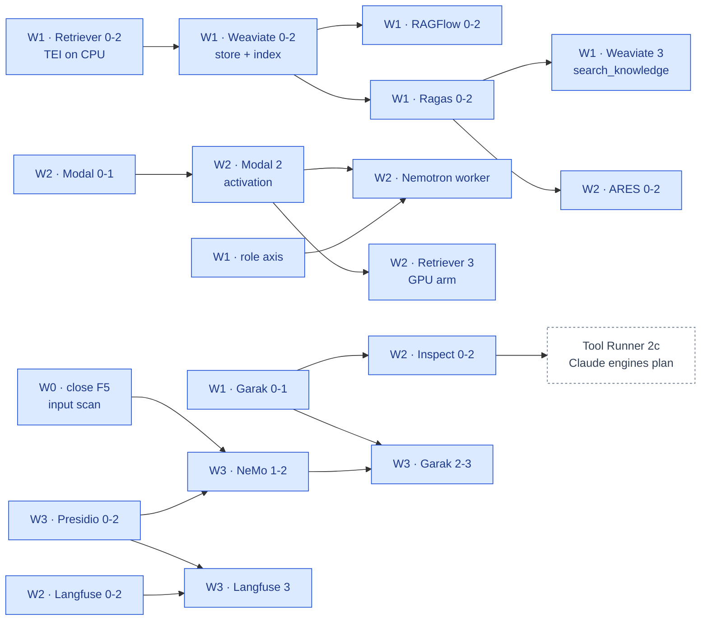
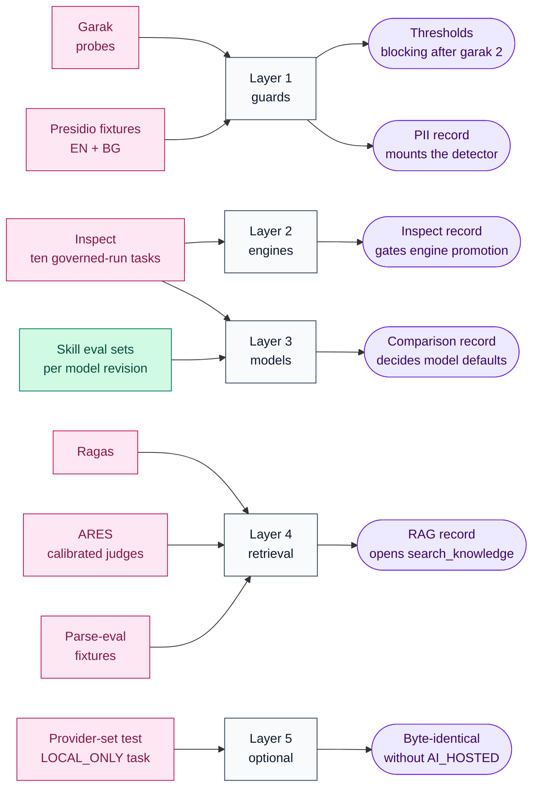

inflect · ai architecture · master roadmap v1 · 2026-10-29

# The AI architecture roadmap: the v6 target, mapped onto the codebase

> **Status: living design** — the master roadmap for bringing inflect-compliance
> to the owner's target state, the "Enterprise AI SaaS Architecture Blueprint
> (v6)" ([`docs/ai-architecture/blueprint-v6.md`](./ai-architecture/blueprint-v6.md),
> received 2026-10-29). The **Current state** section is true today
> (main 3.338.0, `a1c2f05c`) and names what each layer already has. The
> **Roadmap** section is the plan: a status board, the sequencing, the evals
> per layer, and the decisions the owner must take. Every framework the target
> names and the codebase lacks has its own child roadmap under
> [`docs/ai-architecture/`](./ai-architecture/) with phases, sub-phases,
> copy-paste prompts and hardening per phase; this document owns what is
> cross-cutting and is **updated in the pull request that changes a fact
> here**. If the code contradicts a fact here, the code wins and the pull
> request that finds it corrects this document.

## How to read this document

Three documents own three different things, and none repeats another:

| Owns | Where |
| --- | --- |
| The target as received | [`ai-architecture/blueprint-v6.md`](./ai-architecture/blueprint-v6.md) (historical: a record of the input) |
| What exists, the global rules, Layer 5's optionality, sequencing, the status board, the decisions | **this file** |
| Phases, sub-phases, prompts and hardening for one framework | `ai-architecture/<framework>.md` — one per missing framework (eighteen roadmaps, listed in the status board, beside the blueprint record) |

Two operator instructions bind the whole plan: **Layer 5 is planned on Modal
(serverless GPU) for Nemotron 3 Super**, and **Layer 5 is optional** — a
deployment using an online LLM API deploys none of it. Both are designed in
§ Layer 5 is optional by construction and implemented by
[`modal-inference.md`](./ai-architecture/modal-inference.md).

## The target, with status

Green is on `main`, amber partly present, blue missing (each has a child
roadmap), grey dashed declined. Requests enter at Layer 1 and descend; the
evaluation row measures every layer. A node turns green in the pull request
that puts the framework into production use, together with its status-board
row.

## Current state (true today)

Verified by direct inspection of `main` at 3.338.0 on 2026-10-29. Where this
section cites a finding from the 2026-10-09 audit of Flue Phase 1 (made
against 3.164.1), it says so; those were not re-verified and the first pull
request touching Flue re-checks them.

### Layer 1 — Security, guards & alignment

- **A deterministic AI guard with a three-arm outcome.** `src/app-layer/ai/guard/`
  (injection + egress scanners, patterns, policy, proposal guard);
  `guardUntrustedInput` / `guardEgress` / `assertGuardAllowed` /
  `assertNoReviewRequired`; `allow / flag / block` pinned by
  `flue-guard-outcome-has-arms`; `flag` latches review, `block` aborts,
  repeated blocks latch `AgentCircuitBreaker`.
- **Applied three ways at the tool boundary** (`flue/tools-adapter.ts`):
  egress on args before the funnel; injection on results before context;
  egress on result text before a third-party provider. The engine-neutral
  tool core (`src/lib/agentic/engine-tools/`) carries the review latch and
  `runGuardedTool` for every engine.
- **Confinement for the product's own binaries**: NVIDIA OpenShell
  (`src/lib/agentic/openshell/` — transport, executor with no local arm,
  collector network policies with explicit ENFORCE, kill drill, policy drift;
  v0.1.6 pinned by checksum and digest; gateway VM provisioned 2026-10-29
  under a 5 USD/month cap; collectors fail closed, #4443). Model-written code
  in a sandbox is **refused by import** (`flue/refused-capabilities.ts`, 23
  exports). Four OpenShell operator skills are vendored and reviewed.
- **PII is protected by encryption at rest and by field selection** (several
  sub-processor rows promise "no PII by construction"); nothing detects PII
  in a payload. Secrets egress is scanned; persons are not.
- **Known residual (2026-10-09, unverified since):** run *input* reached
  prompt assembly unscanned — `guardUntrustedInput` lived only in the tools
  adapter (F5). Closed by [`nemo-guardrails.md`](./ai-architecture/nemo-guardrails.md)
  Phase 0 with the existing scanner, before NeMo.
- Missing: Morpheus, NeMo Guardrails, Presidio; NemoClaw as a stack.

### Layer 2 — Orchestration & workflow

- **Flue is shipped through Phase 3.** `@flue/runtime 2.3.0` +
  `@earendil-works/pi-ai 1.4.0`; `src/lib/agentic/flue/` with
  `skills/` (ten skills under `docs/agent-skill-standard.md`, evaluation
  sets + records, mount gate), `subagents/` with fan-out policy and
  delegation gates, run SSE at `/agent-runs/[id]/stream`, `INVOKE_AGENT` in
  `AutomationActionType`. Eleven registered workflow definitions
  (`workflow-registry.ts`), two or more asking for the engine. Driver seam:
  `AGENT_DRIVERS` with `DRIVER_IMPLEMENTED` and `isReasoningEngine`,
  `recordedModeOf`, `runsProfiles` as `Record<AgentDriver, …>` so a third
  engine cannot be mis-recorded as STATIC (#4270). The dedicated `flue` CI job
  (ESM, `--experimental-vm-modules`) is a coverage contributor; the gate
  merges **six** artifacts.
- **Residuals from the 2026-10-09 audit, unverified since:** F3 — the
  one-member `PERMITTED_FLUE_PACKAGES` allowlist (exact set equality against
  `package.json`) blocks `@flue/opentelemetry`, so telemetry stays hand-rolled
  (`flue/telemetry.ts`, content-free by guard) — a decision to record, not a
  gap; F12 — a stale comment in `usecases/workflow-runs.ts` claiming no
  definition sets `driver`.
- **The canvas, the rule builder and agent profiles are the authoring
  surfaces.** Profiles (Claude engines Step 1a): approved by a second person,
  frozen by trigger, tools only narrow, no engine runs one yet (owner
  decision 2026-10-26), behind `AGENT_PROFILES` + `AGENT_PROFILES_TENANTS`.
- Missing: Langflow (and the TS client) — [`langflow.md`](./ai-architecture/langflow.md),
  most likely to be declined or design-time only.

### Layer 3 — Cognitive & reasoning

- **Models are chosen by residency, one specifier per run.**
  `flue/model-selection.ts`: provider ids name residency (`inflect-external`,
  `inflect-local`), never vendors; `RESIDENCY_SELECT`, `resolveFlueModel`;
  `providers.ts` registers via pi-ai's Anthropic and OpenAI-compatible APIs
  only when a credential exists; the socket re-checks the specifier
  (`assistant/turn-provider.ts`, `tool-runner/client.ts`). Tenant setting
  `aiResidency ∈ { EXTERNAL, LOCAL_ONLY }` (default EXTERNAL); local route
  `AI_LOCAL_BASE_URL` (OpenAI-compatible: Ollama / vLLM) with per-tenant
  `aiLocalBaseUrl`.
- **Supervisor/worker exists as subagents** (fan-out capped, tokens charged
  to the parent); there is no *role* in model selection — a subagent uses its
  parent's model.
- **Claude.** `@anthropic-ai/sdk 1.3.0` powers the **Tool Runner** engine
  (`src/lib/agentic/tool-runner/`, Step 2b, `DRIVER_IMPLEMENTED['tool-runner']
  = false` until Step 2c). The Agent SDK and Managed Agents are designed
  (living docs, #4135), not built. The harness scanner recognises customers'
  Agent SDK agents (Step 3b, #4476 — today's tip). Every model call is
  preceded by the kill switch and the caps (#4196) and writes an Art 12 row.
- Missing: Nemotron as the worker model, the role axis, cuOpt.

### Layer 4 — Knowledge & deep RAG

- **Retrieval is tool-shaped.** The assistant's tool loop
  (`src/app-layer/ai/assistant/`, spend ceiling, stream capacity), the
  audited MCP read tools (`src/lib/mcp/tools/`), questionnaire grounding
  (titles only), vendor-doc and risk-assessment AI features — each a
  provider behind `AI_*_PROVIDER` defaulting to `stub`.
- **No vector store, no embedding, no parser, no RAG eval.** The 18
  `embedding` hits are prompt/UI wording; `weaviate`, `pgvector`, `ragflow`,
  `langfuse` return nothing. Business content is encrypted by the manifest;
  tenant isolation is RLS + repository filters — both in Postgres.
- **Observability is OTel + Sentry + the decision log**; Flue telemetry is
  content-free by guard; prompts are code and profiles are frozen rows.
- Missing: RAGFlow, Nemotron Retriever, Weaviate, Langfuse. LlamaIndex is
  not planned (see [`langfuse.md`](./ai-architecture/langfuse.md) § Fit).

### Layer 5 — Runtime & infrastructure

- **One GCP VM, eight Compose services** (`postgres`, `pgbouncer`, `redis`,
  `clamav`, `app`, `worker`, `watchtower`, `caddy`), repo-canonical
  (`deploy/docker-compose.prod.yml`, `apply.sh`, `check-drift.sh`, #2849);
  plus the OpenShell gateway VM. Images pinned by digest (dependency
  governance, fifth pillar). CI builds `app`, the worker/scheduler bundle and
  a `scanner-image`.
- **The TypeScript API gateway is the Next.js route tree** (582 routes under
  two authorization layers), and the "microservices" are the Compose services.
- **No GPU, no vLLM, no Triton, no NIM, no Modal.** `vLLM` appears in comments
  naming what `AI_LOCAL_BASE_URL` may point at.
- Missing: the hosted route on Modal; Triton (dormant until a trigger); NIM
  declined by design.

### Evals

- **House discipline exists and is stricter than most frameworks':**
  evaluation *sets* authored beside the thing evaluated and hash-tied to it;
  evaluation *records* = set + one named model revision's raw answers; rates
  **recomputed** every time (`flue/skills/evaluation-record.ts`,
  `identity-match/evaluation-record.ts`); four case kinds required; mount
  gates refuse without a record. Nightly service-backed checks follow the DAST
  pattern (`dast.yml`: boot, role login, scan, report, auto-issue, dated
  `*-NON-BLOCKING-UNTIL:` marker **parsed** by a guard).
- **The product scores customers' agents on a six-level ladder**
  (`harness-ladder.ts`, H0–H5 with named criteria) and does not yet score its
  own the same way.
- Missing: Garak, Ragas, ARES, Inspect. SWE-bench measures a capability that
  is absent and refused.

### Existing roadmaps this one indexes, not replaces

| Roadmap | Tracks | Status |
| --- | --- | --- |
| Flue × Inflect integration plan (artifact, v4, 2026-10-09 audit) | Flue Phases 1–3 | shipped; residuals F3/F5/F12 carried here |
| `docs/claude-agent-sdk-design.md`, `claude-tool-runner-design.md`, `claude-managed-agents-design.md` | Claude engines, #4135 | Steps 0a, 1a, 2b, 3b on `main`; 2c pending |
| `docs/agentic-iam-roadmap.md` | agentic IAM, #3654 | in progress |
| `docs/sap-agent-integration-roadmap.md` | SAP routes, #3859 | Phase 0 re-scoped 2026-10-20 |
| OpenShell notes (`2026-10-21-openshell-spike.md` → `2026-10-29-openshell-gateway-vm-provisioned.md`) | OpenShell, #3924 | gateway live |

## Global rules

Every child roadmap inherits these; its hardening sections cite them by
number. They are restatements of rules the repository already enforces,
collected so a new framework cannot miss one.

- **G1 — Residency decides routing before anything is built.** Provider ids
  name residency (`inflect-external`, `inflect-local`, and the planned
  `inflect-hosted`), never vendors. `model-selection.ts` owns the decision; a
  deployment with no credential registers no provider; the socket re-checks
  the specifier; `LOCAL_ONLY` is refused before anything external is read.
  Embeddings, rerankers, guard rails, judges and detectors all route the same
  way — or they are a cross-tenant egress waiting to happen.
- **G2 — Sub-processor four-step before wiring.** Any endpoint outside the
  operator's perimeter (Modal, a cloud eval or trace service, a vendor API) is
  a row in `docs/sub-processors.md`, a 30-day notice, and activation after the
  window (`docs/sub-processor-change-policy.md`). In-deployment services still
  get a register row in the `legacy-mcp` style, because the register is the
  inventory of every external connection. Changing *what* a vendor receives is
  a row change in the same PR.
- **G3 — The engine decides what to try; the funnel decides what is
  permitted.** Every tool call goes `runGuardedTool → runReadTool /
  runProposeTool`. No engine, retriever, guard or parser module holds a
  permission check, a usecase call or a Prisma call. A runtime that makes its
  own model or tool calls (Langflow, NemoClaw's agent) is a third engine
  outside the funnel and is refused.
- **G4 — The guard sandwich at every boundary text crosses.**
  `guardUntrustedInput` into model context; `guardEgress` on args before the
  funnel and on text before a third party; new slices (PII redaction, NeMo
  rails) compose *worst-of* behind the same `GuardOutcome`; one Art 12 row per
  model call; kill switch and caps before every model call (#4196).
- **G5 — Dependencies by the five pillars.** Runtime role decides the
  `package.json` section; lockfile committed; strict peers; risk review for
  parsers and credential handlers; runtime images **by digest** in the
  repo-canonical Compose file. **Python lives in images and `deploy/`, never in
  the app** — every Python framework here (Presidio, NeMo, RAGFlow, Langflow,
  garak, Ragas, ARES, Inspect, Modal apps) is a container or a deploy script.
- **G6 — Egress is `safeFetch`, hosts are config.** Every new outbound host
  joins `tests/guards/ssrf-egress-coverage.test.ts`'s population; base URLs are
  operator config or code constants, never tenant-writable; reads are
  byte-capped and deadline-bounded (the MCP client is the pattern).
- **G7 — Tenant data gets RLS and a two-tenant behavioural test.** A store
  outside Postgres (Weaviate) proves isolation with the same test shape at
  every layer that touches it, and is **rebuildable from Postgres** so losing
  it loses nothing (vectors-only rule).
- **G8 — Long work runs in the worker.** BullMQ jobs under `runJob()`,
  resumable under the Epic E drain; never the web tier.
- **G9 — Off by default, fail closed, two keys where a customer's data is the
  blast radius.** Operator env + tenant setting (the `AGENT_DRIVER_FLUE` /
  `agentDriver` and `AGENT_PROFILES` / `AGENT_PROFILES_TENANTS` pattern).
  Absent config constructs nothing. A guard that cannot reach its provider
  degrades to `flag` (or blocks egress), never to `allow`.
- **G10 — Tests named for invariants; prose is not a gate.** No epic-named
  ratchets; a structural rule is an ESLint rule in `eslint-rules/`; every PR
  an implementation note (no classification entry); SIGNIFICANT changes carry
  a rollback plan and a risk assessment; a dated deferral marker is parsed by
  a guard or it is decoration; thresholds and floors ratchet down freely and
  up with a written reason.
- **G11 — Evals produce records, not figures.** Set beside the thing, hashed;
  record = set + a named revision's raw answers; aggregates recomputed; four
  case kinds; a new framework emits this shape or it is a dashboard, not a
  gate. Records are committed by PR, never pushed by a job. Seed and fixture
  corpora only — never customer data.
- **G12 — Layer 5 is optional by construction.** It exists in a deployment
  iff a provider id that needs it is registered; with an online API only,
  nothing of it is deployed, configured or health-checked (next section).

## Layer 5 is optional by construction

The owner's two instructions become one design decision: a **third provider
id**, `inflect-hosted`, for inference the operator controls (own Modal
workspace, own pinned open weights, own endpoint and token) that runs outside
the perimeter on Modal.

- **Why not point `inflect-local` at Modal.** `inflect-local` is the id a
  `LOCAL_ONLY` tenant trusts. Pointing it at a US cloud would route the tenants
  who asked for the opposite, under the label that promised it.
  `inflect-hosted` is **EXTERNAL-class** for residency: `LOCAL_ONLY` never
  resolves to it. The id says what the residency *is*; Modal is the vendor
  behind it — the same argument `providers.ts` makes for not registering
  vendors under their own names.
- **Why Modal is a sub-processor.** Prompts are processed on Modal-managed
  hosts. Operator-held weights and ephemeral containers change the retention
  column, not the processing fact. The four-step notice (G2) runs during the
  Modal roadmap's Phases 0–1.

**The routing, drawn.** Which provider a call reaches is decided by the
tenant's residency first and the deployment's configuration second; Layer 5
is one optional branch, and no path leads a `LOCAL_ONLY` tenant to it.

- **The contract.**

  | Deployment | `AI_HOSTED_*` | What exists | Worker role → |
  | --- | --- | --- | --- |
  | Online API only | unset | nothing — no provider id, no Modal app, no probe | external (EXTERNAL tenants) / local or refused (LOCAL_ONLY) |
  | Hosted enabled | set | `inflect-hosted` registered at boot; `deploy/modal/` deployed by the operator | hosted (EXTERNAL) / local or refused (LOCAL_ONLY) |
  | Perimeter GPU | `AI_LOCAL_*` set | unchanged from today | local for everyone who may |

- **Degradation, not refusal.** `/api/readyz` never gates on the hosted route
  (the audit-stream precedent). A hosted outage degrades the worker role to the
  supervisor's provider with an outcome label. The only tenants a missing
  Layer 5 can *refuse* are `LOCAL_ONLY` tenants with no local route — who are
  refused today, by design.
- **Every GPU arm shares the conventions**: `deploy/modal/<app>.py`, weights on
  a Modal Volume, scale-to-zero, proxy-auth token, region per D-L5-2, a
  manually-dispatched `modal-deploy` job with drift checking, metrics with a
  `cold_start` label. Workers ([`nemotron-reasoning.md`](./ai-architecture/nemotron-reasoning.md)),
  embeddings + rerank ([`nemotron-retriever.md`](./ai-architecture/nemotron-retriever.md)),
  ARES judges, cuOpt, Morpheus scoring and — if a trigger ever fires — Triton.
- **De-NIM.** No NIM container anywhere (blueprint §3): vLLM, TEI and the
  open-source Triton image serve open weights.

## Roadmap (future direction)

### Status board

The living part. One row per framework; the child roadmap owns the phases.
"Phase" is the highest phase whose "done when" has been met on `main`.

| Framework | Layer | Child roadmap | Wave | Status | Phase on `main` | Decisions open |
| --- | --- | --- | --- | --- | --- | --- |
| Presidio | 1 | [`presidio.md`](./ai-architecture/presidio.md) | 3 | missing | — | D-L1-1 |
| NeMo Guardrails | 1 | [`nemo-guardrails.md`](./ai-architecture/nemo-guardrails.md) | 3 | missing (F5 residual closes in its Phase 0) | — | D-L1-2 |
| Morpheus | 1 | [`morpheus.md`](./ai-architecture/morpheus.md) | 3 | missing; CPU detector first | — | D-L1-3 |
| NemoClaw | 1 | [`nemoclaw.md`](./ai-architecture/nemoclaw.md) | 3 | substrate present (OpenShell); stack to be declined | — | D-L1-4 |
| Langflow + TS client | 2 | [`langflow.md`](./ai-architecture/langflow.md) | 4 | missing; likely design-time or declined | — | D-L2-1 |
| Flue | 2 | artifact v4 + residuals here | — | **shipped** (Phases 1–3) | 3 | F3 decision to record |
| Nemotron workers + role axis | 3 | [`nemotron-reasoning.md`](./ai-architecture/nemotron-reasoning.md) | 1 (role axis) / 2 (hosted) | missing | — | D-L3-1, D-L3-2 |
| Claude engines | 3 | `docs/claude-*-design.md` (#4135) | — | Tool Runner built, off; Agent SDK designed | 2b | Step 2c (gated on Inspect record) |
| cuOpt | 3 | [`cuopt.md`](./ai-architecture/cuopt.md) | 4 | missing; CPU seam first if any | — | D-L3-3 |
| Weaviate | 4 | [`weaviate.md`](./ai-architecture/weaviate.md) | 1 | missing | — | D-L4-1, D-L4-2 |
| Nemotron Retriever | 4 | [`nemotron-retriever.md`](./ai-architecture/nemotron-retriever.md) | 1 (CPU) / 2 (GPU) | missing | — | D-L4-3 |
| RAGFlow | 4 | [`ragflow.md`](./ai-architecture/ragflow.md) | 1 | missing | — | D-L4-4 |
| Langfuse | 4 | [`langfuse.md`](./ai-architecture/langfuse.md) | 2 | missing | — | D-L4-5, D-L4-6 |
| Modal (vLLM, Nemotron 3 Super) | 5 | [`modal-inference.md`](./ai-architecture/modal-inference.md) | 2 | missing; optional | — | D-L5-1, D-L5-2 |
| Triton | 5 | [`triton.md`](./ai-architecture/triton.md) | 4 | dormant until trigger | — | D-L5-3 |
| NIM | 5 | — | — | **declined** (de-NIM) | — | — |
| Garak | evals | [`garak.md`](./ai-architecture/garak.md) | 3 (Phase 1 any time) | missing | — | D-EV-1 |
| Ragas | evals | [`ragas.md`](./ai-architecture/ragas.md) | 1 | missing | — | D-EV-2 |
| ARES | evals | [`ares.md`](./ai-architecture/ares.md) | 2 | missing | — | D-EV-3 |
| Inspect | evals | [`inspect.md`](./ai-architecture/inspect.md) | 2 | missing | — | D-EV-4 |
| SWE-bench | evals | [`swe-bench.md`](./ai-architecture/swe-bench.md) | — | no capability to measure | — | D-EV-5 |

### Sequencing

Ordered by value delivered per unit of risk, with the zero-GPU pilot first —
which the blueprint's own §4 also asks for. The timeline is ordering, not
dates: a wave starts when the waves before it have landed what it depends on.
"Weaviate 0-3" means that roadmap's Phases 0 to 3.

The hard dependencies between roadmaps, as a graph. A box may start only when
everything pointing at it has landed; the dashed box belongs to another plan.

The same dependencies as prose, for a reader without a Mermaid renderer:
Weaviate Phase 2 needs an embedding provider; Ragas needs an index; the
`search_knowledge` tool needs a Ragas record; every GPU arm needs Modal
Phase 1; Langfuse capture-on and NeMo PII rails need Presidio; Tool Runner
Step 2c needs an Inspect record. Each child's "Where it sits" table states its
own.

### Evals by layer

Every evaluation ends in a committed record, and every record either opens a
gate or ratchets a floor — that is what separates an eval from a dashboard
(G11). Pink is an evaluation, purple the gate its record controls.

| Layer | What is evaluated | Framework | Record / gate |
| --- | --- | --- | --- |
| 1 | injection, jailbreak, leakage through the composed guard; PII precision/recall; rail precision | Garak; Presidio fixtures; NeMo rail sets | garak thresholds (blocking after Phase 2); `evals/pii/records/` as a mount condition |
| 2 | governed-run invariants (propose-not-commit, halt on flagged result, kill mid-run, caps) | Inspect (ten tasks) | `evals/inspect/records/`; engine promotion (Step 2c) gated on a record |
| 3 | worker/supervisor model quality; protocol fidelity; residency per role | skills evaluation sets per model revision; Inspect comparisons | skills records; comparison records decide defaults |
| 4 | retrieval precision/recall, faithfulness; parse fidelity; isolation | Ragas → ARES; parse-eval; two-tenant tests | `evals/rag/records/` opens `search_knowledge`; floors ratchet |
| 5 | optionality (byte-identical without), residency at the socket, serving smoke, cost | provider-set test; Inspect LOCAL_ONLY task; nightly smoke; spend alerts | CI; Modal alerts |
| cross | the product's own agents on its own ladder (H3–H5) | Inspect records cited on the agent's Coverage tab | committed records are evidence; live runs are not |

All of it on seed and fixture data; records by PR; nightly jobs
non-blocking with a dated, parsed marker until their floors are set, then
blocking — the DAST path, every time.

### Decisions for the owner

Each child roadmap's Phase 0 ends with one or more of these. Initial here;
the child records the reasoning.

| Id | Decision | Child | Default if undecided |
| --- | --- | --- | --- |
| D-L1-1 | PII redaction scope: paths, entity types, locales, LOCAL_ONLY handling | presidio | external routes only; PERSON/EMAIL/PHONE/IBAN/ЕГН; EN+BG; LOCAL_ONLY off |
| D-L1-2 | NeMo rails: LLM-free first; LLM-backed only on the tenant's permitted route | nemo-guardrails | as stated |
| D-L1-3 | Behaviour anomaly signal; CPU detector before Morpheus | morpheus | CPU first |
| D-L1-4 | NemoClaw: reference-only; runtime and privacy router declined | nemoclaw | declined |
| D-L2-1 | Langflow: design-time exporter, or declined | langflow | declined |
| D-L3-1 | Supervisor/worker role axis in model selection | nemotron-reasoning | adopt |
| D-L3-2 | Nemotron as the default worker when a hosted/local route exists | nemotron-reasoning | adopt after skill records |
| D-L3-3 | An optimisation problem at GPU scale exists | cuopt | no; CPU seam if a feature wants it |
| D-L4-1 | pgvector-first or Weaviate-first | weaviate | Weaviate (the target), with the note's trade-offs |
| D-L4-2 | Vectors-only rule (no chunk text outside Postgres) | weaviate | adopt |
| D-L4-3 | De-NIM retriever: open weights on TEI/vLLM | nemotron-retriever | adopt |
| D-L4-4 | Parser backend: RAGFlow slim or a parsing-only service | ragflow | measured in Phase 0 |
| D-L4-5 | Langfuse hosting: self-host / Cloud EU / OTel-only | langfuse | self-host if the VM bears it |
| D-L4-6 | Trace content capture off by default; three conditions to turn on | langfuse | adopt |
| D-L5-1 | Modal as a sub-processor (four-step notice) | modal-inference | start the notice |
| D-L5-2 | Model, weights, licence, region, GPU class, cold-start budget | modal-inference | Nemotron 3 Super; Nano fallback; EU region if available |
| D-L5-3 | Triton consolidation trigger | triton | dormant |
| D-EV-1 | Which model answers garak probes in CI, and the nightly budget | garak | external CI key, budgeted |
| D-EV-2 | Ragas judge residency and cost | ragas | external CI key; local for LOCAL_ONLY-only deployments |
| D-EV-3 | Who labels ARES triples, from the seed corpus | ares | operator, seed only |
| D-EV-4 | The product scores its own agents on its own ladder | inspect | adopt |
| D-EV-5 | SWE-bench: declined or placeholder | swe-bench | declined |

### How this document is updated

- A phase lands → its child's "done when" is met → the **Status board** row's
  "Phase on `main`" moves and the PR is linked in the child; the phase's node
  in the child's **At a glance** diagram changes from `todo` to `done`; any
  fact in **Current state** that changed is rewritten in the present tense
  **in the same pull request**. When a framework reaches production use, its
  node in **The target, with status** turns green in that pull request too.
- A decision is taken → the D-* row gets an initial and a date; the child's
  Phase 0 note holds the reasoning.
- A framework is declined → its row reads "declined (D-…)" with the note's
  link; the child document stays as the record of why.
- Nothing here is a CI gate (`docs:lint` is advisory by design); the ratchet
  that applies is `docs-accuracy` — this file and every child are classified
  `living`, which means the banner and the two H2s above are required and
  future tense is permitted.
