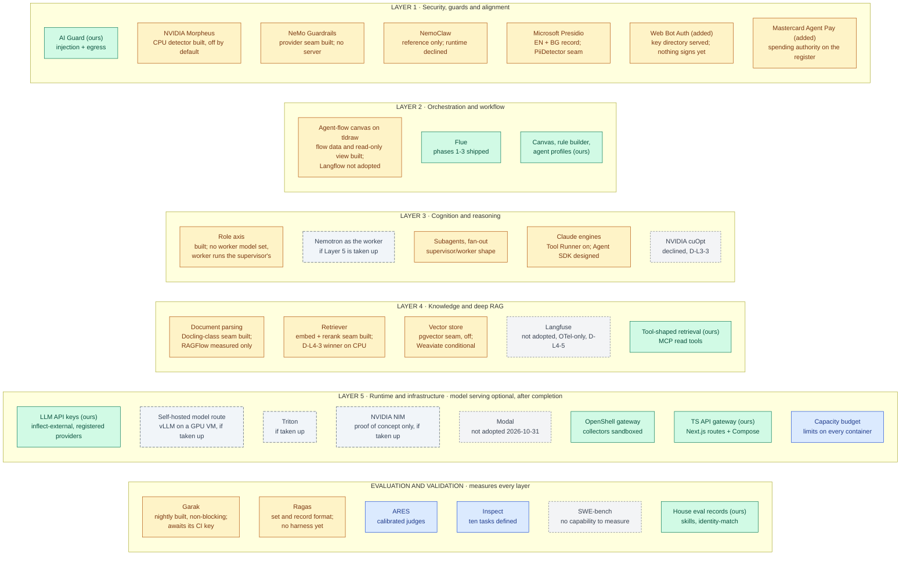
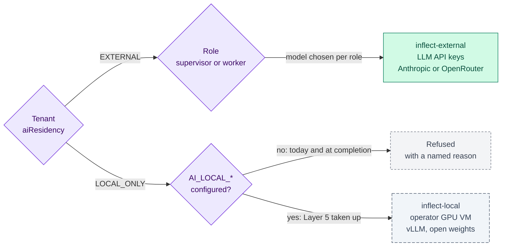
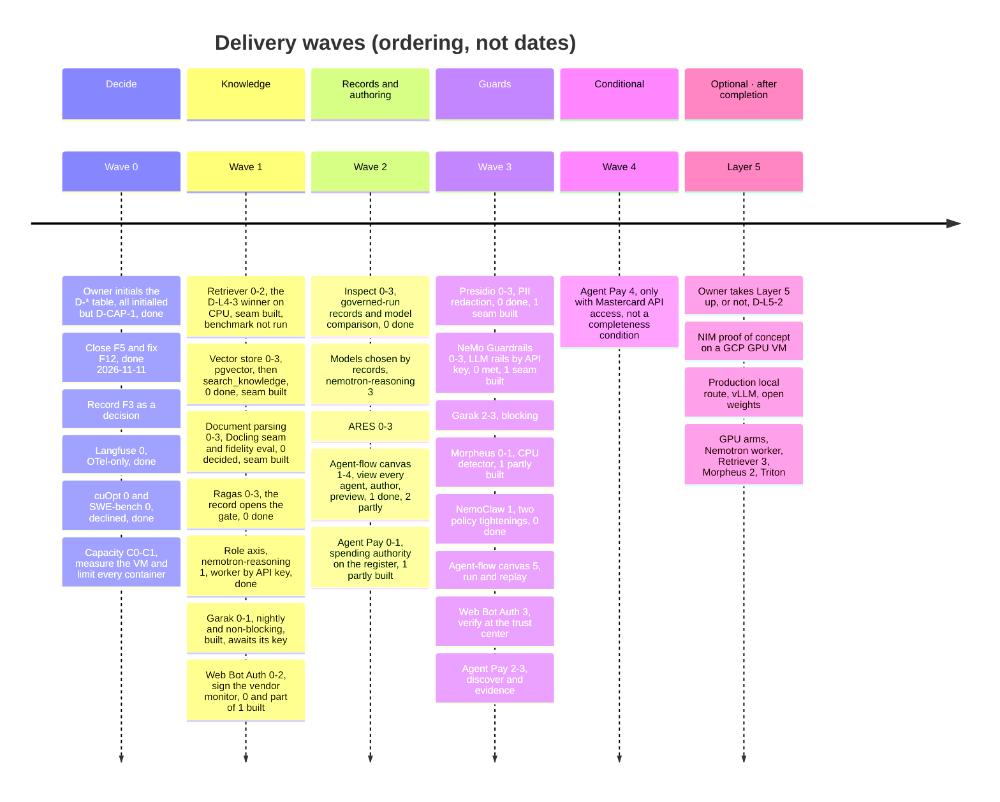
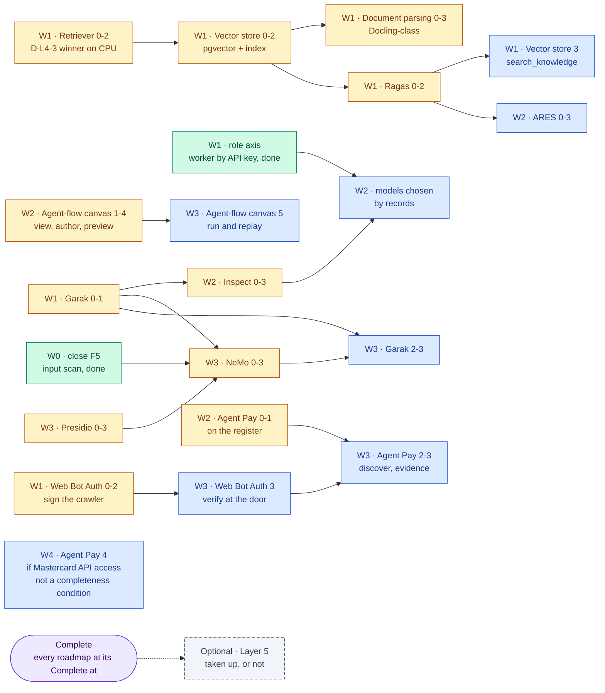
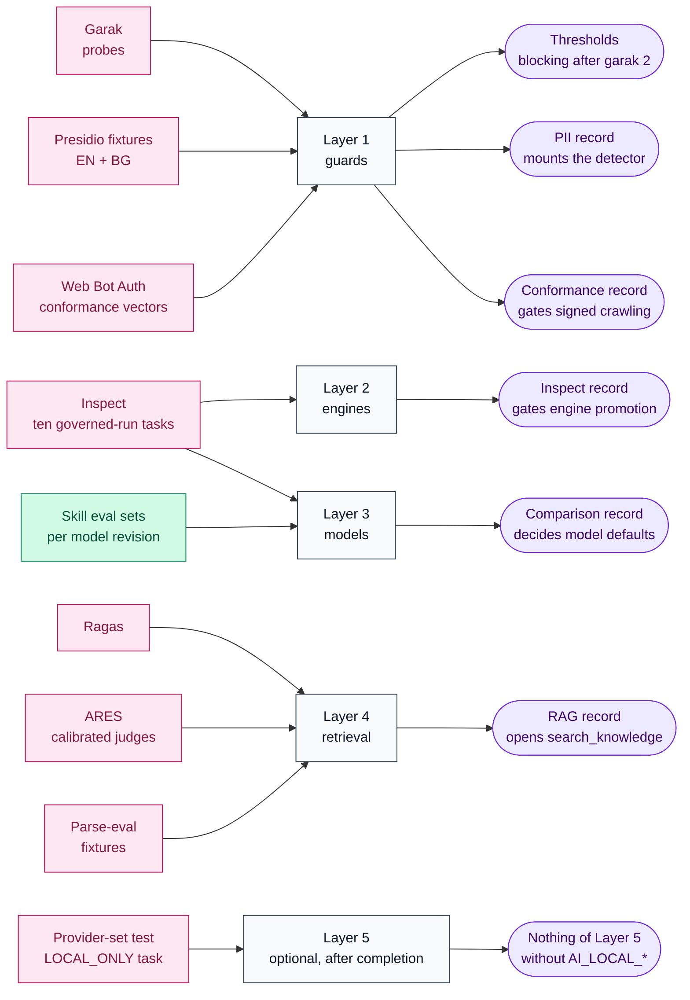

inflect · ai architecture · master roadmap v2 · 2026-11-12

# The AI architecture roadmap: the v6 target, mapped onto the codebase

> **Status: living design** — the master roadmap for bringing inflect-compliance
> to the owner's target state, the "Enterprise AI SaaS Architecture Blueprint
> (v6)" ([`docs/ai-architecture/blueprint-v6.md`](./ai-architecture/blueprint-v6.md),
> received 2026-10-29). The plan is **complete without Layer 5**: complete
> means every roadmap outside Layer 5, and the capacity budget of the VM they
> run on, has reached its "Complete at" phase. Layer 5's model serving is
> optional work taken up after that, or never (owner, 2026-10-31).
> The **Current state** section is true today (verified at main 3.338.0,
> `a1c2f05c`; re-checked where it changed at 3.347.0, `e0e682e03`, on
> 2026-10-31, and again on 2026-11-12 against the integration of the
> 2026-11-11 wave, twenty-two work items on top of main 3.368.1) and names
> what each layer already has. The
> **Roadmap** section is the plan: what complete means, a status board, the
> sequencing, the evals per layer, and the decisions the owner must take. Every framework the target
> names and the codebase lacks has its own child roadmap under
> [`docs/ai-architecture/`](./ai-architecture/) with phases, sub-phases,
> copy-paste prompts and hardening per phase; this document owns what is
> cross-cutting and is **updated in the pull request that changes a fact
> here**. If the code contradicts a fact here, the code wins and the pull
> request that finds it corrects this document.

## How to read this document

Three documents own three different things, and none repeats another:

| Owns | Where |
| --- | --- |
| The target as received | [`ai-architecture/blueprint-v6.md`](./ai-architecture/blueprint-v6.md) (historical: a record of the input) |
| What exists, the global rules, Layer 5's optionality, what complete means, the capacity budget, sequencing, the status board, the decisions | **this file** |
| Phases, sub-phases, prompts and hardening for one framework | `ai-architecture/<framework>.md` — one per missing framework (twenty roadmaps, listed in the status board, beside the blueprint record): eighteen from the blueprint, and two additions the owner made on 2026-10-30, [`web-bot-auth.md`](./ai-architecture/web-bot-auth.md) and [`mastercard-agent-pay.md`](./ai-architecture/mastercard-agent-pay.md). Two keep the filename of the framework the blueprint named after a decision replaced it, so links stay stable: `weaviate.md` plans the vector store (pgvector first, D-L4-1) and `ragflow.md` the document parser (Docling-class, D-L4-4) |

Two owner decisions of 2026-10-31 (D-L5-1) bind the whole plan:

- **Model usage goes through LLM API keys** on the existing external route, to
  providers on the sub-processor register. There is no self-hosting now: no
  GPU, no NIM, no vLLM deployment, and Modal is not adopted.
- **The plan is complete without Layer 5.** Every other roadmap names the
  phase at which it is complete, and none of those phases needs a GPU or a
  self-hosted model (§ What complete means). Layer 5's model serving
  (self-hosted models, GPUs) is optional and comes after completion, or
  never.

They replace the instruction of 2026-10-29, which planned Layer 5 on Modal for
Nemotron 3 Super. Both are designed in § Layer 5 is optional by construction;
[`modal-inference.md`](./ai-architecture/modal-inference.md) keeps the optional
Layer 5 plan under its old filename so links stay stable.

## The target, with status

Green is in production use on `main`, amber partly present (some of it runs,
or a seam is built and nothing runs through it yet), blue missing and part of
completeness (each has a child roadmap), slate dashed optional Layer 5 work
that starts only after every other roadmap is complete, grey dashed declined.
Requests enter at Layer 1 and descend; the evaluation row measures every
layer. A node turns green in the pull request that puts the framework into
production use, together with its status-board row.

## Current state (true today)

Verified by direct inspection of `main` at 3.338.0 on 2026-10-29, and
rewritten where the 2026-11-11 wave changed it (re-read against the code of
its integration, 2026-11-12). Most of that wave is **seams**: a module, its
tests and its operator variables, off by default, with nothing deployed behind
it and nothing in the product calling it yet. Each bullet below says which.
Of the residuals from the 2026-10-09 audit of Flue Phase 1 (made against
3.164.1), F5 and F12 were re-verified and closed on 2026-11-11 against
3.364.1; F3 is unchanged.

### Layer 1 — Security, guards & alignment

- **A deterministic AI guard with a three-arm outcome.** `src/app-layer/ai/guard/`
  (injection + egress scanners, patterns, policy, proposal guard);
  `guardUntrustedInput` / `guardEgress` / `assertGuardAllowed` /
  `assertNoReviewRequired`; `allow / flag / block` pinned by
  `flue-guard-outcome-has-arms`; `flag` latches review, `block` aborts,
  repeated blocks latch `AgentCircuitBreaker`.
- **The guard composes providers, worst-of** (NeMo Phase 1, 2026-11-11):
  `src/app-layer/ai/guard/providers/` holds a `GuardProvider` seam, the
  deterministic patterns as the first provider, and a NeMo Guardrails client
  read from `AI_GUARD_NEMO_BASE_URL` (operator config, never tenant-writable),
  composed worst-of behind the unchanged `GuardOutcome` (G4). An unreachable
  provider scans `suspicious` (`guard.provider_unavailable.<id>`), which is
  `flag` in both directions under `strict` and `balanced`, never `allow` and
  never `block` (G9): the call latches review rather than aborting, egress
  included. A tenant in `audit` mode records it and allows, as it does every
  verdict.
  With the URL unset the guard is byte-identical to before. No NeMo server is
  deployed (Phase 1.3, held by the capacity rule until C1), and three callers
  that scan inside a tenant transaction (A2A reply delivery, questionnaire
  autofill, risk suggestions) consult the patterns provider only, recording
  `notConsulted: ['nemo']`. The client dials the server through the
  in-deployment rule (`src/lib/ai/in-deployment-service.ts`, G6 as amended on
  2026-11-12), not `safeFetch`, so a NeMo container on the Compose network is
  reachable and an address outside the deployment is refused.
- **Applied three ways at the tool boundary** (`flue/tools-adapter.ts`):
  egress on args before the funnel; injection on results before context;
  egress on result text before a third-party provider. The engine-neutral
  tool core (`src/lib/agentic/engine-tools/`) carries the review latch and
  `runGuardedTool` for every engine.
- **Confinement for the product's own binaries**: NVIDIA OpenShell
  (`src/lib/agentic/openshell/` — transport, executor with no local arm,
  collector network policies with explicit ENFORCE, kill drill, policy drift;
  v0.1.6 pinned by checksum and digest; gateway VM provisioned 2026-10-29
  under a 5 USD/month cap; collectors fail closed, #4443). Model-written code
  in a sandbox is **refused by import** (`flue/refused-capabilities.ts`, 23
  exports). Four OpenShell operator skills are vendored and reviewed.
- **PII is protected by encryption at rest and by field selection** (several
  sub-processor rows promise "no PII by construction"); nothing in the product
  detects PII in a payload. Secrets egress is scanned; persons are not.
  Presidio's Phase 0 is done (2026-11-11): D-L1-1's scope (external routes
  only; PERSON, EMAIL, PHONE, IBAN, ЕГН; LOCATION and ORG out of scope; EN +
  BG; `LOCAL_ONLY` not redacted), a seeded 85-case EN + BG fixture corpus
  (`tests/fixtures/pii/`), Bulgarian recognisers in the detector image's
  sources (`guards/presidio/`, which no CI job builds yet), and the first
  precision/recall record (`evals/pii/records/`), a development-set figure that
  is not yet a mount condition. The `PiiDetector` seam (Phase 1.2–1.4,
  `src/lib/ai/pii/`) is built: a stub default, a Presidio client on the
  in-deployment dial, an egress use that fails closed when the detector is
  unavailable, and a mount gate that registers the provider only with a passing
  record. No detector is deployed (Phase 1.1, held by C1), and no record can
  mount until a held-out corpus carries at least `PII_MIN_SUPPORT` cases per
  type and locale (D-L1-11).
- **Run input is scanned before any engine sees it** (F5, closed 2026-11-11,
  re-verified against 3.364.1). The admission scan in `startWorkflowRun`
  (#3468) runs before engine selection, and
  `tests/integration/run-input-scan-precedes-every-engine.test.ts` pins it for
  Flue and the Tool Runner. A `flag` verdict on run input refuses the run at
  admission; it does not park it for review (owner, 2026-11-12, D-L1-16).
- **The behaviour circuit breaker is hourly, and a daily fingerprint is built
  beside it** (Morpheus Phase 1, partly). The breaker already watches an
  agent's hourly window (`AgentBehaviourWindow`: `PROPOSAL_RATE`, `TOOL_MIX`,
  `REJECTION_RATE`, `GUARD_BLOCK`); the gap was daily signals (read volume,
  tokens, runs, active hours). The `agent-fingerprint` job (01:53 UTC, in the
  existing worker, no container) baselines each agent over 14 to 28 days in
  `AgentBehaviourBaseline` and records `AgentBehaviourAnomaly` rows under RLS:
  z ≥ 4 raises a finding and z ≥ 8 latches the existing breaker with
  `BEHAVIOUR_ANOMALY`. It is off by default under `AGENT_BEHAVIOUR_DETECTOR` +
  `AGENT_BEHAVIOUR_DETECTOR_TENANTS`, with `AGENT_BEHAVIOUR_DETECTOR_LATCH` as a
  third key for the latch, and its thresholds are written down with reasons
  but not measured (Morpheus Phase 0.2's seeded check is open).
- **Automated HTTP: a signing key exists, nothing signs, and a refusal is now
  visible.** The product's only unattended crawler of third-party websites,
  the vendor monitor's TLS grade, still identifies itself by a User-Agent
  string alone. It fetches the tenant-entered domain only through
  `safeFetch`, following redirects one re-checked hop at a time (since
  2026-10-31). Since 2026-11-11 it records why a fetch did not grade —
  `GRADED`, `REFUSED`, `UNREACHABLE` or `BLOCKED`, with the time, on
  `VendorMonitor` — counts it on `vendor_monitor.tls_fetch{provider,outcome}`,
  and the vendor page marks a stale grade stale. A DNS failure is
  `UNREACHABLE` and every 4xx is `REFUSED` (owner, 2026-11-12, D-L1-15).
  Web Bot Auth Phase 1 is partly built: an optional deployment-wide Ed25519
  key (`WEB_BOT_AUTH_SIGNING_KEY`, with `WEB_BOT_AUTH_PREVIOUS_SIGNING_KEY`;
  absent means a 404 and nothing built) and a signed key directory at
  `/.well-known/http-message-signatures-directory`, its `keyid` the RFC 7638
  thumbprint, signed in-house on `node:crypto`. The wire format follows
  `draft-ietf-webbotauth-httpsig-protocol-01` (2026-10-29). No outbound request
  is signed yet, and the public trust center knows automated visitors only by
  IP. [`web-bot-auth.md`](./ai-architecture/web-bot-auth.md) plans both
  directions; it is an addition to the blueprint (owner, 2026-10-30).
- **The register records an agent's spending authority** (Agent Pay Phase 1,
  partly). `AgentSpendingAuthority` holds a declared envelope reviewed by a
  second person; activation refuses `SPENDING_AUTHORITY_UNREVIEWED`, and a
  trigger on `RegisteredAgent` backs it; the kill switch and the owner-orphan
  kill request a spending suspension and open an `AGENT_SPENDING_SUSPENSION`
  task; widening an envelope raises a `SPENDING_AUTHORITY_WIDENED` finding.
  The harness contract refuses a card number as a secret (Phase 0,
  `harness-contract-rules.ts`). No card data exists anywhere in the product,
  and Inflect never holds a payment credential (D-L1-8). The recertification
  section, the governance-pack row, the API routes and the register page
  section are not built.
  [`mastercard-agent-pay.md`](./ai-architecture/mastercard-agent-pay.md) is the
  second addition to the blueprint (owner, 2026-10-30).
- Missing: a deployed second guard slice (NeMo server), a PII detector, signed
  outbound requests and the inbound verifier, Agent Pay's discovery and
  evidence. NemoClaw is reference-only by decision (D-L1-4); its Phase 1 is
  two collector-policy tightenings.

### Layer 2 — Orchestration & workflow

- **Flue is shipped through Phase 3.** `@flue/runtime 2.3.0` +
  `@earendil-works/pi-ai 1.4.0`; `src/lib/agentic/flue/` with
  `skills/` (ten skills under `docs/agent-skill-standard.md`, evaluation
  sets + records, mount gate), `subagents/` with fan-out policy and
  delegation gates, run SSE at `/agent-runs/[id]/stream`, `INVOKE_AGENT` in
  `AutomationActionType`. Eleven registered workflow definitions
  (`workflow-registry.ts`), two or more asking for the engine. Driver seam:
  `AGENT_DRIVERS` with `DRIVER_IMPLEMENTED` and `isReasoningEngine`,
  `recordedModeOf`, `runsProfiles` as `Record<AgentDriver, …>` so a third
  engine cannot be mis-recorded as STATIC (#4270). The dedicated `flue` CI job
  (ESM, `--experimental-vm-modules`) is a coverage contributor; the gate
  merges **nine** artifacts (the trailing argument to
  `check-merged-coverage.ts` in `ci.yml` is the authority).
- **Residuals from the 2026-10-09 audit, re-verified 2026-11-11 against
  3.364.1:** F3 is unchanged — the one-member `PERMITTED_FLUE_PACKAGES`
  allowlist (`['@flue/runtime']`, exact set equality against `package.json`)
  blocks `@flue/opentelemetry`, so telemetry stays hand-rolled
  (`flue/telemetry.ts`, content-free by guard) — a decision to record, not a
  gap. F12, the stale comment in `usecases/workflow-runs.ts` claiming no
  definition sets `driver`, is fixed. F5 is closed (Layer 1).
- **The canvas, the rule builder and agent profiles are the authoring
  surfaces.** Profiles (Claude engines Step 1a): approved by a second person,
  frozen by trigger, tools only narrow. Only the Tool Runner runs one (Step
  2c, #4512); Flue does not, by owner decision of 2026-10-26. The surface is
  behind `AGENT_PROFILES` + `AGENT_PROFILES_TENANTS`, or, with the variable
  unset, the workspace organization's own switch (#4557).
- **A drawn flow exists as data, and an agent can be viewed on the canvas,
  read-only** (agent-flow canvas Phases 1 and 2, 2026-11-11).
  `AgentProfileVersion.flowJson` is encrypted, frozen by trigger and covered by
  the version hash (still the `instructionsHash` column, unchanged for a
  version without a flow); with a flow, the version's tool list is derived
  from it, and the approver sees the flow as text, diffed against the version
  in force. A flow version runs on **no engine** until Phase 5: admission
  refuses it with `PROFILE_FLOW_NOT_RUNNABLE` (`runsFlows`, false for every
  engine), and so does the worker's pinned path. There is no checkpoint node
  kind (D-L2-2). The read-only agent view lives at
  `/t/:slug/processes/agents/:agentId`, inside the process-canvas module, with
  its own node taxonomy (`AGENT_VIEW_NODE_TAXONOMY`); ESLint refuses
  `@xyflow/*` across the agent-flow paths.
- Missing: authoring a flow on the canvas, the Behaviour tab's "Open on
  canvas" link and the approver's visual diff (Phase 2.3, 2.4), preview, and
  running a flow. [`langflow.md`](./ai-architecture/langflow.md) plans it in the
  product as a second editor for the agent profile (D-L2-1, decided
  2026-10-29); Langflow itself is not adopted.
- The process canvas is switching drawing engines tenant by tenant, from
  `@xyflow/react` to `tldraw` 3.15.6 (#2960); #2962 removes xyflow. The
  agent-flow canvas is built on tldraw only and inside the process-canvas
  module (D-L2-3, decided 2026-10-29), because tldraw's licence caps it at 3.x
  with the watermark kept and a guard confines the editor to that module. So
  it reaches only tenants that have the module enabled.

### Layer 3 — Cognitive & reasoning

- **Models are chosen by residency, one specifier per run.**
  `flue/model-selection.ts`: provider ids name residency (`inflect-external`,
  `inflect-local`), never vendors; `RESIDENCY_SELECT`, `resolveFlueModel`;
  `providers.ts` registers via pi-ai's Anthropic and OpenAI-compatible APIs
  only when a credential exists; the socket re-checks the specifier
  (`assistant/turn-provider.ts`, `tool-runner/client.ts`). Tenant setting
  `aiResidency ∈ { EXTERNAL, LOCAL_ONLY }` (default EXTERNAL); local route
  `AI_LOCAL_BASE_URL` (OpenAI-compatible: Ollama / vLLM); a tenant's stored
  `aiLocalBaseUrl` is honoured only when it is that address (#4545). An
  `EXTERNAL` tenant resolves to the external route and a `LOCAL_ONLY` tenant
  to the local route or a named refusal. Nothing serves the local route since
  the Laya estate was retired on 2026-10-14, so model usage in production is
  the API keys on the external route.
- **Supervisor/worker exists as subagents** (fan-out capped, tokens charged
  to the parent), and **model selection has a role** (D-L3-1, built
  2026-11-11). The supervisor uses `AGENT_FLUE_MODEL`; the worker (Flue
  subagents) uses the optional `AGENT_FLUE_WORKER_MODEL` on the same external
  provider and key, or the supervisor's model when it is unset
  (`worker_fallback`). No worker model is configured by default, so **the
  worker runs on the supervisor's model today**. `LOCAL_ONLY` uses the local
  route for both roles or refuses both. Both roles' models are recorded in
  `WORKFLOW_RUN_STARTED`. No sub-processor changed: the variable is noted on
  the existing Anthropic row.
- **Claude.** `@anthropic-ai/sdk 1.3.0` powers the **Tool Runner** engine
  (`src/lib/agentic/tool-runner/`), built in Step 2b and turned on in Step 2c
  (#4512): `DRIVER_IMPLEMENTED['tool-runner']` is true and `TOOL_RUNNER` is a
  written mode. It runs agent profiles where the operator's
  `AGENT_DRIVER_TOOL_RUNNER` switch (or, unset, the workspace organization,
  #4557) allows it and the workspace owner chooses it, and serves skills
  through `activate_skill` (Step 2d, #4525). The Agent SDK and Managed Agents
  are designed (living docs, #4135), not built. The harness scanner
  recognises customers' Agent SDK agents (Step 3b, #4476). Every model call is
  preceded by the kill switch and the caps (#4196) and writes an Art 12 row.
- Missing: a worker model chosen by records (nemotron-reasoning Phase 3,
  after Inspect's comparison records). cuOpt is declined (D-L3-3, 2026-11-11:
  no optimisation problem in the product, none at GPU scale; a CPU seam only if
  a feature wants one). Nemotron as the worker is optional Layer 5 work
  (D-L3-2, deferred 2026-10-31).

### Layer 4 — Knowledge & deep RAG

- **Retrieval is tool-shaped.** The assistant's tool loop
  (`src/app-layer/ai/assistant/`, spend ceiling, stream capacity), the
  audited MCP read tools (`src/lib/mcp/tools/`), questionnaire grounding
  (titles only), vendor-doc and risk-assessment AI features — each a
  provider behind `AI_*_PROVIDER` defaulting to `stub`.
- **Three knowledge seams exist, off by default, and nothing in the product
  calls them yet** (2026-11-11). Business content is encrypted by the manifest;
  tenant isolation is RLS + repository filters — both in Postgres.
  - *Embedding and rerank* (`src/lib/ai/embeddings/`, Retriever Phase 1.2–1.5
    and 2.1): residency-routed providers, a stub default, a TEI client, a
    `RerankProvider` with fallback, a revision key carrying the rerank model,
    and a served-model check that compares the container's `model_id`
    exactly. Operator variables `AI_EMBED_LOCAL_*` and `AI_RERANK_LOCAL_*`.
    It dials an in-deployment address through the shared in-deployment rule
    (`src/lib/ai/in-deployment-service.ts`), not through `safeFetch`, as G6
    as amended requires. There is no external embedding route, so no sub-processor changed.
    No `tei-embed` or `tei-rerank` container is deployed (Phase 1.1, held by
    C1).
  - *Vector store* (`src/app-layer/repositories/VectorRepository.ts`, the only
    entry, held by ESLint `local/vector-store-single-seam`): pgvector first
    (D-L4-1), on only when `VECTOR_STORE_BACKEND` is exactly `pgvector`. **No
    Postgres image in the repository carries the `vector` extension** — every
    one is `postgres:16-alpine` (CI's `Test`, `E2E` and load jobs, the DAST and
    stress workflows, every Compose file, `deploy/docker-compose.prod.yml`) —
    so no table exists and the SQL is tested only against a recording mock. A
    pgvector-carrying image is the vector store's Phase 1.1 prerequisite and a
    SIGNIFICANT change: every image moves in the pull request whose migration
    runs `CREATE EXTENSION vector`, and a repo-built image `FROM
    postgres:16-alpine` keeps the production volume's musl collation, where
    swapping in the Debian `pgvector/pgvector` image would need a reindex or a
    dump and restore.
  - *Document parsing* (`src/lib/ai/parsing/`, parser Phase 1.1, 1.2, 1.4,
    1.7): a `DocumentParser` seam with a paragraph stub as the default and a
    docling-serve client (D-L4-4), read from `DOC_PARSER_BASE_URL` /
    `DOC_PARSER_API_KEY`. The client dials through the in-deployment rule
    (`src/lib/ai/in-deployment-service.ts`, G6 as amended), so a Docling
    container on the Compose network is reachable and an outside address is
    refused. No parsing service is deployed (Phase 1.3, held by C1).
- **The RAG and retriever evaluation sets exist; no harness or record does.**
  Ragas Phase 0 put a 52-case set at `evals/rag/sets/seed-policies.json` and a
  record schema (`src/lib/ai/evals/rag-record.ts`), grounded on the three
  seeded policies (the seed has no questionnaire answer-library rows). The
  D-L4-3 benchmark is built and has never been dispatched
  (`.github/workflows/retriever-benchmark.yml`, dispatch-only;
  `scripts/retriever-benchmark/`; a 200-case synthetic seed set at
  `tests/fixtures/rag/retriever-seed-set.json`). It cannot decide D-L4-3 on TEI
  CPU yet: no current Nemotron retriever model runs on TEI's CPU backend (it
  refuses Llama- and Mistral-family models), so a dispatch reports BLOCKED and
  names them.
- **Observability is OTel + Sentry + the decision log**, and that is the
  decided end state for traces: OTel-only, no Langfuse service and no
  sub-processor (D-L4-5, 2026-11-11), with trace content capture off by default
  for any sink (D-L4-6). Flue telemetry is content-free by guard; prompts are
  code and profiles are frozen rows.
- Missing: a deployed embedding, rerank or parsing service; the pgvector image,
  migration and table; `search_knowledge`; a RAG record. LlamaIndex is not
  planned (see [`langfuse.md`](./ai-architecture/langfuse.md) § Fit).

### Layer 5 — Runtime & infrastructure

- **One GCP VM, eight Compose services** (`postgres`, `pgbouncer`, `redis`,
  `clamav`, `app`, `worker`, `watchtower`, `caddy`), repo-canonical
  (`deploy/docker-compose.prod.yml`, `apply.sh`, `check-drift.sh`, #2849);
  plus the OpenShell gateway VM. Images pinned by digest (dependency
  governance, fifth pillar). CI builds `app`, the worker/scheduler bundle and
  a `scanner-image`.
- **The TypeScript API gateway is the Next.js route tree** (582 routes under
  two authorization layers), and the "microservices" are the Compose services.
- **No GPU, no vLLM, no Triton, no NIM, no Modal.** `vLLM` appears in comments
  naming what `AI_LOCAL_BASE_URL` may point at.
- **No container has a memory or CPU limit** (`deploy/docker-compose.prod.yml`,
  2026-10-31); Redis caps its own data at 256 MB. § Capacity budget plans the
  limits and the room the completeness services need. The 2026-11-11 wave
  added no container: the embedding, rerank, parsing, NeMo and PII services it
  prepared are each held by the capacity rule until C1, and pgvector adds none
  (it grows `postgres`).
- **Model usage is LLM API keys.** `inflect-external` is registered from
  `ANTHROPIC_API_KEY` or the OpenRouter key, and `docs/sub-processors.md`
  bounds what each provider receives.
- Missing for completeness: the capacity budget's measurements and limits
  (§ Capacity budget). By the owner's decision of 2026-10-31, Layer 5's model
  serving (a self-hosted model route, the GPU arms other roadmaps deferred,
  Triton, a NIM proof of concept) is optional and starts only after every
  other roadmap is complete. Modal is not adopted.

### Evals

- **House discipline exists and is stricter than most frameworks':**
  evaluation *sets* authored beside the thing evaluated and hash-tied to it;
  evaluation *records* = set + one named model revision's raw answers; rates
  **recomputed** every time (`flue/skills/evaluation-record.ts`,
  `identity-match/evaluation-record.ts`); four case kinds required; mount
  gates refuse without a record. Nightly service-backed checks follow the DAST
  pattern (`dast.yml`: boot, role login, scan, report, auto-issue, dated
  `*-NON-BLOCKING-UNTIL:` marker **parsed** by a guard).
- **The product scores customers' agents on a six-level ladder**
  (`harness-ladder.ts`, H0–H5 with named criteria) and does not yet score its
  own the same way; D-EV-4 (2026-11-11) decided that it will, and Inspect's
  Phase 0 defined the first ten governed-run tasks
  ([`2026-11-11-inspect-first-tasks.md`](./implementation-notes/2026-11-11-inspect-first-tasks.md)).
  No Inspect harness exists.
- **Garak's nightly is built and has not run keyed** (garak Phases 0–1,
  partly): `.github/workflows/garak.yml` (01:15 UTC and dispatch, never from a
  pull request) runs a pinned garak in a `python:3.12-slim` image by digest
  against the assistant's existing non-streaming route,
  `POST /api/t/:slug/assistant/ask`, under the USD 5/night cap (D-EV-1), with a
  pinning guard and a parsed `GARAK-NON-BLOCKING-UNTIL: 2027-02-28` marker. It
  waits on the owner creating the `GARAK_CI_ANTHROPIC_KEY` secret in its own
  Anthropic workspace, with that workspace's spend limit as the backstop. The
  baseline (0.4), the agent-run adapter route (1.1b) and the
  re-enabled-probe proof (1.5) are open.
- **Ragas has its set and record format** (Phase 0, Layer 4 above); the
  harness and the judge are Phase 1. Web Bot Auth's conformance vectors are at
  `evals/web-bot-auth/vectors.json`; the PII record at `evals/pii/records/`.
- Missing: an ARES labelled set, the Inspect harness, a RAG record, a keyed
  garak run. SWE-bench is declined (D-EV-5, 2026-11-11): there is no
  capability to measure.

### Existing roadmaps this one indexes, not replaces

| Roadmap | Tracks | Status |
| --- | --- | --- |
| Flue × Inflect integration plan (artifact, v4, 2026-10-09 audit) | Flue Phases 1–3 | shipped; F5 closed and F12 fixed 2026-11-11; F3 carried here as a decision to record |
| `docs/claude-agent-sdk-design.md`, `claude-tool-runner-design.md`, `claude-managed-agents-design.md` | Claude engines, #4135 | the Tool Runner built and on (Steps 2a–2d, the flag since 2c, #4512), the connect wizard and the scanner recogniser (3a, 3b) on `main`; the Agent SDK engine (Phase 4) and Managed Agents (Phases 5–6) designed |
| `docs/agentic-iam-roadmap.md` | agentic IAM, #3654 | in progress |
| `docs/sap-agent-integration-roadmap.md` | SAP routes, #3859 | Phase 0 re-scoped 2026-10-20 |
| OpenShell notes (`2026-10-21-openshell-spike.md` → `2026-10-29-openshell-gateway-vm-provisioned.md`) | OpenShell, #3924 | gateway live |

## Global rules

Every child roadmap inherits these; its hardening sections cite them by
number. G1 to G11 restate rules the repository already enforces, collected so
a new framework cannot miss one; G12 and G13 are the owner's decisions of
2026-10-31.

- **G1 — Residency decides routing before anything is built.** Provider ids
  name residency (`inflect-external`, `inflect-local`), never vendors; no
  third id is planned (the `inflect-hosted` id planned for Modal was dropped
  on 2026-10-31). `model-selection.ts` owns the decision; a
  deployment with no credential registers no provider; the socket re-checks
  the specifier; `LOCAL_ONLY` is refused before anything external is read.
  Embeddings, rerankers, guard rails, judges and detectors all route the same
  way — or they are a cross-tenant egress waiting to happen.
- **G2 — Sub-processor four-step before wiring.** Any endpoint outside the
  operator's perimeter (a model API, a cloud eval or trace service, a vendor
  API) is
  a row in `docs/sub-processors.md`, a 30-day notice, and activation after the
  window (`docs/sub-processor-change-policy.md`). In-deployment services still
  get a register row in the `legacy-mcp` style, because the register is the
  inventory of every external connection. Changing *what* a vendor receives is
  a row change in the same PR.
- **G3 — The engine decides what to try; the funnel decides what is
  permitted.** Every tool call goes `runGuardedTool → runReadTool /
  runProposeTool`. No engine, retriever, guard or parser module holds a
  permission check, a usecase call or a Prisma call. A runtime that makes its
  own model or tool calls (Langflow, NemoClaw's agent) is a third engine
  outside the funnel and is refused.
- **G4 — The guard sandwich at every boundary text crosses.**
  `guardUntrustedInput` into model context; `guardEgress` on args before the
  funnel and on text before a third party; new slices (PII redaction, NeMo
  rails) compose *worst-of* behind the same `GuardOutcome`; one Art 12 row per
  model call; kill switch and caps before every model call (#4196).
- **G5 — Dependencies by the five pillars.** Runtime role decides the
  `package.json` section; lockfile committed; strict peers; risk review for
  parsers and credential handlers; runtime images **by digest** in the
  repo-canonical Compose file, each with a memory limit, a CPU cap and its
  line in § Capacity budget, in the same pull request. **Python lives in
  images and `deploy/`, never in the app** — every Python framework here
  (Presidio, NeMo, RAGFlow, Langflow, garak, Ragas, ARES, Inspect) is a
  container or a deploy script. Still true after the 2026-11-11 wave: the
  Presidio recognisers live in the detector image's sources
  (`guards/presidio/`), garak runs in a `python:3.12-slim` image pinned by
  digest in CI, and the retriever benchmark drives TEI's container from
  TypeScript; the app gained no Python.
- **G6 — Egress is `safeFetch` outside the deployment, a perimeter dial inside
  it; hosts are config.** Every new outbound host joins
  `tests/guards/ssrf-egress-coverage.test.ts`'s population; base URLs are
  operator config or code constants, never tenant-writable; reads are
  byte-capped and deadline-bounded (the MCP client is the pattern).
  `safeFetch` stays the rule for **every host outside the deployment**. An
  **in-deployment service** (owner amendment, 2026-11-12) — a URL the operator
  sets, read by exactly one module, never tenant-writable — must resolve to an
  address **inside** the deployment (private, loopback or ULA, and every
  address it resolves to), and is dialled with a deadline and a byte cap that
  aborts the transfer rather than truncating it. The one dial is
  `src/lib/ai/in-deployment-service.ts`, whose address test is the inverse of
  `safeFetch`'s: `safeFetch` admits only public addresses, which for a service
  that must stay inside the deployment is exactly the wrong set. Its
  `IN_DEPLOYMENT_SERVICES` table names each service, its variable and its one
  reader — the parser, NeMo, the embedder, the reranker and the PII detector —
  and `tests/guards/ssrf-egress-coverage.test.ts` derives each variable's
  readers from the tree and requires exactly one.
- **G7 — Tenant data gets RLS and a two-tenant behavioural test.** Vectors
  live in Postgres under RLS (pgvector, D-L4-1). A store outside Postgres —
  Weaviate, only if the vector store's conditional Phase 4 is triggered —
  proves isolation with the same test shape at every layer that touches it,
  and is **rebuildable from Postgres** so losing it loses nothing
  (vectors-only rule, D-L4-2).
- **G8 — Long work runs in the worker.** BullMQ jobs under `runJob()`,
  resumable under the Epic E drain; never the web tier.
- **G9 — Off by default, fail closed, two keys where a customer's data is the
  blast radius.** Operator env + tenant setting (the `AGENT_DRIVER_FLUE` /
  `agentDriver` and `AGENT_PROFILES` / `AGENT_PROFILES_TENANTS` pattern).
  Absent config constructs nothing. A guard that cannot reach its provider
  degrades to `flag` (or blocks egress), never to `allow`.
- **G10 — Tests named for invariants; prose is not a gate.** No epic-named
  ratchets; a structural rule is an ESLint rule in `eslint-rules/`; every PR
  an implementation note (no classification entry); SIGNIFICANT changes carry
  a rollback plan and a risk assessment; a dated deferral marker is parsed by
  a guard or it is decoration; thresholds and floors ratchet down freely and
  up with a written reason.
- **G11 — Evals produce records, not figures.** Set beside the thing, hashed;
  record = set + a named revision's raw answers; aggregates recomputed; four
  case kinds; a new framework emits this shape or it is a dashboard, not a
  gate. Records are committed by PR, never pushed by a job. Seed and fixture
  corpora only — never customer data.
- **G12 — Complete means complete without Layer 5.** Every roadmap names its
  "Complete at" phase, and no such phase may need a GPU, a self-hosted model
  or any other Layer 5 model serving. That work is optional, starts only
  after every other roadmap is complete, and exists in a deployment iff
  `AI_LOCAL_*` names a gateway; without it nothing of it is deployed,
  configured or health-checked (next section). The VM the other roadmaps run
  on is Layer 5 too, and its capacity budget is part of completeness.
- **G13 — Open-source frameworks; models through LLM API keys by default**
  (owner, 2026-10-31). A framework the plan adopts is open source and run by
  the operator. Model usage goes through API keys on `inflect-external`, to
  providers on the register (G2). A vendor's API reached through a connection
  (Mastercard, Cloudflare's bot directory) is an integration under G2 and G6,
  not a framework. A proprietary runtime (NIM in production, a hosted GPU
  platform) or open weights under a licence that is not open source
  (Nemotron's) is an owner decision recorded in the child, never a default.
  One exception predates the rule and stands: tldraw (D-L2-3), a
  source-available licence with its watermark kept, already the process
  canvas's renderer.

## Layer 5 is optional by construction

The owner's decision of 2026-10-31 (D-L5-1) replaces the design this section
held until then: a third provider id, `inflect-hosted`, for open weights on
Modal. Four things follow from it.

- **Model usage is API keys.** Every model call for an `EXTERNAL` tenant goes
  through `inflect-external` to a provider on the register: Anthropic direct,
  or OpenRouter where its row allows. The role axis
  ([`nemotron-reasoning.md`](./ai-architecture/nemotron-reasoning.md) Phase 1)
  chooses a *model* per role, supervisor or worker, and both roles are served
  through API keys. A new provider, or a new kind of data sent to one, is a
  register change under G2 before any byte moves.
- **There is no `inflect-hosted`.** It existed only to keep Modal apart from
  the route a `LOCAL_ONLY` tenant trusts. A GPU in the operator's own Google
  Cloud project, if Layer 5 is ever taken up, *is* the local route, and adds
  no sub-processor (the Laya precedent).
- **`LOCAL_ONLY` keeps what it has today: no model route.** Its model-backed
  features are refused with a named reason, never sent elsewhere, until an
  operator-run gateway is configured. Completeness does not change that.
- **Nothing degrades to anything.** With one route, a provider outage is the
  feature's own failure path, as it is today, and `/api/readyz` gates on no
  model provider.

**The routing, drawn.** Which provider a call reaches is decided by the
tenant's residency first and the deployment's configuration second. The
slate branch exists only if Layer 5 is taken up after completion.

- **The contract.**

  | Deployment | What exists | `EXTERNAL` tenant | `LOCAL_ONLY` tenant |
  | --- | --- | --- | --- |
  | API keys only: production today, and the completeness target | `inflect-external`, registered from its credential; nothing of Layer 5 (no provider id, no VM, no probe) | both roles on models reached through API keys | refused, named reason |
  | Layer 5 taken up (optional, after completion) | also `inflect-local`, registered from `AI_LOCAL_*` and served by an operator GPU VM | unchanged, unless an owner decision routes a role to the local model | the local route |

- **The deferred GPU arms.** Each roadmap that planned a GPU arm states what it
  completes without one: the retriever on CPU (the D-L4-3 winner), Morpheus as a CPU
  detector, cuOpt by its recorded decline (D-L3-3), the worker role on an
  API-key model. The arms themselves (Nemotron as the worker, the retriever's
  GPU phase, Morpheus's GPU scoring, Triton; cuOpt on a GPU went with D-L3-3) are
  [`modal-inference.md`](./ai-architecture/modal-inference.md) Phase 3.
- **De-NIM, restated.** No NIM container in production. If Layer 5 is taken
  up, NIM may serve a proof of concept on a GPU VM under the NVIDIA Developer
  Program (development and testing only); production is vLLM, TEI and the
  open-source Triton image serving open weights (G13).

## Roadmap (future direction)

### What complete means

The AI architecture roadmap is **complete when every row of the status board
below, outside the optional wave, shows a "Phase on `main`" at or past its
"Complete at"** (owner, 2026-10-31). Each child roadmap states its own
"Complete at" in its "Where it sits" table; the column below copies it, and
the child wins if the two disagree. Five rules make the definition hold:

- **No completeness phase needs Layer 5** (G12). Where a roadmap planned a GPU
  arm, it is complete without it: the retriever on CPU (the D-L4-3 winner), Morpheus as a CPU
  detector, cuOpt by its recorded decline (D-L3-3), the worker role on a
  model reached through API keys.
- **Layer 5, here, means its model serving.** The Layer 5 box also holds the
  VM everything else runs on, and that VM's capacity budget is part of
  completeness, because every container the other roadmaps add spends from
  it. Only the self-hosted model route, the GPU arms, Triton and the NIM proof
  of concept are optional.
- **A recorded decision can be the completing phase.** SWE-bench (D-EV-5),
  cuOpt (D-L3-3) and Langfuse (D-L4-5) completed at Phase 0 by recorded
  decisions on 2026-11-11. NemoClaw's Phase 0 found two tightenings worth
  taking, so it completes at Phase 1, not by its decision alone. ARES may
  complete at Phase 2 by a recorded failure to calibrate. A decision is a
  result, not a gap.
- **Two rows are outside the definition.** The Claude engines are tracked by
  their own plan (#4135); this roadmap asks of them only an Inspect record for
  the Tool Runner ([`inspect.md`](./ai-architecture/inspect.md) Phase 2).
  Agent Pay's Phase 4 waits on API access Mastercard gates, and completeness
  does not wait for it.
- **At completion the plan stops.** Layer 5 starts only if the owner then
  takes it up ([`modal-inference.md`](./ai-architecture/modal-inference.md)
  Phase 0), and nothing in the plan waits for that.

### Capacity budget

Every phase that adds a container to the production VM spends from one budget
(G5). Until 2026-10-31 there was no budget, and there are no limits: no service
in `deploy/docker-compose.prod.yml` sets a memory or CPU limit, and only Redis
caps its own data, at 256 MB. So the kernel's out-of-memory killer is the
only memory limit, and it picks which process to kill. The one precedent for a
limited model service is the retired Laya estate, which ran at 1 vCPU and
4 GB.

**The host.** One Google Cloud `e2-highmem-2`: 2 vCPU, 16 GB. This was recorded
on 2026-10-12 in `docs/legacy-access-recertification-design.md`, and not
re-read on 2026-10-31: the session that wrote this section had no access to the
project. Disk size is not recorded anywhere in the repository.

**CPU is the scarcer resource.** Two vCPUs serve the request path, the
worker, Postgres and ClamAV. On one of them, Laya measured a model call at
p50 7.3 s (2026-10-12).

**The rule.** A container lands with a memory limit and a CPU cap in the
Compose file, and its line below, in the same pull request. Its limit is set
from a measured peak, never from a guess. The memory limits together stay at
or under the host's memory minus 1.5 GB for the OS, Docker and the page cache:
14.5 GB on this host. CPU may be oversubscribed, but a batch-shaped service
(embedding, parsing, PII analysis) is capped at 1.0 CPU so the request path
always keeps a core. That is the Laya precedent. A pull request that would
cross the memory line carries D-CAP-1's answer in the same pull request.

**The lines.** The ceilings are planning estimates, labelled as such, until a
phase measures its service. "Measured" replaces an estimate in the pull request
that measures it.

| Line | Containers | Added by | Memory ceiling | CPU cap | Basis |
| --- | --- | --- | --- | --- | --- |
| Today's stack | `postgres`, `pgbouncer`, `redis`, `clamav`, `app`, `worker`, `watchtower`, `caddy` | on `main` | **not measured** | none | C0 measures each peak |
| Embeddings | `tei-embed` | Retriever 1 | 1 to 3 GB with a small open model; 5 GB with Nemotron, if an engine serves it on CPU (estimates) | 1.0 | TEI on CPU runs fp32 only. The small candidates are about 0.47 to 2.3 GB of fp32 weights; the current Nemotron embedder, Nemotron 3 Embed 1B, is about 1.14B parameters, about 4.6 GB at fp32. No current Nemotron retriever model runs on TEI's CPU backend (it refuses Llama- and Mistral-family models). D-L4-3 (2026-11-11) keeps the smaller model unless its recall falls past the margin |
| Reranking | `tei-rerank` | Retriever 2 | 1.5 to 3 GB with a small open model; 5 GB with Nemotron (estimates) | 1.0 | small rerankers are about 1.2 to 2.3 GB at fp32; Llama Nemotron Rerank 1B v2 is still the only 1B Nemotron reranker, in the same size class as the embedder |
| Vectors | none: pgvector inside `postgres` (D-L4-1, 2026-11-11) | Vector store 1 | +0.5 GB on `postgres`'s limit (estimate), measured with `postgres` in C0 | `postgres`'s own | a 1024-dimensional `float4` vector is 4 KiB, so 100k chunks are about 0.4 GB of heap plus an HNSW graph of similar order, served from shared buffers and the page cache; index builds take `maintenance_work_mem`, capped for the build. No container is added, so the "no new container until C1" rule is not crossed. **The image changes:** no Postgres image in the repository ships pgvector (every one is `postgres:16-alpine`); a repo-built image `FROM postgres:16-alpine` compiling pgvector replaces all of them in one pull request, a SIGNIFICANT change, with its patch cadence open (D-L4-8). Weaviate's 1.5 GB line returns only if the vector store's conditional Phase 4 is triggered |
| Parsing | a Docling-class parsing-only service (D-L4-4, 2026-11-11), `docling-serve-cpu` | Parser 1 | 3 GB (estimate, until the parser's Phase 0 measures it) | 1.0 | layout and table models on CPU; the image is about 4.4 GB on disk. RAGFlow's full reference stack (server, search engine, MySQL, MinIO, Redis) is a second product and is not budgeted here |
| PII detection | `presidio` | Presidio 1 | 1.5 GB (estimate) | 1.0 | a large spaCy pipeline plus recognisers |
| Guard rails | `nemo-guardrails` | NeMo 1 | 1 GB (estimate) | 0.5 | LLM-free rails; LLM-backed rails call the external API, not this VM |
| Traces | none: OTel-only (D-L4-5, 2026-11-11) | — | 0 | — | traces stay on the existing OTel export: no Langfuse container, no sub-processor. Self-hosted Langfuse would not have fitted (its own guide sets 8 GiB for ClickHouse alone, plus web, worker, Postgres and blob storage) |
| In-app work | none (Morpheus CPU detector, Web Bot Auth, Agent Pay, the agent-flow canvas, the seams' clients) | various | inside `app` / `worker` | — | measured with today's stack |
| Evaluations | none on the VM | Garak, Ragas, ARES, Inspect | 0 | — | they run in CI images (G5, G11) |

**What the arithmetic says.** As first planned, the completeness additions
alone came to about 17 GB of estimated ceilings, above the 14.5 GB line before
today's eight services were counted; two embedding-class models at fp32 made up
most of it. The owner's decisions of 2026-11-11 (pgvector inside Postgres
instead of a vector container, a small open retriever model unless recall says
otherwise, a parsing-only service, traces OTel-only) bring the estimate to
about 8.5 GB with the smallest open models, up to about 12 GB with the largest
small candidates, or about 16 GB if Retriever 0 keeps the Nemotron pair.
Whether 8.5 GB fits beside today's stack is C0's question: it does only if
today's eight services measure under about 6 GB. Where it does not fit,
something has to give, and that is D-CAP-1:

- **Resize** to `e2-highmem-4` (4 vCPU, 32 GB). This doubles the machine, and
  its cost, and keeps one Compose file.
- **A second CPU VM** for the model services (embedding, reranking, parsing,
  PII). The request path's VM stays as it is, at the price of a second
  repo-canonical deployment, an internal TLS hop and its own drift check.
- **Smaller pieces.** Smaller open embedding and reranking models while their
  recall holds (this is D-L4-3 as decided, not a change to it), quantised
  weights; the parsing-only service (D-L4-4) and traces OTel-only (D-L4-5) are
  already taken.

The default, until the owner decides, is in that order of preference: measure
first (C0 and Retriever 0), take the smaller pieces the records allow, and
resize when the measured sum still crosses the line. Self-hosted Langfuse never
goes on the production VM.

**The budget's own phases** (a status-board row; complete at C1, and C2 if
needed):

- [ ] **C0 — measure.** On the VM: each container's peak memory and CPU over a
      working day, including the nightly jobs (vendor monitor 02:00, identity
      chain 03:00–05:00), with free memory and disk. Record the figures in
      this table, replacing "not measured". The `VM capacity` workflow
      (`.github/workflows/vm-capacity.yml`, dispatch-only, read-only, behind
      the `production` reviewer like `Scanner VM`) prints exactly this: per
      container the peak since it started (cgroup `memory.peak`), anonymous
      and page-cache memory, average CPU and OOM kills, and optional samples.
      A session cannot do it itself: this environment's proxy carries HTTPS
      only, so no SSH or IAP tunnel reaches the VM from a session.
- [ ] **C1 — limit today's stack.** A memory limit and CPU cap on each of the
      eight services, at 1.5× its measured peak, in
      `deploy/docker-compose.prod.yml`, applied with `deploy/apply.sh`. A
      structural Compose change, so it carries a rollback plan: revert the
      file and apply.
- [ ] **C2 — D-CAP-1's answer, before the first addition that crosses the
      line.** The resize, the second VM or the smaller pieces, in the pull
      request that would otherwise cross it.

### Status board

The living part. One row per framework; the child roadmap owns the phases.
"Phase on `main`" is the highest phase whose "done when" has been met on
`main`. "Optional" in the Wave column is Layer 5 work, which starts only after
completion.

| Framework | Layer | Child roadmap | Wave | Status | Phase on `main` | Complete at | Decisions open |
| --- | --- | --- | --- | --- | --- | --- | --- |
| Presidio | 1 | [`presidio.md`](./ai-architecture/presidio.md) | 3 | Phase 0 done: D-L1-1's scope, an EN + BG fixture corpus, Bulgarian recognisers, the first precision/recall record ([note](./implementation-notes/2026-11-11-pii-redaction-decision.md)); Phase 1.2–1.4 built: the `PiiDetector` seam on the in-deployment dial, fail-closed egress use, record mount gate; 1.1 (the `presidio` container) open, held by C1; no detector deployed | 0 | 3 | D-L1-11 |
| NeMo Guardrails | 1 | [`nemo-guardrails.md`](./ai-architecture/nemo-guardrails.md) | 3 | Phase 0's done-when met: F5 closed, D-L1-2 decided; 0.2 (the rail-by-rail list) and 0.3 (the garak baseline) open. Phase 1 seam built (1.1, 1.2, 1.4, 1.5: `GuardProvider`, worst-of, a fail-closed NeMo client); 1.3, the server and its rails, held by C1; nothing runs | 0 | 3, LLM-backed rails by API key | — |
| Morpheus | 1 | [`morpheus.md`](./ai-architecture/morpheus.md) | 3 / optional (GPU, Phase 2) | Phase 0 — signal defined; seeded check (0.2) open. Phase 1 partly: the `agent-fingerprint` CPU detector built (1.1, 1.2, 1.4), off by default under three keys, thresholds unmeasured; 1.3 open | — | 1, the CPU detector | — |
| NemoClaw | 1 | [`nemoclaw.md`](./ai-architecture/nemoclaw.md) | 3 | Phase 0 done; reference-only, runtime and router declined (D-L1-4, 2026-11-11, [note](./implementation-notes/2026-11-11-ai-roadmap-decision-completions.md)); Phase 1 — two collector-policy tightenings | 0 | 1 | D-L1-12 |
| Web Bot Auth (added 2026-10-30, not in v6) | 1 | [`web-bot-auth.md`](./ai-architecture/web-bot-auth.md) | 1 (sign the crawler) / 3 (verify at the door) | Phase 0's sub-phases done: the wire format recorded (`-01`), signing in-house on `node:crypto`, the TLS-fetch outcome recorded and metered, a stale grade marked; its done-when waits for the outcome metric to be observed in production. Phase 1 partly (1.1, 1.3, 1.5): a deployment Ed25519 key and a signed key directory; nothing signs outbound yet | — | 3 | D-L1-13, D-L1-14 |
| Mastercard Agent Pay (added 2026-10-30, not in v6) | 1 | [`mastercard-agent-pay.md`](./ai-architecture/mastercard-agent-pay.md) | 2 (register) / 3 (discover, evidence) / 4 (Mastercard API, if access) | Phase 0 partly: the card-number refusal in code (0.4); 0.2, 0.3 and 0.5 done in substance, their boxes to be ticked in the child now that D-L1-8 to D-L1-10 are initialled here; 0.1 (primary sources, a conversation with Mastercard) open. Phase 1 partly: spending authority on the register (1.1, 1.2, 1.3, 1.5), four-eyes, refused at activation, suspended by a kill; 1.4 and 1.6 open | — | 3 (4 waits on access) | — |
| Agent-flow canvas (Langflow's box) | 2 | [`langflow.md`](./ai-architecture/langflow.md) | 2 (view, author, preview) / 3 (run) | Phase 1 done: a flow as data on the profile version, refused on every engine until Phase 5. Phase 2 partly: the read-only agent view; 2.3 (open on canvas, drill-down) and 2.4 (the approver's diff) open. Langflow not adopted | 1 | 5 | — |
| Flue | 2 | artifact v4 + residuals here | — | **shipped** (Phases 1–3); F5 closed and F12 fixed 2026-11-11 | 3 | 3 (met) | F3 decision to record |
| Role axis; Nemotron as the worker | 3 | [`nemotron-reasoning.md`](./ai-architecture/nemotron-reasoning.md) | 1 (role axis) / 2 (models chosen by records) / optional (Nemotron, Phases 0 and 2) | Phase 1 done: the role axis, worker by API key (`AGENT_FLUE_WORKER_MODEL`, unset by default, so the worker runs the supervisor's model). Phase 3 and the optional Phases 0 and 2 unchanged | 1 | 1 and 3, worker by API key | — |
| Claude engines | 3 | `docs/claude-*-design.md` (#4135) | — | Tool Runner on (Step 2c, #4512); Agent SDK and Managed Agents designed | 2d | its own plan | — (its own plan) |
| cuOpt | 3 | [`cuopt.md`](./ai-architecture/cuopt.md) | — | **declined** — no optimisation problem in the product, none at GPU scale (D-L3-3, 2026-11-11, [note](./implementation-notes/2026-11-11-ai-roadmap-decision-completions.md)) | 0 | 0's recorded decline (met) | — |
| Vector store (pgvector; Weaviate conditional) | 4 | [`weaviate.md`](./ai-architecture/weaviate.md) | 1 | Phase 0 done (pgvector first, vectors-only). Phase 1's seam built, off by default (`VectorRepository`, `VECTOR_STORE_BACKEND`), tested only against a mock: no image in the repository carries pgvector, no migration, no table. Phase 4 (Weaviate) only on a missed floor | 0 | 3 | D-L4-8, D-L4-9 |
| Nemotron Retriever | 4 | [`nemotron-retriever.md`](./ai-architecture/nemotron-retriever.md) | 1 (CPU) / optional (GPU, Phase 3) | Phase 0 desk research done (0.1, 0.2); the D-L4-3 benchmark built and never dispatched, and TEI CPU refuses both Nemotron candidates. Phase 1 seam built (1.2–1.5), 1.1 (`tei-embed`) held by C1; Phase 2.1 (`RerankProvider`) built. No service deployed, nothing calls the seam | — | 2, the D-L4-3 winner on CPU | D-L4-10 |
| Document parsing (Docling-class; RAGFlow measured) | 4 | [`ragflow.md`](./ai-architecture/ragflow.md) | 1 | Phase 0 decided (D-L4-4), its fidelity set and measurements (0.1–0.5) open. Phase 1 seam built (1.1, 1.2, 1.4, 1.7: `DocumentParser`, a docling-serve client, a paragraph stub default); 1.3 (the Compose service, held by C1), 1.5 and 1.6 open | 0 | 3 | — |
| Langfuse | 4 | [`langfuse.md`](./ai-architecture/langfuse.md) | — | **complete** — OTel-only (D-L4-5, 2026-11-11); content capture off by default (D-L4-6) ([note](./implementation-notes/2026-11-11-ai-roadmap-decision-completions.md)) | 0 | 0's OTel-only decision (met) | — |
| Self-hosted model route (was "Modal") | 5 | [`modal-inference.md`](./ai-architecture/modal-inference.md) | optional | **optional, after completion**; Modal not adopted (D-L5-1) | — | not part of completeness | D-L5-2 (deferred) |
| Triton | 5 | [`triton.md`](./ai-architecture/triton.md) | optional | optional, after completion | — | not part of completeness | D-L5-3 (deferred) |
| NIM | 5 | [`modal-inference.md`](./ai-architecture/modal-inference.md) | optional (proof of concept) | **declined** in production (G13); a proof of concept only, if Layer 5 is taken up | — | not part of completeness | — |
| Capacity budget (added 2026-10-31) | 5 | § Capacity budget, this file | 0 | no container has a limit; nothing measured. The 2026-11-11 wave added no container | — | C1, and C2 before the first addition that crosses the line | D-CAP-1 |
| Garak | evals | [`garak.md`](./ai-architecture/garak.md) | 3 (Phase 1 any time) | Phase 0 partly (0.1–0.3, D-EV-1; 0.4 baseline open). Phase 1 partly: the nightly, the pinning guard and the budget built, non-blocking until 2027-02-28, skipped until the owner creates its CI key; 1.1b (agent-run adapter) and 1.5 (a re-enabled probe shown) open | — | 3 | — |
| Ragas | evals | [`ragas.md`](./ai-architecture/ragas.md) | 1 | Phase 0 done: a 52-case set over the seeded policies and the record format, D-EV-2 decided; 0.6 built (the shared cost meter, `evals/cost-meter/`, at D-EV-11's USD 2.50 each); 0.5 (one seed set with the retriever's) open | 0 | 3 | — |
| ARES | evals | [`ares.md`](./ai-architecture/ares.md) | 2 | Phase 0: D-EV-3 decided; labelling not yet done | — | 3, or 2's recorded failure to calibrate | — |
| Inspect | evals | [`inspect.md`](./ai-architecture/inspect.md) | 2 | Phase 0 done: the ten governed-run tasks defined ([note](./implementation-notes/2026-11-11-inspect-first-tasks.md)), D-EV-4 decided; Phase 1 next, under D-EV-6's budget | 0 | 3 | D-EV-7, D-EV-8, D-EV-9, D-EV-10 |
| SWE-bench | evals | [`swe-bench.md`](./ai-architecture/swe-bench.md) | — | **declined** — no capability to measure (D-EV-5, 2026-11-11, [note](./implementation-notes/2026-11-11-ai-roadmap-decision-completions.md)) | 0 | 0's recorded decision (met) | — |

### Sequencing

Ordered by value delivered per unit of risk. Waves 0 to 4 are the completeness
target, and none of them needs a GPU: each range ends at that roadmap's
"Complete at" phase. The last section is optional Layer 5 work, which starts
only after every wave before it has landed (G12). The timeline is ordering, not
dates: a wave starts when the waves before it have landed what it depends on.
"Vector store 0-3" means that roadmap's Phases 0 to 3. An event marked "done"
landed in the 2026-11-11 wave; "built" means its seam or code is in place and
the phase's done-when is not yet met. Three roadmaps moved into Wave 0 because
a recorded decision completed them: Langfuse (OTel-only), cuOpt and SWE-bench
(declined).

The hard dependencies between roadmaps, as a graph. A box may start only when
everything pointing at it has landed; a roadmap's own earlier phases are
implied and not drawn, except where another roadmap's box sits between them.
The slate pair at the bottom is the optional tail: Layer 5 waits for every
other box, which a single edge from "complete" stands for. Green boxes have
landed, amber ones are partly built (a phase or a seam in place, the range not
finished), blue ones have not started.

The same dependencies as prose, for a reader without a Mermaid renderer:
the vector store's Phase 2 needs an embedding provider and its Phase 1 a
Postgres image carrying pgvector; Ragas needs an index; the
`search_knowledge` tool needs a Ragas record; choosing the worker's model needs
the role axis and Inspect's comparison records; NeMo's PII rails need
Presidio; Inspect's Phase 1 needs the test-only route that starts and awaits
an agent run, which is garak's sub-phase 1.1b (the assistant already has a
non-streaming route, so garak's assistant probes need no such route); Web Bot Auth's inbound verifier needs its own
outbound phases; NeMo's rails are measured by Garak Phase 1 before and after;
Agent Pay's discovery reuses that verifier, and its Mastercard phase waits on
API access Mastercard gates. Every phase that adds a container waits for the
capacity budget's C1, and lands within the budget or carries D-CAP-1's answer.
Layer 5 waits for all of it. Each child's "Where it sits" table states its
own.

### Evals by layer

Every evaluation ends in a committed record, and every record either opens a
gate or ratchets a floor — that is what separates an eval from a dashboard
(G11). Pink is an evaluation, purple the gate its record controls.

| Layer | What is evaluated | Framework | Record / gate |
| --- | --- | --- | --- |
| 1 | injection, jailbreak, leakage through the composed guard; PII precision/recall; rail precision; request-signature conformance and the verifier's negative cases | Garak; Presidio fixtures; NeMo rail sets; Web Bot Auth vectors and the directory validator | garak thresholds in `.github/workflows/garak.yml` (non-blocking until 2027-02-28, blocking after Phase 2); `evals/pii/records/` as a mount condition; `evals/web-bot-auth/records/` gates signed crawling |
| 2 | governed-run invariants (propose-not-commit, halt on flagged result, kill mid-run, caps) | Inspect (ten tasks, defined in [`2026-11-11-inspect-first-tasks.md`](./implementation-notes/2026-11-11-inspect-first-tasks.md); the Tool Runner covers three case kinds until D-EV-7) | `evals/inspect/records/`; every engine that is on needs a record (Flue and the Tool Runner get theirs in Inspect Phase 2) |
| 3 | worker/supervisor model quality among models reached through API keys; residency per role | skills evaluation sets per model revision; Inspect comparisons | skills records; comparison records decide defaults |
| 4 | retrieval precision/recall, faithfulness; parse fidelity; isolation; the D-L4-3 model choice | Ragas (set `evals/rag/sets/seed-policies.json`) → ARES; parse-eval; two-tenant tests; the retriever benchmark (`tests/fixtures/rag/retriever-seed-set.json`) | `evals/rag/records/` opens `search_knowledge`; floors ratchet |
| 5 (optional) | optionality (nothing of Layer 5 without `AI_LOCAL_*`), residency at the socket; if taken up, serving smoke and cost | provider-set test; Inspect LOCAL_ONLY task; if taken up, the Layer 5 Phase 1 checklist | CI; if taken up, budget alerts on the GPU VM |
| cross | the product's own agents on its own ladder (H3–H5); customers' payment-capable agents found in code | Inspect records cited on the agent's Coverage tab; synthetic repositories for the scanner | committed records are evidence; live runs are not; the scanner fixture record gates Agent Pay discovery |

All of it on seed and fixture data; records by PR; nightly jobs
non-blocking with a dated, parsed marker until their floors are set, then
blocking — the DAST path, every time.

### Decisions for the owner

Each child roadmap's Phase 0 ends with one or more of these. Initial here;
the child records the reasoning. As of 2026-11-12 every row through D-L1-10,
D-L4-6 and D-EV-5 is decided or deferred except D-CAP-1. The rows after those
were raised by the 2026-11-11 wave: four of them are decided (D-L1-15,
D-L1-16, D-L4-7 and D-EV-6), and each open one carries a proposed default,
which applies only when the owner adopts it.

| Id | Decision | Child | Default if undecided |
| --- | --- | --- | --- |
| D-L1-1 | PII redaction scope: paths, entity types, locales, LOCAL_ONLY handling | presidio | **decided 2026-11-11** (owner): external routes only; PERSON/EMAIL/PHONE/IBAN/ЕГН; EN+BG; LOCAL_ONLY off |
| D-L1-2 | NeMo rails: LLM-free first; LLM-backed only on the tenant's permitted route | nemo-guardrails | **decided 2026-11-11** (owner): LLM-free rails first |
| D-L1-3 | Behaviour anomaly signal; CPU detector before Morpheus | morpheus | **decided 2026-11-11** (owner): CPU detector in the worker first |
| D-L1-4 | NemoClaw: reference-only; runtime and privacy router declined | nemoclaw | **decided 2026-11-11** (owner): reference only; runtime and privacy router declined |
| D-L1-5 | Web Bot Auth signing identity: one Ed25519 key per deployment, never per tenant, so no signature discloses which customer monitors a vendor | web-bot-auth | **decided 2026-11-11** (owner): adopt |
| D-L1-6 | Outbound conduct: a User-Agent naming the bot, a public bot page, robots.txt honoured, registration with Cloudflare Verified Bots by the operator | web-bot-auth | **decided 2026-11-11** (owner): adopt, at the default only; what Cloudflare's policy adds is D-L1-13 |
| D-L1-7 | Inbound verification: a label on public surfaces, never authorization; open directory fetch under cache and caps, or an allowlist of operators | web-bot-auth | **decided 2026-11-11** (owner): adopt, at the default (an open directory fetch, cached and capped); what the draft adds is D-L1-14 |
| D-L1-8 | Inflect never holds a payment credential (no PAN, token value or wallet key) and its own agents never pay; it stays outside PCI DSS cardholder-data scope | mastercard-agent-pay | **decided 2026-11-11** (owner): adopt |
| D-L1-9 | Spending authority is a declared envelope on the register, reviewed by a second person, required before activation, and reached by recertification and the kill switch | mastercard-agent-pay | **decided 2026-11-11** (owner): adopt |
| D-L1-10 | Reading and suspending at Mastercard only through a customer-owned connection on the external write ladder, once written API access and a sandbox exist | mastercard-agent-pay | **decided 2026-11-11** (owner): adopt; Phases 1-3 need no access |
| D-L1-11 | Presidio redaction action per type, and the record floors that mount the detector | presidio | **open.** Proposed: a numbered typed placeholder (`<PERSON_1>`) for all five types, recorded as a Phase 0 default and not part of D-L1-1; a type and locale counts towards the mount only with at least `PII_MIN_SUPPORT` = 20 cases, against floors of recall 0.95 and precision 0.80 |
| D-L1-12 | NemoClaw Phase 1: take the two collector-policy tightenings Phase 0 found | nemoclaw | **open.** Proposed: take both, each from a real run's measurements — binaries named on every network rule, and an L7 rule on the Vertex AI residual that admits the measured configuration reads and refuses the inference verbs |
| D-L1-13 | Additions under D-L1-6 from Cloudflare's Verified Bots policy: honour crawl directives (a crawl-delay as well as disallow), and a stated purpose on the bot page that matches what the monitor fetches | web-bot-auth | **open**, needed before Phase 2's registration. Proposed: adopt both by name |
| D-L1-14 | Additions under D-L1-7 from the draft: the inbound label is keyed on the (URL, key) pair, never the key alone; only `verified` is labelled, `invalid` and `unverified` stay distinct; a failed directory fetch never evicts a cached directory | web-bot-auth | **open**, needed before Phase 3's verifier. Proposed: adopt by name |
| D-L1-15 | The vendor monitor's TLS-fetch outcome taxonomy | web-bot-auth | **decided 2026-11-12** (owner): a DNS failure is `UNREACHABLE`, not `BLOCKED`; every 4xx is `REFUSED`, not only 403, 429 and a challenge |
| D-L1-16 | A `flag` verdict on run input at admission: refuse the run, or park it for review | nemo-guardrails | **decided 2026-11-12** (owner): keep refusing; no parked run |
| D-L2-1 | Langflow's box: the visual canvas is the product's own, editing the agent profile; Langflow not adopted | langflow | **decided 2026-10-29** (owner) |
| D-L2-2 | Reasoning engines enforce flow checkpoints, or the canvas offers no checkpoint node | langflow | **decided 2026-11-11** (owner): enforcement first; no checkpoint node until it lands |
| D-L2-3 | The agent-flow canvas is drawn by tldraw (3.x, watermark kept), never xyflow, and lives inside the process-canvas module | langflow | **decided 2026-10-29** (owner) |
| D-L3-1 | Supervisor/worker role axis in model selection | nemotron-reasoning | **decided 2026-11-11** (owner): adopt; built 2026-11-11 (nemotron-reasoning Phase 1) |
| D-L3-2 | Nemotron as the default worker | nemotron-reasoning | **deferred 2026-10-31** with Layer 5 (owner); the worker is a model reached through API keys |
| D-L3-3 | An optimisation problem at GPU scale exists | cuopt | **decided 2026-11-11** (owner): no; a CPU seam only if a feature wants one |
| D-L4-1 | pgvector-first or Weaviate-first | weaviate | **decided 2026-11-11** (owner): **pgvector first**, in the existing Postgres under RLS; Weaviate only if a measured recall or latency floor is not met |
| D-L4-2 | Vectors-only rule (no chunk text outside Postgres) | weaviate | **decided 2026-11-11** (owner): adopt |
| D-L4-3 | Retriever models in the deployment; the GPU arm is optional Layer 5 | nemotron-retriever | **decided 2026-11-11** (owner): benchmark Nemotron 1B embed and rerank against a small open multilingual model on CPU (open weights on an open engine, never the NIM container); keep the smaller unless recall@10 drops by more than the agreed margin (D-L4-10); the GPU arm is optional Layer 5 |
| D-L4-4 | Parser backend: RAGFlow slim or a parsing-only service | ragflow | **decided 2026-11-11** (owner): a Docling-class parsing-only service; RAGFlow measured, adopted only if Docling fails the fidelity eval |
| D-L4-5 | Langfuse hosting: self-host / Cloud EU / OTel-only | langfuse | **decided 2026-11-11** (owner): **OTel-only for now**; no new service and no sub-processor |
| D-L4-6 | Trace content capture off by default; three conditions to turn on | langfuse | **decided 2026-11-11** (owner): adopt |
| D-L4-7 | The lexical search arm under vectors-only and field encryption: none, a keyed blind-token index, or a plaintext `tsvector` | weaviate | **decided 2026-11-12** (owner): a **keyed blind-token index** — an HMAC of each normalised token under a per-tenant key, matching exact terms without storing them; never a plaintext `tsvector`, and not none |
| D-L4-8 | Patch cadence of the self-built pgvector Postgres image | weaviate | **open.** Proposed: keep the owner's 2026-10-10 tag rule, with the image rebuilt on a weekly schedule and whenever the upstream `16-alpine` digest changes, republishing a moving line tag plus an immutable per-build tag. The alternative, digest pins with a scheduled bump pull request, reverses the 2026-10-10 decision |
| D-L4-9 | The floors that trigger Weaviate (the vector store's Phase 4) | weaviate | **open.** Proposed: recall@10 at least 0.95 of an exact scan of the same tenant, and p95 `search` latency at most 300 ms on the VM, at `k = 10`; a miss on two consecutive nightly records after tuning is the trigger, one miss is a tuning task |
| D-L4-10 | D-L4-3's recall margin and the retriever latency budgets | nemotron-retriever | **open.** Proposed: 0.05 absolute recall@10, the value the benchmark carries (`D_L4_3_RECALL_MARGIN`, about two standard errors on its 200 cases); the child's Phase 0 text still proposes 0.03 overall and 0.05 on the Bulgarian slice and follows whichever the owner agrees. Also open: the latency budgets, and growing the Bulgarian slice to about 200 queries so its margin is closer to enforceable |
| D-L5-1 | Model usage through LLM API keys; no self-hosting now; Modal not adopted; Layer 5 optional, after every other roadmap is complete | modal-inference | **decided 2026-10-31** (owner) |
| D-L5-2 | If Layer 5 is taken up: model, weights and licence, GPU class, zone and quota, cost | modal-inference | **deferred** until Layer 5 is taken up |
| D-L5-3 | Triton consolidation trigger | triton | **deferred** with Layer 5 |
| D-CAP-1 | Where the completeness services run once the measured sum crosses the line: resize the VM, a second CPU VM, or smaller pieces (smaller embedding models, quantised weights; the parsing-only service and OTel-only traces are already decided) | § Capacity budget | **open**, the one original row not initialled. Default: measure first; smaller pieces the records allow; then resize to `e2-highmem-4`; never self-host Langfuse on the production VM |
| D-EV-1 | Which model answers garak probes in CI, and the nightly budget | garak | **decided 2026-11-11** (owner): a Haiku-class model through a dedicated CI key, capped at USD 5 a night, seed data only |
| D-EV-2 | Ragas judge residency and cost | ragas | **decided 2026-11-11** (owner): as D-EV-1, one shared cap |
| D-EV-3 | Who labels ARES triples, from the seed corpus | ares | **decided 2026-11-11** (owner): operator, seed data only |
| D-EV-4 | The product scores its own agents on its own ladder | inspect | **decided 2026-11-11** (owner): adopt |
| D-EV-5 | SWE-bench: declined or placeholder | swe-bench | **decided 2026-11-11** (owner): declined |
| D-EV-6 | The Inspect nightly budget and model | inspect | **decided 2026-11-12** (owner): **USD 10 a night**, covering both engines, each run on its own model (a record about another model evidences another system); non-blocking at first. Separate from D-EV-1's USD 5 |
| D-EV-7 | A missing-input arm for the Tool Runner: profile runs take no caller input, so its record covers three case kinds, not four | inspect | **open.** Proposed: accept three kinds for the Tool Runner with the reason recorded; a declared input on profile runs is a product change in the Claude engines plan |
| D-EV-8 | A JSON read of a run's decision rows (`AiDecisionLog`), which no REST route serves | inspect | **open.** Proposed: a read under the steps feed's gate (`admin.view` or `admin.agent_registry_view`); until then tasks 4, 7 and 8 score on step facts only |
| D-EV-9 | Persisting a run's offered tool set, which is logged (`toolsOffered`, `toolsOmitted`) and not stored | inspect | **open.** Proposed: store the offered names on the run (a product change), so task 5 can prove a tool was never offered, not only never reached |
| D-EV-10 | A guard verdict on the delegation step: the `task` step carries no `guardVerdict`, so a flagged answer that is not refused leaves no trace on it | inspect | **open.** Proposed: write the verdict onto the step (a product change in the Claude engines plan); task 6 then requires it and task 8 drops the `task` exclusion |
| D-EV-11 | Whether D-EV-1's USD 5 a night is shared between garak and Ragas or is per job | garak, ragas | **decided 2026-11-12** (owner): **shared, USD 2.50 each.** `evals/cost-meter/shares.json` states the split and the shared meter enforces it; garak meters against its USD 2.50 share (40 requests per role, 80 a night at the planned USD 0.03 turn, USD 2.40), and Ragas takes its share when its harness lands. Garak's worst case is not reserved: its measured breaker checks the night's spend between roles, not within one, so one role can overrun its share (garak 1.4). The invoice-level stop is the spend limit on the dedicated key's workspace, an owner action |

### How this document is updated

- A phase lands → its child's "done when" is met → the **Status board** row's
  "Phase on `main`" moves and the PR is linked in the child; the phase's node
  in the child's **At a glance** diagram changes from `todo` to `done`; any
  fact in **Current state** that changed is rewritten in the present tense
  **in the same pull request**. When a framework reaches production use, its
  node in **The target, with status** turns green in that pull request too.
- A decision is taken → the D-* row gets an initial and a date; the child's
  Phase 0 note holds the reasoning.
- A framework is declined → its row reads "declined (D-…)" with the note's
  link; the child document stays as the record of why.
- A child's "Complete at" changes → the status board's column changes in the
  same pull request, with the reason in the child. When every row outside the
  optional wave shows its "Complete at" on `main`, the pull request that lands
  the last one says so here, and Layer 5 becomes eligible for its Phase 0
  decision.
- Nothing here is a CI gate (`docs:lint` is advisory by design); the ratchet
  that applies is `docs-accuracy` — this file and every child are classified
  `living`, which means the banner and the two H2s above are required and
  future tense is permitted.
