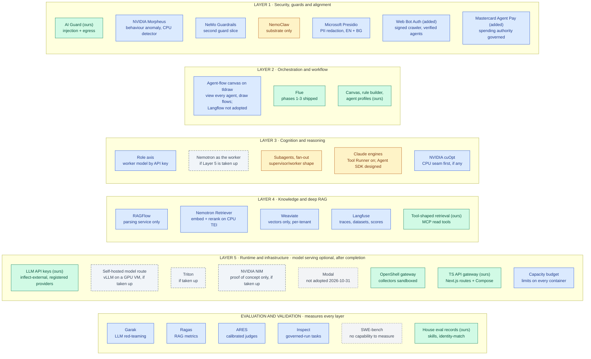
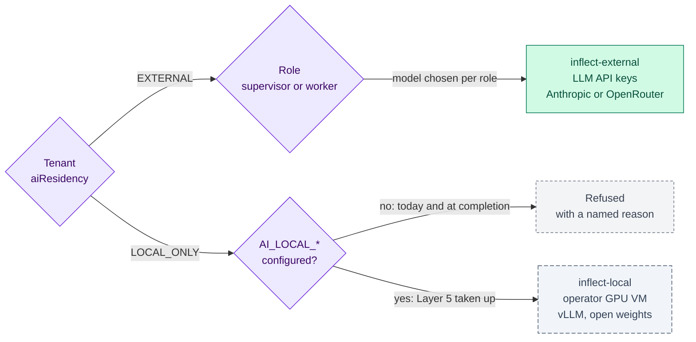
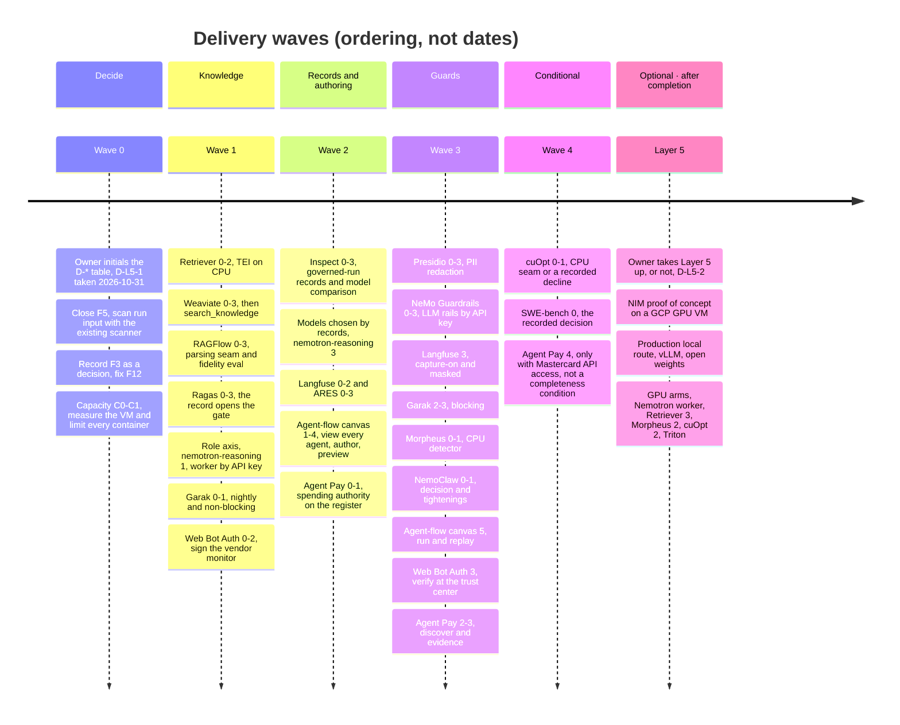
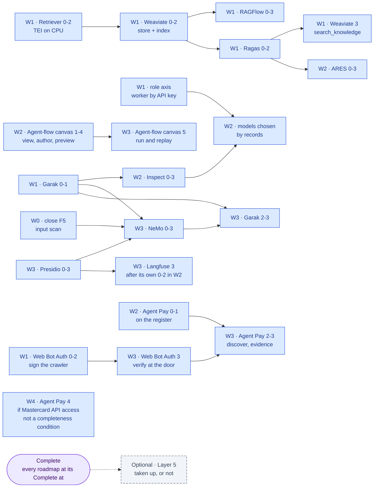
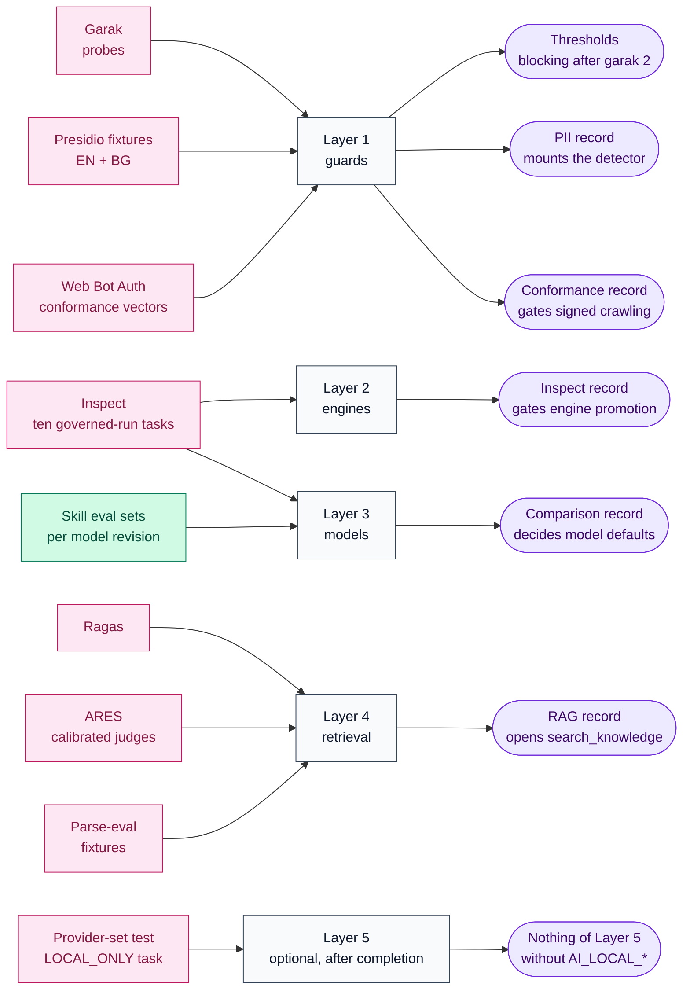

inflect · ai architecture · master roadmap v2 · 2026-10-31

# The AI architecture roadmap: the v6 target, mapped onto the codebase

> **Status: living design** — the master roadmap for bringing inflect-compliance
> to the owner's target state, the "Enterprise AI SaaS Architecture Blueprint
> (v6)" ([`docs/ai-architecture/blueprint-v6.md`](./ai-architecture/blueprint-v6.md),
> received 2026-10-29). The plan is **complete without Layer 5**: complete
> means every roadmap outside Layer 5, and the capacity budget of the VM they
> run on, has reached its "Complete at" phase. Layer 5's model serving is
> optional work taken up after that, or never (owner, 2026-10-31).
> The **Current state** section is true today (verified at main 3.338.0,
> `a1c2f05c`; re-checked where it changed at 3.347.0, `e0e682e03`, on
> 2026-10-31) and names what each layer already has. The
> **Roadmap** section is the plan: what complete means, a status board, the
> sequencing, the evals per layer, and the decisions the owner must take. Every framework the target
> names and the codebase lacks has its own child roadmap under
> [`docs/ai-architecture/`](./ai-architecture/) with phases, sub-phases,
> copy-paste prompts and hardening per phase; this document owns what is
> cross-cutting and is **updated in the pull request that changes a fact
> here**. If the code contradicts a fact here, the code wins and the pull
> request that finds it corrects this document.

## How to read this document

Three documents own three different things, and none repeats another:

| Owns | Where |
| --- | --- |
| The target as received | [`ai-architecture/blueprint-v6.md`](./ai-architecture/blueprint-v6.md) (historical: a record of the input) |
| What exists, the global rules, Layer 5's optionality, what complete means, the capacity budget, sequencing, the status board, the decisions | **this file** |
| Phases, sub-phases, prompts and hardening for one framework | `ai-architecture/<framework>.md` — one per missing framework (twenty roadmaps, listed in the status board, beside the blueprint record): eighteen from the blueprint, and two additions the owner made on 2026-10-30, [`web-bot-auth.md`](./ai-architecture/web-bot-auth.md) and [`mastercard-agent-pay.md`](./ai-architecture/mastercard-agent-pay.md) |

Two owner decisions of 2026-10-31 (D-L5-1) bind the whole plan:

- **Model usage goes through LLM API keys** on the existing external route, to
  providers on the sub-processor register. There is no self-hosting now: no
  GPU, no NIM, no vLLM deployment, and Modal is not adopted.
- **The plan is complete without Layer 5.** Every other roadmap names the
  phase at which it is complete, and none of those phases needs a GPU or a
  self-hosted model (§ What complete means). Layer 5's model serving
  (self-hosted models, GPUs) is optional and comes after completion, or
  never.

They replace the instruction of 2026-10-29, which planned Layer 5 on Modal for
Nemotron 3 Super. Both are designed in § Layer 5 is optional by construction;
[`modal-inference.md`](./ai-architecture/modal-inference.md) keeps the optional
Layer 5 plan under its old filename so links stay stable.

## The target, with status

Green is on `main`, amber partly present, blue missing and part of
completeness (each has a child roadmap), slate dashed optional Layer 5 work
that starts only after every other roadmap is complete, grey dashed declined.
Requests enter at Layer 1 and descend; the evaluation row measures every
layer. A node turns green in the pull request that puts the framework into
production use, together with its status-board row.

## Current state (true today)

Verified by direct inspection of `main` at 3.338.0 on 2026-10-29. Where this
section cites a finding from the 2026-10-09 audit of Flue Phase 1 (made
against 3.164.1), it says so; those were not re-verified and the first pull
request touching Flue re-checks them.

### Layer 1 — Security, guards & alignment

- **A deterministic AI guard with a three-arm outcome.** `src/app-layer/ai/guard/`
  (injection + egress scanners, patterns, policy, proposal guard);
  `guardUntrustedInput` / `guardEgress` / `assertGuardAllowed` /
  `assertNoReviewRequired`; `allow / flag / block` pinned by
  `flue-guard-outcome-has-arms`; `flag` latches review, `block` aborts,
  repeated blocks latch `AgentCircuitBreaker`.
- **Applied three ways at the tool boundary** (`flue/tools-adapter.ts`):
  egress on args before the funnel; injection on results before context;
  egress on result text before a third-party provider. The engine-neutral
  tool core (`src/lib/agentic/engine-tools/`) carries the review latch and
  `runGuardedTool` for every engine.
- **Confinement for the product's own binaries**: NVIDIA OpenShell
  (`src/lib/agentic/openshell/` — transport, executor with no local arm,
  collector network policies with explicit ENFORCE, kill drill, policy drift;
  v0.1.6 pinned by checksum and digest; gateway VM provisioned 2026-10-29
  under a 5 USD/month cap; collectors fail closed, #4443). Model-written code
  in a sandbox is **refused by import** (`flue/refused-capabilities.ts`, 23
  exports). Four OpenShell operator skills are vendored and reviewed.
- **PII is protected by encryption at rest and by field selection** (several
  sub-processor rows promise "no PII by construction"); nothing detects PII
  in a payload. Secrets egress is scanned; persons are not.
- **Known residual (2026-10-09, unverified since):** run *input* reached
  prompt assembly unscanned — `guardUntrustedInput` lived only in the tools
  adapter (F5). Closed by [`nemo-guardrails.md`](./ai-architecture/nemo-guardrails.md)
  Phase 0 with the existing scanner, before NeMo.
- **Nothing signs or verifies an automated HTTP request** (verified
  2026-10-30, main 3.340.0). The product's only unattended crawler of
  third-party websites, the vendor monitor's TLS grade, identifies itself by
  a User-Agent string alone. It fetches the tenant-entered domain only
  through `safeFetch`, following redirects one re-checked hop at a time
  (since 2026-10-31; it used `fetchWithRetry` until then, an SSRF sink). A
  site that refuses it (403, or a challenge) still leaves the vendor's old
  grade in place with no event. The public trust center knows automated visitors only by IP.
  [`web-bot-auth.md`](./ai-architecture/web-bot-auth.md) plans both
  directions; it is an addition to the blueprint (owner, 2026-10-30).
- **Nothing records that an agent can spend money** (verified 2026-10-30).
  The agentic IAM subsystem governs grants, autonomy, ownership and kills,
  but no field, finding or evidence kind describes payment authority, and
  the harness cannot see payment code. No card data exists anywhere in the
  product. [`mastercard-agent-pay.md`](./ai-architecture/mastercard-agent-pay.md)
  makes spending authority a governed privilege without Inflect ever
  holding a payment credential; it is the second addition to the blueprint
  (owner, 2026-10-30).
- Missing: Morpheus, NeMo Guardrails, Presidio, Web Bot Auth, Agent Pay
  governance; NemoClaw as a stack.

### Layer 2 — Orchestration & workflow

- **Flue is shipped through Phase 3.** `@flue/runtime 2.3.0` +
  `@earendil-works/pi-ai 1.4.0`; `src/lib/agentic/flue/` with
  `skills/` (ten skills under `docs/agent-skill-standard.md`, evaluation
  sets + records, mount gate), `subagents/` with fan-out policy and
  delegation gates, run SSE at `/agent-runs/[id]/stream`, `INVOKE_AGENT` in
  `AutomationActionType`. Eleven registered workflow definitions
  (`workflow-registry.ts`), two or more asking for the engine. Driver seam:
  `AGENT_DRIVERS` with `DRIVER_IMPLEMENTED` and `isReasoningEngine`,
  `recordedModeOf`, `runsProfiles` as `Record<AgentDriver, …>` so a third
  engine cannot be mis-recorded as STATIC (#4270). The dedicated `flue` CI job
  (ESM, `--experimental-vm-modules`) is a coverage contributor; the gate
  merges **nine** artifacts (the trailing argument to
  `check-merged-coverage.ts` in `ci.yml` is the authority).
- **Residuals from the 2026-10-09 audit, unverified since:** F3 — the
  one-member `PERMITTED_FLUE_PACKAGES` allowlist (exact set equality against
  `package.json`) blocks `@flue/opentelemetry`, so telemetry stays hand-rolled
  (`flue/telemetry.ts`, content-free by guard) — a decision to record, not a
  gap; F12 — a stale comment in `usecases/workflow-runs.ts` claiming no
  definition sets `driver`.
- **The canvas, the rule builder and agent profiles are the authoring
  surfaces.** Profiles (Claude engines Step 1a): approved by a second person,
  frozen by trigger, tools only narrow. Only the Tool Runner runs one (Step
  2c, #4512); Flue does not, by owner decision of 2026-10-26. The surface is
  behind `AGENT_PROFILES` + `AGENT_PROFILES_TENANTS`, or, with the variable
  unset, the workspace organization's own switch (#4557).
- Missing: a canvas on which to draw what an agent does. The process canvas
  can invoke an agent (an `agent` node owns an `INVOKE_AGENT` rule), and agents
  are created through two forms (registration, and the Behaviour tab's profile),
  but no agent can be seen on a canvas and nothing composes an agent's flow
  visually. [`langflow.md`](./ai-architecture/langflow.md) plans it in the
  product as a second editor for the agent profile (D-L2-1, decided
  2026-10-29); Langflow itself is not adopted.
- The process canvas is switching drawing engines tenant by tenant, from
  `@xyflow/react` to `tldraw` 3.15.6 (#2960); #2962 removes xyflow. The
  agent-flow canvas is built on tldraw only and inside the process-canvas
  module (D-L2-3, decided 2026-10-29), because tldraw's licence caps it at 3.x
  with the watermark kept and a guard confines the editor to that module. So
  it reaches only tenants that have the module enabled.

### Layer 3 — Cognitive & reasoning

- **Models are chosen by residency, one specifier per run.**
  `flue/model-selection.ts`: provider ids name residency (`inflect-external`,
  `inflect-local`), never vendors; `RESIDENCY_SELECT`, `resolveFlueModel`;
  `providers.ts` registers via pi-ai's Anthropic and OpenAI-compatible APIs
  only when a credential exists; the socket re-checks the specifier
  (`assistant/turn-provider.ts`, `tool-runner/client.ts`). Tenant setting
  `aiResidency ∈ { EXTERNAL, LOCAL_ONLY }` (default EXTERNAL); local route
  `AI_LOCAL_BASE_URL` (OpenAI-compatible: Ollama / vLLM); a tenant's stored
  `aiLocalBaseUrl` is honoured only when it is that address (#4545). An
  `EXTERNAL` tenant resolves to the external route and a `LOCAL_ONLY` tenant
  to the local route or a named refusal. Nothing serves the local route since
  the Laya estate was retired on 2026-10-14, so model usage in production is
  the API keys on the external route.
- **Supervisor/worker exists as subagents** (fan-out capped, tokens charged
  to the parent); there is no *role* in model selection — a subagent uses its
  parent's model.
- **Claude.** `@anthropic-ai/sdk 1.3.0` powers the **Tool Runner** engine
  (`src/lib/agentic/tool-runner/`), built in Step 2b and turned on in Step 2c
  (#4512): `DRIVER_IMPLEMENTED['tool-runner']` is true and `TOOL_RUNNER` is a
  written mode. It runs agent profiles where the operator's
  `AGENT_DRIVER_TOOL_RUNNER` switch (or, unset, the workspace organization,
  #4557) allows it and the workspace owner chooses it, and serves skills
  through `activate_skill` (Step 2d, #4525). The Agent SDK and Managed Agents
  are designed (living docs, #4135), not built. The harness scanner
  recognises customers' Agent SDK agents (Step 3b, #4476). Every model call is
  preceded by the kill switch and the caps (#4196) and writes an Art 12 row.
- Missing: the role axis, with the worker role served by a model through API
  keys; cuOpt's seam, if a feature wants one. Nemotron as the worker is
  optional Layer 5 work (D-L3-2, deferred 2026-10-31).

### Layer 4 — Knowledge & deep RAG

- **Retrieval is tool-shaped.** The assistant's tool loop
  (`src/app-layer/ai/assistant/`, spend ceiling, stream capacity), the
  audited MCP read tools (`src/lib/mcp/tools/`), questionnaire grounding
  (titles only), vendor-doc and risk-assessment AI features — each a
  provider behind `AI_*_PROVIDER` defaulting to `stub`.
- **No vector store, no embedding, no parser, no RAG eval.** The 18
  `embedding` hits are prompt/UI wording; `weaviate`, `pgvector`, `ragflow`,
  `langfuse` return nothing. Business content is encrypted by the manifest;
  tenant isolation is RLS + repository filters — both in Postgres.
- **Observability is OTel + Sentry + the decision log**; Flue telemetry is
  content-free by guard; prompts are code and profiles are frozen rows.
- Missing: RAGFlow, Nemotron Retriever, Weaviate, Langfuse. LlamaIndex is
  not planned (see [`langfuse.md`](./ai-architecture/langfuse.md) § Fit).

### Layer 5 — Runtime & infrastructure

- **One GCP VM, eight Compose services** (`postgres`, `pgbouncer`, `redis`,
  `clamav`, `app`, `worker`, `watchtower`, `caddy`), repo-canonical
  (`deploy/docker-compose.prod.yml`, `apply.sh`, `check-drift.sh`, #2849);
  plus the OpenShell gateway VM. Images pinned by digest (dependency
  governance, fifth pillar). CI builds `app`, the worker/scheduler bundle and
  a `scanner-image`.
- **The TypeScript API gateway is the Next.js route tree** (582 routes under
  two authorization layers), and the "microservices" are the Compose services.
- **No GPU, no vLLM, no Triton, no NIM, no Modal.** `vLLM` appears in comments
  naming what `AI_LOCAL_BASE_URL` may point at.
- **No container has a memory or CPU limit** (`deploy/docker-compose.prod.yml`,
  2026-10-31); Redis caps its own data at 256 MB. § Capacity budget plans the
  limits and the room the completeness services need.
- **Model usage is LLM API keys.** `inflect-external` is registered from
  `ANTHROPIC_API_KEY` or the OpenRouter key, and `docs/sub-processors.md`
  bounds what each provider receives.
- Missing for completeness: the capacity budget's measurements and limits
  (§ Capacity budget). By the owner's decision of 2026-10-31, Layer 5's model
  serving (a self-hosted model route, the GPU arms other roadmaps deferred,
  Triton, a NIM proof of concept) is optional and starts only after every
  other roadmap is complete. Modal is not adopted.

### Evals

- **House discipline exists and is stricter than most frameworks':**
  evaluation *sets* authored beside the thing evaluated and hash-tied to it;
  evaluation *records* = set + one named model revision's raw answers; rates
  **recomputed** every time (`flue/skills/evaluation-record.ts`,
  `identity-match/evaluation-record.ts`); four case kinds required; mount
  gates refuse without a record. Nightly service-backed checks follow the DAST
  pattern (`dast.yml`: boot, role login, scan, report, auto-issue, dated
  `*-NON-BLOCKING-UNTIL:` marker **parsed** by a guard).
- **The product scores customers' agents on a six-level ladder**
  (`harness-ladder.ts`, H0–H5 with named criteria) and does not yet score its
  own the same way.
- Missing: Garak, Ragas, ARES, Inspect. SWE-bench measures a capability that
  is absent and refused.

### Existing roadmaps this one indexes, not replaces

| Roadmap | Tracks | Status |
| --- | --- | --- |
| Flue × Inflect integration plan (artifact, v4, 2026-10-09 audit) | Flue Phases 1–3 | shipped; residuals F3/F5/F12 carried here |
| `docs/claude-agent-sdk-design.md`, `claude-tool-runner-design.md`, `claude-managed-agents-design.md` | Claude engines, #4135 | the Tool Runner built and on (Steps 2a–2d, the flag since 2c, #4512), the connect wizard and the scanner recogniser (3a, 3b) on `main`; the Agent SDK engine (Phase 4) and Managed Agents (Phases 5–6) designed |
| `docs/agentic-iam-roadmap.md` | agentic IAM, #3654 | in progress |
| `docs/sap-agent-integration-roadmap.md` | SAP routes, #3859 | Phase 0 re-scoped 2026-10-20 |
| OpenShell notes (`2026-10-21-openshell-spike.md` → `2026-10-29-openshell-gateway-vm-provisioned.md`) | OpenShell, #3924 | gateway live |

## Global rules

Every child roadmap inherits these; its hardening sections cite them by
number. G1 to G11 restate rules the repository already enforces, collected so
a new framework cannot miss one; G12 and G13 are the owner's decisions of
2026-10-31.

- **G1 — Residency decides routing before anything is built.** Provider ids
  name residency (`inflect-external`, `inflect-local`), never vendors; no
  third id is planned (the `inflect-hosted` id planned for Modal was dropped
  on 2026-10-31). `model-selection.ts` owns the decision; a
  deployment with no credential registers no provider; the socket re-checks
  the specifier; `LOCAL_ONLY` is refused before anything external is read.
  Embeddings, rerankers, guard rails, judges and detectors all route the same
  way — or they are a cross-tenant egress waiting to happen.
- **G2 — Sub-processor four-step before wiring.** Any endpoint outside the
  operator's perimeter (a model API, a cloud eval or trace service, a vendor
  API) is
  a row in `docs/sub-processors.md`, a 30-day notice, and activation after the
  window (`docs/sub-processor-change-policy.md`). In-deployment services still
  get a register row in the `legacy-mcp` style, because the register is the
  inventory of every external connection. Changing *what* a vendor receives is
  a row change in the same PR.
- **G3 — The engine decides what to try; the funnel decides what is
  permitted.** Every tool call goes `runGuardedTool → runReadTool /
  runProposeTool`. No engine, retriever, guard or parser module holds a
  permission check, a usecase call or a Prisma call. A runtime that makes its
  own model or tool calls (Langflow, NemoClaw's agent) is a third engine
  outside the funnel and is refused.
- **G4 — The guard sandwich at every boundary text crosses.**
  `guardUntrustedInput` into model context; `guardEgress` on args before the
  funnel and on text before a third party; new slices (PII redaction, NeMo
  rails) compose *worst-of* behind the same `GuardOutcome`; one Art 12 row per
  model call; kill switch and caps before every model call (#4196).
- **G5 — Dependencies by the five pillars.** Runtime role decides the
  `package.json` section; lockfile committed; strict peers; risk review for
  parsers and credential handlers; runtime images **by digest** in the
  repo-canonical Compose file, each with a memory limit, a CPU cap and its
  line in § Capacity budget, in the same pull request. **Python lives in
  images and `deploy/`, never in the app** — every Python framework here
  (Presidio, NeMo, RAGFlow, Langflow, garak, Ragas, ARES, Inspect) is a
  container or a deploy script.
- **G6 — Egress is `safeFetch`, hosts are config.** Every new outbound host
  joins `tests/guards/ssrf-egress-coverage.test.ts`'s population; base URLs are
  operator config or code constants, never tenant-writable; reads are
  byte-capped and deadline-bounded (the MCP client is the pattern).
- **G7 — Tenant data gets RLS and a two-tenant behavioural test.** A store
  outside Postgres (Weaviate) proves isolation with the same test shape at
  every layer that touches it, and is **rebuildable from Postgres** so losing
  it loses nothing (vectors-only rule).
- **G8 — Long work runs in the worker.** BullMQ jobs under `runJob()`,
  resumable under the Epic E drain; never the web tier.
- **G9 — Off by default, fail closed, two keys where a customer's data is the
  blast radius.** Operator env + tenant setting (the `AGENT_DRIVER_FLUE` /
  `agentDriver` and `AGENT_PROFILES` / `AGENT_PROFILES_TENANTS` pattern).
  Absent config constructs nothing. A guard that cannot reach its provider
  degrades to `flag` (or blocks egress), never to `allow`.
- **G10 — Tests named for invariants; prose is not a gate.** No epic-named
  ratchets; a structural rule is an ESLint rule in `eslint-rules/`; every PR
  an implementation note (no classification entry); SIGNIFICANT changes carry
  a rollback plan and a risk assessment; a dated deferral marker is parsed by
  a guard or it is decoration; thresholds and floors ratchet down freely and
  up with a written reason.
- **G11 — Evals produce records, not figures.** Set beside the thing, hashed;
  record = set + a named revision's raw answers; aggregates recomputed; four
  case kinds; a new framework emits this shape or it is a dashboard, not a
  gate. Records are committed by PR, never pushed by a job. Seed and fixture
  corpora only — never customer data.
- **G12 — Complete means complete without Layer 5.** Every roadmap names its
  "Complete at" phase, and no such phase may need a GPU, a self-hosted model
  or any other Layer 5 model serving. That work is optional, starts only
  after every other roadmap is complete, and exists in a deployment iff
  `AI_LOCAL_*` names a gateway; without it nothing of it is deployed,
  configured or health-checked (next section). The VM the other roadmaps run
  on is Layer 5 too, and its capacity budget is part of completeness.
- **G13 — Open-source frameworks; models through LLM API keys by default**
  (owner, 2026-10-31). A framework the plan adopts is open source and run by
  the operator. Model usage goes through API keys on `inflect-external`, to
  providers on the register (G2). A vendor's API reached through a connection
  (Mastercard, Cloudflare's bot directory) is an integration under G2 and G6,
  not a framework. A proprietary runtime (NIM in production, a hosted GPU
  platform) or open weights under a licence that is not open source
  (Nemotron's) is an owner decision recorded in the child, never a default.
  One exception predates the rule and stands: tldraw (D-L2-3), a
  source-available licence with its watermark kept, already the process
  canvas's renderer.

## Layer 5 is optional by construction

The owner's decision of 2026-10-31 (D-L5-1) replaces the design this section
held until then: a third provider id, `inflect-hosted`, for open weights on
Modal. Four things follow from it.

- **Model usage is API keys.** Every model call for an `EXTERNAL` tenant goes
  through `inflect-external` to a provider on the register: Anthropic direct,
  or OpenRouter where its row allows. The role axis
  ([`nemotron-reasoning.md`](./ai-architecture/nemotron-reasoning.md) Phase 1)
  chooses a *model* per role, supervisor or worker, and both roles are served
  through API keys. A new provider, or a new kind of data sent to one, is a
  register change under G2 before any byte moves.
- **There is no `inflect-hosted`.** It existed only to keep Modal apart from
  the route a `LOCAL_ONLY` tenant trusts. A GPU in the operator's own Google
  Cloud project, if Layer 5 is ever taken up, *is* the local route, and adds
  no sub-processor (the Laya precedent).
- **`LOCAL_ONLY` keeps what it has today: no model route.** Its model-backed
  features are refused with a named reason, never sent elsewhere, until an
  operator-run gateway is configured. Completeness does not change that.
- **Nothing degrades to anything.** With one route, a provider outage is the
  feature's own failure path, as it is today, and `/api/readyz` gates on no
  model provider.

**The routing, drawn.** Which provider a call reaches is decided by the
tenant's residency first and the deployment's configuration second. The
slate branch exists only if Layer 5 is taken up after completion.

- **The contract.**

  | Deployment | What exists | `EXTERNAL` tenant | `LOCAL_ONLY` tenant |
  | --- | --- | --- | --- |
  | API keys only: production today, and the completeness target | `inflect-external`, registered from its credential; nothing of Layer 5 (no provider id, no VM, no probe) | both roles on models reached through API keys | refused, named reason |
  | Layer 5 taken up (optional, after completion) | also `inflect-local`, registered from `AI_LOCAL_*` and served by an operator GPU VM | unchanged, unless an owner decision routes a role to the local model | the local route |

- **The deferred GPU arms.** Each roadmap that planned a GPU arm states what it
  completes without one: the retriever on CPU TEI, Morpheus as a CPU
  detector, cuOpt as a CPU seam or a recorded decline, the worker role on an
  API-key model. The arms themselves (Nemotron as the worker, the retriever's
  GPU phase, Morpheus's GPU scoring, cuOpt on a GPU, Triton) are
  [`modal-inference.md`](./ai-architecture/modal-inference.md) Phase 3.
- **De-NIM, restated.** No NIM container in production. If Layer 5 is taken
  up, NIM may serve a proof of concept on a GPU VM under the NVIDIA Developer
  Program (development and testing only); production is vLLM, TEI and the
  open-source Triton image serving open weights (G13).

## Roadmap (future direction)

### What complete means

The AI architecture roadmap is **complete when every row of the status board
below, outside the optional wave, shows a "Phase on `main`" at or past its
"Complete at"** (owner, 2026-10-31). Each child roadmap states its own
"Complete at" in its "Where it sits" table; the column below copies it, and
the child wins if the two disagree. Five rules make the definition hold:

- **No completeness phase needs Layer 5** (G12). Where a roadmap planned a GPU
  arm, it is complete without it: the retriever on CPU TEI, Morpheus as a CPU
  detector, cuOpt as a CPU seam or a recorded decline, the worker role on a
  model reached through API keys.
- **Layer 5, here, means its model serving.** The Layer 5 box also holds the
  VM everything else runs on, and that VM's capacity budget is part of
  completeness, because every container the other roadmaps add spends from
  it. Only the self-hosted model route, the GPU arms, Triton and the NIM proof
  of concept are optional.
- **A recorded decision can be the completing phase.** SWE-bench, NemoClaw,
  cuOpt and Langfuse may complete at Phase 0 by a recorded decline or
  narrowing, and ARES at Phase 2 by a recorded failure to calibrate. A
  decision is a result, not a gap.
- **Two rows are outside the definition.** The Claude engines are tracked by
  their own plan (#4135); this roadmap asks of them only an Inspect record for
  the Tool Runner ([`inspect.md`](./ai-architecture/inspect.md) Phase 2).
  Agent Pay's Phase 4 waits on API access Mastercard gates, and completeness
  does not wait for it.
- **At completion the plan stops.** Layer 5 starts only if the owner then
  takes it up ([`modal-inference.md`](./ai-architecture/modal-inference.md)
  Phase 0), and nothing in the plan waits for that.

### Capacity budget

Every phase that adds a container to the production VM spends from one budget
(G5). Until 2026-10-31 there was no budget, and there are no limits: no service
in `deploy/docker-compose.prod.yml` sets a memory or CPU limit, and only Redis
caps its own data, at 256 MB. So the kernel's out-of-memory killer is the
only memory limit, and it picks which process to kill. The one precedent for a
limited model service is the retired Laya estate, which ran at 1 vCPU and
4 GB.

**The host.** One Google Cloud `e2-highmem-2`: 2 vCPU, 16 GB. This was recorded
on 2026-10-12 in `docs/legacy-access-recertification-design.md`, and not
re-read on 2026-10-31: the session that wrote this section had no access to the
project. Disk size is not recorded anywhere in the repository.

**CPU is the scarcer resource.** Two vCPUs serve the request path, the
worker, Postgres and ClamAV. On one of them, Laya measured a model call at
p50 7.3 s (2026-10-12).

**The rule.** A container lands with a memory limit and a CPU cap in the
Compose file, and its line below, in the same pull request. Its limit is set
from a measured peak, never from a guess. The memory limits together stay at
or under the host's memory minus 1.5 GB for the OS, Docker and the page cache:
14.5 GB on this host. CPU may be oversubscribed, but a batch-shaped service
(embedding, parsing, PII analysis) is capped at 1.0 CPU so the request path
always keeps a core. That is the Laya precedent. A pull request that would
cross the memory line carries D-CAP-1's answer in the same pull request.

**The lines.** The ceilings are planning estimates, labelled as such, until a
phase measures its service. "Measured" replaces an estimate in the pull request
that measures it.

| Line | Containers | Added by | Memory ceiling | CPU cap | Basis |
| --- | --- | --- | --- | --- | --- |
| Today's stack | `postgres`, `pgbouncer`, `redis`, `clamav`, `app`, `worker`, `watchtower`, `caddy` | on `main` | **not measured** | none | C0 measures each peak |
| Embeddings | `tei-embed` | Retriever 1 | 5 GB (estimate) | 1.0 | a 1B-parameter model (`llama-nemotron-embed-1b-v2`) is about 4 GB of weights at fp32, before runtime overhead |
| Reranking | `tei-rerank` | Retriever 2 | 5 GB (estimate) | 1.0 | the same size class; Retriever 0.1 confirms it |
| Vectors | `weaviate` | Weaviate 1 | 1.5 GB (estimate) | 0.5 | vectors held in memory; the embedding dimension (384 to 2048, configurable) moves it most |
| Parsing | a parsing-only service (D-L4-4) | RAGFlow 1 | 3 GB (estimate) | 1.0 | RAGFlow's full reference stack (server, search engine, MySQL, MinIO, Redis) is a second product and is not budgeted here |
| PII detection | `presidio` | Presidio 1 | 1.5 GB (estimate) | 1.0 | a large spaCy pipeline plus recognisers |
| Guard rails | `nemo-guardrails` | NeMo 1 | 1 GB (estimate) | 0.5 | LLM-free rails; LLM-backed rails call the external API, not this VM |
| Traces | Langfuse self-host | Langfuse 1 | **does not fit** | — | Langfuse's own guide sets 8 GiB for ClickHouse alone, plus web, worker, Postgres and blob storage. D-L4-5 picks Cloud EU or OTel-only, or a VM of its own |
| In-app work | none (Morpheus CPU detector, cuOpt CPU seam, Web Bot Auth, Agent Pay, the agent-flow canvas) | various | inside `app` / `worker` | — | measured with today's stack |
| Evaluations | none on the VM | Garak, Ragas, ARES, Inspect | 0 | — | they run in CI images (G5, G11) |

**What the arithmetic says.** The completeness additions alone come to about
17 GB of estimated ceilings, above the 14.5 GB line before today's eight
services are counted. Two embedding-class models at fp32 make up most of it.
So the completeness target, as planned, does not fit this VM. Something has to
give, and that is D-CAP-1:

- **Resize** to `e2-highmem-4` (4 vCPU, 32 GB). This doubles the machine, and
  its cost, and keeps one Compose file.
- **A second CPU VM** for the model services (embedding, reranking, parsing,
  PII). The request path's VM stays as it is, at the price of a second
  repo-canonical deployment, an internal TLS hop and its own drift check.
- **Smaller pieces.** Smaller open embedding and reranking models if
  Retriever 0's recall holds (a change to D-L4-3), quantised weights, a
  parsing-only service rather than RAGFlow, Langfuse OTel-only.

The default, until the owner decides, is in that order of preference: measure
first (C0 and Retriever 0), take the smaller pieces the records allow, and
resize when the measured sum still crosses the line. Self-hosted Langfuse never
goes on the production VM.

**The budget's own phases** (a status-board row; complete at C1, and C2 if
needed):

- [ ] **C0 — measure.** On the VM: each container's peak memory and CPU over a
      working day, including the nightly jobs (vendor monitor 02:00, identity
      chain 03:00–05:00), with free memory and disk. Record the figures in
      this table, replacing "not measured". The `VM capacity` workflow
      (`.github/workflows/vm-capacity.yml`, dispatch-only, read-only, behind
      the `production` reviewer like `Scanner VM`) prints exactly this: per
      container the peak since it started (cgroup `memory.peak`), anonymous
      and page-cache memory, average CPU and OOM kills, and optional samples.
      A session cannot do it itself: this environment's proxy carries HTTPS
      only, so no SSH or IAP tunnel reaches the VM from a session.
- [ ] **C1 — limit today's stack.** A memory limit and CPU cap on each of the
      eight services, at 1.5× its measured peak, in
      `deploy/docker-compose.prod.yml`, applied with `deploy/apply.sh`. A
      structural Compose change, so it carries a rollback plan: revert the
      file and apply.
- [ ] **C2 — D-CAP-1's answer, before the first addition that crosses the
      line.** The resize, the second VM or the smaller pieces, in the pull
      request that would otherwise cross it.

### Status board

The living part. One row per framework; the child roadmap owns the phases.
"Phase on `main`" is the highest phase whose "done when" has been met on
`main`. "Optional" in the Wave column is Layer 5 work, which starts only after
completion.

| Framework | Layer | Child roadmap | Wave | Status | Phase on `main` | Complete at | Decisions open |
| --- | --- | --- | --- | --- | --- | --- | --- |
| Presidio | 1 | [`presidio.md`](./ai-architecture/presidio.md) | 3 | missing | — | 3 | D-L1-1 |
| NeMo Guardrails | 1 | [`nemo-guardrails.md`](./ai-architecture/nemo-guardrails.md) | 3 | missing (F5 residual closes in its Phase 0) | — | 3, LLM-backed rails by API key | D-L1-2 |
| Morpheus | 1 | [`morpheus.md`](./ai-architecture/morpheus.md) | 3 / optional (GPU, Phase 2) | missing; CPU detector first | — | 1, the CPU detector | D-L1-3 |
| NemoClaw | 1 | [`nemoclaw.md`](./ai-architecture/nemoclaw.md) | 3 | substrate present (OpenShell); stack to be declined | — | 1, or 0's recorded decision | D-L1-4 |
| Web Bot Auth (added 2026-10-30, not in v6) | 1 | [`web-bot-auth.md`](./ai-architecture/web-bot-auth.md) | 1 (sign the crawler) / 3 (verify at the door) | missing; vendor monitor unsigned, its refusals invisible | — | 3 | D-L1-5, D-L1-6, D-L1-7 |
| Mastercard Agent Pay (added 2026-10-30, not in v6) | 1 | [`mastercard-agent-pay.md`](./ai-architecture/mastercard-agent-pay.md) | 2 (register) / 3 (discover, evidence) / 4 (Mastercard API, if access) | missing; no agent's spending authority is recorded | — | 3 (4 waits on access) | D-L1-8, D-L1-9, D-L1-10 |
| Agent-flow canvas (Langflow's box) | 2 | [`langflow.md`](./ai-architecture/langflow.md) | 2 (view, author, preview) / 3 (run) | missing; in-product canvas on tldraw decided, Langflow not adopted | 0 (decided) | 5 | D-L2-2 |
| Flue | 2 | artifact v4 + residuals here | — | **shipped** (Phases 1–3) | 3 | 3 (met) | F3 decision to record |
| Role axis; Nemotron as the worker | 3 | [`nemotron-reasoning.md`](./ai-architecture/nemotron-reasoning.md) | 1 (role axis) / 2 (models chosen by records) / optional (Nemotron, Phases 0 and 2) | missing | — | 1 and 3, worker by API key | D-L3-1 |
| Claude engines | 3 | `docs/claude-*-design.md` (#4135) | — | Tool Runner on (Step 2c, #4512); Agent SDK and Managed Agents designed | 2d | its own plan | — (its own plan) |
| cuOpt | 3 | [`cuopt.md`](./ai-architecture/cuopt.md) | 4 / optional (GPU, Phase 2) | missing; CPU seam first if any | — | 1, or 0's recorded decline | D-L3-3 |
| Weaviate | 4 | [`weaviate.md`](./ai-architecture/weaviate.md) | 1 | missing | — | 3 | D-L4-1, D-L4-2 |
| Nemotron Retriever | 4 | [`nemotron-retriever.md`](./ai-architecture/nemotron-retriever.md) | 1 (CPU) / optional (GPU, Phase 3) | missing | — | 2, CPU TEI | D-L4-3 |
| RAGFlow | 4 | [`ragflow.md`](./ai-architecture/ragflow.md) | 1 | missing | — | 3 | D-L4-4 |
| Langfuse | 4 | [`langfuse.md`](./ai-architecture/langfuse.md) | 2 | missing | — | 3, or 0's OTel-only decision | D-L4-5, D-L4-6 |
| Self-hosted model route (was "Modal") | 5 | [`modal-inference.md`](./ai-architecture/modal-inference.md) | optional | **optional, after completion**; Modal not adopted (D-L5-1) | — | not part of completeness | D-L5-2 (deferred) |
| Triton | 5 | [`triton.md`](./ai-architecture/triton.md) | optional | optional, after completion | — | not part of completeness | D-L5-3 (deferred) |
| NIM | 5 | [`modal-inference.md`](./ai-architecture/modal-inference.md) | optional (proof of concept) | **declined** in production (G13); a proof of concept only, if Layer 5 is taken up | — | not part of completeness | — |
| Capacity budget (added 2026-10-31) | 5 | § Capacity budget, this file | 0 | no container has a limit; nothing measured | — | C1, and C2 before the first addition that crosses the line | D-CAP-1 |
| Garak | evals | [`garak.md`](./ai-architecture/garak.md) | 3 (Phase 1 any time) | missing | — | 3 | D-EV-1 |
| Ragas | evals | [`ragas.md`](./ai-architecture/ragas.md) | 1 | missing | — | 3 | D-EV-2 |
| ARES | evals | [`ares.md`](./ai-architecture/ares.md) | 2 | missing | — | 3, or 2's recorded failure to calibrate | D-EV-3 |
| Inspect | evals | [`inspect.md`](./ai-architecture/inspect.md) | 2 | missing | — | 3 | D-EV-4 |
| SWE-bench | evals | [`swe-bench.md`](./ai-architecture/swe-bench.md) | — | no capability to measure | — | 0's recorded decision | D-EV-5 |

### Sequencing

Ordered by value delivered per unit of risk. Waves 0 to 4 are the completeness
target, and none of them needs a GPU: each range ends at that roadmap's
"Complete at" phase. The last section is optional Layer 5 work, which starts
only after every wave before it has landed (G12). The timeline is ordering, not
dates: a wave starts when the waves before it have landed what it depends on.
"Weaviate 0-3" means that roadmap's Phases 0 to 3.

The hard dependencies between roadmaps, as a graph. A box may start only when
everything pointing at it has landed; a roadmap's own earlier phases are
implied and not drawn, except where another roadmap's box sits between them.
The slate pair at the bottom is the optional tail: Layer 5 waits for every
other box, which a single edge from "complete" stands for.

The same dependencies as prose, for a reader without a Mermaid renderer:
Weaviate Phase 2 needs an embedding provider; Ragas needs an index; the
`search_knowledge` tool needs a Ragas record; choosing the worker's model needs
the role axis and Inspect's comparison records; Langfuse capture-on and NeMo
PII rails need Presidio; Web Bot Auth's inbound verifier needs its own
outbound phases; NeMo's rails are measured by Garak Phase 1 before and after;
Agent Pay's discovery reuses that verifier, and its Mastercard phase waits on
API access Mastercard gates. Every phase that adds a container waits for the
capacity budget's C1, and lands within the budget or carries D-CAP-1's answer.
Layer 5 waits for all of it. Each child's "Where it sits" table states its
own.

### Evals by layer

Every evaluation ends in a committed record, and every record either opens a
gate or ratchets a floor — that is what separates an eval from a dashboard
(G11). Pink is an evaluation, purple the gate its record controls.

| Layer | What is evaluated | Framework | Record / gate |
| --- | --- | --- | --- |
| 1 | injection, jailbreak, leakage through the composed guard; PII precision/recall; rail precision; request-signature conformance and the verifier's negative cases | Garak; Presidio fixtures; NeMo rail sets; Web Bot Auth vectors and the directory validator | garak thresholds (blocking after Phase 2); `evals/pii/records/` as a mount condition; `evals/web-bot-auth/records/` gates signed crawling |
| 2 | governed-run invariants (propose-not-commit, halt on flagged result, kill mid-run, caps) | Inspect (ten tasks) | `evals/inspect/records/`; every engine that is on needs a record (Flue and the Tool Runner get theirs in Inspect Phase 2) |
| 3 | worker/supervisor model quality among models reached through API keys; residency per role | skills evaluation sets per model revision; Inspect comparisons | skills records; comparison records decide defaults |
| 4 | retrieval precision/recall, faithfulness; parse fidelity; isolation | Ragas → ARES; parse-eval; two-tenant tests | `evals/rag/records/` opens `search_knowledge`; floors ratchet |
| 5 (optional) | optionality (nothing of Layer 5 without `AI_LOCAL_*`), residency at the socket; if taken up, serving smoke and cost | provider-set test; Inspect LOCAL_ONLY task; if taken up, the Layer 5 Phase 1 checklist | CI; if taken up, budget alerts on the GPU VM |
| cross | the product's own agents on its own ladder (H3–H5); customers' payment-capable agents found in code | Inspect records cited on the agent's Coverage tab; synthetic repositories for the scanner | committed records are evidence; live runs are not; the scanner fixture record gates Agent Pay discovery |

All of it on seed and fixture data; records by PR; nightly jobs
non-blocking with a dated, parsed marker until their floors are set, then
blocking — the DAST path, every time.

### Decisions for the owner

Each child roadmap's Phase 0 ends with one or more of these. Initial here;
the child records the reasoning.

| Id | Decision | Child | Default if undecided |
| --- | --- | --- | --- |
| D-L1-1 | PII redaction scope: paths, entity types, locales, LOCAL_ONLY handling | presidio | external routes only; PERSON/EMAIL/PHONE/IBAN/ЕГН; EN+BG; LOCAL_ONLY off |
| D-L1-2 | NeMo rails: LLM-free first; LLM-backed only on the tenant's permitted route | nemo-guardrails | as stated |
| D-L1-3 | Behaviour anomaly signal; CPU detector before Morpheus | morpheus | CPU first |
| D-L1-4 | NemoClaw: reference-only; runtime and privacy router declined | nemoclaw | declined |
| D-L1-5 | Web Bot Auth signing identity: one Ed25519 key per deployment, never per tenant, so no signature discloses which customer monitors a vendor | web-bot-auth | adopt |
| D-L1-6 | Outbound conduct: a User-Agent naming the bot, a public bot page, robots.txt honoured, registration with Cloudflare Verified Bots by the operator | web-bot-auth | adopt; register after Phase 2 |
| D-L1-7 | Inbound verification: a label on public surfaces, never authorization; open directory fetch under cache and caps, or an allowlist of operators | web-bot-auth | label only; open fetch, cached and capped |
| D-L1-8 | Inflect never holds a payment credential (no PAN, token value or wallet key) and its own agents never pay; it stays outside PCI DSS cardholder-data scope | mastercard-agent-pay | adopt |
| D-L1-9 | Spending authority is a declared envelope on the register, reviewed by a second person, required before activation, and reached by recertification and the kill switch | mastercard-agent-pay | adopt |
| D-L1-10 | Reading and suspending at Mastercard only through a customer-owned connection on the external write ladder, once written API access and a sandbox exist | mastercard-agent-pay | wait for access; Phases 1–3 need none |
| D-L2-1 | Langflow's box: the visual canvas is the product's own, editing the agent profile; Langflow not adopted | langflow | **decided 2026-10-29** (owner) |
| D-L2-2 | Reasoning engines enforce flow checkpoints, or the canvas offers no checkpoint node | langflow | build enforcement; no checkpoint node until it lands |
| D-L2-3 | The agent-flow canvas is drawn by tldraw (3.x, watermark kept), never xyflow, and lives inside the process-canvas module | langflow | **decided 2026-10-29** (owner) |
| D-L3-1 | Supervisor/worker role axis in model selection | nemotron-reasoning | adopt |
| D-L3-2 | Nemotron as the default worker | nemotron-reasoning | **deferred 2026-10-31** with Layer 5 (owner); the worker is a model reached through API keys |
| D-L3-3 | An optimisation problem at GPU scale exists | cuopt | no; CPU seam if a feature wants it |
| D-L4-1 | pgvector-first or Weaviate-first | weaviate | Weaviate (the target), with the note's trade-offs |
| D-L4-2 | Vectors-only rule (no chunk text outside Postgres) | weaviate | adopt |
| D-L4-3 | De-NIM retriever: open weights on CPU TEI in the deployment; the GPU arm is optional Layer 5 | nemotron-retriever | adopt |
| D-L4-4 | Parser backend: RAGFlow slim or a parsing-only service | ragflow | measured in Phase 0 |
| D-L4-5 | Langfuse hosting: self-host / Cloud EU / OTel-only | langfuse | self-host if the VM bears it |
| D-L4-6 | Trace content capture off by default; three conditions to turn on | langfuse | adopt |
| D-L5-1 | Model usage through LLM API keys; no self-hosting now; Modal not adopted; Layer 5 optional, after every other roadmap is complete | modal-inference | **decided 2026-10-31** (owner) |
| D-L5-2 | If Layer 5 is taken up: model, weights and licence, GPU class, zone and quota, cost | modal-inference | **deferred** until Layer 5 is taken up |
| D-L5-3 | Triton consolidation trigger | triton | **deferred** with Layer 5 |
| D-CAP-1 | Where the completeness services run once the measured sum crosses the line: resize the VM, a second CPU VM, or smaller pieces (smaller embedding models, a parsing-only service, Langfuse OTel-only) | § Capacity budget | measure first; smaller pieces the records allow; then resize to `e2-highmem-4`; never self-host Langfuse on the production VM |
| D-EV-1 | Which model answers garak probes in CI, and the nightly budget | garak | external CI key, budgeted |
| D-EV-2 | Ragas judge residency and cost | ragas | external CI key, budgeted |
| D-EV-3 | Who labels ARES triples, from the seed corpus | ares | operator, seed only |
| D-EV-4 | The product scores its own agents on its own ladder | inspect | adopt |
| D-EV-5 | SWE-bench: declined or placeholder | swe-bench | declined |

### How this document is updated

- A phase lands → its child's "done when" is met → the **Status board** row's
  "Phase on `main`" moves and the PR is linked in the child; the phase's node
  in the child's **At a glance** diagram changes from `todo` to `done`; any
  fact in **Current state** that changed is rewritten in the present tense
  **in the same pull request**. When a framework reaches production use, its
  node in **The target, with status** turns green in that pull request too.
- A decision is taken → the D-* row gets an initial and a date; the child's
  Phase 0 note holds the reasoning.
- A framework is declined → its row reads "declined (D-…)" with the note's
  link; the child document stays as the record of why.
- A child's "Complete at" changes → the status board's column changes in the
  same pull request, with the reason in the child. When every row outside the
  optional wave shows its "Complete at" on `main`, the pull request that lands
  the last one says so here, and Layer 5 becomes eligible for its Phase 0
  decision.
- Nothing here is a CI gate (`docs:lint` is advisory by design); the ratchet
  that applies is `docs-accuracy` — this file and every child are classified
  `living`, which means the banner and the two H2s above are required and
  future tense is permitted.
