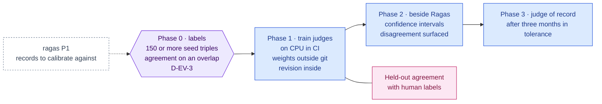

inflect · ai architecture · ares · roadmap v1 · 2026-10-29

# ARES — calibrated RAG judges, Validation column

> **Status: living design** — the integration roadmap for ARES (Automated RAG
> Evaluation System), which the target architecture places in the Validation
> column as "diagnostic testing". The **Current state** section is true today
> (main 3.338.0, `a1c2f05c`). The **Roadmap** section is the plan. This is a
> child of [`docs/ai-architecture-roadmap.md`](../ai-architecture-roadmap.md):
> read that first for the target map, the global rules **G1–G13**, and the
> sequencing. If the code contradicts a fact here, the code wins and the pull
> request that finds it corrects this document.

## Where it sits in the master roadmap

| | |
| --- | --- |
| Column · box | Validation · "ARES (diagnostic testing)" — evaluates Layer 4, calibrates Ragas |
| Wave | 2 (after Ragas has produced records to calibrate against) |
| Depends on | [`ragas.md`](./ragas.md) Phase 1. Judges train on CPU in CI; no Layer 5 |
| Unblocks | cheaper nightly RAG evals; confidence intervals on the floors |
| Owner decisions | **D-EV-3** (who labels the 150+ triples, and from which corpus) |
| Complete at | Phase 3, or a recorded decision at Phase 2 that the judges did not calibrate, in which case Ragas stays the judge of record |

## At a glance

Purple hexagon: the Phase 0 decision. Blue: a phase not yet on `main`; it turns green (`done`) in the pull request that meets its "done when". Dashed: another roadmap this one waits on or unblocks. Pink: the evaluation record. Grey dashed: an outcome that ends the roadmap.



## Current state (true today)

- Same as [`ragas.md`](./ragas.md) § Current state: nothing to evaluate yet;
  the house eval discipline (sets, records, recompute, mount gates) exists.
- **Human judgements exist in the product, but they are customer data.**
  Proposal approvals/rejections, questionnaire reviewer edits, review-quality
  verdicts (`/agents/review-quality`), Art 14 `humanOutcome` stamps. For the
  seed tenant these can seed a labelled set; for customers they cannot be
  used without a consent basis nobody has written.
- **No GPU** in the deployment, and none is planned before every other
  roadmap is complete (Layer 5 is optional and last); training a judge is a
  long CPU job in CI.

## Fit, and what is deliberately not adopted

**What ARES does.** From a small human-labelled set of (query, passage,
answer) triples plus synthetically generated ones, it fine-tunes lightweight
classifier judges for context relevance, answer faithfulness and answer
relevance, and reports scores with confidence intervals via prediction-powered
inference (PPI). Value over Ragas: much cheaper per evaluation (no large
judge call per case), and calibrated against *your* labels rather than a
zero-shot judge's taste.

**Adopted.** ARES as the *second* judge: trained once per domain on labelled
seed triples, run nightly beside Ragas, with disagreement between the two
surfaced for human review; eventually the nightly judge of record if it
calibrates.

**Not adopted, with the reason.**

- *ARES before Ragas.* It needs labels and a baseline to calibrate against;
  Ragas needs neither.
- *Training on customer judgements.* The labelled set is seed-corpus only
  (D-EV-3), labelled by the operator or a reviewer under the owner's
  instruction, committed with a hash.
- *Trusting a confidence interval as a floor.* Floors stay ratchets in
  `evals/rag/floors.json`; ARES's CI is reported beside the point estimate,
  not substituted for the floor.

## Roadmap (future direction)

### Phase 0 — The labelled set

**Sub-phases.**
- [ ] 0.1 D-EV-3: who labels, from which corpus (seed only), how many (≥150
      triples per judge, ARES's floor), with what rubric.
- [ ] 0.2 `evals/rag/labels/seed-triples.json`: query, passage, answer, three
      human labels (context relevant? answer faithful? answer relevant?),
      labeller id, date; content hash file beside it.
- [ ] 0.3 Inter-labeller agreement on a 30-triple overlap, recorded in the
      note — a labelled set with no agreement figure is an opinion.

**Prompt.**
```text
Context (main 3.338.0 + ragas Phase 1): Ragas records exist for the seed retriever
revision; evaluation sets in this repo are hash-tied and reviewed; customer judgements
cannot be used for evals. ARES needs ≥150 human-labelled (query, passage, answer)
triples per judge.

Task: the ARES labelled set. (1) An implementation note recording D-EV-3: labellers,
rubric (three yes/no questions with examples), seed corpus only, target count. (2)
evals/rag/labels/seed-triples.json built from the Ragas set's queries + the product's
retrieved passages + the product's answers, with three human labels each, labeller id
and date; hash file beside it. (3) A 30-triple overlap labelled twice; Cohen's kappa
per label in the note.

Constraints: no customer content; no model-generated labels in this set (synthetic
augmentation is ARES's own step, kept separate and marked). The note states who
accepted the rubric.

Done when: ≥150 labelled triples with kappa reported, and D-EV-3 initialled.
```

**Hardening.** G11 (labels are the raw answers of a human; the set is hashed),
G2 is not in play (no vendor sees the labels).

### Phase 1 — Train the judges, record the revision

**Sub-phases.**
- [ ] 1.1 `evals/ares/` Python project (pinned ARES), containerised; training
      runs as a long CI job on CPU with a small base model. A GPU path is
      optional Layer 5 work and nothing here waits for it.
- [ ] 1.2 Judge artefacts stored as CI artifacts — **never**
      in the repo; the repo holds the judge *revision* (base model, labels
      hash, hyperparameters, metrics on a held-out slice) in
      `evals/ares/revisions/<id>.json`.
- [ ] 1.3 Held-out accuracy per judge against the human labels is the
      acceptance test for a revision.

**Prompt.**
```text
Context (main 3.338.0 + Phase 0): the labelled set exists; Python eval projects live
under evals/ as CI images (never in the app image); there is no GPU, and Layer 5 is
optional and last (modal-inference.md).

Task: train ARES judges. (1) evals/ares/ with pinned ARES; a train script taking the
labels + Ragas set, producing three judges and a held-out report. (2) A CI job that runs
it on CPU with a small base model, within the job's time limit. (3) Judge weights go to
a CI artifact; the repo gets evals/ares/revisions/<id>.json {baseModel, labelsHash,
hyperparameters, heldOut{accuracy, kappa per judge}}. (4) Acceptance: a revision whose
held-out kappa is below the Phase 0 inter-labeller kappa is refused by the script.

Constraints: no weights in git; seed data only.

Done when: a revision file exists whose held-out figures meet acceptance, reproducible
from the labels hash.
```

**Hardening.** G5 (weights are artefacts, revisions are code), G12 (no GPU:
the CPU path is the path), G11 (acceptance recomputed from the
held-out slice, not declared).

### Phase 2 — Run beside Ragas, surface disagreement

**Sub-phases.**
- [ ] 2.1 The nightly `rag-eval` job runs ARES scoring after Ragas; the record
      gains an `ares` block with point estimate + PPI interval per metric.
- [ ] 2.2 Disagreement (Ragas vs ARES beyond a tolerance on a case) is listed
      in the auto-issue for a human to look at; persistent disagreement on a
      case kind triggers a label review.
- [ ] 2.3 Cost comparison per night recorded in the record (judge tokens vs
      classifier inference).

**Hardening.** G11, G10 (disagreement is surfaced, never averaged away).

### Phase 3 — Judge of record (if calibrated)

If three months of records show ARES within tolerance of Ragas on every case
kind, the nightly uses ARES as the primary judge and Ragas weekly as the
check. Floors stay in `floors.json`; ARES's intervals are reported beside them.

## Evals for this framework

ARES evaluates the RAG layer; ARES itself is evaluated by held-out agreement
with human labels (Phase 1) and by agreement with Ragas over time (Phase 2).

## Updating the master

Flip the row on the master [Status board](../ai-architecture-roadmap.md#status-board)
per phase; D-EV-3 in the decision table.
