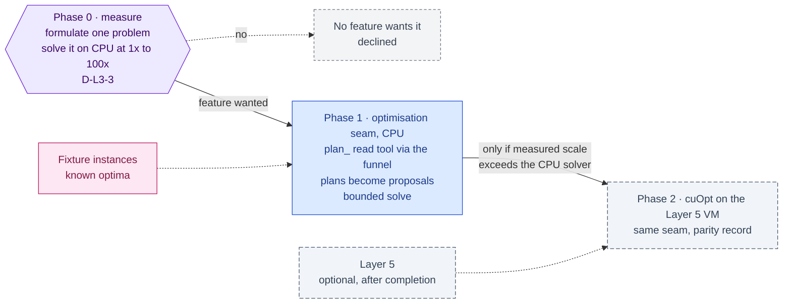

inflect · ai architecture · cuopt · roadmap v1 · 2026-10-29

# NVIDIA cuOpt — optimisation as an agent skill, Layer 3

> **Status: living design** — the integration roadmap for NVIDIA cuOpt, named
> by the target architecture for Layer 3 as an "optimisation tool for ERP/SAP
> scheduling & logistics routing". The **Current state** section is true today
> (main 3.338.0, `a1c2f05c`). The **Roadmap** section is the plan. This is a
> child of [`docs/ai-architecture-roadmap.md`](../ai-architecture-roadmap.md):
> read that first for the target map, the global rules **G1–G13**, and the
> sequencing. If the code contradicts a fact here, the code wins and the pull
> request that finds it corrects this document.

## Where it sits in the master roadmap

| | |
| --- | --- |
| Layer · box | 3 — Cognitive & reasoning · "NVIDIA cuOpt" |
| Wave | 4 (last; conditional on a measured need). The GPU arm (Phase 2) is optional Layer 5 work, after every other roadmap is complete |
| Depends on | nothing for Phases 0–1; Layer 5 ([`modal-inference.md`](./modal-inference.md)), optional and last, for Phase 2 |
| Unblocks | nothing |
| Owner decisions | **D-L3-3** (is there an optimisation problem at a size that needs a GPU) |
| Complete at | Phase 1, or Phase 0's recorded decline when no feature wants it. Phase 2 is optional Layer 5 work |

## At a glance

Purple hexagon: the Phase 0 decision. Blue: a phase not yet on `main`; it turns green (`done`) in the pull request that meets its "done when". Slate dashed: optional Layer 5 work, which starts only after every other roadmap is complete. Dashed white: another roadmap this one waits on or unblocks. Pink: the evaluation record. Grey dashed: an outcome that ends the roadmap.



## Current state (true today)

- **No optimisation solver of any kind.** No LP/MILP/VRP library in
  `package.json`; no `cuopt` anywhere.
- **The scheduling-shaped data the product holds** is compliance work, not
  logistics: audit cycles and packs (`audit-workflow.prisma`), control tests
  and test plans (`controls.prisma`, `usecases/control/test-plans.ts`), tasks
  with owners and due dates (`tasks.prisma`), risk treatment with a priced
  Mitigation ROI per item (RQ3, `docs/rq3-roadmap-complete.md`), evidence
  requests with owners and deadlines. The SAP work in this repo is
  *transaction review* (`workflows/sap-transaction-review.ts`,
  `docs/sap-agent-integration-roadmap.md`), not routing or scheduling.
- **Instance sizes are small.** A large tenant has hundreds of controls, tens
  of audits, thousands of tasks — hundreds to low thousands of decision
  variables. That is CPU territory by three orders of magnitude.
- **Agents reach tools only through the funnel** (G3); an optimisation call
  would be a read tool returning a plan, and a plan becomes real only as
  proposals a human approves (propose-not-commit).

## Fit, and what is deliberately not adopted

**What cuOpt is.** NVIDIA's GPU-accelerated LP / MILP / vehicle-routing solver
(open-sourced under Apache-2.0), with a self-hosted REST server image and a
Python API. It pays at scale — hundreds of thousands of variables, large VRPs
— where CPU solvers take minutes to hours.

**Where it *could* fit here**, in descending plausibility:

1. *Evidence-collection scheduling for an audit cycle* — assign evidence
   requests to owners under capacity and deadlines, minimising late items.
2. *Control-test calendar balancing* — spread recurring tests across the year
   under tester capacity.
3. *Remediation portfolio selection* — choose treatments under a budget
   maximising ROI (RQ3 prices the items; the portfolio is a knapsack).

**Not adopted, with the reason.**

- *cuOpt as the first solver.* Every problem above is a few hundred variables.
  A CPU solver (HiGHS or OR-Tools behind the same seam) solves them in
  milliseconds with no GPU, no Layer 5, no sub-processor. Adopting
  cuOpt first would be adopting a runtime for a problem size that does not
  exist.
- *The blueprint's ERP/SAP logistics routing.* Not a capability of this
  product; the SAP roadmap is about judgement over transactions.
- *The NIM container* (blueprint §3): the open-source server image is the
  de-NIM path if the GPU arm is ever built.

**The honest recommendation (D-L3-3).** Build the *optimisation seam* with a
CPU backend when one of the three problems is wanted as a feature; put cuOpt
behind the same seam on the Layer 5 GPU VM only if Layer 5 is taken up and a
measured instance exceeds what the
CPU backend solves inside the engine's step budget.

## Roadmap (future direction)

### Phase 0 — Find the problem and measure it

**Sub-phases.**
- [ ] 0.1 Pick one of the three candidate problems with the owner; write its
      formulation (variables, constraints, objective) in an implementation
      note.
- [ ] 0.2 Export an anonymised instance from the seed tenant at 1×, 10×, 100×
      scale; solve with a CPU solver in a scratch script; record wall-clock.
- [ ] 0.3 Decide D-L3-3: CPU seam now / cuOpt later / neither.

**Prompt.**
```text
Context (main 3.338.0): the product holds audit cycles, control tests, tasks with owners
and due dates, and RQ3-priced risk treatments; there is no optimisation solver. The target
names NVIDIA cuOpt (GPU LP/MILP/VRP). Agents reach tools only through runGuardedTool and
plans become real only as proposals.

Task: docs/implementation-notes/2026-MM-DD-optimisation-seam-decision.md. (1) Formulate
ONE candidate problem (evidence-collection scheduling, control-test calendar balancing,
or remediation portfolio under budget): variables, constraints, objective. (2) Build
synthetic instances at 1×/10×/100× of the seed tenant; solve with a CPU MILP solver in a
scratch script (not committed to src/); record wall-clock and variable counts. (3) State
at what scale, if any, a GPU solver would be justified. (4) Recommend D-L3-3.

Constraints: no production code; no dependency added; synthetic data only.

Done when: the note has the formulation, the timing table and a recommendation the
owner can initial.
```

### Phase 1 — The optimisation seam with a CPU backend (if wanted)

**Sub-phases.**
- [ ] 1.1 `src/lib/ai/optimisation/`: `types.ts` (`Optimiser.solve(problem) →
      plan`, problem types per formulation), `highs-provider.ts` (CPU, in
      process or a tiny service — decide by the dependency's build story),
      `stub-provider.ts`.
- [ ] 1.2 A read tool `plan_<problem>` in `src/lib/mcp/tools/` that reads the
      instance under RLS, solves, and returns a plan — a *suggestion*; the
      agent turns it into proposals (`propose_*`) a human approves.
- [ ] 1.3 Bounded: instance size cap, solver time limit, result size cap —
      every bound labelled in the outcome metric.
- [ ] 1.4 A behavioural test: a plan never references an entity outside the
      caller's tenant; an infeasible instance returns a named reason, not an
      empty plan.

**Prompt.**
```text
Context (main 3.338.0 + Phase 0): D-L3-3 chose a CPU seam for <problem>. Read tools live
in src/lib/mcp/tools/ (name, description, inputSchema, resourceScope) and are reached
through runGuardedTool; writes are proposals a human approves; dependencies follow
docs/dependency-governance.md (runtime role, strict peers, risk review for parsers).

Task: the optimisation seam. (1) src/lib/ai/optimisation/{types,highs-provider,stub-
provider}.ts with the Phase 0 formulation as the problem type. (2) A read tool
plan_<problem>: read the instance under RLS via the repositories, solve with a time
limit, return a plan with per-item rationale. (3) Caps: instance size, solver time,
result size, each with an outcome label. (4) Tests: two-tenant ("a plan never names
another tenant's entity"), infeasible ("returns INFEASIBLE with the binding constraint,
never an empty plan"), time-limit ("returns the best incumbent with a TIMEOUT label").

Constraints: the tool proposes nothing itself — the agent proposes, the human approves.
No GPU, no Layer 5, no cuOpt in this phase.

Done when: an agent granted plan_<problem> produces proposals from a plan on the seed
tenant, and the three tests are green.
```

**Hardening.** G3 (funnel), G7 (RLS reads), propose-not-commit (a plan is a
suggestion), bounded everything (the engine's caps are per run; a solver can
burn a step's budget alone).

### Phase 2 — cuOpt on the Layer 5 VM, behind the same seam (optional, Layer 5; only if Phase 0 found the scale)

**Sub-phases.**
- [ ] 2.1 The open-source cuOpt server on the Layer 5 GPU VM
      ([`modal-inference.md`](./modal-inference.md) Phase 2), deployed from the
      Layer 5 scripts, behind an operator-held token.
- [ ] 2.2 `cuopt-provider.ts` behind `Optimiser`, configured by operator
      settings like the local model route (absent = CPU backend). The VM is in
      the operator's own project, so `LOCAL_ONLY` tenants may use it too.
- [ ] 2.3 Parity test: CPU and cuOpt agree on the objective value for the
      fixture instances within tolerance.
- [ ] 2.4 No sub-processor change while the VM is in the operator's own
      Google Cloud project (the Laya precedent in `docs/sub-processors.md`).

**Hardening.** G1, G12 (optional Layer 5), G11-style parity record.

## Evals for this framework

| What | How |
| --- | --- |
| Correctness | fixture instances with known optima; CPU vs cuOpt parity |
| Isolation | two-tenant plan test |
| Usefulness | acceptance rate of plan-derived proposals on `/agents/review-quality` |

## Updating the master

Flip the row on the master [Status board](../ai-architecture-roadmap.md#status-board)
after Phase 0; if D-L3-3 is "neither", mark the box "declined — no problem at
GPU scale" with the note's link.
