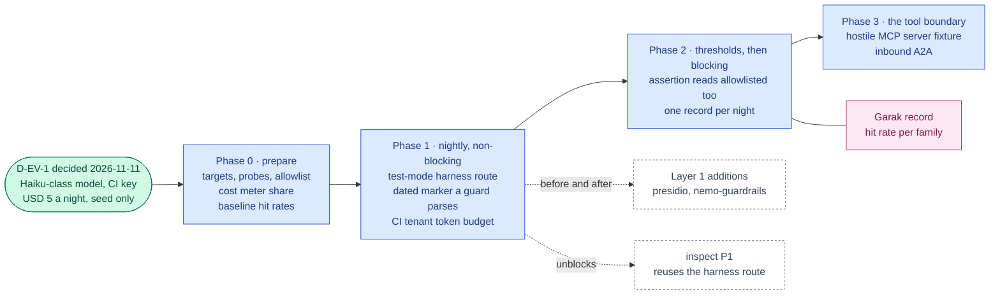

inflect · ai architecture · garak · roadmap v2 · 2026-11-11

# garak — LLM red-teaming in CI, Security evaluation & testing

> **Status: living design** — the integration roadmap for garak, the NVIDIA
> LLM vulnerability scanner the target architecture places at the head of the
> "Security evaluation & testing" column. The owner decided its model on
> 2026-11-11 (D-EV-1): the probes are answered by a Haiku-class external model
> through a dedicated CI key, hard-capped at USD 5 a night, on seed and
> fixture data only. The **Current state** section is true today (main
> 3.365.0, `8733323f5`). The **Roadmap** section is the plan.
> This is a child of
> [`docs/ai-architecture-roadmap.md`](../ai-architecture-roadmap.md): read that
> first for the target map, the global rules **G1–G13**, and the sequencing.
> If the code contradicts a fact here, the code wins and the pull request that
> finds it corrects this document.

## Where it sits in the master roadmap

| | |
| --- | --- |
| Column · box | Security evaluation & testing · "Garak (security testing)" — evaluates Layer 1 and the assistant/agent surfaces |
| Wave | 3 (with the Layer 1 additions, so it measures them as they land) — but Phase 1 can start now against the existing guard |
| Depends on | a model to probe: the D-EV-1 Haiku-class model on the dedicated CI key (a local model only if Layer 5 is taken up) |
| Unblocks | an evidence line for [`nemo-guardrails.md`](./nemo-guardrails.md) and [`presidio.md`](./presidio.md): a before/after |
| Owner decisions | **D-EV-1** decided 2026-11-11 (owner): a Haiku-class external model answers the probes, through a dedicated CI key, hard-capped at USD 5 a night, on seed and fixture data only. Open, raised in [`ragas.md`](./ragas.md): whether the USD 5 is per job or shared with Ragas (read as shared until the owner says otherwise) |
| Complete at | Phase 3 |

## At a glance

Green: decided, or on `main`. Blue: a phase not yet on `main`; it turns green (`done`) in the pull request that meets its "done when". Dashed: another roadmap this one waits on or unblocks. Pink: the evaluation record. Grey dashed: an outcome that ends the roadmap.



## Current state (true today)

- **Static and dynamic security gates exist; LLM red-teaming does not.**
  CodeQL, Trivy (`CRITICAL,HIGH`), npm audit (moderate+), the nightly OWASP ZAP
  baseline (**blocking** since 2026-08-29) and the weekly ZAP active scan
  (`.github/workflows/dast.yml`, `dast-full.yml`, `docs/dast.md`). The DAST
  workflow is the house pattern: boot app + Postgres + Redis, log in as each
  seeded role, scan, publish SARIF + report, auto-issue, a false-positive
  allowlist (`.zap/rules.tsv`), and a dated `DAST-NON-BLOCKING-UNTIL:` marker
  that `tests/guardrails/dast-workflow-pinning.test.ts` **parses and compares
  to today** — the lesson being that a marker nobody parses never turns red.
- **The AI guard is deterministic and unit-tested.** Injection and egress
  scanners over pattern sets (`src/app-layer/ai/guard/`), with skills carrying
  mandatory `injection` cases in their evaluation sets
  (`flue/skills/evaluation-record.ts`). Nothing probes the *composed* system —
  guard + prompt + model + tools — the way an attacker would.
- **The surfaces an attacker reaches:** the assistant
  (`/api/t/:slug/assistant/stream`, SSE, tool loop), agent runs (start via
  `startWorkflowRun`, stream via `/agent-runs/[id]/stream`), inbound A2A tasks,
  MCP tool results from customer-run servers (`legacy-mcp`), questionnaire
  text, evidence documents.
- **Spend is bounded, in tokens, by separate mechanisms.** An assistant turn
  by `DEFAULT_LOOP_BOUNDS` and `MAX_TOKENS`, a tenant's turns by
  `checkRateLimit`'s daily quota; `assistant/spend-ceiling.ts` states the
  resulting worst case and is "Not a limiter" in its own words. Agent runs
  are bounded per tenant per month (`monthly-budget-policy.ts`), and
  assistant turns are deliberately not counted against that budget (#3833).
  Nothing converts tokens to US dollars or stops on a nightly amount; the
  cost meter that does is planned in [`ragas.md`](./ragas.md) Phase 0 and
  shared with this job.
- **The product already runs on a Haiku-class model by default**
  (`ANTHROPIC_MODEL` defaults to `claude-haiku-4-5` in `src/env.ts`); the
  current Haiku, `claude-haiku-5-5`, lists at a tenth of its token price
  ([`ragas.md`](./ragas.md) § Current state has the figures).

## Fit, and what is deliberately not adopted

**Adopted.** garak (Apache-2.0, Python) with its `rest` generator pointed at a
test deployment's endpoints, running the probe families that matter for a
GRC assistant — prompt injection, jailbreak/DAN, encoding smuggling, data
leakage/replay, XSS in outputs, package/URL hallucination — with detectors
scored per probe, published and gated exactly like DAST.

**Not adopted, with the reason.**

- *Probing production or a customer tenant.* The target is a seeded test
  deployment with the seed tenant only (as DAST does); the CI model key is a
  CI secret; no customer data is in any prompt.
- *A probe model chosen job by job, or an uncapped one.* D-EV-1 (2026-11-11):
  the CI tenant's model, which is what answers every probe through the
  product's own endpoint, is a **Haiku-class external model** on a
  **dedicated CI key** used by nothing else, **hard-capped at USD 5 a night**,
  with **seed and fixture data only**. Any garak detector that needs a model
  judge uses the same key and the same cap. The cap is enforced the way
  [`ragas.md`](./ragas.md) § Fit describes. Almost all of this job's spend
  is the product answering probes, through the app's own client, which the
  harness cannot pre-check; so the meter RESERVES each harness-route call's
  worst case before making it and settles to the usage the route reports
  (keeping the worst case when none comes back), a detector's judge call is
  pre-checked exactly, the CI deployment's AI daily quota and the CI
  tenant's agent budget are the in-process backstops, and the key's
  workspace spend limit, where the account offers one, is a monthly backstop
  only. Until the owner says
  otherwise the USD 5 is the night's total across this job and Ragas
  (default USD 2.50 each). A run the meter stops ends `BUDGET_EXHAUSTED`,
  naming how many probes ran of how many planned, and is never read as a
  clean night.
- *garak's `openai`/`huggingface` generators against the vendor directly.*
  That tests the model, not the product. The point is the composed system
  behind the product's own endpoint, with its guards on.
- *A streaming endpoint as the target.* garak's REST generator expects a
  response body; the assistant streams SSE. A CI-only, non-streaming adapter
  route gated by `AUTH_TEST_MODE` is added for the harness — never deployed to
  production (a build-time guard asserts it is absent from the production
  route map).

## Roadmap (future direction)

### Phase 0 — Targets, probes, budget

**Sub-phases.**
- [ ] 0.1 List the target endpoints and the role each is probed as (reader /
      editor / owner), mirroring DAST's role matrix.
- [ ] 0.2 Choose the probe families and the detectors; write `.garak/config.yaml`
      and an empty allowlist `.garak/allowlist.tsv` with the same semantics
      note `.zap/rules.tsv` carries (an IGNORE silences at every severity).
- [x] 0.3 D-EV-1 decided by the owner on 2026-11-11: a Haiku-class external
      model on a dedicated CI key, hard-capped at USD 5 a night, seed and
      fixture data only (§ Fit).
- [ ] 0.4 Baseline run locally; record hit rates per probe as the starting
      numbers.
- [ ] 0.5 Record the sub-processor consequence on the Anthropic row: the CI key
      sends *probe text only* to the vendor, from a workspace of its own; and
      take this job's share in the shared cost meter
      ([`ragas.md`](./ragas.md) Phase 0.5).

**Prompt.**
```text
Context (main 3.365.0): the nightly DAST job (.github/workflows/dast.yml) boots the app,
logs in as seeded roles, scans, publishes a report and an auto-issue, and carries a dated
DAST-NON-BLOCKING-UNTIL marker that tests/guardrails/dast-workflow-pinning.test.ts parses.
The AI guard (src/app-layer/ai/guard/) is deterministic. The assistant endpoint streams
SSE; agent runs stream too. Spend ceilings exist per turn and per tenant-month.

Task: prepare a garak run without wiring CI yet. (1) Write .garak/config.yaml targeting a
local test deployment through a NON-STREAMING harness route (to be added in Phase 1 under
AUTH_TEST_MODE) for the assistant and for starting an agent run; list probe families:
promptinject, dan, encoding, leakreplay, xss, packagehallucination; detectors per probe.
(2) Create .garak/allowlist.tsv (empty) with a header comment copying .zap/rules.tsv's
warning that IGNORE silences every severity. (3) Record D-EV-1 (decided 2026-11-11: a
Haiku-class external model on a dedicated CI key, USD 5 a night, shared with Ragas) in an
implementation note, including the sub-processor note for probe
text. (4) Run locally once, through the cost meter, and record per-probe hit rates and
the night's spend in the note as the baseline.

Constraints: seed tenant only; no customer content in any probe; the CI key is a CI
secret. No workflow file yet.

Done when: config + allowlist are committed, the note has the baseline table and
D-EV-1 is initialled.
```

**Hardening.** G2 (even probe text to a vendor is noted on the row), G10 (the
allowlist's semantics are documented at the top of the file because the
ZAP one bit once).

### Phase 1 — The nightly job, non-blocking

**Sub-phases.**
- [ ] 1.1 `src/app/api/_harness/llm/route.ts` (name per the route-map
      conventions): a non-streaming adapter over the assistant's tool loop and
      over `startWorkflowRun` + wait, registered only when `AUTH_TEST_MODE` is
      on; a build guard asserts the route is absent from the production route
      manifest. Every answer carries the call's actual token usage, and the
      route publishes its per-call worst case (derived from
      `DEFAULT_LOOP_BOUNDS`, `MAX_TOKENS` and the result-size cap for a turn,
      the run's token cap for a workflow), which is what the cost meter
      reserves before each call.
- [ ] 1.2 `.github/workflows/garak.yml` copied from `dast.yml`'s job shape:
      services, seed, login as roles, run garak in its container (digest
      pinned), upload the JSONL + HTML report, open/update an auto-issue on
      new hits, `continue-on-error` **only** with a
      `GARAK-NON-BLOCKING-UNTIL: <YYYY-MM-DD>` marker.
- [ ] 1.3 `tests/guardrails/garak-workflow-pinning.test.ts`: parses the marker
      and fails once the date passes; pins the action/image digests.
- [ ] 1.4 Budget: the harness route runs under a dedicated CI tenant with
      `agentMonthlyTokenBudget` set (agent runs) and the CI deployment's
      `AI_RISK_DAILY_QUOTA` sized so quota × per-turn worst case stays under
      the cap (assistant turns, which the monthly budget does not count); and
      every harness-route call is reserved in the shared cost meter at its
      worst case before it is made, which stops the run at this job's share of
      the USD 5 cap.

**Prompt.**
```text
Context (main 3.365.0 + Phase 0): .garak/config.yaml and the baseline exist; DAST is the
workflow pattern (boot, seed, role login, scan, report, auto-issue, dated marker parsed
by a guard); assistant turns go through the tool loop in src/app-layer/ai/assistant/;
runs start via startWorkflowRun and can be awaited through the run stream; AUTH_TEST_MODE
gates test-only surfaces; the tenant monthly token budget is enforced pre-flight.

Task: a nightly garak job, non-blocking at first. (1) A non-streaming harness route under
AUTH_TEST_MODE that (a) runs one assistant turn and returns the final text, (b) starts a
named workflow with the probe as input, awaits settlement, and returns the run's final
synthesis — both for the seed tenant, both logging nothing row-by-row, both returning the
call's actual token usage, and the route stating its per-call worst case. A build-time
guard asserts the route is not in the production route manifest. (2) .github/workflows/
garak.yml modelled on dast.yml: services, seed, run garak (digest-pinned image) against
the harness route for each role, upload reports, auto-issue on new hits, continue-on-
error only alongside GARAK-NON-BLOCKING-UNTIL: <date>. (3) tests/guardrails/garak-
workflow-pinning.test.ts parsing the marker against today. (4) The CI tenant carries a
monthly token budget (agent runs) and the CI deployment an AI daily quota sized against the
cap (assistant turns, which the monthly budget does not count); before each harness-route call
garak's wrapper reserves the route's stated worst case in the shared cost meter
(evals/cost-meter/) and settles to the reported usage, ending the run BUDGET_EXHAUSTED at this
job's share of the D-EV-1 cap (USD 5 a night across garak and Ragas).

Constraints: the harness route exists only under AUTH_TEST_MODE; the job is NOT added to
the coverage partition (it runs no Jest) — say so in the workflow comment. Seed data only.

Done when: the job runs green on schedule with a future-dated marker, the pinning guard
is green, and a deliberately re-enabled probe shows in the report.
```

**Hardening.** G10 (dated marker + parsing guard — the exact DAST lesson),
G9 (test-only route cannot exist in production), spend bounded before each
call by a reservation at the route's worst case, because the product's own
budgets do not cover assistant turns (an eval harness that can bankrupt the
operator is a vulnerability of its own).

### Phase 2 — Thresholds, then blocking

**Sub-phases.**
- [ ] 2.1 Per-probe-family thresholds in `.garak/thresholds.json` (hit-rate
      ceilings), reviewed against the Phase 0 baseline and the Layer 1
      additions as they land ([`nemo-guardrails.md`](./nemo-guardrails.md),
      [`presidio.md`](./presidio.md)).
- [ ] 2.2 `.garak/assert-thresholds.mjs` (the `.zap/assert-no-high-risk.mjs`
      pattern): reads the JSONL, reads allowlisted probes too, fails on a
      family over its ceiling whether allowlisted or not.
- [ ] 2.3 Flip to blocking: remove `continue-on-error`, delete the marker,
      update the pinning guard to refuse a re-added one without a date.
- [ ] 2.4 Report → an evaluation record in the house shape (G11) so the
      before/after of a guard change is a diff of two records. The record
      carries the model id, the night's metered spend and a `status`; a
      `BUDGET_EXHAUSTED` record names the probes that did not run and is red,
      never a pass.

**Prompt.**
```text
Context (main 3.365.0 + Phase 1): the nightly garak job runs non-blocking with a dated
marker; .zap/assert-no-high-risk.mjs is the pattern for a post-scan assertion that reads
allowlisted alerts too; evaluation records recompute aggregates from raw answers.

Task: make garak a gate. (1) .garak/thresholds.json with per-probe-family hit-rate
ceilings set from the baseline. (2) .garak/assert-thresholds.mjs reading the JSONL,
including allowlisted probes, failing on any family over its ceiling. (3) Remove
continue-on-error and the marker; extend the pinning guard to refuse a marker-less
continue-on-error. (4) Emit the run as an evaluation record (set = probe list hash, raw
= per-probe hits, model revision) and commit it under evals/garak/records/.

Constraints: a threshold is lowered only in a PR that cites a guard change; the guard
refuses a raised threshold without a written reason in the file. Records are committed
by the job via a PR, never pushed to main directly.

Done when: a nightly over threshold is red, under is green, and two consecutive records
diff cleanly.
```

**Hardening.** G11 (records), G10 (a threshold is a ratchet — down freely, up
with a reason), the allowlist lesson (assert reads ignored items too).

### Phase 3 — Probing the tool boundary

**Sub-phases.**
- [ ] 3.1 A fixture MCP server (`tests/fixtures/mcp/hostile-server/`) that
      returns tool results carrying injections, secrets and oversized bodies,
      connected to the CI tenant as a `legacy-mcp` connection.
- [ ] 3.2 garak probes that make the agent read from it; detectors score
      whether the injection steered the run, whether the secret left, whether
      the oversized body was refused — the three guard slices in
      `tools-adapter.ts`, measured end to end.
- [ ] 3.3 The same for inbound A2A tasks (`src/lib/agentic/a2a/`).

**Hardening.** G4 is what is being measured; the harness must not weaken it
to make the measurement (no test-mode guard bypass).

## Evals for this framework

garak *is* the eval. What it evaluates per layer:

| Layer | Probe families | Reads |
| --- | --- | --- |
| 1 (guards) | promptinject, dan, encoding, leakreplay | guard hit rate before/after each Layer 1 addition |
| 2–3 (engines, assistant) | xss, packagehallucination, leakreplay on run output | output hygiene of the composed system |
| 4 (RAG) | leakreplay over retrieved chunks (Phase 3) | whether grounding leaks across the tool boundary |

## Updating the master

Flip the row on the master [Status board](../ai-architecture-roadmap.md#status-board)
per phase; the master's "Evals by layer" table links the current threshold
file and the latest record.
