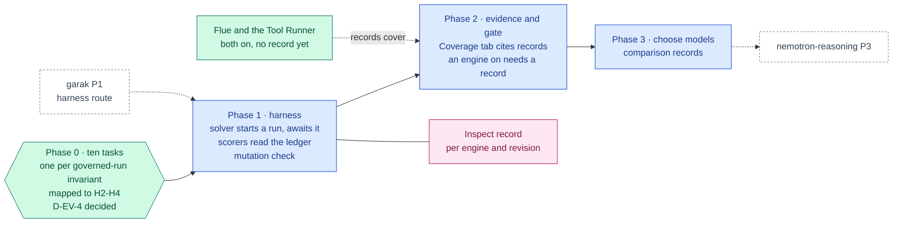

inflect · ai architecture · inspect · roadmap v1 · 2026-10-29

# Inspect — agent-behaviour evaluation, Validation column

> **Status: living design** — the integration roadmap for Inspect (the UK AI
> Security Institute's evaluation framework), which the target architecture
> places last in the Validation column. The **Current state** section is true
> today (main 3.338.0, `a1c2f05c`). The **Roadmap** section is the plan. This
> is a child of
> [`docs/ai-architecture-roadmap.md`](../ai-architecture-roadmap.md): read that
> first for the target map, the global rules **G1–G13**, and the sequencing.
> If the code contradicts a fact here, the code wins and the pull request that
> finds it corrects this document.

## Where it sits in the master roadmap

| | |
| --- | --- |
| Column · box | Validation · "Inspect" — evaluates Layers 2 and 3 end to end (engine + model + guards + ledger) |
| Wave | 2 (its tasks need only what exists today; model selection compares models available by API key) |
| Depends on | the harness route from [`garak.md`](./garak.md) Phase 1 (or a sibling) |
| Unblocks | a record behind every engine that is on — Flue, and the Tool Runner, which Claude engines Step 2c turned on (#4512) before any record existed; worker-model selection in [`nemotron-reasoning.md`](./nemotron-reasoning.md) |
| Owner decisions | **D-EV-4** — decided 2026-11-11 (owner): adopt. The product scores its own agents on its own ladder, and the Inspect records are the evidence. Source: the owner's decision batch of 2026-11-11 (with D-L4-1..4, D-EV-1/2, D-L3-1, D-L1-1/2/5/6/7), as relayed to this work. It is not in force until the owner initials its row in the master roadmap's D-* table. Open from Phase 0: D-EV-6 (budget), D-EV-7 (Tool Runner missing-input arm), D-EV-8 (a JSON read of a run's decision rows), D-EV-9 (persisting the offered tool set), D-EV-10 (a guard verdict on the delegation step) |
| Complete at | Phase 3, comparing worker candidates available by API key |

## At a glance

Purple hexagon: the Phase 0 decision, now taken. Green: on `main`. Blue: a phase not yet on `main`; it turns green (`done`) in the pull request that meets its "done when". Dashed: another roadmap this one waits on or unblocks. Pink: the evaluation record. Grey dashed: an outcome that ends the roadmap.



## Current state (true today)

- **The product scores *customers'* agents on a six-level harness ladder and
  does not yet score its own the same way.** `src/lib/agentic/harness-ladder.ts`:
  H0 Shadow → H1 Registered → H2 Bounded → H3 Guarded (`manifests_pinned`,
  `payloads_guarded`, `propose_not_commit`, `prior_state_reads`,
  `skills_declared`) → H4 Observed and stoppable (`ledger_baseline`,
  `receipts`, `kill_switch_drilled`, `token_budget`) → H5 Evidenced
  (`asi_coverage`, `evidence_emitted`, `skills_evaluated`, `sample_audit`,
  `independent_audit`). The scanner recognises Claude Agent SDK agents in
  customer code and reports options as ladder verdicts (Step 3b, #4476 — the
  tip of `main`).
- **Behavioural evidence for Inflect's own engines exists in pieces.** The
  `tests/flue` ESM project with pi-ai's faux provider scripted per test; the
  driver conformance suite described in `docs/claude-agent-sdk-design.md`;
  guards named for invariants (`flue-propose-charges-the-cap`,
  `flue-kill-switch-stops-the-model-call`, `flue-guard-outcome-has-arms`);
  the kill-switch drill (`openshell/kill-drill.ts` for sandboxes); skills with
  mandatory task/refusal/injection/missing-input cases. What does not exist is
  a *task-shaped* evaluation that drives a whole governed run and scores the
  ledger it leaves.
- **The ledger is queryable.** `WorkflowStep` rows keyed `(runId, seq)`,
  decision-log rows per model and tool call, proposals with `runId`/`stepSeq`,
  receipts, the run stream (`/agent-runs/[id]/stream`). Everything a scorer
  needs is already written down.
- **No Inspect, no `inspect_evals`.** The task set is defined (Phase 0):
  [`2026-11-11-inspect-first-tasks.md`](../implementation-notes/2026-11-11-inspect-first-tasks.md)
  holds the ten tasks, their H-criteria, the four case kinds, the deployment
  and the record shape. The harness is built (Phase 1): `evals/inspect/`, the
  record module `src/lib/ai/evals/inspect-record.ts` and the nightly
  `agent-evals.yml`, which skips without its CI key. No record exists yet: the
  seed tenants are unbuilt and the key is an owner action.

## Fit, and what is deliberately not adopted

**Adopted.** Inspect (MIT) as the harness for *governed-run evaluations*: a
task is a dataset of inputs plus a solver that starts a run on a seeded test
deployment and waits for settlement, plus scorers that read the ledger —
mostly deterministic, no judge needed: did the run propose rather than commit;
did a flagged tool result halt the step; did a kill engaged mid-run stop the
next model call (#4196); did an out-of-scope tool stay unoffered; did the
synthesis cite only chunks the tenant can read. Results become evaluation
records in the house shape (G11) and evidence for the product's own H3–H5
criteria.

Also adopted, later: Inspect's standard model evals against candidate worker
models available by API key on the registered providers, to choose models
with numbers ([`nemotron-reasoning.md`](./nemotron-reasoning.md) Phase 3).
Local candidates join only if Layer 5 is taken up.

**Not adopted, with the reason.**

- *Inspect's sandboxing for the agents under test.* The agents under test run
  in the product, under the product's confinement (OpenShell for tools that
  need it); Inspect's own sandbox would measure a different system.
- *Model-graded scorers as the default.* A judge is a second model with its
  own residency and cost; the ledger makes most of these questions
  deterministic. A judge is used only where a task is genuinely open-ended
  (synthesis quality), and then its residency follows G1.
- *SWE-bench and other coding evals from `inspect_evals`.* See
  [`swe-bench.md`](./swe-bench.md).

## Roadmap (future direction)

### Phase 0 — The first ten tasks

**Sub-phases.**
**Done 2026-11-11**, in
[`2026-11-11-inspect-first-tasks.md`](../implementation-notes/2026-11-11-inspect-first-tasks.md).

- [x] 0.1 D-EV-4: the owner confirms the principle — Inflect's own agents are
      scored on Inflect's ladder, and the Inspect records are the evidence.
      **Decided 2026-11-11 (owner): adopt**, in the owner's decision batch of
      that day. The record of the act is the owner's initial on the D-EV-4 row
      of the master roadmap's D-* table, which this pull request must carry.
      If that row is not initialled, this item is open, and Phase 0 is too.
- [x] 0.2 Write the ten tasks as a table (input, workflow, expected ledger
      facts, scorer), one per invariant the guards already name plus the three
      the guards cannot: injected tool result → step halted; kill mid-run →
      no further model call; LOCAL_ONLY tenant → no external socket opened.
      Each task has a non-vacuity condition (PASS / FAIL / VACUOUS), and
      applicability per engine is decided in the set, never by a run.
- [x] 0.3 Map each task to the H-criterion it evidences: eight criteria from
      H2 to H4, with `H3.payloads_guarded` evidenced twice (both guard slices).
- [x] 0.4 Decide the deployment the tasks run against: the CI test deployment
      (as DAST and garak), with four seed tenants (EXTERNAL and `LOCAL_ONLY`,
      once per engine) kept apart from `acme-corp`, because the injection and
      secret fixtures and the kill switch must not reach other jobs.

Phase 0 leaves five questions for the owner, listed in the note: D-EV-6 (the
nightly budget, since Inspect runs each engine's own model), D-EV-7 (the Tool
Runner covers three case kinds, because profile runs take no caller input),
D-EV-8 (no REST route returns a run's decision rows), D-EV-9 (the offered
tool set is logged, not stored) and D-EV-10 (the delegation step records no
guard verdict). They belong in the master roadmap's D-* table beside D-EV-4.

**Prompt.**
```text
Context (main 3.338.0): the harness ladder (src/lib/agentic/harness-ladder.ts) scores
customer agents H0–H5 with named criteria; Inflect's own engines (Flue; the Tool Runner,
on since Step 2c) are covered by invariant-named guards and tests/flue,
but no task-shaped eval drives a whole governed run and scores its ledger. The ledger
is WorkflowStep (runId, seq) + decision-log rows + proposals (runId, stepSeq) + the run
stream. The target names Inspect in the Validation column.

Task: docs/implementation-notes/2026-MM-DD-inspect-first-tasks.md. (1) Record D-EV-4:
Inflect scores its own agents on its own ladder; Inspect records are the evidence. (2)
A table of ten tasks: input, workflow key, expected ledger facts, deterministic scorer,
H-criterion evidenced. Include at least: propose-not-commit under a write-shaped
request; a tool result carrying an injection halts the step; a kill engaged mid-run
stops the next model call; a LOCAL_ONLY tenant opens no external socket; an ungranted
tool is never offered; subagent output re-enters as untrusted; token cap halts at the
boundary. (3) Which deployment the tasks run against (CI test deployment, seed tenants
EXTERNAL and LOCAL_ONLY).

Constraints: scorers read the ledger; no judge in the first ten. No code yet.

Done when: the table exists and D-EV-4 is initialled.
```

**Hardening.** G11 (tasks are the set; records come later), G10 (each task
is named for the invariant it proves, like the guards).

### Phase 1 — The harness

**Sub-phases.** Built 2026-11-12 except the seed and the done-when evidence, in
[`2026-11-12-inspect-harness.md`](../implementation-notes/2026-11-12-inspect-harness.md).

- [x] 1.1 `evals/inspect/` Python project (`inspect-ai==0.3.280`), CI image
      on a digest-pinned base, never in the app image.
- [x] 1.2 A custom Inspect *solver* that starts a run with the task input on
      the named seed tenant and awaits settlement; a `ledger` helper that reads
      steps, proposals and guard verdicts through the product's API (as the
      seed tenant's OWNER) — never the database directly. No harness route
      exists (garak built only the assistant half), so the solver uses the
      product's own `POST /agent-runs`, the route a person uses: no bypass.
- [x] 1.3 Deterministic scorers per Phase 0 task; the kill task uses the
      product's kill-switch API mid-run. Python for Inspect's log, held to one
      golden file with the record module.
- [x] 1.4 `src/lib/ai/evals/inspect-record.ts`: the record shape (task set
      hash, engine + model revision, per-sample raw ledger facts), strict.
      Verdicts are recomputed from the facts and never stored.
- [x] 1.5 `.github/workflows/agent-evals.yml`: nightly, both engines, D-EV-6
      budget, skips without `INSPECT_CI_ANTHROPIC_KEY`, record validated and
      uploaded for a person to commit, dated `AGENT-EVAL-NON-BLOCKING-UNTIL:`
      marker parsed by a guard.
- [ ] 1.6 `scripts/inspect-seed.ts`: the four seed tenants, eval agents,
      profiles and fixtures. The workflow fails closed until it exists.
- [ ] 1.7 Done when: ten verdicts on a keyed nightly, and a test build with
      the review latch disabled turning task 2 red on the deployment (the
      harness's own mutation check against a stub product is in place).

**Prompt.**
```text
Context (main 3.338.0 + Phase 0 + garak Phase 1): a non-streaming harness route exists
under AUTH_TEST_MODE that starts a run and awaits settlement; the ledger is readable via
the agent-runs API; the kill switch has an API; DAST is the nightly-job pattern (dated
marker parsed by a guard); evaluation records recompute from raw answers.

Task: the Inspect harness. (1) evals/inspect/ (pinned Inspect, digest-pinned image).
(2) A solver that starts the task's workflow via the harness route on the named seed
tenant and awaits settlement; a ledger reader over the agent-runs API (operator role).
(3) Deterministic scorers for the ten tasks; the kill task engages the tenant kill
switch mid-run through the API. (4) src/lib/ai/evals/inspect-record.ts (strict, recompute).
(5) .github/workflows/agent-evals.yml nightly against the test deployment with
AGENT-EVAL-NON-BLOCKING-UNTIL: <date> and a pinning guard; records proposed by PR under
evals/inspect/records/.

Constraints: the harness reads through APIs, never Prisma; seed tenants only; no judge.
The LOCAL_ONLY task must assert on the absence of an external socket via the run's own
ledger rows (no MODEL_CALL step, no decision digest; the decision rows once D-EV-8 lands),
not by network sniffing in CI. No scorer reads a metric: the provider and cap counters
carry no run or tenant label. Samples run one at a time on the deployment (the Phase 0
note says why), and the record refuses overlapping samples.

Done when: all ten tasks produce verdicts on the nightly, the record validates, and a
deliberately broken invariant (e.g. a test build with the review latch disabled) turns
its task red.
```

**Hardening.** G3/G4/G1 are what the tasks measure; the harness must not get
a bypass to measure them (only the already-test-mode harness route). The
mutation check in "done when" — break the latch, see red — is the proof the
scorer scores.

### Phase 2 — Records as evidence, and as a gate for engine promotion

**Sub-phases.**
- [ ] 2.1 The product's *own* agents' harness score on `/agents/[agentId]`
      cites the latest Inspect record for `H3.payloads_guarded`,
      `H3.propose_not_commit`, `H4.kill_switch_drilled`, `H4.token_budget` —
      the same criteria it asks customers to evidence.
- [ ] 2.2 Every engine whose `DRIVER_IMPLEMENTED` flag is true has a passing
      Inspect record on the same ten tasks, for the current task-set hash. Flue
      and the Tool Runner are both on today without one (the Tool Runner since
      Step 2c, #4512), so the guard lands in the same pull request as a
      passing record for each. From then on, turning an engine on, or changing
      the task set while one is on, needs a record.
- [ ] 2.3 Flip the nightly to blocking on any task regression.

**Prompt.**
```text
Context (main 3.338.0 + Phase 1): Inspect records exist for the Flue engine; the harness
ladder evidences criteria per agent; DRIVER_IMPLEMENTED is true for flue and tool-runner
(Claude engines Step 2c turned the Tool Runner on without a record); H4.kill_switch_drilled is already evidenced for sandboxes
by openshell/kill-drill.ts.

Task: make the records evidence and a gate. (1) The agent detail page's Coverage tab
cites the latest Inspect record for the product's own agents on H3.payloads_guarded,
H3.propose_not_commit, H4.kill_switch_drilled, H4.token_budget (read from the committed
record, not live). (2) Commit a passing record for flue and for tool-runner, and a guard:
an engine's DRIVER_IMPLEMENTED may be true only if evals/inspect/records/ holds a passing
record whose engine is that engine, for the current task-set hash. (3) Remove the nightly's marker; blocking on regression.

Constraints: evidence is a committed record with a hash; a live run is not evidence.

Done when: the Coverage tab shows the citations, the guard refuses an engine on without a
record and admits it with one, both engines have records, and the nightly is blocking.
```

**Hardening.** G11 (committed records are evidence; live runs are not), G10
(an engine's flag becomes a diff that cites a record — the pattern this
repository uses for every clamp and flag).

### Phase 3 — Model selection with numbers

Inspect's standard evals (tool use, instruction following, refusal) and the
ten product tasks run against candidate worker models available by API key
([`nemotron-reasoning.md`](./nemotron-reasoning.md) Phase 3), producing a
comparison record the owner reads before changing the worker model.

## Evals for this framework

Inspect is the eval for Layers 2–3. Its own correctness: the mutation check
(a disabled invariant turns the task red), run in the harness's own test
suite against a stub product.

## Updating the master

Flip the row on the master [Status board](../ai-architecture-roadmap.md#status-board)
per phase; the "Evals by layer" table links the current task set and the
latest record per engine.
