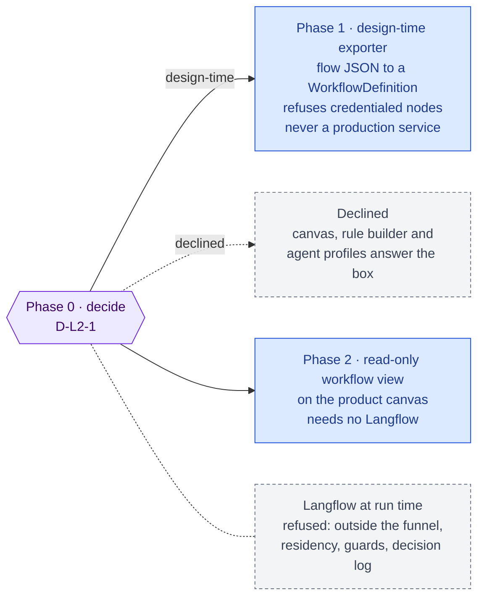

inflect · ai architecture · langflow · roadmap v1 · 2026-10-29

# Langflow — a visual flow designer, Layer 2

> **Status: living design** — the integration roadmap for Langflow and its
> TypeScript client, named by the target architecture for Layer 2 as the
> "visual workflow canvas" with `@datastax/langflow-client` "replacing Dify for
> flow design". The **Current state** section is true today (main 3.338.0,
> `a1c2f05c`). The **Roadmap** section is the plan. This is a child of
> [`docs/ai-architecture-roadmap.md`](../ai-architecture-roadmap.md): read that
> first for the target map, the global rules **G1–G12**, and the sequencing.
> If the code contradicts a fact here, the code wins and the pull request that
> finds it corrects this document.

## Where it sits in the master roadmap

| | |
| --- | --- |
| Layer · box | 2 — Orchestration & workflow · "Langflow (visual workflow canvas)" + "TS Client" |
| Wave | 4 (last; optional) |
| Depends on | nothing |
| Unblocks | nothing on the critical path |
| Owner decisions | **D-L2-1** (design-time only, or not at all) |

## At a glance

Purple hexagon: the Phase 0 decision. Blue: a phase not yet on `main`; it turns green (`done`) in the pull request that meets its "done when". Dashed: another roadmap this one waits on or unblocks. Pink: the evaluation record. Grey dashed: an outcome that ends the roadmap.



## Current state (true today)

- **The product already has three authoring surfaces for "what an agent
  does", and all three are governed.** The process canvas (xyflow,
  `lib/processes/canvas-execution-overlay.tsx`) with automation nodes; the rule
  builder (`RuleBuilderModal.tsx`) whose `AutomationActionType` now carries
  `INVOKE_AGENT` beside `NOTIFY_USER`, `CREATE_TASK`, `UPDATE_STATUS`,
  `WEBHOOK`, `INVOKE_SUBFLOW`; and **agent profiles** (Claude engines Step 1a,
  `usecases/agent-profiles.ts`) — a customer-built agent with no CLI, whose
  version runs only once a person other than its author approves it, whose
  tools only narrow, and which no engine runs yet (owner decision 2026-10-26).
- **Workflows are code.** `src/lib/agentic/workflow-registry.ts` registers
  eleven `WorkflowDefinition`s (`posture-review`, `access-posture`,
  `audit-prep`, `audit-narrative`, `sap-transaction-review`, …), each a typed
  module with READ / PROPOSE / SYNTHESIS / HUMAN_CHECKPOINT steps, reviewed in a
  pull request. A definition asks for its engine (`driver: 'flue'`).
- **Skills are Markdown with a standard and an evaluation gate**
  (`docs/agent-skill-standard.md`, `flue/skills/`, ten skills today).
- **No Langflow, no Dify, no `@datastax/langflow-client`.**

## Fit, and what is deliberately not adopted

**What Langflow is.** A Python (MIT) visual builder for LLM flows with its own
runtime and REST API; `@datastax/langflow-client` calls that runtime from
TypeScript.

**Not adopted: Langflow at run time.** A Langflow flow calls models and tools
from inside Langflow. Every one of those calls would bypass the funnel
(`runGuardedTool → runReadTool / runProposeTool`, G3), the residency decision
(G1), the guard sandwich (G4), the decision log, the kill switch and the caps.
It would be a third reasoning engine, written in another language, outside
every control the governance plane applies to the two it has. "The engine
decides what to try; the funnel decides what is permitted" has no reading
under which a Langflow runtime fits.

**Possibly adopted: Langflow at design time.** An operator sketches a flow in
Langflow and an exporter turns the flow JSON into a `WorkflowDefinition`
*skeleton* — a PR, reviewed, registered in code, run by Flue or the Tool
Runner. Langflow never touches production and never sees tenant data.

**The honest recommendation (D-L2-1).** The customer-facing "build an agent
without a CLI" problem is being solved by agent profiles under #4135, on the
product's own canvas idioms. A second visual builder in another language,
whose output must be translated into the first one's model, is more likely to
diverge than to help. The roadmap below exists so the diagram's box has an
answer; its Phase 0 is the decision to proceed, and "declined" is a legitimate
outcome recorded in the master.

## Roadmap (future direction)

### Phase 0 — Decide

**Sub-phases.**
- [ ] 0.1 Memo (implementation note): what a flow designer would add over the
      canvas + rule builder + agent profiles, for whom (operator vs customer),
      and at what divergence cost.
- [ ] 0.2 If "design-time only": the export target is `WorkflowDefinition` and
      nothing else; name the node types that map (READ → read tool call,
      PROPOSE → propose tool, SYNTHESIS → model step with a skill) and the ones
      that do not (Langflow's own LLM/tool nodes with vendor credentials).
- [ ] 0.3 If "declined": mark the master row and stop.

**Prompt.**
```text
Context (main 3.338.0): workflows are typed code modules registered in
src/lib/agentic/workflow-registry.ts; the rule builder has INVOKE_AGENT; agent profiles
(usecases/agent-profiles.ts) are the customer-facing agent builder, approved by a second
person, run by no engine yet; every engine tool call goes through runGuardedTool. The
target names Langflow + @datastax/langflow-client for "flow design".

Task: docs/implementation-notes/2026-MM-DD-langflow-decision.md answering: what would a
visual flow designer add over the existing three surfaces, for operators and for
customers; why a Langflow RUNTIME cannot be admitted (name the controls it would bypass:
funnel, residency, guard sandwich, decision log, kill switch, caps); what a design-time
exporter would map (Langflow node → WorkflowDefinition step) and what it cannot. End with
a recommendation: design-time only, or declined.

Constraints: no code, no dependency. Do not propose running Langflow in production.

Done when: the owner has initialled D-L2-1 in the master's decision table.
```

**Hardening.** G3, G1, G4 are the argument, not a checklist: the memo must
name them.

### Phase 1 — Design-time exporter (only if D-L2-1 = design-time)

**Sub-phases.**
- [ ] 1.1 A dev-only Compose profile (`docker-compose.yml`, not the production
      file) running Langflow locally for operators; never on the VM.
- [ ] 1.2 `scripts/langflow-export.ts`: reads a Langflow flow JSON file (an
      untrusted input — schema-validated, size-bounded) and emits a
      `src/lib/agentic/workflows/<key>.ts` skeleton with typed steps, a
      `driver` left unset, and TODO markers where a mapping was lossy; plus a
      unit test file for the definition.
- [ ] 1.3 The exporter refuses nodes that would need a vendor credential or an
      unmapped tool, listing them by name; it never writes a credential.
- [ ] 1.4 Round-trip test over three fixture flows under `tests/fixtures/langflow/`.

**Prompt.**
```text
Context (main 3.338.0): WorkflowDefinition is typed in src/lib/agentic/workflow-types.ts
(steps READ / PROPOSE / SYNTHESIS / HUMAN_CHECKPOINT, engine caps, optional driver); read
tools are named in src/lib/mcp/tools/; skills are named directories under
flue/skills/. D-L2-1 chose design-time only.

Task: a design-time exporter. (1) A dev-only Compose profile for Langflow (not
deploy/docker-compose.prod.yml). (2) scripts/langflow-export.ts <flow.json> <key>:
validate the JSON (zod, size-bounded), map nodes to steps (document the mapping table in
the script header), emit src/lib/agentic/workflows/<key>.ts with driver unset and TODO
markers for lossy mappings, plus tests/unit/workflows/<key>.test.ts. (3) Refuse, by
name, any node needing a vendor credential or an unmapped tool. (4) Three fixture flows
with expected outputs; a round-trip test.

Constraints: the output is a PR for a human to review, never auto-registered; the script
writes no credential and reads no env. Langflow is never a production service.

Done when: the three fixtures export to definitions that typecheck and pass their
generated tests, and the refusal test lists the offending nodes.
```

**Hardening.** G3 (the emitted definition reaches tools only through the
funnel because every definition does), G6 (no network in the exporter), G10
(the generated test is the regression guard, named for the workflow).

### Phase 2 — Read-only flow view on the product canvas (optional)

A `WorkflowDefinition` rendered on the existing xyflow canvas as a read-only
graph, so an operator can *see* a registered workflow without Langflow at all.
This is the part of the box's value that survives the decision, and it needs
no Langflow — which is the argument for doing it instead.

## Evals for this framework

None beyond the generated per-definition tests. A design-time tool has no
runtime behaviour to evaluate; the definitions it emits are evaluated like any
other (driver conformance suite, Inspect tasks — [`inspect.md`](./inspect.md)).

## Updating the master

Flip the row on the master [Status board](../ai-architecture-roadmap.md#status-board)
after Phase 0 — most likely to "design-time only" or "declined". Either is
final for this box unless a product decision about a customer-facing visual
builder reopens it, in which case the agent-profile design docs are the place
it reopens, not this one.
