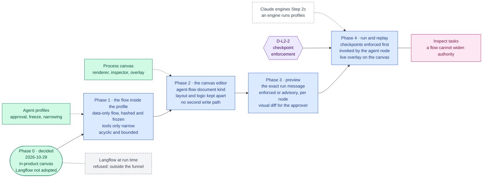

inflect · ai architecture · agent-flow canvas · roadmap v2 · 2026-10-29

# The agent-flow canvas: Langflow's box, answered in the product, Layer 2

> **Status: living design** — the roadmap for the target architecture's Layer 2
> "visual workflow canvas", which the blueprint fills with Langflow and its
> TypeScript client. The owner decided on 2026-10-29 to build it in the
> product instead: a canvas on which a user draws what an agent does, saved as
> part of the agent's governed profile and run by a reasoning engine. Langflow
> is not adopted. The **Current state** section is true today (main 3.338.0,
> `a1c2f05c`). The **Roadmap** section is the plan. This is a child of
> [`docs/ai-architecture-roadmap.md`](../ai-architecture-roadmap.md): read that
> first for the target map, the global rules **G1–G12**, and the sequencing.
> The filename keeps the box's name so links into it stay stable. If the code
> contradicts a fact here, the code wins and the pull request that finds it
> corrects this document.

## Where it sits in the master roadmap

| | |
| --- | --- |
| Layer · box | 2 — Orchestration & workflow · "Langflow (visual workflow canvas)" + "TS Client" |
| Wave | 2 for authoring and preview (Phases 1–3); 3 for running (Phase 4) |
| Depends on | agent profiles (on `main`); the process canvas (on `main`); for Phase 4, an engine that runs profiles — Claude engines Step 2c (`docs/claude-tool-runner-design.md`) |
| Unblocks | customers composing their own agent flows with no code and no CLI |
| Owner decisions | **D-L2-1** decided 2026-10-29 (in-product canvas; Langflow not adopted); **D-L2-2** (reasoning engines enforce checkpoints, or the palette offers none) |

## At a glance

Purple hexagon: a decision. Green: already on `main`, or decided. Blue: a
phase not yet on `main`; it turns green (`done`) in the pull request that meets
its "done when". Dashed: another roadmap this one waits on. Pink: the
evaluation record. Grey dashed: refused.



## Current state (true today)

**The product has a canvas, and it can already invoke an agent. Nothing lets a
user draw what an agent does.**

- **The process canvas** (`/processes`, `docs/processes-canvas.md`) is a
  business-process and automation canvas on xyflow, with a tldraw renderer
  behind a flag, snapshots and restore, a history sidebar, a diff overlay
  (`CanvasDiffOverlay.tsx`), a command palette and an inspector
  (`AutomationInspectorPanel.tsx`). Run replay draws on it
  (`canvas-execution-overlay`), and since 2026-10-15 a human checkpoint can be
  reviewed inline on the canvas.
- **Canvas and logic are two projections of one truth**
  (`src/app-layer/services/canvas-rule-sync.ts`, VR-3): `ProcessNode` owns
  geometry; `AutomationRule` owns logic; neither is written with the other's
  fields (`tests/guards/vr3-sync-invariant.test.ts`).
- **An `agent` node exists** (#3471): a fifth automation kind that owns an
  `INVOKE_AGENT` rule (`agentId` + `workflowKey`). The bridge learned about it
  only in #3541. Before that an operator could drag one on and save, and the
  node owned nothing; the file's own comment records that "it rendered, which
  is what made it look finished". That sentence is the standard this roadmap
  holds itself to.
- **The canvas was once a privilege escalation** (2026-07-29): saving a map
  needed EDITOR (`assertCanWrite`) while authoring a rule needed ADMIN, so the
  canvas was a lower-privilege path to the same writes, with unverified claimed
  ids and no cycle guard. Fixed with a conditional permission assert, in-tenant
  id verification, a cycle guard and rule-level audit.
- **Workflows are code, and their steps carry code.** `WorkflowDefinition`
  steps in `src/lib/agentic/workflow-types.ts` hold functions — `args`,
  `buildItems`, `synthesize`, `rationale` — which the static engine calls. So a
  drawn flow cannot become a static workflow; it can only become a
  *specification* for a reasoning engine.
- **A reasoning engine reads steps as a specification.** `flue/run-message.ts`
  hands the model "the description plus the steps it still has to cover"; it
  does not walk them. Only the static driver parks a run at a
  `HUMAN_CHECKPOINT` (`drivers/static-driver.ts`); no reasoning engine does.
- **Agent profiles are the data-only, governed definition the product already
  has** (Claude engines Step 1a; `usecases/agent-profiles.ts`,
  `usecases/agent-profile-runs.ts`):
  - `admin.agent_registry` gates every act;
  - a version runs only after a person other than its author approves it;
  - versions are frozen by trigger, and the resolver recomputes the hash;
  - tools only narrow (`TOOL_NOT_GRANTED`, by name);
  - the run key `agent-profile:<id>@v<n>` resolves only inside the caller's
    tenant.

  Profiles are edited on the agent's **Behaviour** tab, one of nine
  (`overview, risk, policy, tools, skills, behaviour, coverage, runs, breaker`).
  `runsProfiles` is false for every engine (owner decision 2026-10-26) until
  Step 2c. `AGENT_PROFILES` plus `AGENT_PROFILES_TENANTS` gate the whole
  surface.
- **No Langflow, no Dify, no `@datastax/langflow-client`.**

## The decision, and what follows from it

**Decided 2026-10-29 (D-L2-1).** The visual canvas is the product's own.
Langflow is not adopted at run time. A Langflow flow makes its own model and
tool calls, bypassing the funnel (G3), the residency decision (G1), the guard
sandwich (G4), the decision log, the kill switch and the caps. A design-time
Langflow importer is not pursued; § Not pursued records how it would be done if
the decision is reopened.

**The canvas edits the profile; it is not a new object.** A drawn flow becomes
a data-only `flow` on an `AgentProfileVersion`. It therefore inherits, with no
new code path:
- second-person approval and the frozen version;
- the recomputed hash;
- tool narrowing;
- the tenant-scoped run key;
- the engine refusals at admission (`PROFILE_NEEDS_REASONING_ENGINE`,
  `PROFILE_ENGINE_CANNOT_RUN_PROFILES`);
- the deployment switch.

A separate "flow" object would have needed every one of those built a second
time, and the repository's rule is that the second copy is the one that drifts.

**What a drawn flow means on a reasoning engine.** Some of what a user draws is
enforced; some is guidance. The canvas must show which is which, and must offer
no element that the engine would ignore.

| Drawn element | What enforces it | Status |
| --- | --- | --- |
| A tool on a node | `offerToolSet` offers only the flow's tools ∩ the agent's grants; save refuses an ungranted tool by name | enforced |
| A propose node | propose-not-commit: the run can only queue `AgentProposal`s a human approves | enforced |
| No propose node anywhere | the flow compiles to `readOnly: true`, so the run is offered the read surface only | enforced |
| A subagent node | the delegation gate and fan-out policy; the subagent's tools are a subset of the parent's | enforced |
| A skill | the skill mount gate: a skill mounts only with an evaluation record | enforced |
| Node order and edges | the run message lists the steps in order; the model may deviate | **advisory** — drawn dashed, and deviations shown on replay |
| A checkpoint node | nothing today: no reasoning engine parks a run at a checkpoint | **not offered** until Phase 4.1 (D-L2-2) |

## Roadmap (future direction)

### Phase 0 — Decide (done)

D-L2-1 was decided by the owner on 2026-10-29 and is recorded in the master's
decision table. D-L2-2 is open. Its recommended answer is to build checkpoint
enforcement (Phase 4.1); until it lands, the palette offers no checkpoint node,
and save refuses one with `FLOW_CHECKPOINT_UNENFORCED`.

### Phase 1 — The flow inside the profile version

**Goal.** A flow is data on an `AgentProfileVersion`, validated, hashed and
frozen with the rest of the version, and compiled into the specification a
reasoning engine receives. No UI yet.

**Sub-phases.**
- [ ] 1.1 `src/lib/agentic/agent-flow.ts`: a strict zod schema for a flow.
      - Nodes: `{ key, kind: 'read' | 'propose' | 'synthesis' | 'subagent',
        label, tool?, profileRef? }`.
      - Edges: `{ from, to }`.
      - At most `ENGINE_CAPS.MAX_STEPS` nodes.
      - Acyclic: a cycle is refused, as the canvas cycle guard already does for
        rule chains.
      - No `checkpoint` kind until Phase 4.1.
- [ ] 1.2 Migration: `AgentProfileVersion.flowJson` (nullable).
      - The freeze trigger covers it.
      - It is in the hash the resolver recomputes, so a tampered flow is
        `PROFILE_HASH_MISMATCH` exactly as tampered instructions are.
      - Labels pass `sanitizePlainText`.
      - The column joins the encrypted-field manifest (labels are business
        content) and is classified in `sanitize-rich-text-coverage`.
- [ ] 1.3 One source of truth for tools: when a version has a flow, its
      `toolNames` is derived from the flow's nodes, never entered separately.
      Save and approval refuse an ungranted tool by name (`TOOL_NOT_GRANTED`),
      and a `subagent` node's `profileRef` must name an APPROVED profile in the
      caller's tenant.
- [ ] 1.4 `compileFlow(flow) → { stepsSpec, readOnly }`: a topological order of
      the nodes rendered as the step specification `run-message.ts` already
      consumes. `readOnly` is true when no propose node exists. It is a pure
      function with no I/O.
- [ ] 1.5 The existing profile-version routes accept `flow` — **no new
      route**, so the permission (`admin.agent_registry` via
      `requirePermission`), the audit rows and the 404-when-switched-off
      behaviour are unchanged.

**Prompt.**
```text
Context (main): agent profiles (src/app-layer/usecases/agent-profiles.ts, agent-profile-runs.ts;
AgentProfileVersion in prisma/schema/agentic.prisma) are the governed, data-only agent
definition — admin.agent_registry for every act, approval by a person other than the author,
versions frozen by trigger, the resolver recomputes the instructions hash, tools only narrow
(TOOL_NOT_GRANTED by name), keys agent-profile:<id>@v<n> resolve in-tenant only. Static
WorkflowDefinition steps carry functions, so a drawn flow can only be a specification for a
reasoning engine; flue/run-message.ts renders "the description plus the steps it still has to
cover". docs/ai-architecture/langflow.md is the plan.

Task: Phase 1 — the flow inside the profile version. (1) src/lib/agentic/agent-flow.ts: a
strict zod schema (nodes {key, kind read|propose|synthesis|subagent, label, tool?,
profileRef?}, edges {from,to}), max ENGINE_CAPS.MAX_STEPS nodes, cycle refused, no checkpoint
kind. (2) Migration adding AgentProfileVersion.flowJson (nullable): covered by the freeze
trigger and by the recomputed hash; labels via sanitizePlainText; column added to
src/lib/security/encrypted-fields.ts and classified in the sanitize coverage ratchet. (3) When
a flow exists, toolNames is derived from it; save and approval refuse an ungranted tool by
name and a subagent profileRef that is not an APPROVED in-tenant profile. (4) compileFlow:
pure, topological, renders the step spec run-message.ts consumes, readOnly when no propose
node. (5) The existing version routes accept `flow`; add no route.

Constraints: no new permission path; no UI. Name tests for invariants: "a flow cannot offer a
tool the agent is not granted", "a tampered flow fails the hash", "a cycle is refused", "a flow
with no propose node runs read-only", plus the two-tenant test for a subagent profileRef
naming another tenant's profile. Write an implementation note.

Done when: typecheck, lint, the new tests, the ratchets (encrypted-fields, sanitize coverage,
rls-coverage, schema-index-coverage) and the fresh-DB migration gate are green.
```

**Hardening.**
- G3: no new route and no new permission check; the profile usecase stays the
  only writer.
- G9: the profile switch gates flows too.
- The hash and freeze cover the flow, which is the property that makes an
  approval mean something.
- The encrypted-field manifest gains a column, so the encryption invariants
  apply to it.
- G10: tests are named for invariants. The derived `toolNames` is the drift
  this phase is built to prevent: two lists that must agree, maintained by
  hand.

**Done when.** A version with a flow can be created, approved by a second
person and resolved through `agent-profile:<id>@v<n>`. Admission still refuses
it on every engine, because `runsProfiles` is false. That is correct until
Phase 4.

### Phase 2 — The canvas editor

**Goal.** Drawing a flow on the product's canvas, saved through the Phase 1
usecase, with layout and logic kept apart.

**Sub-phases.**
- [ ] 2.1 A canvas document kind `agent-flow`, reusing the process canvas's
      renderer, node taxonomy (`node-taxonomy.ts`), inspector, history sidebar
      and diff overlay. It opens from the agent's Behaviour tab, and its
      palette holds the agent-flow kinds only.
- [ ] 2.2 **Layout and logic kept apart**, as VR-3 does for rules.
      - Positions live in a layout record that is not part of the version and
        not hashed, so moving a box creates no new version.
      - Logic lives in `flowJson`; changing it saves a DRAFT version.
      - A guard asserts that neither write carries the other's fields, the same
        shape as `vr3-sync-invariant`.
- [ ] 2.3 **No second write path.** The canvas saves logic only by calling the
      Phase 1 usecase, which requires `admin.agent_registry`.
      - This is the 2026-07-29 escalation, closed in advance: the canvas must
        never become the lower-privilege door to a governed write.
      - Every claimed id (tool, `profileRef`) is verified in-tenant on the
        server.
      - The audit row names the profile and version.
- [ ] 2.4 Inspector per node kind.
      - The tool picker lists the agent's **grants**, not the catalogue.
      - The subagent picker lists approved profiles.
      - Diagnostics (an ungranted tool, a cycle, too many nodes) show inline
        before save, from the same schema the server enforces.
- [ ] 2.5 Read-only rendering of code-registered workflows from
      `workflow-registry.ts` in the same canvas: labels, kinds and tools, with
      no editing. This is the view the earlier plan proposed, and it needs no
      Langflow.
- [ ] 2.6 en + bg message parity; rendered tests testid-first; `AGENT_PROFILES`
      and `AGENT_PROFILES_TENANTS` gate the editor, 404 before the permission
      check.

**Prompt.**
```text
Context (main + Phase 1): AgentProfileVersion carries a validated, hashed, frozen flowJson
saved only through usecases/agent-profiles.ts (admin.agent_registry). The process canvas
(/processes; src/components/processes/: node-taxonomy.ts, AutomationInspectorPanel.tsx,
CanvasHistorySidebar.tsx, CanvasDiffOverlay.tsx; docs/processes-canvas.md) is xyflow with a
tldraw renderer flag; canvas-rule-sync.ts keeps geometry (ProcessNode) and logic
(AutomationRule) apart under tests/guards/vr3-sync-invariant.test.ts. The 2026-07-29 note
records the canvas once being a lower-privilege path to ADMIN writes.

Task: Phase 2 — the agent-flow canvas editor. (1) A canvas document kind `agent-flow`
reusing the canvas renderer, taxonomy, inspector, history and diff overlay; opened from the
agent's Behaviour tab; palette = read, propose, synthesis, subagent only. (2) Layout
(positions) in its own record, not hashed, not versioned; logic in flowJson via the Phase 1
usecase (a logic change saves a DRAFT version); a guard in the vr3 shape that neither write
carries the other's fields. (3) The canvas saves logic ONLY through the Phase 1 usecase; no
new route grants a write; claimed ids verified in-tenant server-side; audit names profile +
version. (4) Inspector: tool picker from the agent's grants, subagent picker from approved
in-tenant profiles, inline diagnostics from the same zod schema. (5) Read-only rendering of
registry workflows. (6) en + bg parity; AGENT_PROFILES gating (404 before permission).

Constraints: use the platform primitives (Epic 51–60: tokens, Button, FormField, Combobox,
Tooltip, Sheet). An EDITOR without admin.agent_registry can open nothing and save nothing
here. Tests: rendered tests for the palette, the inspector diagnostics and the save; a
usecase test that an EDITOR save is refused; the two-tenant test for claimed ids.

Done when: an admin draws a three-node flow on the seed tenant, saves a DRAFT, and a second
admin approves it; moving a node creates no version; the guard and tests are green.
```

**Hardening.**
- Permission parity: one write path, the profile usecase. This is the lesson
  of the canvas's own history.
- The layout/logic split, guarded.
- G7: claimed ids are verified in-tenant, because FK checks bypass row
  security.
- G9: the switches gate the editor.
- Epic 51–60 primitives only.

**Done when.** As stated in the prompt.

### Phase 3 — Preview: what the engine will receive

**Goal.** Before anyone approves a flow, they can see exactly what an engine
would be given, and which parts of the drawing are enforced.

**Sub-phases.**
- [ ] 3.1 A "Compiled" panel showing the exact run message, produced by the
      same `run-message.ts` function the engine calls (G3: one function, no
      re-derivation), with the offered tool set computed by `offerToolSet` and
      its omissions listed by reason (`PROFILE_TOOL_NOT_GRANTED`,
      `READ_ONLY_WORKFLOW`, …).
- [ ] 3.2 Enforced or advisory, per element: enforced elements drawn solid,
      advisory edges drawn dashed with a tooltip naming why (the table in
      § The decision).
- [ ] 3.3 Submit from the canvas through the existing submit route. The
      approver sees the flow diff between this version and the one in force,
      drawn by `CanvasDiffOverlay`; approval stays a different person,
      unchanged.

**Prompt.**
```text
Context (main + Phases 1–2): flows are drawn, saved and approved; the engines build the run
message in flue/run-message.ts and the offered tools with offerToolSet
(src/lib/agentic/engine-tools/offer-tools.ts), recording omissions by reason;
CanvasDiffOverlay.tsx draws a diff between canvas versions.

Task: Phase 3 — preview. (1) A read-only "Compiled" panel on the agent-flow canvas showing
the exact run message from the same run-message function and the offered tool set from
offerToolSet with omissions by reason — no re-implementation of either. (2) Per-element
enforced/advisory marking: edges dashed (advisory, with a Tooltip naming why), tool,
propose, subagent and skill elements solid. (3) Submit for approval from the canvas via the
existing route; the approver's view shows the flow diff against the version in force using
CanvasDiffOverlay.

Constraints: the preview may not compute anything the engine computes differently — a test
asserts the panel's message equals the engine's for a fixture flow, byte for byte.

Done when: a reviewer can see, for any submitted flow, the exact message and tools a run
would receive and the visual diff from the current version.
```

**Hardening.** G3 (one function for the message and one for the tools, with a
byte-equality test), and honesty about what is advisory. The preview is what
makes the approval informed rather than a rubber stamp. The review-quality
surface exists because approvals that mean nothing are a known failure here.

### Phase 4 — Run, replay, and checkpoint enforcement

**Goal.** A drawn flow runs, is invoked from the canvas, and is replayed on the
same canvas. A checkpoint can be drawn only once an engine will honour it.

**Sub-phases.**
- [ ] 4.1 **Checkpoint enforcement on the reasoning engine (D-L2-2).**
      - A flow's checkpoint node splits the run into segments.
      - The engine ends a segment there and parks the run `AWAITING_APPROVAL`,
        the same state the static driver uses.
      - The run resumes through `resumeWorkflowRun`, which already re-resolves
        the invocation after a human checkpoint.
      - The `checkpoint` kind enters the schema and the palette in the same
        pull request as the enforcement, never before.
- [ ] 4.2 An engine that runs profiles: Claude engines Step 2c sets
      `runsProfiles`, renders the pinned instructions as the operator's fenced
      block and records the data category on the Anthropic sub-processor row.
      The compiled flow rides in the same block. Flue can run flows when it
      learns to run profiles, under the same rule.
- [ ] 4.3 Invocation from the canvas: the existing `agent` node's
      `INVOKE_AGENT` rule takes `workflowKey = agent-profile:<id>@v<n>`, and
      its picker lists approved versions. No new action type.
- [ ] 4.4 Replay: the run overlay highlights the node each step corresponds
      to. Inline checkpoint review on the canvas (2026-10-15) works for flow
      checkpoints. A step the model took out of the drawn order is shown as a
      deviation, not hidden.
- [ ] 4.5 Inspect tasks for flows ([`inspect.md`](./inspect.md)):
      - a flow cannot widen tools;
      - a read-only flow proposes nothing;
      - a checkpoint parks the run;
      - an edited, unapproved flow does not run;
      - `LOCAL_ONLY` residency is unchanged by a flow.

**Prompt.**
```text
Context (main + Phases 1–3 + Claude engines Step 2c): an engine runs profiles; flows compile
to a step specification and readOnly; only the static driver parks at HUMAN_CHECKPOINT
(drivers/static-driver.ts); resumeWorkflowRun re-resolves the invocation after a checkpoint;
the canvas has an `agent` node owning an INVOKE_AGENT rule (agentId + workflowKey) and a run
overlay with inline checkpoint review.

Task: Phase 4. (1) Checkpoint enforcement on the reasoning engine: a flow checkpoint
segments the run; the engine ends the segment and parks AWAITING_APPROVAL; resume continues
from the next segment. Add the `checkpoint` kind to agent-flow.ts and the palette in THIS
PR, not before. (2) The agent node's picker offers approved profile versions as workflowKey.
(3) Replay maps steps to flow nodes and shows deviations from the drawn order. (4) Inspect
tasks: a flow cannot widen tools; a read-only flow proposes nothing; a checkpoint parks the
run; an unapproved edited flow does not run; LOCAL_ONLY is unchanged.

Constraints: no new automation action type; no checkpoint node without enforcement; a
behavioural test proves the run is parked (not merely that a step was recorded).

Done when: a drawn flow with a checkpoint runs on the seed tenant from a canvas agent node,
parks at the checkpoint, is approved inline on the canvas, completes, and replays on the
canvas with its steps mapped to the drawn nodes; the Inspect tasks are green.
```

**Hardening.**
- The #3541 standard: no element is offered that renders and does nothing.
  The checkpoint kind arrives with its enforcement or not at all.
- G3 and G4: unchanged, because the flow is a profile and runs on the same
  engines.
- G2: the Anthropic row already gains the profile data category in Step 2c, so
  check whether a flow changes what is sent. Labels do, so name them on the
  row.
- G11: Inspect records gate this phase.

**Done when.** As stated in the prompt.

## Not pursued: a Langflow design-time importer

Recorded so the decision can be reopened without rediscovering it. If someone
wants to sketch flows in Langflow, an importer would read a Langflow flow JSON
(untrusted, schema-validated, size-bounded) and produce a **draft `flowJson`**.
That is the Phase 1 schema, not a code `WorkflowDefinition`. The draft opens on
the canvas and goes through approval like any other. Langflow would remain a
local tool and never a service, and nodes that need a vendor credential or an
unmapped tool are refused by name. Reopening it is D-L2-1 again.

## Evals for this framework

| What | How | Record |
| --- | --- | --- |
| Authority | "a flow cannot offer an ungranted tool", "a tampered flow fails the hash", "an EDITOR cannot save" | CI (Phases 1–2) |
| Faithful preview | the panel's run message equals the engine's, byte for byte | CI (Phase 3) |
| Behaviour | flow tasks in Inspect: no widening, read-only holds, checkpoint parks, unapproved does not run, residency unchanged | Inspect record (Phase 4) |
| Usefulness | approval and rejection rates of flow versions; deviations from the drawn order on replay | `/agents/review-quality`, run overlay |

## Updating the master

Flip the row on the master [Status board](../ai-architecture-roadmap.md#status-board)
per phase; D-L2-2 in the decision table when it is taken. When Phase 4 lands,
the master's target diagram turns the Layer 2 canvas node green.
