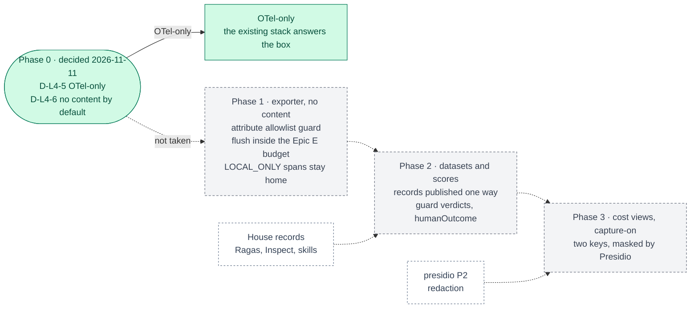

inflect · ai architecture · langfuse · roadmap v1 · 2026-10-29

# Langfuse — LLM tracing, datasets and scores, Layer 4

> **Status: living design** — the integration roadmap for Langfuse, named by
> the target architecture for Layer 4 as "tracing & observability" (the
> diagram pairs it with LlamaIndex; see § Fit for why LlamaIndex is not
> planned). **Phase 0's decision is taken: OTel-only (D-L4-5 and D-L4-6,
> decided by the owner 2026-11-11).** No Langfuse service is run and no
> sub-processor is added. The roadmap is complete once the master's decision
> table and status board record it; that edit is the coordinator's and is
> outstanding (§ Updating the master). The **Current state** section is true today
> (re-verified 2026-11-11 at main 3.365.0, `8733323f`). The **Roadmap** section
> records the decision; Phases 1–3 are kept as the plan if D-L4-5 is reopened. This is a child of
> [`docs/ai-architecture-roadmap.md`](../ai-architecture-roadmap.md): read that
> first for the target map, the global rules **G1–G13**, and the sequencing.
> If the code contradicts a fact here, the code wins and the pull request that
> finds it corrects this document.

## Where it sits in the master roadmap

| | |
| --- | --- |
| Layer · box | 4 — Knowledge & deep RAG · "Langfuse / LlamaIndex (tracing & observability)" |
| Wave | 2 (decision taken 2026-11-11; Phases 1–3 not pursued) |
| Depends on | nothing to deploy; [`presidio.md`](./presidio.md) Phase 1 before any content capture |
| Unblocks | the eval UI for [`ragas.md`](./ragas.md), [`inspect.md`](./inspect.md); per-tenant cost views |
| Owner decisions | **D-L4-5** decided 2026-11-11: OTel-only (no new service, no sub-processor); **D-L4-6** decided 2026-11-11: content capture off by default, three conditions to turn it on |
| Complete at | Phase 0's recorded OTel-only decision (D-L4-5) — decided 2026-11-11; complete when the master records it |

## At a glance

Green: decided or on `main`. Grey dashed: a path not taken, kept as the plan
if D-L4-5 is reopened. Dashed white: another roadmap that path would have used.



## Current state (true today)

- **Observability is OpenTelemetry, and it already carries the agent runs.**
  `src/lib/observability/` (OTel traces + metrics over OTLP/HTTP, off unless
  `OTEL_ENABLED=true`, to `OTEL_EXPORTER_OTLP_ENDPOINT`; Sentry errors, structured
  logging through `log()` / `logger` with AsyncLocalStorage context),
  `traceUsecase` / `traceOperation` spans, the BullMQ worker's `execute <job>`
  spans linked to the `enqueue` span, Epic E's graceful shutdown draining
  audit buffers → OTel → Sentry under per-stage budgets.
- **The AI record of record is not a trace.** Every model call and tool call
  writes an EU AI Act Art 12 row in the decision log
  (`src/app-layer/ai/decision-log/`); human review stamps Art 14; proposals
  pin `policyCardVersion`; `WorkflowRun.costTokens` is charged from per-turn
  usage; the tenant has a monthly token budget (`monthly-budget-policy.ts`)
  and the assistant a spend ceiling (`assistant/spend-ceiling.ts`). Flue's
  telemetry (`flue/telemetry.ts`) is guarded to carry **no content**
  (`tests/guards/flue-telemetry-carries-no-content.test.ts`).
- **Prompts are code, and policy cards are versioned rows.** Prompt text lives
  in modules such as `risk-assessment/prompt-builder.ts`; agent instructions
  are approved, frozen `AgentProfileVersion`s whose hash the resolver
  recomputes; policy cards are pinned per run. There is no prompt registry
  and nothing to migrate one from.
- **Evaluation records are in-house and recomputed from raw answers**
  (`flue/skills/evaluation-record.ts`, `identity-match/evaluation-record.ts`):
  a stored rate is a refusal.
- **No Langfuse, no LlamaIndex** (`package.json`, `src/`), and by D-L4-5
  (2026-11-11) none is planned: Langfuse is not deployed, and no Langfuse
  sub-processor row exists or is proposed.
- **No trace carries prompt or completion text**, and by D-L4-6 (2026-11-11)
  none may until three conditions hold together (§ Phase 0). The only
  content-free telemetry guard today is Flue's; the attribute-allowlist guard
  of Phase 1 would be the second, and is not built because Phase 1 is not
  pursued.
- **The Art 12 decision log is NOT content-free, and is not a trace.**
  `AiDecisionLog.outputSummary` holds the model's own answer text, sanitised
  and cut to 4,000 characters for agentic runs and the assistant
  (`AGENTIC_SUMMARY_MAX` in `src/app-layer/ai/decision-log/index.ts`; 500
  otherwise), written by `flue/model-decision.ts` and
  `tool-runner/model-decision.ts`. It is the record a reader parses back:
  `usecases/audit-workpaper-narrative.ts` reads the narrative answer out of it.
  Only the input is reduced to a digest. So "met by construction" below is
  true of the trace pipeline alone: routing decision-log rows (or
  `outputSummary`) into any trace sink, or exporting them, would put
  completion text there, and needs D-L4-6's three conditions like any other
  content.

## Fit, and what is deliberately not adopted

**What adoption would have bought** (not adopted: D-L4-5 chose OTel-only on
2026-11-11). Langfuse (MIT core) for three things the OTel stack does not have
a UI for: *LLM-shaped traces* (prompt → tool calls → completion with token
counts per generation), *datasets and runs* (the eval sets and their records,
browsable), and *scores* attached to traces. The TypeScript SDK is OTel-native
(a span processor/exporter on the existing OTel pipeline), so there is no
second instrumentation layer — which is the only reason this is cheap enough
to have considered adopting it.

**Not adopted under any option, with the reason.**

- *Prompt management.* A second source of truth for text the product already
  freezes, hashes and approves (profiles, policy cards, pinned prompts). The
  repo's own rule, quoted in `assistant/turn-provider.ts`: "the single most
  expensive mistake available here is building a second one of any of them".
- *Langfuse as the record.* The decision log is the Art 12 record and the
  hash-chained audit trail is the audit record; Langfuse is observability,
  rebuildable and deletable.
- *LlamaIndex.* A Python-first orchestration/RAG framework whose job the
  retriever seam, the knowledge index and the engines already divide between
  them; LlamaIndex.TS would be a third engine. Not planned; recorded here so
  the diagram's pairing is answered.
- *Content capture by default.* Prompts and completions are business content
  (and, for `discovered-agent-review`, a person reference). Traces carry no
  content unless an explicit switch, a tenant residency that permits it, and
  masking are all on (D-L4-6).

**The decision (D-L4-5), as it stood before 2026-11-11.** Langfuse v3 self-hosted needs its own Postgres,
ClickHouse, Redis and S3-compatible store — four more services on one VM.
Langfuse Cloud's EU region removes the weight but is a sub-processor receiving
traces (G2, 30-day notice), and `LOCAL_ONLY` tenants could never be exported
to it. The third option is honest: OTel + the decision log already answer
"what happened and what did it cost"; Langfuse adds the eval/dataset UI.
Phase 0 put the three in front of the owner, and the owner chose OTel-only.

## Roadmap (future direction)

### Phase 0 — Decide hosting and content policy (decided 2026-11-11; master record outstanding)

**The record.** Both decisions were taken by the owner on 2026-11-11 and
relayed to this change by the coordinating session; the owner's initials go in
the master's decision table, which this change does not edit.

- **D-L4-5, decided 2026-11-11: OTel-only.** The existing OpenTelemetry
  pipeline (`src/lib/observability/instrumentation.ts`, OTLP/HTTP traces and
  metrics, drained by Epic E's shutdown under its stage budget), the Art 12
  decision log and the in-house evaluation records answer the box's question —
  what happened, what it cost, and whether it was any good. Langfuse would add
  a browsing UI for LLM-shaped traces, datasets and scores. It would duplicate
  the trace pipeline and, if it were treated as more than a copy, the record.
  Self-hosting it does not fit the VM (the master's capacity budget: ClickHouse
  alone is sized at 8 GiB), and Langfuse Cloud EU would be a sub-processor
  receiving traces that `LOCAL_ONLY` tenants could never use. So: no new
  service, no dependency, no sub-processor row, no notice clock started.
- **D-L4-6, decided 2026-11-11: content capture is off by default.** It
  binds any trace sink, Langfuse or not, now or after a reopening: prompt and
  completion text may enter a trace only when an explicit deployment switch
  is on, **and** the tenant's residency permits the sink, **and** the
  Presidio mask hook ([`presidio.md`](./presidio.md) Phase 2) runs on the
  text first. Absent any one, the span carries ids, counts and verdicts only.
  OTel-only builds no capture switch at all, so today the rule is met by
  construction **for traces**. It is not a statement about the decision log,
  which stores completion text in `outputSummary` (§ Current state): that
  column never feeds a trace sink unless the three conditions hold.
- **Reopening.** D-L4-5 is reopened only by the owner. The trigger worth
  naming: an evaluation roadmap (Ragas, Inspect) finds the committed records
  unreadable without a browsing UI. Because the OTel pipeline is the
  integration point, a later Langfuse is an OTLP destination added to it, not
  a second instrumentation layer; Phases 1–3 below are that plan, unchanged.

**Sub-phases.**
- [x] 0.1 Measure the self-host footprint locally (containers, idle memory);
      record digests (G5). *Not run: OTel-only makes the measurement moot. The
      master's capacity budget already records the published sizing (does not
      fit the VM).*
- [x] 0.2 Write the D-L4-5 memo: self-host / Cloud EU / OTel-only, with the
      sub-processor consequence spelled out for Cloud. *OTel-only, 2026-11-11;
      `docs/implementation-notes/2026-11-11-ai-roadmap-decision-completions.md`.*
- [x] 0.3 Write D-L4-6 into the same note: content capture is off by default;
      on requires `LANGFUSE_CAPTURE_CONTENT=1` **and** tenant
      `aiResidency = EXTERNAL` (for Cloud) **and** the Presidio mask hook.
      *Adopted 2026-11-11, stated for any sink (the switch's name is whatever
      the sink's phase introduces).*
- [x] 0.4 If Cloud: start the four-step process now (the 30 days run in
      parallel with Phase 1). *Not applicable: Cloud was not chosen, and no
      sub-processor process was started.*

**Prompt.**
```text
Context (main 3.338.0): observability is OTel + Sentry (src/lib/observability/) with Epic
E shutdown drain; the AI record is the Art 12 decision log; Flue telemetry carries no
content by guard; prompts/profiles/policy cards are versioned in code or DB. The target
names Langfuse for tracing. Sub-processors follow docs/sub-processor-change-policy.md.

Task: docs/implementation-notes/2026-MM-DD-langfuse-decision.md. (1) Stand Langfuse v3
up locally from its reference Compose; record containers, idle memory, image digests.
(2) Compare three options — self-host, Langfuse Cloud (EU region), OTel-only — on VM
weight, sub-processor consequence, LOCAL_ONLY tenant handling, and what each adds beyond
the decision log. (3) Record D-L4-6: content capture off by default; on only with
LANGFUSE_CAPTURE_CONTENT=1 AND residency permits AND masking. (4) If recommending Cloud,
draft the docs/sub-processors.md row and name the data shared.

Constraints: no code, no dependency. Say plainly what Langfuse adds that OTel + the
decision log do not, and what it duplicates.

Done when: the note exists and the owner has initialled D-L4-5 and D-L4-6.
```

**Hardening.** G2 (the notice clock starts at the decision, not at the
code), G5, G10.

### Phase 1 — Exporter behind a flag, no content

*Not pursued (D-L4-5, OTel-only). Kept as the plan if the owner reopens
D-L4-5.*

**Sub-phases.**
- [ ] 1.1 `src/env.ts`: `LANGFUSE_BASE_URL`, `LANGFUSE_PUBLIC_KEY`,
      `LANGFUSE_SECRET_KEY`, `LANGFUSE_CAPTURE_CONTENT` (default off). Absent
      URL = nothing registered (G9).
- [ ] 1.2 Register the Langfuse OTel span processor in
      `src/instrumentation.ts::register()` beside the existing exporters, and
      add its flush to `shutdownTelemetry` under the OTel stage budget (Epic E
      — a slow exporter never blocks the drain).
- [ ] 1.3 Attribute allowlist: `tenantId`, `runId`, `agentId`, `driver`,
      `model`, token counts, guard verdicts, decision-log row ids — **never**
      prompt or completion text while `LANGFUSE_CAPTURE_CONTENT` is off. A
      guard in the style of `flue-telemetry-carries-no-content` asserts the
      exporter's attribute set.
- [ ] 1.4 If self-hosted: Compose services, digest-pinned, no published port;
      `caddy` routes the Langfuse UI only behind the operator's own auth.
- [ ] 1.5 Sub-processor row (Cloud) or in-deployment row (self-host).

**Prompt.**
```text
Context (main 3.338.0): OTel is initialised in src/instrumentation.ts::register() and
drained by installShutdownHandlers() with per-stage budgets (src/lib/observability/
shutdown-budget.ts); tests/guards/flue-telemetry-carries-no-content.test.ts is the
pattern for "telemetry carries no content". Phase 0 chose the hosting option.

Task: add Langfuse tracing with no content. (1) LANGFUSE_BASE_URL / PUBLIC_KEY /
SECRET_KEY / LANGFUSE_CAPTURE_CONTENT (default off) in src/env.ts; absent URL = nothing
registered. (2) Register the Langfuse OTel span processor in register(); add its flush
to shutdownTelemetry under the existing OTel stage budget. (3) An attribute allowlist
module src/lib/observability/langfuse-attributes.ts and a guard asserting no prompt/
completion attribute is exported while capture is off. (4) Self-host: Compose services
digest-pinned, UI behind operator auth; Cloud: the sub-processor row already approved.
(5) Decision-log row id as a trace attribute so a trace links to its Art 12 record.

Constraints: the decision log remains the record; Langfuse is deletable. LOCAL_ONLY
tenants' spans are exported ONLY to a self-hosted instance (assert in the processor:
drop the span otherwise, with a counter). Keys are secrets in .env.prod.

Done when: a Flue run appears as a trace with tokens and guard verdicts and no text;
the drain completes within budget with Langfuse unreachable; the content guard is green.
```

**Hardening.** G1 (LOCAL_ONLY spans never leave), G4-adjacent (no content),
Epic E (bounded flush), G9. The attribute allowlist is a *guard*, not a
convention: the day a developer adds `input` to a span attribute is the day a
tenant's policy text lands in a trace store.

### Phase 2 — Datasets and scores from the house records

*Not pursued (D-L4-5, OTel-only).*

**Sub-phases.**
- [ ] 2.1 A job `evals-publish` (G8) that pushes each committed evaluation
      record (skills, RAG, parse, Inspect) to Langfuse as a dataset run with
      per-item scores — **the record stays the source**; Langfuse holds a copy.
- [ ] 2.2 Scores on live traces from the review latch (guard verdicts) and
      from human review outcomes (Art 14 `humanOutcome`), as numeric scores
      with the decision-log id — so "do these approvals mean anything?"
      (`/agents/review-quality`) has a trace-level view too.
- [ ] 2.3 No score may be *entered* in Langfuse and read back as a fact; the
      TS validators recompute from raw answers (G11).

**Prompt.**
```text
Context (main 3.338.0 + Phase 1): evaluation records exist in the house shape (set +
raw answers + model revision; aggregates recomputed) for skills and, after ragas.md,
for RAG; human review outcomes are Art 14 stamps on decision-log rows; the review-quality
surface asks whether approvals mean anything.

Task: publish records as Langfuse datasets/runs and attach scores. (1) Job evals-publish:
for each committed record, upsert a dataset (keyed by set hash) and a run (keyed by
model/retriever revision) with per-item scores; idempotent. (2) On the live trace,
attach guard verdicts (review latch) and humanOutcome as scores, with the decision-log
id. (3) Nothing reads a score back from Langfuse into product state.

Constraints: worker only; Langfuse unreachable = skipped with a counter, never a failed
run. Dataset items carry case ids and expectations, never customer content (records are
built on seed/fixture sets by rule).

Done when: a skill's evaluation record is browsable as a dataset run, and a reviewed
proposal's trace shows its humanOutcome score.
```

**Hardening.** G11 (copies, not sources), G8, G9. The one-way arrow —
records → Langfuse, never back — is what keeps the eval gate honest.

### Phase 3 — Cost and quality views on `/agents/reports`

*Not pursued as a Langfuse phase (D-L4-5, OTel-only). 3.1's per-tenant spend
view reads the product's own metrics and needs no Langfuse; if it is wanted, it
belongs to the agent reports, not to this roadmap.*

**Sub-phases.**
- [ ] 3.1 Per-tenant token spend by agent/model/driver read from the product's
      own metrics (not from Langfuse) and shown on `/agents/reports`; Langfuse
      links out per run for operators.
- [ ] 3.2 Capture-on mode for EXTERNAL tenants with the Presidio mask hook
      ([`presidio.md`](./presidio.md) Phase 2), behind D-L4-6's three
      conditions; a tenant-level switch in `TenantSecuritySettings`
      (`aiTraceCapture`), default off, two keys (G9).

**Hardening.** G9 (two keys), G1, G2 (capture-on with Cloud changes the data
category on the sub-processor row — same diff).

## Evals for this framework

None run: with OTel-only there is no exporter to evaluate. The table is the
plan's, and applies if D-L4-5 is reopened.

| What | How |
| --- | --- |
| No-content invariant | guard on the exporter's attribute set (Phase 1) |
| Drain budget | shutdown test with Langfuse unreachable |
| Residency | "LOCAL_ONLY spans never reach a non-self-hosted sink" unit test |
| Usefulness | the eval UI is what Phases 2–3 of the other roadmaps use; if nobody opens it in a quarter, D-L4-5 is revisited |

## Updating the master

Outstanding, and the coordinator's to do (this change does not edit the
master, whose Langfuse row still reads "missing" and whose D-L4-5 row still
shows "self-host if the VM bears it" as the default-if-undecided). Write:

- **Status board**, Langfuse row, current-state column: "complete — OTel-only
  (D-L4-5, 2026-11-11); content capture off by default (D-L4-6)", linking the
  implementation note.
- **Decisions for the owner**, D-L4-5: "**decided 2026-11-11** (owner):
  OTel-only"; D-L4-6: "**decided 2026-11-11** (owner): adopt", each in place
  of the default-if-undecided text.

Once both read so, the roadmap is complete. The diagram's box is answered by
the existing stack, which is a legitimate outcome of a roadmap.
