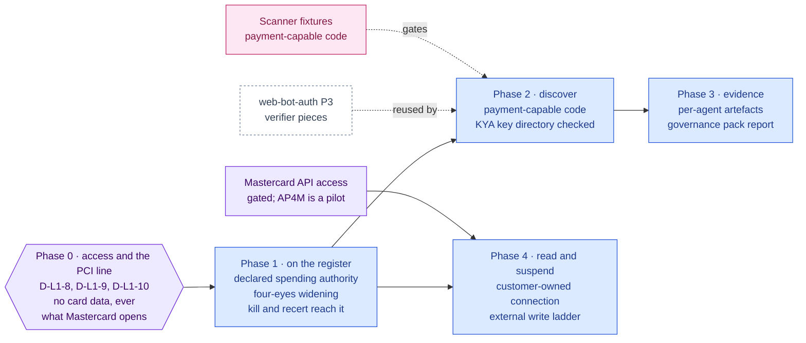

inflect · ai architecture · mastercard agent pay · roadmap v1 · 2026-10-30

# Mastercard Agent Pay — spending authority as a governed agent privilege, Layer 1

> **Status: living design** — the integration roadmap for Mastercard Agent Pay,
> Mastercard's framework for AI agents that pay. It is an **addition to the v6
> target**, requested by the owner on 2026-10-30: the blueprint names no such
> box. The **Current state** section is true today (main 3.340.0,
> `c08922f3c`). The **Roadmap** section is the plan. This is a child of
> [`docs/ai-architecture-roadmap.md`](../ai-architecture-roadmap.md): read that
> first for the target map, the global rules **G1–G13**, and the sequencing.
> It extends the agentic IAM subsystem, so every phase also obeys the rules in
> [`docs/agentic-iam-roadmap.md`](../agentic-iam-roadmap.md). If the code
> contradicts a fact here, the code wins and the pull request that finds it
> corrects this document.

## Where it sits in the master roadmap

| | |
| --- | --- |
| Layer · box | 1 — Security, guards & alignment · an added box, "Mastercard Agent Pay" (spending authority as a governed privilege) |
| Wave | 2 for Phases 0–1 (data only, no Mastercard call); 3 for Phases 2–3; 4 for Phase 4, conditional on API access |
| Depends on | nothing for Phases 0–1; Phase 2's key-directory check reuses [`web-bot-auth.md`](./web-bot-auth.md) Phase 3's verifier; Phase 4 needs Mastercard API access, which is gated |
| Unblocks | a register that knows which agents can spend money; recertification and kill switch that reach spending authority; evidence for agent payments against the library's controls |
| Owner decisions | **D-L1-8** (Inflect never holds a payment credential and its own agents never pay), **D-L1-9** (spending authority is a declared, reviewed privilege on the register), **D-L1-10** (reading and suspending at Mastercard only through a customer-owned connection on the external write ladder, once access exists) |
| Complete at | Phase 3. Phase 4 follows when Mastercard grants API access; it is not Layer 5 and completeness does not wait for it |

## At a glance

Purple hexagon: the Phase 0 decision. Blue: a phase not yet on `main`; it turns green (`done`) in the pull request that meets its "done when". Purple box: a condition outside the code. Dashed: another roadmap this one waits on. Pink: the evaluation record.



## Current state (true today)

### Agent Pay, as read on 2026-10-30

Read from public sources through search. Most of what is public about the
APIs comes from secondary explainers, not from Mastercard's developer
documentation, so **Phase 0.1 confirms every API fact before any is built
on**.

- **What it is.** Mastercard's framework, launched in April 2025, for AI agents
  that pay on a cardholder's behalf. An agent must be **registered and
  verified** before it may transact ("Know Your Agent"). It then pays with an
  **Agentic Token**: a network token from Mastercard's tokenization service,
  bound to one agent, one consent policy and a merchant scope. The
  cardholder sets the limits within which the agent may pay.
- **Agent identity at the merchant is Web Bot Auth.** The Agent Pay
  Acceptance Framework (announced with Cloudflare in October 2025) has the
  agent sign its merchant traffic under HTTP Message Signatures, and the
  merchant checks it against the registered key. A secondary source reports
  that Mastercard's tag differs from the IETF draft's `web-bot-auth`; Phase
  0.1 confirms it. American Express and Visa (Trusted Agent Protocol) build
  on the same layer.
- **Consumer intent.** Mastercard's "Verifiable Intent" is a signed record of
  what the person authorised: an amount range, the allowed merchants, a total
  budget. A single secondary source reports it was contributed to a FIDO
  Alliance working group in April 2026, alongside Google's AP2.
- **Access is gated.** Issuers and agent platforms work through Mastercard
  Developers; merchants usually inherit acceptance from their acquirer. No
  self-serve Agent Pay API was found.
- **Agent Pay for Machines (AP4M).** Early access opened on 2026-10-20: buyer-
  and seller-side APIs, a toolkit and a sandbox, built on the x402 payment
  protocol. Mastercard describes it as a pilot, not commercially available,
  with sign-up for the pilot.
- **The Mastercard Developers Agent Toolkit** (an MCP server, npm
  `@mastercard/developers-agent-toolkit` 0.1.6) serves Mastercard's
  documentation to coding agents. It does not make payments and is not an
  Agent Pay integration.

### What Inflect has today

- **No payment concept for agents.** "Spend" in `src/lib/agentic/` means the
  product's own model spend (`monthly-budget-policy.ts`) and action budgets
  on the policy card (`AgentPolicyCardVersion.maxActionsPerRun` / `PerDay`).
  Nothing records that an agent can move money.
- **The agentic IAM subsystem has every surface this needs**, and none of them
  knows about payment:
  - the register (`RegisteredAgent`, owner, status, activation preconditions
    in `assertActivatable`);
  - the harness scanner and ingest (`inflect-agent-harness/3`; the `code`
    source recognises only LangChain, LangGraph and the Claude Agent SDK, by
    `FRAMEWORK_MARKERS`);
  - agent recertification (`AccessReviewScope.AGENT`, packs, narrowings);
  - the kill switch (platform, tenant and agent scopes) and the owner-orphan
    pass;
  - per-agent evidence (`AGENT_ACTION_RECEIPTS_PER_AGENT` and its sibling);
  - the external write ladder on integration connections
    (`IntegrationConnection.externalWriteMode`, DISABLED → DRY_RUN →
    PROPOSE_ONLY → AUTOMATIC), whose worked example is the Entra
    service-principal disable on its own endpoint.
- **No integration provider for Mastercard** in
  `src/app-layer/integrations/providers/`.
- **The product's own agents cannot pay.** No funnel tool initiates a
  payment, the Tool Runner's client sends Messages calls only, and Inflect
  bills its own customers through Stripe.
- **No PCI DSS framework in the library** (`src/data/libraries/`). The nearest
  frameworks are `owasp-agentic-top10`, `eu-ai-act`, `dora`, `soc2` and
  `aiuc-1`.
- **No card data anywhere**: Inflect is outside PCI DSS cardholder-data scope
  today, and D-L1-8 keeps it there.

## Fit, and what is deliberately not adopted

Agent Pay offers three roles. Inflect takes one.

**Adopted: the governor of agents that pay.** Inflect's tenants will run
agents that hold Agentic Tokens or AP4M budgets. Spending authority is the
most consequential privilege an agent can hold, and the register is where a
privilege belongs. So Inflect makes it:
- *declared*, on the register, as an envelope: rail, per-transaction limit,
  period budget, merchant scope, expiry, the person who consented, and the
  agent platform that holds the token;
- *discovered* when the register does not know it, from code the harness
  already reads;
- *reviewed*, with four eyes on any widening, in every agent
  recertification;
- *stopped* by the kill switch and the owner-orphan pass, first as a task
  for a person, later through Mastercard itself;
- *evidenced*, per agent per month, against controls the library holds.

**Not adopted: payer.** Inflect's own agents never hold spending authority
(D-L1-8). Paying would make Inflect a registered agent operator under Know
Your Agent, put payment credentials in its custody, and give a model a way to
move a customer's money through the product. If a feature ever needs Inflect
to buy something, it is a separate decision with its own roadmap.

**Not adopted: merchant.** Inflect bills through Stripe, and no customer has
asked to let agents buy subscriptions. Accepting agent payments would be a
change to billing, not to governance.

**The PCI line (D-L1-8).** Inflect never stores, processes or transmits a
PAN, an Agentic Token value, a wallet key or a payment credential of any
kind. It records references (the token requestor's own token reference, the
agent platform's name) and the envelope. That keeps Inflect outside PCI DSS
cardholder-data scope, which is worth more than any feature here. The
harness contract already refuses a credential-shaped value
(`firstSecretShapedMember`); Phase 0 adds a card-number shape (a 13–19 digit
run that passes the Luhn check) to it and to the register's writer.

**Not adopted, with the reason.**

- *A payment tool in the funnel.* The funnel decides what the product's
  agents may do. Adding a pay verb there would be the payer role by another
  name.
- *Mirroring the cardholder's consent into Inflect as authority.* Inflect
  records the envelope as a declaration to review, not as a grant it
  enforces at payment time. Mastercard and the issuer enforce the token's
  limits; Inflect's job is to know them, check them and stop them.
- *The Developers Agent Toolkit.* It serves documentation to coding agents.
  It is a contributor's tool, not a product integration.
- *A PCI DSS library framework, by default.* The PCI SSC publishes the
  standard under its own licence; adding it is a content and licensing
  decision (Phase 0.4), not a by-product of this roadmap.

## Roadmap (future direction)

### Phase 0 — Access, scope and the PCI line

**Sub-phases.**
- [ ] 0.1 Confirm what Mastercard actually offers a governance tool, from its
      own documentation and a conversation with Mastercard Developers: the
      Agent Pay APIs open to an agent platform (token status, consent
      policy, suspension), whether a third party acting for the token
      requestor can be authorised, the AP4M early-access terms, the
      authentication scheme, and the Web Bot Auth tag and directory location
      Agent Pay uses. Record each answer, and each "not available", in the
      implementation note.
- [ ] 0.2 D-L1-8 initialled: no payment credential in Inflect's custody, no
      payment initiated by its agents. Add the card-number shape (13–19
      digits passing Luhn) to `firstSecretShapedMember` and to every writer
      Phase 1 adds, with a test per writer.
- [ ] 0.3 D-L1-9 initialled, with the envelope's fields: rail (`AGENT_PAY_TOKEN`,
      `AP4M`, `OTHER`), per-transaction limit and currency, period budget and
      period, merchant scope (domains, merchant category codes), expiry, the
      consenting person (a member of the tenant), the token requestor (agent
      platform) and its token reference. No field may carry a credential.
- [ ] 0.4 Framework mapping: which requirements in the existing library the
      Phase 3 evidence is filed against (candidates: OWASP agentic ASI03 and
      ASI02, EU AI Act Article 14, SOC 2 CC6, DORA, AIUC-1), and whether a
      PCI DSS library is wanted at all (default: no).
- [ ] 0.5 D-L1-10 initialled, with the trigger for Phase 4: written API
      access for at least one tenant's token requestor, plus a sandbox.

**Prompt.**
```text
Context (main 3.340.0): the agentic IAM subsystem has a register (RegisteredAgent,
assertActivatable), a harness scanner (inflect-agent-harness/3; the code source knows
LangChain, LangGraph and the Claude Agent SDK by FRAMEWORK_MARKERS), agent
recertification, a kill switch, per-agent evidence and an external write ladder on
IntegrationConnection.externalWriteMode. Nothing records that an agent can pay. No
card data exists anywhere in the product. The library has no PCI DSS framework.
Mastercard Agent Pay gives registered agents Agentic Tokens (network tokens bound to an
agent, a consent policy and a merchant scope); API access is gated; Agent Pay for
Machines (x402) has been in pilot since 2026-10-20.

Task: Phase 0 of docs/ai-architecture/mastercard-agent-pay.md. (1) Write
docs/implementation-notes/2026-MM-DD-agent-pay-decisions.md recording what
Mastercard's own documentation says is available to a governance tool (token status,
consent policy, suspension, third-party authorisation, AP4M terms, authentication,
the Web Bot Auth tag and directory), each answer sourced, each gap stated. (2) Record
D-L1-8/9/10 as initialled and the envelope's field list. (3) Extend
firstSecretShapedMember with a card-number shape (13-19 digits passing Luhn), with
tests that a harness report carrying one is refused and that ordinary numeric fields
(limits, MCCs, budgets) are not. (4) Record the framework mapping for Phase 3.

Constraints: no Mastercard API is called; no payment credential is requested, stored
or logged; the product's own agents get no payment capability.

Done when: the note answers 0.1 from primary sources and the card-number refusal is
tested.
```

**Hardening.** D-L1-8 (the PCI line is held by a refusal in code, not by a
sentence), G10 (the decisions live in a dated note), G2 (the note decides
whether any later Mastercard call makes Mastercard a sub-processor or is the
customer's own connection, the way directory integrations are).

### Phase 1 — Spending authority on the register

**Sub-phases.**
- [ ] 1.1 `AgentSpendingAuthority`, tenant-scoped with RLS and a two-tenant
      test (G7): one row per agent per rail, the envelope from 0.3, `status`
      (`DECLARED`, `REVIEWED`, `SUSPENDED_REQUESTED`, `WITHDRAWN`), and who
      declared and who reviewed it. One writer usecase,
      `usecases/agent-spending-authority.ts`, under `admin.agent_registry`,
      held by a single-write-seam guard.
- [ ] 1.2 Four eyes: declaring an envelope or widening any field of it needs a
      second person to review it, never the declarer and never the agent's
      owner (the profile-approval and recertification precedents). A CHECK
      backs the usecase. Narrowing needs one person.
- [ ] 1.3 Activation: `assertActivatable` refuses `SPENDING_AUTHORITY_UNREVIEWED`
      for an agent with a declared envelope nobody has reviewed. A later
      widening on an ACTIVE agent raises a HIGH finding rather than
      suspending it (the auditor-independence precedent: a later break is a
      finding, not a refusal).
- [ ] 1.4 Recertification: an AGENT campaign's pack gains a spending-authority
      section, and a narrowing may propose reducing or withdrawing the
      envelope. Accepting it writes the declaration and opens a task for the
      owner to apply the change at the token requestor, because Inflect
      cannot apply it until Phase 4.
- [ ] 1.5 Kill switch and owner-orphan pass: engaging an AGENT-scope kill, or
      containing an orphaned agent, on an agent with spending authority
      moves the row to `SUSPENDED_REQUESTED` and opens a task naming the
      token requestor and the token reference. Lifting the kill does not
      reverse it; a person does.
- [ ] 1.6 Retention classification in `docs/data-retention.md` (the ratchet
      requires it) and an inventory row in the governance pack.

**Prompt.**
```text
Context (main 3.340.0 + Phase 0): D-L1-8/9 and the envelope fields are recorded; the
register's activation preconditions live in assertActivatable; agent recertification
packs and narrowings live in usecases/access-review-agent.ts; the kill switch and
owner-orphan pass engage AGENT-scope kills; single-write-seam guards hold each table's
writer; every tenant table needs RLS and a two-tenant test.

Task: Phase 1. (1) AgentSpendingAuthority in prisma/schema/agentic.prisma with RLS,
tenantId-leading indexes and a two-tenant behavioural test. (2)
usecases/agent-spending-authority.ts, the only writer, under admin.agent_registry:
declare, widen, narrow, review, withdraw; widening and declaring need a reviewer who is
neither the declarer nor the agent's owner (usecase + CHECK); every value passes the
card-number refusal. (3) assertActivatable refuses SPENDING_AUTHORITY_UNREVIEWED; a
widening on an ACTIVE agent raises a HIGH finding. (4) Recertification pack section and
a narrowing that proposes a reduction and opens a task. (5) An AGENT-scope kill or an
orphan containment sets SUSPENDED_REQUESTED and opens a task naming the token requestor.
(6) docs/data-retention.md row; single-write-seam guard entry.

Constraints: no Mastercard call; no credential field; the envelope is a declaration to
review, never a grant Inflect enforces at payment time.

Done when: an agent with an unreviewed envelope cannot be activated, and killing it
opens the suspension task, both proved by tests.
```

**Hardening.** G7 (RLS and the two-tenant test), G10 (single writer guarded;
four eyes held twice), D-L1-8 (card-number refusal on every writer), the
agentic IAM rule that a later break is a finding.

### Phase 2 — Discover payment capability the register does not know

**Sub-phases.**
- [ ] 2.1 The `code` source recognises Agent Pay and x402 client libraries,
      by package names confirmed in 0.1, added to `FRAMEWORK_MARKERS`. The
      fact is "this agent's code can initiate a payment", NOT MET only, as
      the Agent SDK mapping is: code shows a capability and never that a
      control works. An unresolved import is `UNPARSEABLE`, never dropped.
- [ ] 2.2 A new fact needs a new contract id: `inflect-agent-harness/4` is
      `/3` plus the payment-capability fact and nothing else, a strict schema
      beside the others, produced by the reference scanner and the fake
      scanner.
- [ ] 2.3 The pure planner raises `SPENDING_AGENT_UNDECLARED` when a scan
      links a payment-capable agent to a register row with no envelope, and
      closes it only on positive evidence: an envelope reviewed, or a
      complete `code` read that no longer shows the capability.
- [ ] 2.4 Know Your Agent cross-check: the register records the agent's Web
      Bot Auth key directory URL; Inflect fetches and validates it with
      [`web-bot-auth.md`](./web-bot-auth.md) Phase 3's verifier pieces
      (`safeFetch`, cached, capped) and records whether it is valid and which
      key ids it holds. An invalid or unreachable directory on an agent with
      spending authority is a finding, `AGENT_SIGNING_DIRECTORY_INVALID`.
- [ ] 2.5 Fixtures: synthetic repositories that pay through each recognised
      library, one that imports and never calls, and one that hides the
      import behind a variable. Their expected facts are an evaluation
      record (G11).

**Prompt.**
```text
Context (main 3.340.0 + Phase 1): AgentSpendingAuthority exists; the reference scanner's
code source parses statically (sources/code/), recognises frameworks by FRAMEWORK_MARKERS
and reports NOT-MET-only facts; the ingest verifies a report against the strict schema of
the id it names; harness findings are planned in src/lib/agentic/harness-findings.ts;
web-bot-auth Phase 3 provides verify.ts and a cached safeFetch directory reader.

Task: Phase 2. (1) Add the Agent Pay and x402 client packages named in the Phase 0
note to FRAMEWORK_MARKERS; report a payment-capability fact, NOT MET only, UNPARSEABLE
when unresolved. (2) inflect-agent-harness/4 = /3 + that fact, a new strict schema;
the reference and fake scanners produce it. (3) Planner: SPENDING_AGENT_UNDECLARED opens
on a linked agent with the capability and no envelope; closes only on a reviewed
envelope or a complete code read without the capability. (4) Register field for the
agent's key directory URL; validation through web-bot-auth's verifier pieces;
AGENT_SIGNING_DIRECTORY_INVALID finding. (5) Synthetic fixtures and an evaluation
record of the expected facts.

Constraints: the scanner never runs scanned code; a report naming /4 must not be read
by the /3 schema; the directory URL is fetched through safeFetch only, with the cache.

Done when: the fixtures' record passes and a payment-capable agent with no envelope
raises the finding end to end.
```

**Hardening.** The harness contract rules (a new fact is a new strict id;
code counts only against an agent; closes on positive evidence only), G6
(the directory URL is tenant-entered), G11 (the fixtures are a record).

### Phase 3 — Evidence and the governance pack

**Sub-phases.**
- [ ] 3.1 A per-agent evidence kind, `AGENT_SPENDING_AUTHORITY_PER_AGENT`,
      one artefact per agent per month on the controls 0.4 chose: the
      envelope as declared, its reviews, findings and kill events. It
      follows the per-agent evidence rules (#3700): a per-agent kind, not an
      agent column on a tenant-wide kind; nothing written CURRENT for a
      retired agent.
- [ ] 3.2 The governance pack gains a report: agents with spending authority,
      by rail, with each envelope's last review and any open finding.
      "None" is reported as a count of zero with its basis, never as a clean
      bill when the scan behind it was incomplete.
- [ ] 3.3 The recertification evidence hash covers the spending-authority
      section, so an auditor can recompute it from stored rows.

**Hardening.** The per-agent evidence rules, zero is never complete
(invariant 5 of the recertification section), G11.

### Phase 4 — Read and suspend through Mastercard (conditional)

Starts only when 0.5's trigger is met. Until then, Phases 1–3 deliver the
whole governance value with a person applying changes at the token
requestor.

**Sub-phases.**
- [ ] 4.1 Provider `mastercard-agent-pay`: a customer-owned integration
      connection holding the token requestor's API credentials, encrypted
      under the tenant's DEK (Epic B), never logged. The API hosts are code
      constants (sandbox and production), never tenant-writable (G6).
- [ ] 4.2 Read first: token status and consent policy for each declared
      envelope's token reference. `SPENDING_ENVELOPE_DRIFT` opens when the
      observed envelope is wider than the declared one, and closes only on a
      complete read that agrees.
- [ ] 4.3 Suspend through the external write ladder, on its own connection
      and endpoint (the Entra service-principal disable is the pattern):
      DISABLED reads nothing; DRY_RUN records intent; PROPOSE_ONLY opens a
      proposal a person approves; AUTOMATIC suspends on an AGENT-scope kill
      or an orphan containment. A 2xx is `ACCEPTED`, never `APPLIED`, until
      a read confirms the token is suspended.
- [ ] 4.4 The suspension is not reversed by lifting the kill; resuming a
      token is a person's act at the token requestor, as re-enabling a
      disabled account is in the JML subsystem.

**Hardening.** G2 (the connection's classification from 0.1), G6, G9 (two
keys: the deployment's provider switch and the connection's rung), the
external write ladder's rules (its own rung, accepted-not-applied,
`INDETERMINATE` on an ambiguous answer), D-L1-8 (the connection holds API
credentials, never payment credentials).

## Evals for this framework

| What | How | Record |
| --- | --- | --- |
| The PCI line | card-number shapes refused by the harness contract and every writer; ordinary numbers accepted | CI |
| Register rules | four eyes on widening; activation refusal; kill opens the suspension task; two-tenant isolation | CI |
| Discovery | synthetic repositories per recognised library, including the evasions | scanner fixture record (G11), gates Phase 2 |
| Key directory | valid, invalid and unreachable directories through the web-bot-auth verifier | CI |
| Mastercard contract | sandbox contract tests for read and suspend, recorded per API version | Phase 4 record |

## Updating the master

Flip the row on the master [Status board](../ai-architecture-roadmap.md#status-board)
per phase; D-L1-8, D-L1-9 and D-L1-10 in the decision table. When Phase 1
lands, the master's Layer 1 current-state paragraph says the register records
spending authority; when Phase 4 lands, the Agent Pay node in **The target,
with status** turns green.

## Sources read

Read on 2026-10-30 through search, pending Phase 0.1's reading of
Mastercard's own documentation:

- [Mastercard Agent Pay](https://www.mastercard.com/us/en/business/artificial-intelligence/mastercard-agent-pay.html)
  and [the agentic token framework](https://www.mastercard.com/us/en/news-and-trends/stories/2025/agentic-commerce-framework.html)
- [Mastercard Developers: agentic commerce guide, Level 1](https://developer.mastercard.com/merchant-cloud/documentation/tutorials-and-guides/agentic-commerce-guide/21/)
- [Mastercard: Agent Pay for Machines in action](https://www.mastercard.com/global/en/news-and-trends/press/2026/october/Mastercard-Agent-Pay-for-Machines-in-action.html)
- [Cloudflare blog: securing agentic commerce with Visa and Mastercard](https://blog.cloudflare.com/secure-agentic-commerce/)
- [Mastercard Developers Agent Toolkit](https://developer.mastercard.com/platform/documentation/agent-toolkit/)
