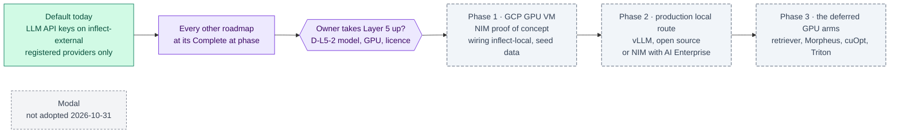

inflect · ai architecture · layer 5 · roadmap v2 · 2026-10-31

# Layer 5 — optional, and taken up only after every other roadmap is complete

> **Status: living design** — the roadmap for Layer 5 (runtime and
> infrastructure for self-hosted models) after the owner's decisions of
> 2026-10-31: model usage goes through **LLM API keys** on the existing external
> route by default; there is **no self-hosting now**, and Modal is not adopted;
> Layer 5 is **outside the completeness target** and is taken up, if ever, only
> after every other roadmap has reached its "Complete at" phase. The filename
> is kept so existing links stay stable (the `langflow.md` precedent). The
> **Current state** section is true today (main 3.340.0, `c08922f3c`); the
> **Roadmap** section records what is planned if Layer 5 is taken up. This is
> a child of [`docs/ai-architecture-roadmap.md`](../ai-architecture-roadmap.md):
> read its "Layer 5 is optional by construction" section and the global rules
> **G1–G13** first. If the code contradicts a fact here, the code wins and the
> pull request that finds it corrects this document.

## Where it sits in the master roadmap

| | |
| --- | --- |
| Layer · box | 5 — Runtime & infrastructure (the blueprint's "NVIDIA NIM" and "vLLM"); also every GPU arm the other roadmaps defer: [`nemotron-reasoning.md`](./nemotron-reasoning.md) Phases 0 and 2, [`nemotron-retriever.md`](./nemotron-retriever.md) Phase 3, [`morpheus.md`](./morpheus.md) Phase 2, [`cuopt.md`](./cuopt.md) Phase 2, [`triton.md`](./triton.md) |
| Wave | Optional, after completion: it starts only when every other roadmap has reached its "Complete at" phase, and only if the owner takes it up |
| Depends on | every other roadmap complete; an owner decision to take Layer 5 up |
| Unblocks | nothing on the completeness path, by design |
| Owner decisions | **D-L5-1** decided 2026-10-31 (API keys by default; no self-hosting now; Modal not adopted; Layer 5 optional and last); **D-L5-2** and **D-L5-3** deferred until Layer 5 is taken up |
| Complete at | Not part of completeness |

## At a glance

Green: on `main`. Purple: a decision. Slate dashed: optional Layer 5 work, which starts only after every other roadmap is complete. Grey dashed: declined.



## Current state (true today)

- **There are two model routes, and both are residency-named.**
  `src/lib/agentic/flue/model-selection.ts` resolves a `"<provider-id>/<model>"`
  specifier whose id is `inflect-external` (Anthropic direct via
  `ANTHROPIC_API_KEY`, or OpenRouter) or `inflect-local` (`AI_LOCAL_BASE_URL`,
  an OpenAI-compatible endpoint inside the operator's perimeter; a tenant's
  stored `aiLocalBaseUrl` is honoured only when it names that same gateway,
  `src/lib/ai/local-gateway.ts`, #4545). `flue/providers.ts` registers a
  provider only when its credential exists, the socket boundary re-checks the
  specifier, and the Tool Runner's `clientForRun` refuses a `LOCAL_ONLY` tenant
  before anything external is read.
- **The external route is the API-key route, and the register bounds it.**
  `docs/sub-processors.md` lists Anthropic (posture summary, risk suggestions,
  agent runs on Flue and the Tool Runner, for `EXTERNAL` tenants) and
  OpenRouter (risk suggestions only). Each receives only what its row names.
- **Nothing serves the local route.** The register records that the
  operator-run Laya estate was retired on 2026-10-14 and that no local
  alternative has replaced it. A `LOCAL_ONLY` tenant's model-backed features
  are refused rather than sent elsewhere.
- **No GPU anywhere.** Production is one Google Cloud VM with eight Compose
  services, plus a small VM for the OpenShell gateway under a 5 USD/month cap.
- **Modal is not a dependency, a service or a sub-processor row**, and no
  `inflect-hosted` provider id exists.

## The decision (D-L5-1, owner, 2026-10-31)

1. **Default model usage is LLM API keys** on `inflect-external`, through the
   providers already on the register. A new provider, or a new kind of data
   for an existing one, is a register change under G2 before any byte moves.
2. **No self-hosting now.** No Modal, no GPU VM, no NIM container, no vLLM
   deployment, and no `inflect-hosted` provider id.
3. **Layer 5 is optional and last.** "Complete" for the AI architecture
   roadmap means every other roadmap at its "Complete at" phase. Layer 5 is
   taken up after that, or never.

**What follows from it.**

- **Every model call for an `EXTERNAL` tenant goes to a registered external
  provider.** Presidio's egress redaction ([`presidio.md`](./presidio.md))
  becomes the main control on what those calls carry.
- **`LOCAL_ONLY` tenants keep no model route** until Layer 5, or another
  operator-run local gateway, is configured. Their model-backed features stay
  refused, which is how they behave today.
- **The GPU arms the other roadmaps planned are deferred with this layer**:
  Nemotron as the worker, the retriever's GPU arm, Morpheus's GPU scoring,
  cuOpt on a GPU and Triton. Each roadmap states what it completes without
  them.

**Not adopted, with the reason.**

- *Modal.* A serverless GPU vendor: a sub-processor processing prompts outside
  the perimeter, on a platform nobody else can run. The owner chose against an
  external GPU vendor on 2026-10-31.
- *The `inflect-hosted` provider id.* It existed only to keep Modal apart from
  the local route. A GPU in the operator's own Google Cloud project would be
  the local route.
- *NIM in production.* NIM is free under the NVIDIA Developer Program for
  development, testing and research on up to 16 GPUs; serving real users
  needs an NVIDIA AI Enterprise licence. It is also not an open-source
  framework (G13).

## Roadmap (future direction)

Nothing here starts until every other roadmap is complete and the owner takes
Layer 5 up. The phases record the candidate the owner named on 2026-10-31, so
the work does not have to be re-planned from nothing.

### Phase 0 — Take it up, or not

**Sub-phases.**
- [ ] 0.1 The owner decides whether a local model route is wanted, and for
      whom: `LOCAL_ONLY` tenants who have no model today, a cheaper worker
      role, or the deferred GPU arms.
- [ ] 0.2 D-L5-2: the model and its licence (Nemotron 3 Super, 120B with 12B
      active, is under the NVIDIA Nemotron Open Model License, which permits
      commercial use but is not an OSI licence; Apache-2.0 alternatives exist),
      the GPU shape (NVIDIA lists three H100-, B200- or RTX PRO 6000-class
      GPUs for a self-hosted Super NIM; Nemotron 3 Nano fits one GPU and proves
      the same wiring), the zone and its GPU quota, and the cost per hour.
- [ ] 0.3 Re-read every fact above at the time: model versions, licences and
      GPU support matrices move.

**Done when.** The decision is recorded, either way, with the reasons.

### Phase 1 — A NIM proof of concept on a Google Cloud GPU VM

**Sub-phases.**
- [ ] 1.1 `deploy/gpu-poc/`: create, start, stop and delete scripts for one
      GPU VM in the existing Google Cloud project; the NIM image pinned by
      digest; the NGC key on the VM only, never in the repository; firewall
      open only to the environment's app host; an idle auto-stop and a budget
      alert.
- [ ] 1.2 Wire it through the existing local route in a non-production
      environment (`AI_LOCAL_BASE_URL`, `AI_LOCAL_MODEL`, `AI_LOCAL_API_KEY`),
      on seed tenants only, which the Developer Program terms require.
- [ ] 1.3 Prove, with tests and a recorded checklist: a `LOCAL_ONLY` seed
      tenant resolves to `inflect-local`; the per-tenant gateway rule refuses
      any other host; tool calls round-trip; the guard sandwich and decision-log
      rows are written; the kill switch and caps run before each model call; a
      stopped VM yields a named refusal, never a silent fallback to an external
      provider for a `LOCAL_ONLY` tenant.
- [ ] 1.4 The report: latency, cold start after a stop, cost per hour actually
      spent, tool-call fidelity. Then stop or delete the VM.

**Prompt.**
```text
Context: Layer 5 has been taken up by the owner (docs/ai-architecture/modal-inference.md
Phase 0). Model routes are residency-named in src/lib/agentic/flue/model-selection.ts;
inflect-local reads AI_LOCAL_BASE_URL / AI_LOCAL_MODEL / AI_LOCAL_API_KEY and speaks the
OpenAI-compatible /v1 API; src/lib/ai/local-gateway.ts honours a tenant's stored gateway
only when it names the served one. NIM is licensed for development and testing under the
NVIDIA Developer Program; production needs NVIDIA AI Enterprise.

Task: the NIM proof of concept. (1) deploy/gpu-poc/ scripts for one GPU VM in the
existing Google Cloud project (create/start/stop/delete, NIM image by digest, NGC key on
the VM only, firewall to the environment's app host only, idle auto-stop, budget alert).
(2) Point a non-production environment's AI_LOCAL_* at it; seed tenants only. (3) Tests
and a checklist for: LOCAL_ONLY resolves to inflect-local; another gateway host is
refused; a tool-call round trip; guard verdicts and decision-log rows; kill switch and
caps before each model call; a stopped VM gives a named refusal with no external
fallback for LOCAL_ONLY. (4) docs/implementation-notes/2026-MM-DD-gpu-poc.md with
latency, cold start, cost and tool-call fidelity, and the VM's end state.

Constraints: no production tenant, no customer data, nothing under src/ beyond tests and
configuration, the NGC key never in the repository or a log.

Done when: the checklist passes on the seed tenant and the note records the numbers.
```

**Hardening.** G1 (residency is decided before any socket, and re-checked at
it), G5 (images by digest, Python and drivers on the VM, never in the app),
G9 (absent `AI_LOCAL_*` constructs nothing), G13 (NIM stays a proof of
concept; production is open source or licensed).

### Phase 2 — A production local route, if wanted

- [ ] 2.1 vLLM (Apache-2.0) serving open weights on the GPU VM, wired to
      `inflect-local` in production; or NIM under an NVIDIA AI Enterprise
      licence, which needs an owner decision against G13.
- [ ] 2.2 The register: a GPU in the operator's own Google Cloud project adds
      no sub-processor (the Laya precedent); a region other than the Google
      Cloud row's changes that row's region column.
- [ ] 2.3 Operations: the VM in the repo-canonical deployment set, drift
      checked, a schedule or on-demand start, alerts rather than readiness.

### Phase 3 — The deferred GPU arms

Each is its own roadmap's deferred phase, on the same VM and conventions:
[`nemotron-reasoning.md`](./nemotron-reasoning.md) Phases 0 and 2,
[`nemotron-retriever.md`](./nemotron-retriever.md) Phase 3,
[`morpheus.md`](./morpheus.md) Phase 2, [`cuopt.md`](./cuopt.md) Phase 2 and
[`triton.md`](./triton.md).

## Evals for this framework

| What | How |
| --- | --- |
| Optionality | a deployment with no `AI_LOCAL_*` registers no local provider and behaves as today |
| Residency | selection and socket tests for `LOCAL_ONLY`; the Inspect task "LOCAL_ONLY opens no external socket" ([`inspect.md`](./inspect.md)) |
| Wiring (if taken up) | the Phase 1 checklist, recorded on the seed tenant |

## Updating the master

D-L5-1 is recorded as decided in the master's decision table. If Layer 5 is
taken up, the master's status board gains this roadmap's phases, D-L5-2 is
initialled, and the "Layer 5 is optional by construction" section records the
route and model in force.
