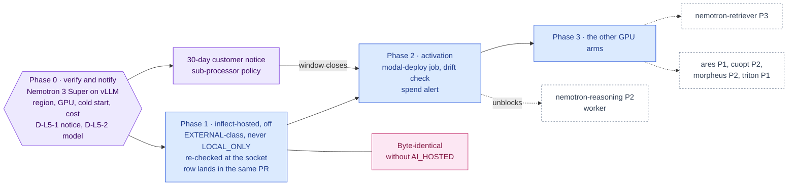

inflect · ai architecture · modal inference · roadmap v1 · 2026-10-29

# Modal — serverless inference for Nemotron 3 Super, the optional Layer 5

> **Status: living design** — the integration roadmap for Layer 5 as the
> owner re-specified it on 2026-10-29: open-weight Nemotron served by vLLM on
> **Modal** (serverless GPU) rather than on rented always-on GPUs, and
> **optional** — when a deployment uses an online LLM API, none of this layer
> is deployed. The **Current state** section is true today (main 3.338.0,
> `a1c2f05c`). The **Roadmap** section is the plan. This is a child of
> [`docs/ai-architecture-roadmap.md`](../ai-architecture-roadmap.md): read its
> "Layer 5 is optional by construction" section first — this document
> implements it — then the global rules **G1–G12**. If the code contradicts a
> fact here, the code wins and the pull request that finds it corrects this
> document.

## Where it sits in the master roadmap

| | |
| --- | --- |
| Layer · box | 5 — Runtime & infrastructure · "NVIDIA NIM (deployment containers)" + "vLLM" from the blueprint, re-homed on Modal; also the GPU arm for [`nemotron-retriever.md`](./nemotron-retriever.md), [`ares.md`](./ares.md), [`cuopt.md`](./cuopt.md), [`morpheus.md`](./morpheus.md) |
| Wave | 2 (the first RAG wave is zero-GPU by design) |
| Depends on | the master's Layer 5 design (the `inflect-hosted` route); [`nemotron-reasoning.md`](./nemotron-reasoning.md) Phase 0 (which model, and whether vLLM serves it) |
| Unblocks | every GPU arm above; sovereign-ish worker inference without an always-on GPU bill |
| Owner decisions | **D-L5-1** (Modal as a sub-processor: the four-step notice), **D-L5-2** (model, weights, licence, region, GPU class, cold-start budget) |

## At a glance

Purple hexagon: the Phase 0 decision. Blue: a phase not yet on `main`; it turns green (`done`) in the pull request that meets its "done when". Dashed: another roadmap this one waits on or unblocks. Pink: the evaluation record. Grey dashed: an outcome that ends the roadmap.



## Current state (true today)

- **There are two model routes and both are already residency-named.**
  `src/lib/agentic/flue/model-selection.ts` resolves a `"<provider-id>/<model>"`
  specifier where the id is `inflect-external` (Anthropic direct via
  `ANTHROPIC_API_KEY`, or OpenRouter) or `inflect-local`
  (`AI_LOCAL_BASE_URL` — "an OpenAI-compatible endpoint (Ollama / vLLM / …)"
  inside the operator's perimeter, with a per-tenant `aiLocalBaseUrl`
  override). `flue/providers.ts` registers providers once from deployment
  config through pi-ai's `anthropicMessagesApi` and `openAICompletionsApi`,
  and "a deployment with no external credential registers no external
  provider AT ALL". The socket boundary re-checks the specifier
  (`assistant/turn-provider.ts`). The Tool Runner's `clientForRun` refuses a
  `LOCAL_ONLY` tenant before anything external is read.
- **Tenant residency is a two-value enum.** `AiResidency { EXTERNAL,
  LOCAL_ONLY }` on `TenantSecuritySettings.aiResidency`, default `EXTERNAL`.
- **No GPU anywhere.** Production is one GCP VM (`e2`-class, eight Compose
  services) plus, since today, a second small VM for the OpenShell gateway
  under a hard 5 USD/month cap (`2026-10-29-openshell-gateway-vm-provisioned.md`).
  Cost discipline is a stated constraint, not an afterthought.
- **The vLLM mention is a comment**, in `env.ts` and
  `risk-assessment/local-provider.ts`, naming what `AI_LOCAL_BASE_URL` may
  point at. Nothing deploys one.
- **Modal is not a dependency, a service, or a sub-processor row.** The
  register (`docs/sub-processors.md`) lists Anthropic and OpenRouter as the
  model vendors; the change policy is four steps with a 30-day customer
  notice.
- **Python runs in images, never in the app** (dependency governance).

## Fit, and what is deliberately not adopted

**Adopted.** A third provider id, **`inflect-hosted`**: inference the operator
controls (its own Modal workspace, its own pinned open weights, its own
endpoint and token) but that runs *outside the perimeter* on Modal's
infrastructure. Served by **vLLM** (Apache-2.0) in a Modal GPU function that
scales to zero, exposing the OpenAI-compatible `/v1` the local route already
speaks — so `openAICompletionsApi` in `providers.ts` serves it unchanged.
Deployment code is a small Python app under `deploy/modal/`, alongside the
Compose file, never inside the product.

**Why a third id and not the local route pointed at Modal.** `inflect-local`
is the name a `LOCAL_ONLY` tenant trusts. Pointing it at a US cloud would route
exactly the tenants who asked for the opposite, under the label that promised
it. `inflect-hosted` is EXTERNAL-class for residency: `LOCAL_ONLY` tenants
never resolve to it; `EXTERNAL` tenants may. The id says what the residency
*is*; Modal is the implementation detail behind it, which is the same
argument `providers.ts` makes for not registering vendors under their own
names.

**Why Modal is a sub-processor.** Prompts transit and are processed on
Modal-managed hosts. Ephemeral containers and operator-held weights change
the *retention* column, not the *processing* fact. D-L5-1 is the four-step
process, and the 30 days run during Phase 0–1.

**Not adopted, with the reason.**

- *NVIDIA NIM containers.* Licensed under NVIDIA AI Enterprise for
  production (blueprint §3). The weights are open; vLLM serves them.
- *Always-on GPU rental* (blueprint §5 Tier A/B). Scale-to-zero is the
  whole reason this is affordable next to a 5 USD/month gateway VM.
- *Layer 5 as a prerequisite.* It is optional by construction (master
  section): absent `AI_HOSTED_*`, no provider is registered, no Modal app is
  deployed, no health check exists, and every worker role resolves to the
  external or local route the tenant's residency permits.
- *Modal's Python client in the product.* The product speaks HTTP to a URL;
  the Modal CLI runs from a developer machine or a manually-dispatched CI job.

## The optionality contract (implements master § Layer 5)

| Deployment | `AI_HOSTED_*` | What exists | Worker role resolves to |
| --- | --- | --- | --- |
| Online API only | unset | nothing: no provider id, no Modal app, no readiness probe | `inflect-external` (EXTERNAL tenants) / `inflect-local` or refused (LOCAL_ONLY) |
| Hosted enabled | set | `inflect-hosted` registered at boot; `deploy/modal/` deployed by the operator | `inflect-hosted` (EXTERNAL) / `inflect-local` or refused (LOCAL_ONLY) |
| Perimeter GPU | `AI_LOCAL_*` set | unchanged from today | `inflect-local` for everyone who may |

`/api/readyz` never gates on the hosted route (the audit-stream precedent:
out-of-band capacity, alert-based). A hosted outage degrades the worker role to
the supervisor's provider with an outcome label, never to a refused run — except
for `LOCAL_ONLY` tenants, who were never routed here.

## Roadmap (future direction)

### Phase 0 — Verify the model, the serving stack and the region; open the sub-processor step

**Sub-phases.**
- [ ] 0.1 D-L5-2: the model. Confirm Nemotron 3 Super's open-weight
      availability and licence (NVIDIA Open Model License — commercial,
      multi-tenant SaaS use); its architecture's vLLM support (the Nemotron 3
      family is a hybrid Mamba-Transformer MoE — verify the vLLM version that
      serves it and the tool-call parser it needs); the GPU class and count at
      the chosen precision; cold-start time with weights on a Modal Volume.
      Fallback named in the note: Nemotron 3 Nano (30B-A3B) on one GPU if
      Super is not yet servable within budget.
- [ ] 0.2 Region. Confirm Modal's region selection for the workspace plan and
      pin an EU region if available; if not, record that in the sub-processor
      row's Region column — it changes the transfer mechanism conversation in
      step 2 of the policy.
- [ ] 0.3 Cost model: per-request cost at p50 latency, cold-start budget,
      `scaledown_window`, and whether a `min_containers` of 1 during business
      hours is affordable — against the same discipline that capped the
      gateway VM.
- [ ] 0.4 D-L5-1: open the four-step process — draft the
      `docs/sub-processors.md` row (Modal Labs; data shared = the same
      category as the Anthropic row's agent-run entry: workflow description,
      declared run input, read-tool output, for EXTERNAL tenants only; region
      per 0.2; retention: none at rest, request logging off; operator-optional:
      yes, absent `AI_HOSTED_*` = unreachable).
- [ ] 0.5 A spike under `deploy/modal/` (not deployed to production): one
      function, vLLM, the model, a proxy-auth token, a smoke call from a
      scratch script.

**Prompt.**
```text
Context (main 3.338.0): model routes are residency-named (inflect-external / inflect-
local) in src/lib/agentic/flue/model-selection.ts and registered once in
flue/providers.ts via pi-ai's openAICompletionsApi; AI_LOCAL_BASE_URL already speaks
OpenAI-compatible /v1. Python lives in images/deploy code only. Sub-processors follow the
four-step policy (30-day notice). The owner wants Layer 5 on Modal for Nemotron 3 Super,
optional when an online API is used.

Task: the verification spike and the sub-processor draft. (1) docs/implementation-notes/
2026-MM-DD-modal-nemotron-verification.md: Nemotron 3 Super weights + licence (quote the
commercial/multi-tenant terms), vLLM version and tool-call parser that serve it, GPU
class/count/precision, cold start with weights on a Modal Volume, per-request cost at p50,
scaledown_window and min_containers options; the Nano fallback if Super is not servable
within budget; Modal region availability for the plan. (2) deploy/modal/nemotron.py: a
Modal app with one GPU function running `vllm serve` for the pinned model, weights
cached on a Volume, exposed as a web endpoint behind a proxy-auth token, scaledown to
zero; a README with the deploy command. (3) A scratch smoke script (not under src/) that
calls /v1/chat/completions and a tool-call round trip. (4) The draft sub-processor row
for Modal Labs with data shared, purpose, region, retention, operator-optional.

Constraints: nothing under src/ changes; no production deploy; the token is a Modal
secret, never in the repo. If the licence forbids multi-tenant SaaS use, stop and say
so first.

Done when: the note has the numbers, the spike serves a tool-call round trip, and the
row is drafted for the owner to start step 2.
```

**Hardening.** G2 (the clock starts here), G5 (Python confined to `deploy/`;
every image and weight snapshot pinned), cost discipline (the gateway VM memo
is the precedent: a runtime budget, with real SKUs).

**Done when.** D-L5-1 step 2 is recorded on the PR, D-L5-2 is initialled, the
spike is deployable from `deploy/modal/`.

### Phase 1 — The `inflect-hosted` route, off by default

**Sub-phases.**
- [ ] 1.1 `src/env.ts`: `AI_HOSTED_BASE_URL`, `AI_HOSTED_MODEL`,
      `AI_HOSTED_API_KEY`, all optional; a boot-time INFO line listing the
      registered provider ids.
- [ ] 1.2 `model-selection.ts`: `FLUE_PROVIDER_IDS.hosted = 'inflect-hosted'`;
      `RESIDENCY_SELECT` treats hosted as EXTERNAL-class; `resolveFlueModel`
      never builds a hosted specifier for `LOCAL_ONLY`; the worker role
      ([`nemotron-reasoning.md`](./nemotron-reasoning.md) Phase 1) prefers
      hosted when registered.
- [ ] 1.3 `providers.ts`: register `inflect-hosted` through
      `openAICompletionsApi` only when the three env values are set (the
      "no credential, no provider" rule, now for three routes); headers carry
      the proxy-auth token; `thinking-shape.ts` learns the model's thinking
      toggle.
- [ ] 1.4 Socket-boundary re-check in `assistant/turn-provider.ts` and the
      Tool Runner's `clientForRun`: a specifier naming `inflect-hosted` is
      refused for a `LOCAL_ONLY` tenant at the socket, not only at selection.
- [ ] 1.5 Egress: the hosted base URL joins the SSRF egress guard's
      population; it is operator config and never tenant-writable.
- [ ] 1.6 Metrics: the existing run metrics' `driver`/provider labels gain
      `hosted`; a `hosted_inference.requests{outcome}` counter and latency
      histogram; alerts, not readiness.
- [ ] 1.7 Tests named for the invariants: "LOCAL_ONLY never resolves to
      hosted", "absent AI_HOSTED_* registers no hosted provider", "a hosted
      outage degrades the worker role with an outcome label".
- [ ] 1.8 The sub-processor row lands in the same PR, marked "activation after
      the window closes"; the env values stay unset in production until then.

**Prompt.**
```text
Context (main 3.338.0 + Phase 0): FLUE_PROVIDER_IDS = {external: 'inflect-external',
local: 'inflect-local'}; RESIDENCY_SELECT and resolveFlueModel own routing; providers.ts
registers a provider only when its credential exists; turn-provider.ts and tool-runner/
client.ts re-check the specifier at the socket; tests/guards/ai-residency-enforcement
pins constructor sets; the SSRF egress guard pins outbound sinks. The Modal sub-processor
row is in step 2 of the policy.

Task: add the inflect-hosted route, off by default. (1) AI_HOSTED_BASE_URL / _MODEL /
_API_KEY in src/env.ts, optional; boot INFO listing registered provider ids. (2)
model-selection.ts: hosted id, EXTERNAL-class in RESIDENCY_SELECT, never built for
LOCAL_ONLY; the worker role prefers hosted when registered (coordinate with nemotron-
reasoning Phase 1 if it has not landed: add the id now, the role later). (3)
providers.ts: register via openAICompletionsApi only when all three values are set;
proxy-auth header; thinking shape for the model. (4) Socket re-check in turn-provider.ts
and tool-runner/client.ts refuses hosted for LOCAL_ONLY. (5) SSRF egress population.
(6) Metrics + labels; no readyz gate. (7) Tests: "LOCAL_ONLY never resolves to hosted",
"absent AI_HOSTED_* registers nothing", "hosted outage degrades the worker role with an
outcome label", plus the residency guard updated for any new constructor.

Constraints: the sub-processor row is in this PR; production env stays unset until the
notice window closes. No Python under src/. Update docs/sub-processors.md's Anthropic
row if the hosted route changes what reaches Anthropic (it should not).

Done when: a deployment without AI_HOSTED_* is byte-identical in behaviour to today; one
with it (staging) routes the worker role to Modal for an EXTERNAL tenant and refuses it
for a LOCAL_ONLY tenant at both the selection and the socket.
```

**Hardening.** G1 (two checks: selection and socket), G2 (row before
activation), G6 (egress population), G9 (off by default), G12 (absent config
= nothing). The boot INFO line is small and load-bearing: "which routes exist
on this deployment" should be readable from the first log line, because the
answer decides whose data goes where.

### Phase 2 — Production activation and operations

**Sub-phases.**
- [ ] 2.1 After the notice window: set `AI_HOSTED_*` in `/opt/inflect/.env.prod`
      (never echoed), deploy `deploy/modal/nemotron.py` from a
      manually-dispatched CI job `modal-deploy` with the Modal token as a CI
      secret and the pinned image digest — repo-canonical like the Compose
      file; drift between the deployed app and the repo file is checked by a
      `modal app list`/describe step the same way `deploy/check-drift.sh`
      checks Compose.
- [ ] 2.2 Warm-pool policy: `min_containers` by schedule if Phase 0's cost
      model allows; otherwise cold-start is accepted and the worker role's
      first call carries a `cold_start` label.
- [ ] 2.3 Request logging off on the Modal side; weights Volume snapshot hash
      recorded in the note.
- [ ] 2.4 Budget: a Modal spend alert at the Phase 0 figure; the product's
      per-tenant monthly token budget already bounds consumption from the
      inside.
- [ ] 2.5 The sub-processor row's status flips to active with the date.

**Prompt.**
```text
Context (main 3.338.0 + Phase 1): the inflect-hosted route exists off by default; the
Modal notice window has closed; deploy/docker-compose.prod.yml is repo-canonical with
apply.sh / check-drift.sh; secrets live in /opt/inflect/.env.prod and are never echoed.

Task: activate. (1) A manually-dispatched CI job `modal-deploy` that deploys
deploy/modal/nemotron.py with the Modal token as a CI secret and pinned digests; a
`modal-drift` step that describes the deployed app and diffs against the repo file. (2)
Set AI_HOSTED_* on the production VM (via gcloud compute ssh; back up .env.prod with the
.bak.<timestamp> convention; do not print values). (3) Modal-side: request logging off,
Volume snapshot hash recorded, spend alert at the Phase 0 figure. (4) Flip the sub-
processor row to active with the date. (5) Implementation note with the first real
hosted run's ledger ids (no content).

Constraints: the deploy job never runs on push; only workflow_dispatch. No secret in
logs. The first production run is on the seed tenant.

Done when: a seed-tenant EXTERNAL run shows provider=hosted in its decision-log rows,
check-drift and modal-drift are clean, and the row is active.
```

**Hardening.** Repo-canonical deployment (the #2849 lesson, applied to a
second deployment surface), G2 (activation only after the window), spend
bounded from both sides.

### Phase 3 — Other GPU arms on the same app

Each is its own roadmap's phase, sharing `deploy/modal/` and the
`inflect-hosted` conventions: embeddings + rerank
([`nemotron-retriever.md`](./nemotron-retriever.md) Phase 3), ARES judge
training ([`ares.md`](./ares.md) Phase 1), cuOpt ([`cuopt.md`](./cuopt.md)
Phase 2), Morpheus batch scoring ([`morpheus.md`](./morpheus.md) Phase 2),
and — if ever consolidated — Triton ([`triton.md`](./triton.md)).

## Evals for this framework

| What | How |
| --- | --- |
| Optionality | "absent `AI_HOSTED_*` is byte-identical to today" — a test that boots providers with and without, compares the registered id set |
| Residency | selection + socket tests for LOCAL_ONLY; the Inspect task "LOCAL_ONLY opens no external socket" ([`inspect.md`](./inspect.md)) |
| Serving correctness | the tool-call round trip from Phase 0 as a nightly smoke against staging |
| Model quality | [`nemotron-reasoning.md`](./nemotron-reasoning.md) Phase 3 (Inspect comparison records) |
| Cost | Modal spend alert + `hosted_inference.requests` by outcome and `cold_start` |

## Updating the master

Flip the row on the master [Status board](../ai-architecture-roadmap.md#status-board)
per phase; D-L5-1 and D-L5-2 in the decision table; when Phase 2 lands, the
master's "Layer 5 is optional by construction" section records the activation
date and the model/revision in force.
