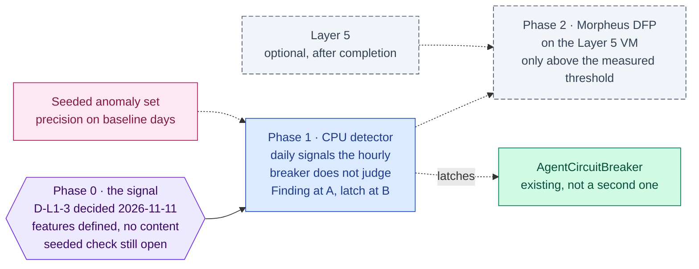

inflect · ai architecture · morpheus · roadmap v1 · 2026-10-29

# NVIDIA Morpheus — behavioural anomaly detection over the agent ledger, Layer 1

> **Status: living design** — the integration roadmap for NVIDIA Morpheus,
> named by the target architecture for Layer 1 as "real-time pipeline
> protection & anomaly detection". **D-L1-3 was decided by the owner on
> 2026-11-11: a CPU anomaly detector in the worker before Morpheus** (not yet
> recorded in the master's decision table; § Updating the master). Phase 0's
> signal definition is recorded below; its seeded measurement is still open.
> The **Current state** section is true today (re-verified 2026-11-11 at main
> 3.365.0, `8733323f`; it corrects an earlier statement that the circuit
> breaker latches only on guard blocks). The **Roadmap** section is the plan. This
> is a child of
> [`docs/ai-architecture-roadmap.md`](../ai-architecture-roadmap.md): read that
> first for the target map, the global rules **G1–G13**, and the sequencing.
> If the code contradicts a fact here, the code wins and the pull request that
> finds it corrects this document.

## Where it sits in the master roadmap

| | |
| --- | --- |
| Layer · box | 1 — Security, guards & alignment · "NVIDIA Morpheus" |
| Wave | 3 (last of the Layer 1 additions). The GPU arm (Phase 2) is optional Layer 5 work, after every other roadmap is complete |
| Depends on | a signal with volume (Phase 0 decides); Layer 5 ([`modal-inference.md`](./modal-inference.md)), optional and last, for Phase 2 |
| Unblocks | an automated latch on `AgentCircuitBreaker` from behaviour, not only from guard blocks |
| Owner decisions | **D-L1-3** decided 2026-11-11: CPU detector in the worker first; Morpheus only above a stated threshold, as optional Layer 5 work |
| Complete at | Phase 1, the CPU detector. Phase 2 is optional Layer 5 work |

## At a glance

Purple hexagon: the Phase 0 decision. Blue: a phase not yet on `main`; it turns green (`done`) in the pull request that meets its "done when". Slate dashed: optional Layer 5 work, which starts only after every other roadmap is complete. Dashed white: another roadmap this one waits on or unblocks. Pink: the evaluation record. Grey dashed: an outcome that ends the roadmap.



## Current state (true today)

- **The signals Morpheus would read already exist, structured and
  immutable.** The hash-chained `AuditLog`/`OrgAuditLog`; the audit event
  stream (C.4) — HMAC-signed batches of structured `detailsJson` with
  free-text `details` deliberately dropped; the AI decision log (Art 12 rows
  per model and tool call); the agent run ledger (`WorkflowStep`, proposals,
  receipts on `/agents/receipts`); MCP activity and quarantine; harness
  scans; A2A receipts.
- **A behavioural detector already exists, and it is hourly.** The agent
  circuit breaker (`src/lib/agentic/circuit-breaker.ts`, pure; reads and
  writes in `circuit-breaker-store.ts`) judges each agent against its OWN
  history and latches `AgentCircuitBreaker` until a person closes it:
  - one `AgentBehaviourWindow` row per agent per ACTIVE hour, written at the
    end of `authorizeToolCall` (`src/lib/mcp/authorize.ts`) for authorized
    calls only: `readCalls`, `proposeCalls`, `orchestrateCalls`, the distinct
    `toolNames` (evidence, never a cause), `anomalous`, `verdict`;
  - three signals over a median/MAD baseline (`BREAKER_SIGNALS`):
    `PROPOSAL_RATE`, `TOOL_MIX` (total-variation distance over the three
    capability classes) and `REJECTION_RATE` (reviewed proposals rejected,
    the last 24 hours against the 7 days before, by review time);
  - a fourth trip reason, `GUARD_BLOCK`, at 3 guard blocks in one window;
  - suppressions against false positives: no verdict below 12 baseline
    windows or 30 calls (`NO_BASELINE`), two consecutive anomalous windows to
    trip (`ARMED` first), all three rate conditions together, and a baseline
    reset when an operator widens the agent's card or grants;
  - judged lazily, on the agent's next call in a new window — no job, so an
    agent that stops calling is never re-judged.

  An earlier version of this document said the breaker latches only on guard
  blocks; that was wrong, and is corrected here.
- **What the breaker does not judge.** `readCalls` is recorded and never
  judged as a rate: `TOOL_MIX` is scale-invariant and `PROPOSAL_RATE` counts
  only proposals, so an agent whose reads triple with its mix unchanged trips
  nothing. Nor does it see token spend, run volume or failure, or the hours an
  agent is active. Those are daily-scale signals over rows the breaker never
  reads, and they are what a detector here would add.
- **Other responses to anomalous behaviour.** Tenant and platform kill
  switches with drills, proposal sampling (`proposal-sampling.ts`), the
  review-quality surface, `automation-bias.ts`, `failure-isolation.ts`.
- **No stream processor, no GPU, no Morpheus.** The SIEM is the customer's
  (audit stream destination); Inflect runs no analytics over its own ledger
  beyond `analytics.prisma` snapshots for dashboards.

## Fit, and what is deliberately not adopted

**What Morpheus is.** NVIDIA's GPU-accelerated cybersecurity pipeline
framework (Apache-2.0, Python): streaming stages over logs/events with
Triton-served models; its flagship pipeline is **Digital Fingerprinting (DFP)**
— a per-entity behavioural baseline with anomaly scoring.

**Adopted (as a candidate).** DFP over the *agent ledger*: one fingerprint per
`RegisteredAgent` (tool-call rates by scope, token spend, proposal rate,
read volume, time-of-day), scored nightly or per batch; a high anomaly score
raises a Finding and may latch the agent's circuit breaker through the
*existing* latch — never a second breaker. For an AI-governance product,
"your agent is behaving unlike itself" is a defensible, on-brand control.

**Not adopted, with the reason.**

- *Network-level ML security* (the blueprint's "zero-trust sidecar over ERP
  transactions"). There is no ERP transaction stream here, and the network
  perimeter is Caddy + the edge middleware, not a GPU pipeline.
- *Morpheus as the first detector.* The ledger is Postgres; a baseline-and-
  z-score job in the worker (CPU) answers the same question for the volumes
  this product has. Morpheus pays when the feature set and volume outgrow a
  nightly SQL+TypeScript job — Phase 0 measures that rather than assuming it.
- *A streaming deployment.* If Layer 5 is ever taken up, batch scoring on its
  GPU VM over an export of the signed audit stream; nothing always-on.
- *Free text as a feature.* The audit stream already strips `details`; the
  fingerprint reads counts, scopes, ids and timestamps only (G4 is not in
  play because no content moves).

## Roadmap (future direction)

### Phase 0 — The signal, measured on CPU

**The record (2026-11-11).** D-L1-3 was decided by the owner (relayed to this
change by the coordinating session; the initials go in the master's decision
table, which this change does not edit): a CPU
detector in the worker first, Morpheus only above the threshold below. The
signal is defined from the real tables, with no data read. It is defined
around the breaker that already exists (§ Current state): the hourly breaker
keeps judging what it judges, and the nightly detector judges only what the
breaker cannot see.

*Features, per agent per UTC day.* Counts, ids and timestamps only.

| Feature | Computed from | Judged by the hourly breaker today? |
| --- | --- | --- |
| Read calls | `AgentBehaviourWindow.readCalls`, summed over the day's rows | recorded, **not judged** — the gap this detector exists for |
| Propose calls, orchestrate calls | `AgentBehaviourWindow.proposeCalls`, `.orchestrateCalls` | yes (`PROPOSAL_RATE`, `TOOL_MIX`); carried for context only |
| Active hours, and their spread over the day | count and hour-of-day of the day's `AgentBehaviourWindow.windowStart` rows (a row exists only for an observed hour) | no |
| Runs started, and runs ending `FAILED` or `ABORTED` | `WorkflowRun` by `agentId` and `startedAt`, with `status` | no |
| Steps per run | `WorkflowRun.stepCount` | no |
| Tokens charged | `WorkflowRun.costTokens` by `agentId` | no |
| Model tokens in and out | `AiDecisionLog.tokensIn`, `.tokensOut` by `agentId` and `createdAt` | no |
| Guard flags short of a block | `WorkflowStep.guardVerdict = FLAGGED` on the agent's runs; `AgentProposal.guardVerdict` by `agentId` | blocks only (`GUARD_BLOCK`) |
| Proposals created, and rejected by review time | `AgentProposal` by `agentId`, `createdAt`, `status`, `reviewedAt` | yes (`REJECTION_RATE`, hourly); carried for the daily view |

*Never read.* Every content-bearing column on these tables:
`WorkflowRun.contextJson`, `.summary`, `.errorMessage`;
`WorkflowStep.inputJson`, `.outputJson`; `AgentProposal.payloadJson`,
`.rationale`; `AiDecisionLog.outputSummary` and `.inputDigest`. A digest is not
content, but it is a per-input fingerprint, and the detector has no use for one.
Phase 1's column-allowlist guard is the enforcement.

*Shape of the judgement.* The breaker's own: a median/MAD baseline per agent
(not mean and σ, which one prior spike inflates), a minimum baseline before any
verdict, and persistence before a latch. Reuse its pure helpers (`median`,
`medianAbsoluteDeviation`, `robustZ`) rather than writing a second set.

*When Morpheus would be reconsidered (Phase 2).* Only if Layer 5 is taken up,
and then only on one of two measured facts: the nightly CPU job no longer
finishes inside its scheduled slot for the largest tenant, or a signal is
wanted that daily counts cannot carry (a learned model over raw per-call event
sequences, which is what DFP is for). Neither holds today: the per-day row
count is bounded by agents × 24 window rows plus their runs.

**Sub-phases.**
- [x] 0.1 D-L1-3: define the fingerprint features from existing rows (per
      agent per day: calls by tool scope, proposals, reads, tokens, guard
      flags, hours active). *The table above, 2026-11-11.*
- [ ] 0.2 A scratch analysis over the seed tenant's ledger: feature volumes,
      and whether a simple baseline (rolling mean/σ per feature) separates
      an injected anomaly (a scripted agent that triples its reads).
      *Open. Run it with the breaker's median/MAD, not mean/σ, so it measures
      the method Phase 1 will ship.*
- [x] 0.3 Decide: CPU detector first (Phase 1), Morpheus later only if volumes
      or feature complexity exceed it (Phase 2). *Decided 2026-11-11 (D-L1-3).*

**Prompt.**
```text
Context (main 3.338.0): the agent ledger is structured and immutable — WorkflowStep,
decision-log rows, proposals, receipts, MCP activity; the audit stream ships detailsJson
only; AgentCircuitBreaker latches on guard blocks; kill switches and drills exist. There
is no behavioural detector. The target names NVIDIA Morpheus (DFP) for Layer 1.

Task: docs/implementation-notes/2026-MM-DD-agent-fingerprint-decision.md. (1) Define
per-agent daily features computable from existing rows (calls by scope, proposals,
reads, tokens, guard flags, active hours). (2) A scratch script (not under src/) over
the seed tenant that computes them for 30 days of seeded activity and tests whether a
rolling mean/σ baseline flags an injected anomaly (an agent tripling its reads) without
flagging the baseline days. (3) Recommend D-L1-3: CPU detector in the worker first;
Morpheus DFP only above a stated volume/feature threshold.

Constraints: features are counts, scopes, ids and timestamps — never content. Seed
tenant only. No dependency added.

Done when: the note has the feature table, the detection result on the injected
anomaly, and the threshold at which Morpheus would be reconsidered.
```

### Phase 1 — The CPU detector in the worker

**Sub-phases.**
- [x] 1.1 Job `agent-fingerprint` (G8, nightly after the ledger settles):
      computes features per agent, keeps a rolling baseline in a
      tenant-scoped table (`AgentBehaviourBaseline`, RLS, retention
      classified), scores the day, writes an anomaly row with the features
      that drove it.
- [x] 1.2 Outcome: a Finding on the agent (through the existing findings
      usecase) at score ≥ threshold; at a higher threshold, latch the
      *existing* circuit breaker with a new trip reason `BEHAVIOUR_ANOMALY`
      added to `BREAKER_TRIP_REASONS` — a human unlatches, as today, and the
      close's reason decides what happens to the baseline, as
      `BREAKER_CLOSE_REASONS` already does.
- [x] 1.3 Surface: the anomaly on `/agents/[agentId]` Overview and on
      `/agents/reports`; a "why" panel listing the features.
- [x] 1.4 Two-tenant test; a test that the seeded anomaly latches and the
      baseline days do not; a test that content never enters a feature.

**What 1.1, 1.2 and 1.4 built (2026-11-11).** The signal was derived from the
real tables, ahead of Phase 0's written decision: eight per-agent, per-UTC-day
counts — read, propose and orchestrate calls and active hours from
`AgentBehaviourWindow`, proposals and guard flags (`FLAGGED`/`QUARANTINED`)
from `AgentProposal`, model calls and tokens from `AiDecisionLog`. The scorer
(`src/lib/agentic/behaviour-fingerprint.ts`, pure) is a rolling mean and σ over
the agent's last 28 in-baseline active days, upward only, with a σ floor and a
per-feature absolute delta; fewer than 14 days is `LEARNING` (recorded, never
raised), z ≥ 4 is threshold A (a finding, one per agent, reopened rather than
duplicated), z ≥ 8 is threshold B (the breaker, through
`latchOnBehaviourAnomaly`). An anomalous day never enters a later baseline.
The column allowlist is `FINGERPRINT_SOURCE_COLUMNS`, held against the Prisma
datamodel and against the one ledger read by
`tests/guards/agent-behaviour-fingerprint-content-free.test.ts`. Off by
default with two operator keys (`AGENT_BEHAVIOUR_DETECTOR` and the tenant named
in `AGENT_BEHAVIOUR_DETECTOR_TENANTS`), and the latch is a third
(`AGENT_BEHAVIOUR_DETECTOR_LATCH`). Scheduled at 01:53 UTC, scoring the day
that closed. No container: it runs in the existing worker. The thresholds are
written down with their reasons and stand until Phase 0's measurement replaces
them.

**What 1.3 built (2026-11-12).** A "Behaviour fingerprint" card on the agent's
Overview tab and a "Behaviour anomalies" view on `/agents/reports`
(`?tab=behaviour`), both over `usecases/agent-behaviour-fingerprint-read.ts`
and read under `admin.agent_registry`, the circuit-breaker read's key. Each
anomaly shows its "why": every driving feature with its count, the agent's own
mean and σ, and the z. An empty card or view says which of three facts it is
— detector off, on but never scored, or scored with nothing found — because
"no anomalies" from a detector nobody turned on is a claim about an agent
nobody watched. The re-baseline question the 1.x pass left is resolved by the
narrowest control rather than none: closing the breaker
`ACCEPTED_NEW_BASELINE` covers only an anomaly that LATCHED, so a deliberate
change at threshold A, or at any tier while the latch key is off, was re-scored
anomalous every night with no exit but switching the detector off. A person
can now "accept as new normal" from the card: it moves the SAME
`AgentCircuitBreaker.baselineEpoch` the close moves (one decision, one column,
both detectors), only on a CLOSED breaker (an open one is decided by its close),
only after an anomaly since the last acceptance, never for an API key or an
agent, and audited `AGENT_BEHAVIOUR_BASELINE_ACCEPTED`. An agent the tool
funnel never saw (one that only proposes, or runs read-only) is scored without
a breaker row, so the acceptance creates the row first and places the epoch
after its creation. It closes no finding.
Note `docs/implementation-notes/2026-11-12-agent-behaviour-fingerprint-surface.md`.

**Prompt.**
```text
Context (main 3.338.0 + Phase 0): features and thresholds are decided; jobs live in
src/app-layer/jobs/ under runJob(); the circuit breaker is latched through
src/lib/agentic/circuit-breaker.ts and unlatched by a person; findings are created
through the findings usecase; new tenant-scoped models need RLS, a tenantId-leading
index, a retention row and a two-tenant test (docs/new-subsystem-checklist.md).

Task: the agent fingerprint detector. (1) Model AgentBehaviourBaseline (+ AgentBehaviour
Anomaly) in agentic.prisma with RLS migration, indexes, retention classification. (2)
Job agent-fingerprint: nightly per tenant; compute features from the ledger; update the
rolling baseline; score; write anomaly rows. (3) Outcomes: Finding at threshold A; latch
the existing circuit breaker with reason BEHAVIOUR_ANOMALY at threshold B. (4) Surface on
the agent Overview tab and /agents/reports with the driving features. (5) Tests: two-
tenant; seeded anomaly latches, baseline days do not; a guard that the feature builder
imports no content-bearing field (allowlist of columns).

Constraints: no second breaker; no content in features; worker only; bounded queries.

Done when: the seeded anomaly produces a Finding and a latch on the seed tenant, the
guard refuses a content column, and the two-tenant test is green.
```

**Hardening.** G7, G8, G10 (the column allowlist is the guard that keeps
this a behaviour detector and not a content reader), "no second mechanism"
(the breaker is the breaker).

### Phase 2 — Morpheus DFP on the Layer 5 VM (optional, Layer 5; only above the Phase 0 threshold)

**Sub-phases.**
- [ ] 2.1 A batch job on the Layer 5 GPU VM, deployed from the Layer 5
      scripts, running the DFP pipeline over an exported day of fingerprint
      features (not raw events), the model on the VM's disk.
- [ ] 2.2 The worker job ships features (ids and counts) to the VM and
      stores the score beside the CPU score; the latch rule reads the higher.
- [ ] 2.3 No sub-processor change while the VM is in the operator's own
      Google Cloud project (the Laya precedent in `docs/sub-processors.md`).
- [ ] 2.4 Parity window: four weeks of both scores recorded; Morpheus becomes
      primary only if it finds anomalies the CPU detector missed and the
      review-quality surface confirms them.

**Hardening.** G1 (the VM is in the operator's own project; nothing
external), G12 (optional), G11 (the parity window is the record that promotes it).

## Evals for this framework

| What | How |
| --- | --- |
| Detection | seeded anomaly set (Phase 0) re-run nightly; precision on baseline days |
| Content-free | column allowlist guard |
| Usefulness | anomalies confirmed vs dismissed on `/agents/review-quality` |

## Updating the master

Flip the row on the master [Status board](../ai-architecture-roadmap.md#status-board)
per phase. Outstanding, and the coordinator's (this change does not edit the
master, whose D-L1-3 row shows only the default-if-undecided): write D-L1-3 as
"**decided 2026-11-11** (owner): CPU detector first" in the decision table,
and the status-board row as "Phase 0 — signal defined; seeded check open". If Phase 0 concludes the CPU detector
suffices indefinitely, the row reads "CPU detector shipped; Morpheus dormant
until <threshold>".
