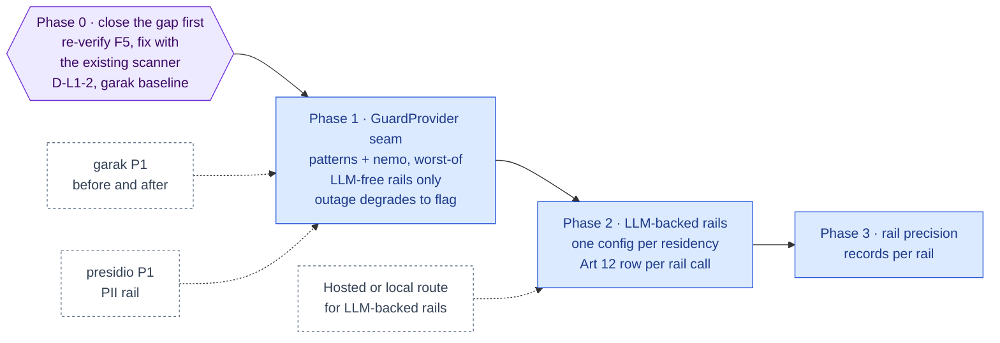

inflect · ai architecture · nemo guardrails · roadmap v1 · 2026-10-29

# NeMo Guardrails — a second guard slice, Layer 1

> **Status: living design** — the integration roadmap for NVIDIA NeMo
> Guardrails, named by the target architecture for Layer 1 as "prompt &
> response filter". The **Current state** section is true today (main
> 3.338.0, `a1c2f05c`). The **Roadmap** section is the plan. This is a child
> of [`docs/ai-architecture-roadmap.md`](../ai-architecture-roadmap.md): read
> that first for the target map, the global rules **G1–G12**, and the
> sequencing. If the code contradicts a fact here, the code wins and the pull
> request that finds it corrects this document.

## Where it sits in the master roadmap

| | |
| --- | --- |
| Layer · box | 1 — Security, guards & alignment · "NeMo Guardrails (prompt & response filter)" |
| Wave | 3 |
| Depends on | [`garak.md`](./garak.md) Phase 1 (the before/after measurement); [`presidio.md`](./presidio.md) Phase 1 for PII rails |
| Unblocks | model-based rails on the assistant and run input; closes the Flue audit's F5 residual (run input unscanned) by a second route |
| Owner decisions | **D-L1-2** (LLM-free rails first; LLM-backed rails only on the tenant's permitted route) |

## At a glance

Purple hexagon: the Phase 0 decision. Blue: a phase not yet on `main`; it turns green (`done`) in the pull request that meets its "done when". Dashed: another roadmap this one waits on or unblocks. Pink: the evaluation record. Grey dashed: an outcome that ends the roadmap.



## Current state (true today)

- **The product has a guard, and it is deterministic.**
  `src/app-layer/ai/guard/`: `injection-scanner.ts`, `egress-scanner.ts`,
  `patterns.ts`, `normalize.ts`, `policy.ts`, `proposal-guard.ts`; the API is
  `guardUntrustedInput`, `guardEgress`, `assertGuardAllowed`,
  `assertNoReviewRequired`, with a three-arm `GuardOutcome` (allow / flag /
  block) whose arms are pinned by `flue-guard-outcome-has-arms`. `flag`
  forces review (`review-latch.ts`), `block` aborts; repeated blocks latch the
  circuit breaker.
- **It is applied at the tool boundary, three ways** (`flue/tools-adapter.ts`):
  egress on proposed args before the funnel; injection on tool results before
  model context; egress on result text before a third-party provider. Legacy
  data reaches a model only through it (legacy-access invariant 3). The
  product's own skills carry mandatory `injection` cases.
- **One known gap, recorded 2026-10-09 against 3.164.1 and not re-verified
  since:** `guardUntrustedInput` was applied only in `tools-adapter.ts`, so a
  run's *initial input* reached prompt assembly unscanned (Flue audit finding
  F5). The first PR under this roadmap re-checks that on `main`.
- **No NeMo Guardrails, no Colang, no model-based rail.** The scanners are
  pattern sets; nothing asks a model "is this a jailbreak".

## Fit, and what is deliberately not adopted

**What NeMo Guardrails is.** NVIDIA's Python (Apache-2.0) toolkit for
programmable rails around an LLM app: input rails (jailbreak detection,
topical control, PII), output rails (moderation, fact-checking, hallucination
checks), dialog rails in Colang, served as a library or a server. Some rails
are heuristic; most call an LLM.

**Adopted.** NeMo Guardrails as a **second slice behind the existing
`GuardOutcome` interface**, not a replacement: a `GuardProvider` seam where
today's scanners become the `patterns` provider and NeMo becomes `nemo`,
composed *worst-of* (block beats flag beats allow). Rails are configured in
the repo (`guards/nemo/config/`), reviewed like code. The deterministic
scanners stay: they are free, local, auditable and cannot be talked out of a
verdict.

**Not adopted, with the reason.**

- *NeMo in the LLM call path* (its "proxy" mode where it wraps the model
  call). The product's providers are the only sockets (G1): a guard that
  makes the model call would be a second route whose residency nobody chose.
  NeMo is asked "allow/flag/block?" and never "answer this".
- *Colang dialog rails.* A second orchestration language for conversation
  flow; the assistant's tool loop and the engines own flow.
- *NIM-backed rail models.* The de-NIM rule (blueprint §3); LLM-backed rails
  use the tenant's permitted route — hosted/local Nemotron or the external
  model — through a per-residency server config (D-L1-2).
- *Rails that need an LLM, first.* Phase 1 ships LLM-free rails only
  (heuristic jailbreak, regex/keyword, Presidio PII); LLM-backed rails are
  Phase 2 and require the residency plumbing to exist.

## Roadmap (future direction)

### Phase 0 — Re-verify the gap, decide the rails

**Sub-phases.**
- [ ] 0.1 Re-check F5 on `main`: is run input scanned before prompt assembly?
      If not, fix it with the *existing* scanner in this phase (one call, one
      test) — it must not wait for NeMo.
- [ ] 0.2 D-L1-2: list the rails by whether they need an LLM; Phase 1 =
      LLM-free; Phase 2 = LLM-backed on the permitted route.
- [ ] 0.3 Baseline: garak hit rates with the deterministic guard only
      ([`garak.md`](./garak.md) Phase 0/1) — the number NeMo must move.

**Prompt.**
```text
Context (main 3.338.0): the AI guard is deterministic (src/app-layer/ai/guard/) with a
three-arm GuardOutcome; applied at the tool boundary in flue/tools-adapter.ts; the
2026-10-09 audit (against 3.164.1) found run input reached prompt assembly unscanned
(F5) — unverified since. The target names NeMo Guardrails.

Task: (1) Verify on main whether a run's initial input and the assistant's user turn pass
guardUntrustedInput before prompt assembly (Flue runtime-start / run-message path, Tool
Runner execute path, assistant tool loop). If not, add the call(s) with the existing
scanner and a test named "run input is scanned before prompt assembly" per engine. (2)
docs/implementation-notes/2026-MM-DD-nemo-guardrails-decision.md recording D-L1-2: the
candidate rails split into LLM-free (heuristic jailbreak, keyword/regex, PII via Presidio)
and LLM-backed (topical, moderation, fact-check), with the residency consequence of each.
(3) Record the garak baseline hit rates as the number to move.

Constraints: no NeMo yet. The F5 fix, if needed, is the existing scanner.

Done when: the input-scan tests exist and pass, and D-L1-2 is initialled.
```

**Hardening.** G4 (close the known gap with what exists before adding
anything), G11 (a baseline before a change).

### Phase 1 — The `GuardProvider` seam and LLM-free rails

**Sub-phases.**
- [ ] 1.1 `src/app-layer/ai/guard/providers/`: `types.ts`
      (`GuardProvider.scan(kind: 'input' | 'egress', text, ctx) →
      GuardOutcome`), `patterns-provider.ts` (today's scanners, unchanged
      behaviour), `nemo-provider.ts` (HTTP to the NeMo server via `safeFetch`,
      byte-capped, deadline, degrade to `flag` on outage — never to `allow`),
      `compose.ts` (worst-of).
- [ ] 1.2 `guardUntrustedInput` / `guardEgress` call the composed provider;
      every verdict row records which provider decided (the decision-log
      already records the verdict; add the provider).
- [ ] 1.3 NeMo Guardrails server as a Compose service (digest), worker/app
      network only; rails config in `guards/nemo/config/` mounted read-only;
      LLM-free rails only in this phase.
- [ ] 1.4 Env `AI_GUARD_NEMO_BASE_URL` optional; absent = patterns only
      (G9).
- [ ] 1.5 Tests: "nemo outage degrades to flag, never allow"; "composition is
      worst-of" (table over the nine arm pairs); "patterns provider is
      byte-identical to the previous scanners" (fixture set).

**Prompt.**
```text
Context (main 3.338.0 + Phase 0): guardUntrustedInput/guardEgress return a three-arm
GuardOutcome; the review latch and circuit breaker consume it; outbound calls use
safeFetch with byte caps and deadlines (the MCP client is the pattern); images are
digest-pinned in the repo-canonical Compose file; absent config means a feature is off.

Task: the GuardProvider seam. (1) src/app-layer/ai/guard/providers/{types,patterns-
provider,nemo-provider,compose}.ts: patterns = today's scanners unchanged; nemo = HTTP to
the NeMo Guardrails server (safeFetch, byte cap, deadline), outage → flag with reason
GUARD_PROVIDER_UNAVAILABLE, never allow; compose = worst-of. (2) guardUntrustedInput /
guardEgress use the composed provider; verdicts record the deciding provider. (3) A
`nemo-guardrails` Compose service (digest), rails config under guards/nemo/config/ with
LLM-free rails only (heuristic jailbreak, regex/keyword, PII via the Presidio service if
present). (4) AI_GUARD_NEMO_BASE_URL optional. (5) Tests: outage→flag; worst-of table;
patterns byte-identical on a fixture set.

Constraints: NeMo never makes a model call in this phase (no `models:` entry in its
config); it is asked for verdicts only. The seam adds no permission or usecase logic.

Done when: with the URL unset the guard is byte-identical; with it set the garak
nightly shows the before/after; the three tests are green.
```

**Hardening.** G4 (worst-of composition — a second slice can only tighten),
G6, G9, "outage degrades to flag" (a guard that fails open is not a guard),
G10 (the fixture-equivalence test is the regression lock for the refactor).

### Phase 2 — LLM-backed rails on the permitted route

**Sub-phases.**
- [ ] 2.1 Two NeMo server configs — `external` and `local` — each with a
      `models:` entry pointing at the route of that residency class
      (`inflect-hosted`/`inflect-local` vLLM, or the external model), deployed
      as two services or one with per-config endpoints; the guard provider
      selects the config by `ctx` residency and **refuses** to send a
      `LOCAL_ONLY` tenant's text to the external config (socket-boundary
      re-check, as in `turn-provider.ts`).
- [ ] 2.2 Rails: topical control for the assistant, output moderation on
      synthesis, a fact-check rail over retrieved chunks once Layer 4 exists.
- [ ] 2.3 Every rail model call is a decision-log row (Art 12), tagged
      `guard`, with tokens charged to the tenant's budget.
- [ ] 2.4 Sub-processor rows: if the external config uses Anthropic/
      OpenRouter, their rows gain "guard rail prompts (user text under
      evaluation)"; if hosted, Modal's row does.

**Prompt.**
```text
Context (main 3.338.0 + Phase 1): the composed guard calls NeMo for LLM-free verdicts;
model routes are residency-named and re-checked at the socket; every model call writes an
Art 12 row and charges the tenant budget; sub-processor rows name data categories.

Task: LLM-backed rails. (1) Two NeMo configs (external, local) with models: entries for
the matching route; the nemo provider picks by ctx residency and refuses to send
LOCAL_ONLY text to the external config. (2) Rails: topical control (assistant), output
moderation (synthesis), fact-check over retrieved chunks (when search_knowledge is
offered). (3) Each rail model call → decision-log row tagged guard, tokens charged. (4)
Sub-processor rows updated with the guard-rail data category.

Constraints: a rail that fails degrades to flag; a LOCAL_ONLY tenant with no local route
gets patterns-only, with reason recorded. No rail makes a product decision beyond its
verdict.

Done when: the garak nightly shows the LLM-backed delta, the residency tests cover the
guard path, and the decision log shows guard rows with tokens.
```

**Hardening.** G1 (per-residency configs with a socket re-check), G2, G4
(a rail is a verdict, not an answer), Art 12 (a guard's model call is still
a model call).

### Phase 3 — Evaluate the rails themselves

An evaluation set of inputs with expected verdicts per rail (seed data +
garak's probe corpus), run nightly through the composed guard, recorded in the
house shape (G11); a rail whose precision drops is flagged in the auto-issue.

## Evals for this framework

| What | How |
| --- | --- |
| Effect | garak hit rates before/after each rail ([`garak.md`](./garak.md)) |
| Rail precision | verdict set per rail, nightly, recorded |
| Fail-closed | outage → flag test |
| Residency | "LOCAL_ONLY text never reaches the external config" |

## Updating the master

Flip the row on the master [Status board](../ai-architecture-roadmap.md#status-board)
per phase; D-L1-2 in the decision table; the F5 residual in the master's
Flue section is closed by Phase 0 and the closing PR is linked there.
