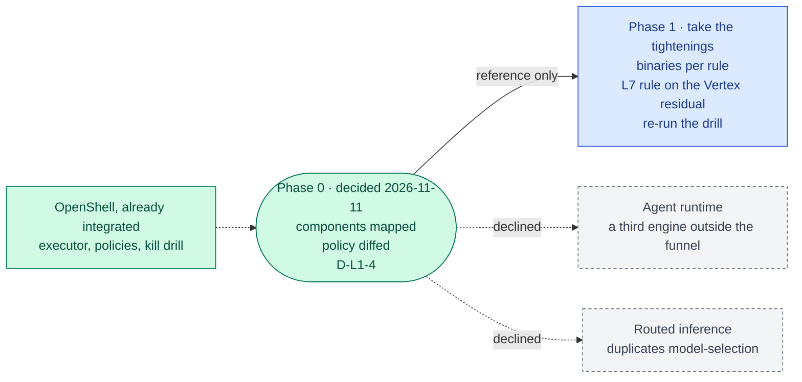

inflect · ai architecture · nemoclaw · roadmap v1 · 2026-10-29

# NemoClaw — what of it is already here, and what is refused, Layer 1

> **Status: living design** — the integration roadmap for NVIDIA NemoClaw,
> which the target diagram places in Layer 1 beside NeMo Guardrails and
> Presidio (the companion markdown does not name it; it names OpenShell under
> Layer 5). **Phase 0's work is done and D-L1-4 is decided (by the owner,
> 2026-11-11): reference-only; the agent runtime and the routed-inference
> layer are declined.** The master's decision table and status board do not
> record it yet; that edit is the coordinator's (§ Updating the master). The mapping found two policy tightenings worth taking,
> so the roadmap completes at Phase 1. The **Current state** section is true
> today (re-verified 2026-11-11 at main 3.365.0, `8733323f`). The **Roadmap**
> section is the plan. This is a child of
> [`docs/ai-architecture-roadmap.md`](../ai-architecture-roadmap.md): read that
> first for the target map, the global rules **G1–G13**, and the sequencing.
> If the code contradicts a fact here, the code wins and the pull request that
> finds it corrects this document.

## Where it sits in the master roadmap

| | |
| --- | --- |
| Layer · box | 1 — Security, guards & alignment · "nemoclaw"; its substrate (OpenShell) is the blueprint's Layer 5 sandbox |
| Wave | 3 (decision); the OpenShell work it rests on proceeds under its own plan (#3924) independently of this document |
| Depends on | nothing new |
| Unblocks | nothing on the critical path |
| Owner decisions | **D-L1-4** decided 2026-11-11: the policy-template half as reference only; the agent-runtime and router halves declined |
| Complete at | Phase 1 — Phase 0 (2026-11-11) found two tightenings worth taking |

## At a glance

Green: decided or on `main`. Blue: a phase not yet on `main`; it turns green (`done`) in the pull request that meets its "done when". Grey dashed: declined.



## Current state (true today)

**The substrate NemoClaw is built on is already integrated, as a confinement
for Inflect's own tools.** `src/lib/agentic/openshell/`:

- `transport.ts` — the gateway client: sandbox phases, deletion outcomes
  (with the proto3 zero value handled pessimistically), an `unconfiguredTransport`
  that refuses rather than runs.
- `executor.ts` — an OpenShell backend for `runBoundedTool` (4.2, #3962):
  inherits the deadline and output cap from the wrapper, *throws* when a
  sandbox cannot be created ("a sandbox that cannot be created is a refusal",
  4.2b), and "contains no local-execution arm — not a disabled one, not one
  behind a flag".
- `collector-policy.ts` — network policies for the Powerpipe collectors (4.1,
  #3961): provider-scoped egress allowlists, every endpoint carrying
  `NETWORK_ENFORCEMENT_MODE_ENFORCE` explicitly because the unspecified zero
  value is audit mode.
- `kill-drill.ts` — the drill proves a sandbox is *gone*, not that the call
  returned (5.4, #3974): evidence for `H4.kill_switch_drilled`.
- `policy-drift.ts` — the deployed policy is compared with the repo's.
- `grpc-transport.ts` (the gateway's gRPC client against the vendored
  `vendor/openshell-proto/v0.1.6`), `pinned-release.ts`
  (`PINNED_GATEWAY_RELEASE = '0.1.6'`), `prover-policy.ts` (the translation
  `openshell-prover` can read) and `sandbox-decisions.ts` (which lifecycle
  decisions our own code records, and which the gateway never logs).
- **The collector policy is host-level.** Each endpoint is a host, every one
  `ENFORCE`, with Landlock `hard_requirement`, a read-only root, one scratch
  directory and a pinned non-root user. It names no binaries per rule and no
  L7 (method and path) rules, although the pinned 0.1.6 schema carries both
  (`NetworkPolicyRule.binaries`, `L7Allow` in `sandbox.proto`).
- Pinned at v0.1.5 → 0.1.6 with verified checksums; the sandbox and
  supervisor images by digest (`2026-10-25-openshell.md`,
  `2026-10-29-openshell-0-1-6-upgrade.md`). **A gateway VM was provisioned
  today** under a hard 5 USD/month cap, triggered by the first production
  caller: the Powerpipe collectors run sandboxed and fail closed when the
  gateway is unreachable (#4443).
- The OpenShell operator skills are vendored into this repository
  (`.claude/skills/openshell-cli`, `generate-sandbox-policy`,
  `debug-openshell-cluster`, `debug-inference`), read in full and reviewed
  (`OPENSHELL-LOCAL-NOTES.md`): "the text is good, and argues for tighter
  controls". `debug-inference` records that OpenShell "no longer supplies a
  managed inference route … the application calls the provider's native
  endpoint and owns its base URL, model, request format, and timeout" —
  i.e. inference routing is the application's, which is how this codebase
  already treats it.

**What is confined and what is not.** OpenShell confines *Inflect's own
binaries* (collectors). It does not run model-written code: `useSandbox`, the
bash tool and the sandbox filesystem tools remain refused by import in
`flue/refused-capabilities.ts` (23 exports), and that refusal is tested.

**Residency routing is the application's** — `model-selection.ts` and the
socket re-checks decide which route a tenant's text may take.

## Fit, and what is deliberately not adopted

**What NemoClaw is, as announced.** NVIDIA's open-source stack (announced at
GTC, March 2026) for running autonomous agents with privacy and security
guardrails: an agent runtime derived from OpenClaw, the OpenShell sandbox
underneath it, a policy layer with a "privacy router" that decides which
requests may go to which model (local vs cloud), and Nemotron models. Exact
packaging and components move quickly; Phase 0 re-reads the current release
before deciding anything.

**Adopted (D-L1-4, 2026-11-11).** NemoClaw's *sandbox policy templates and profiles*
as **reference material** for `generate-sandbox-policy` and
`collector-policy.ts` — where its templates are tighter than ours, ours
tighten; nothing is imported as a dependency.

**Not adopted (D-L1-4, 2026-11-11), with the reason.**

- *The agent runtime.* A third reasoning engine, outside the funnel (G3),
  the residency decision (G1), the guard sandwich (G4), the decision log,
  the kill switch and the caps. Same verdict as the Langflow runtime
  ([`langflow.md`](./langflow.md)); same argument in `turn-provider.ts`
  about building "a second one of any of them".
- *The privacy router.* It decides local-vs-cloud routing — the exact job of
  `model-selection.ts` + `RESIDENCY_SELECT` + the socket re-checks, which are
  per-tenant, tested, and pinned by the residency guard. A second router is
  a second answer to "where may this tenant's text go".
- *Model-written code in the sandbox.* The sandbox exists; the capability is
  refused, and the refusal is a decision with its own guard, not an oversight
  a stack install should reverse ([`swe-bench.md`](./swe-bench.md) says the
  same from the eval side).
- *NIM-packaged Nemotron inside the stack.* De-NIM (blueprint §3). Model
  usage is through LLM API keys by default, and a local model route is
  optional Layer 5 work ([`modal-inference.md`](./modal-inference.md)).

## Roadmap (future direction)

### Phase 0 — Map the current release to what exists; decide (done 2026-11-11; master record outstanding)

**Sources read, 2026-11-11.** Primary sources only, from NVIDIA's `NemoClaw`
repository on GitHub, branch `main`: the README,
`nemoclaw-blueprint/blueprint.yaml`,
`nemoclaw-blueprint/policies/openclaw-sandbox.yaml` and the listing of
`nemoclaw-blueprint/policies/presets/`. NVIDIA's documentation site for
NemoClaw was not reachable from the session that wrote this, and the
repository's Releases page showed no release, so release notes were not read;
what is mapped is `main` as of that date.

**What the release is.** The README describes NemoClaw as "an open source
reference stack for running supported AI agents more safely inside NVIDIA
OpenShell sandboxes" (OpenClaw by default; also Hermes and LangChain Deep
Agents), in early preview and not for production use. The blueprint is
version `0.1.0`; it pins `min_openshell_version` and `max_openshell_version`
to `0.0.116`, citing MCP/JSON-RPC L7 policy support from NVIDIA/OpenShell#1865.
That is a different version string from this repository's gateway pin
(`0.1.6`). Which release line it names was not established from the files
read, so this record claims nothing about which is newer, and nothing below
depends on it.

**The mapping.**

| NemoClaw component | Here | Why |
| --- | --- | --- |
| Agent integration layer (OpenClaw, Hermes, Deep Agents) | **refused** | A third reasoning engine outside the funnel (G3), the residency decision (G1), the guard sandwich (G4), the decision log, the kill switch and the caps. |
| Managed / routed inference (`managed-inference/`, the blueprint's inference profiles, the in-sandbox `inference.local` route) — the announced "privacy router" | **refused** | A second answer to "where may this tenant's text go"; `model-selection.ts`, `RESIDENCY_SELECT` and the socket re-checks are that answer, per tenant and guarded. |
| Nemotron models in the blueprint's profiles | **refused** as packaged | De-NIM; models through LLM API keys, and a local route is optional Layer 5 work. |
| OpenShell-managed channel messaging (Telegram, Discord, Slack presets) | **refused** | Already refused in Flue as `createChannelRouter` ("duplicates IntegrationConnection + notification dispatch"). |
| Managed integrations and the 25 opt-in policy presets (GitHub, Gmail, Jira, npm, PyPI and others) | **refused** as a mechanism | A preset widens a sandbox's egress at run time. Here a collector policy changes only by a reviewed diff to `collector-policy.ts`, and `policy-drift.ts` reports any deployed difference. |
| Operator approval flow and dynamic `openshell policy set` | **refused** | The same reason: a runtime path to widen egress beside the reviewed one. |
| Host CLI, guided onboarding, lifecycle commands | **absent, not wanted** | The operator uses the vendored `openshell-cli` skill and the deploy scripts; there is no customer-run sandbox to onboard. |
| OpenShell-backed state persistence | **absent, not wanted** | Product state is Postgres; a collector sandbox is created per run and deleted. |
| Sandbox lifecycle | **answered** | `transport.ts`, `grpc-transport.ts`, `executor.ts` (no local arm), `kill-drill.ts`, `sandbox-decisions.ts`. |
| Blueprint pinning (OpenShell version window, sandbox image by digest) | **answered** | `pinned-release.ts` with verified checksums; sandbox and supervisor images by digest. |
| Default sandbox policy (`openclaw-sandbox.yaml`) | **answered**, with two gaps | `collector-policy.ts`; the diff is below. |
| Sandbox hardening (capability drops, process limits) | **answered by OpenShell** | The supervisor's own; this repository adds Landlock `hard_requirement`, a read-only root and a pinned non-root user. |

**The policy diff** — `openclaw-sandbox.yaml` against `collector-policy.ts`
and the vendored `generate-sandbox-policy` skill.

| Property | NemoClaw default | Here | Verdict |
| --- | --- | --- | --- |
| Endpoint enforcement | every endpoint `enforce` | every endpoint `NETWORK_ENFORCEMENT_MODE_ENFORCE`, by construction | equal |
| Wildcard hosts | none | none since #4569 (explicit per-service hosts) | equal |
| Landlock | `best_effort` (a TODO in the file defers `enforce`) | `hard_requirement` | ours tighter |
| Writable paths | `/tmp`, `/dev/null`, `/dev/pts`, two state directories, `/home/linuxbrew`, plus the workdir | one scratch directory, root read-only | ours tighter |
| Process identity | `run_as_user: sandbox` | pinned uid `65532`, root refused | equal or tighter |
| Binaries per rule | every rule names the binaries allowed to use it | none: any process in the sandbox may reach any listed host | **NemoClaw tighter — take (1.1)** |
| L7 rules | every rule is `protocol: rest` with a method and path allowlist; the inference host admits only named POST paths | host-level only; `aiplatform.googleapis.com` admits Vertex AI inference along with the configuration reads it audits, recorded as the L7 residual | **NemoClaw tighter — take (1.2)** |
| Looser rules | `managed_inference` admits `curl` and `python3` on `GET /**` and `POST /**`; `allow_encoded_slash` on one host | none | not taken |

The vendored `generate-sandbox-policy` skill already teaches both binaries and
`protocol: rest` rules: it is OpenShell's own guide to the schema NemoClaw
consumes. So the tightenings land in `collector-policy.ts`, and the skill needs
nothing.

**Sub-phases.**
- [x] 0.1 Re-read NemoClaw's current release notes and component list; map
      each component to the module here that already answers for it, or to
      "absent", or to "refused". *The mapping table above, from `main` on
      2026-11-11; release notes not reachable (see Sources).*
- [x] 0.2 Diff NemoClaw's sandbox policy templates against
      `collector-policy.ts` and the vendored `generate-sandbox-policy` skill;
      list tightenings worth taking. *Two: binaries per rule, and an L7 rule on
      the Vertex AI residual (Phase 1).*
- [x] 0.3 D-L1-4 recorded in an implementation note: reference-only adoption;
      runtime and router declined with the reasons above; the OpenShell work
      continues under #3924. *Decided by the owner 2026-11-11 (the initials go in
      the master's decision table, still outstanding);
      `docs/implementation-notes/2026-11-11-ai-roadmap-decision-completions.md`.*

The two tightenings are proposed here as Phase 1 sub-phases; opening an issue
for each is the coordinator's step, since the session that wrote this opens
none.

**Prompt.**
```text
Context (main 3.338.0): OpenShell is integrated as the confinement for Inflect's own
collector binaries (src/lib/agentic/openshell/: transport, executor with no local arm,
collector network policies with explicit ENFORCE, kill drill, policy drift; v0.1.6
pinned; gateway VM provisioned 2026-10-29 under a 5 USD/month cap; operator skills
vendored and reviewed). Model-written code in sandboxes is refused by import
(flue/refused-capabilities.ts). Residency routing is model-selection.ts + socket re-
checks. The target diagram lists "nemoclaw" in Layer 1.

Task: docs/implementation-notes/2026-MM-DD-nemoclaw-decision.md. (1) From NemoClaw's
current release, list its components and map each to: the module here that already
answers for it / absent / refused — with the reason for each "refused" (funnel,
residency, guard sandwich, decision log, kill switch, caps). (2) Diff its sandbox policy
templates against collector-policy.ts and the generate-sandbox-policy skill; list
concrete tightenings. (3) Record D-L1-4: reference-only; runtime and privacy router
declined; OpenShell continues under #3924.

Constraints: no dependency, no code beyond policy tightenings proposed as a separate PR.
Do not reverse the sandbox refusal.

Done when: the mapping table exists, tightenings (if any) are proposed as issues, and
D-L1-4 is initialled.
```

**Hardening.** The refusals are the hardening: `flue-refused-capabilities`
(sandbox by import), the residency guard (routing), the engine-neutral tool
core's ESLint ban on engine packages. A Phase 0 that proposes importing any
NemoClaw package has misread this document.

### Phase 1 — Take the tightenings

Policy diffs from Phase 0.2 land through `collector-policy.ts` and
`policy-drift.ts`, with the drill re-run; the sandbox-policy-review skill's
rule applies — "a policy is not partly enforced". Both need a real run's
measurements first, for the reason `collector-policy.ts` already gives: a
guessed path or binary fails the collection closed, and reads as a network
problem.

**Sub-phases.**
- [ ] 1.1 **Binaries per rule.** Measure which executables in the collector
      sandbox open the cloud connections (Powerpipe and the plugin processes
      it starts), and name them on every network rule
      (`NetworkPolicyRule.binaries`). Then a process the collector did not
      ship cannot reach a cloud API even inside the sandbox.
- [ ] 1.2 **L7 rule on the Vertex AI residual.** Turn
      `aiplatform.googleapis.com` into a `protocol: rest` rule that admits the
      configuration reads a real GCP run makes (method and path, measured) and
      refuses the inference verbs (`:predict`, `:generateContent`). This is the
      shape NemoClaw's inference rule uses, and it closes the residual
      `collector-policy.ts` records.
- [ ] 1.3 Extend `prover-policy.ts` for both, or add each field it cannot
      express to `UNREPRESENTABLE_FIELDS`, so the prover's verdict says what it
      did not see.
- [ ] 1.4 Re-run the kill drill and the policy-drift check against the
      tightened policy, and record measured denials from one real run per
      provider.

**Done when.** A real AWS, Azure and GCP collection each pass under the
tightened policy, a planted process in the sandbox is denied the cloud hosts,
a planted Vertex AI `:predict` call is denied, and the drill and drift check
are green.

## Evals for this framework

None of its own. The OpenShell confinement is evidenced by the kill drill
(`H4.kill_switch_drilled`) and `policy-drift.ts`; tightened policies are
evidenced by measured denials on a real run, per `collector-policy.ts`'s own
note ("the honest way to narrow it further is to measure a real run's
denials").

## Updating the master

Outstanding, and the coordinator's to do (this change does not edit the
master, whose NemoClaw row still reads "substrate present (OpenShell); stack to
be declined" and whose D-L1-4 row shows only the default-if-undecided). Write:

- **Status board**, NemoClaw row: current state "reference-only; runtime and
  router declined (D-L1-4, 2026-11-11); Phase 1 — two policy tightenings",
  and completion phase "1" (Phase 0 found tightenings, so "0's recorded
  decision" no longer applies).
- **Decisions for the owner**, D-L1-4: "**decided 2026-11-11** (owner):
  declined", in place of the default-if-undecided text.

After Phase 1, the row reads complete. The master's Layer 5 current-state paragraph already
carries OpenShell; this document adds nothing there.
