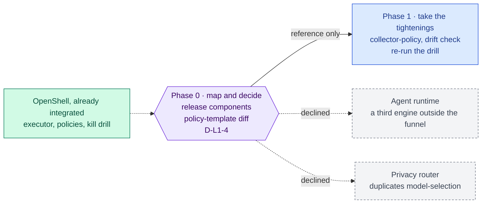

inflect · ai architecture · nemoclaw · roadmap v1 · 2026-10-29

# NemoClaw — what of it is already here, and what is refused, Layer 1

> **Status: living design** — the integration roadmap for NVIDIA NemoClaw,
> which the target diagram places in Layer 1 beside NeMo Guardrails and
> Presidio (the companion markdown does not name it; it names OpenShell under
> Layer 5). The **Current state** section is true today (main 3.338.0,
> `a1c2f05c`). The **Roadmap** section is the plan, and most of it is a
> decision about which half of NemoClaw is wanted. This is a child of
> [`docs/ai-architecture-roadmap.md`](../ai-architecture-roadmap.md): read that
> first for the target map, the global rules **G1–G12**, and the sequencing.
> If the code contradicts a fact here, the code wins and the pull request that
> finds it corrects this document.

## Where it sits in the master roadmap

| | |
| --- | --- |
| Layer · box | 1 — Security, guards & alignment · "nemoclaw"; its substrate (OpenShell) is the blueprint's Layer 5 sandbox |
| Wave | 3 (decision); the OpenShell work it rests on proceeds under its own plan (#3924) independently of this document |
| Depends on | nothing new |
| Unblocks | nothing on the critical path |
| Owner decisions | **D-L1-4** (adopt the policy-template half as reference; decline the agent-runtime and router halves) |

## At a glance

Purple hexagon: the Phase 0 decision. Blue: a phase not yet on `main`; it turns green (`done`) in the pull request that meets its "done when". Dashed: another roadmap this one waits on or unblocks. Pink: the evaluation record. Grey dashed: an outcome that ends the roadmap.



## Current state (true today)

**The substrate NemoClaw is built on is already integrated, as a confinement
for Inflect's own tools.** `src/lib/agentic/openshell/`:

- `transport.ts` — the gateway client: sandbox phases, deletion outcomes
  (with the proto3 zero value handled pessimistically), an `unconfiguredTransport`
  that refuses rather than runs.
- `executor.ts` — an OpenShell backend for `runBoundedTool` (4.2, #3962):
  inherits the deadline and output cap from the wrapper, *throws* when a
  sandbox cannot be created ("a sandbox that cannot be created is a refusal",
  4.2b), and "contains no local-execution arm — not a disabled one, not one
  behind a flag".
- `collector-policy.ts` — network policies for the Powerpipe collectors (4.1,
  #3961): provider-scoped egress allowlists, every endpoint carrying
  `NETWORK_ENFORCEMENT_MODE_ENFORCE` explicitly because the unspecified zero
  value is audit mode.
- `kill-drill.ts` — the drill proves a sandbox is *gone*, not that the call
  returned (5.4, #3974): evidence for `H4.kill_switch_drilled`.
- `policy-drift.ts` — the deployed policy is compared with the repo's.
- Pinned at v0.1.5 → 0.1.6 with verified checksums; the sandbox and
  supervisor images by digest (`2026-10-25-openshell.md`,
  `2026-10-29-openshell-0-1-6-upgrade.md`). **A gateway VM was provisioned
  today** under a hard 5 USD/month cap, triggered by the first production
  caller: the Powerpipe collectors run sandboxed and fail closed when the
  gateway is unreachable (#4443).
- The OpenShell operator skills are vendored into this repository
  (`.claude/skills/openshell-cli`, `generate-sandbox-policy`,
  `debug-openshell-cluster`, `debug-inference`), read in full and reviewed
  (`OPENSHELL-LOCAL-NOTES.md`): "the text is good, and argues for tighter
  controls". `debug-inference` records that OpenShell "no longer supplies a
  managed inference route … the application calls the provider's native
  endpoint and owns its base URL, model, request format, and timeout" —
  i.e. inference routing is the application's, which is how this codebase
  already treats it.

**What is confined and what is not.** OpenShell confines *Inflect's own
binaries* (collectors). It does not run model-written code: `useSandbox`, the
bash tool and the sandbox filesystem tools remain refused by import in
`flue/refused-capabilities.ts` (23 exports), and that refusal is tested.

**Residency routing is the application's** — `model-selection.ts` and the
socket re-checks decide which route a tenant's text may take.

## Fit, and what is deliberately not adopted

**What NemoClaw is, as announced.** NVIDIA's open-source stack (announced at
GTC, March 2026) for running autonomous agents with privacy and security
guardrails: an agent runtime derived from OpenClaw, the OpenShell sandbox
underneath it, a policy layer with a "privacy router" that decides which
requests may go to which model (local vs cloud), and Nemotron models. Exact
packaging and components move quickly; Phase 0 re-reads the current release
before deciding anything.

**Adopted (candidate).** NemoClaw's *sandbox policy templates and profiles*
as **reference material** for `generate-sandbox-policy` and
`collector-policy.ts` — where its templates are tighter than ours, ours
tighten; nothing is imported as a dependency.

**Not adopted, with the reason.**

- *The agent runtime.* A third reasoning engine, outside the funnel (G3),
  the residency decision (G1), the guard sandwich (G4), the decision log,
  the kill switch and the caps. Same verdict as the Langflow runtime
  ([`langflow.md`](./langflow.md)); same argument in `turn-provider.ts`
  about building "a second one of any of them".
- *The privacy router.* It decides local-vs-cloud routing — the exact job of
  `model-selection.ts` + `RESIDENCY_SELECT` + the socket re-checks, which are
  per-tenant, tested, and pinned by the residency guard. A second router is
  a second answer to "where may this tenant's text go".
- *Model-written code in the sandbox.* The sandbox exists; the capability is
  refused, and the refusal is a decision with its own guard, not an oversight
  a stack install should reverse ([`swe-bench.md`](./swe-bench.md) says the
  same from the eval side).
- *NIM-packaged Nemotron inside the stack.* De-NIM (blueprint §3); the model
  route is [`modal-inference.md`](./modal-inference.md).

## Roadmap (future direction)

### Phase 0 — Map the current release to what exists; decide

**Sub-phases.**
- [ ] 0.1 Re-read NemoClaw's current release notes and component list; map
      each component to the module here that already answers for it, or to
      "absent", or to "refused".
- [ ] 0.2 Diff NemoClaw's sandbox policy templates against
      `collector-policy.ts` and the vendored `generate-sandbox-policy` skill;
      list tightenings worth taking.
- [ ] 0.3 D-L1-4 recorded in an implementation note: reference-only adoption;
      runtime and router declined with the reasons above; the OpenShell work
      continues under #3924.

**Prompt.**
```text
Context (main 3.338.0): OpenShell is integrated as the confinement for Inflect's own
collector binaries (src/lib/agentic/openshell/: transport, executor with no local arm,
collector network policies with explicit ENFORCE, kill drill, policy drift; v0.1.6
pinned; gateway VM provisioned 2026-10-29 under a 5 USD/month cap; operator skills
vendored and reviewed). Model-written code in sandboxes is refused by import
(flue/refused-capabilities.ts). Residency routing is model-selection.ts + socket re-
checks. The target diagram lists "nemoclaw" in Layer 1.

Task: docs/implementation-notes/2026-MM-DD-nemoclaw-decision.md. (1) From NemoClaw's
current release, list its components and map each to: the module here that already
answers for it / absent / refused — with the reason for each "refused" (funnel,
residency, guard sandwich, decision log, kill switch, caps). (2) Diff its sandbox policy
templates against collector-policy.ts and the generate-sandbox-policy skill; list
concrete tightenings. (3) Record D-L1-4: reference-only; runtime and privacy router
declined; OpenShell continues under #3924.

Constraints: no dependency, no code beyond policy tightenings proposed as a separate PR.
Do not reverse the sandbox refusal.

Done when: the mapping table exists, tightenings (if any) are proposed as issues, and
D-L1-4 is initialled.
```

**Hardening.** The refusals are the hardening: `flue-refused-capabilities`
(sandbox by import), the residency guard (routing), the engine-neutral tool
core's ESLint ban on engine packages. A Phase 0 that proposes importing any
NemoClaw package has misread this document.

### Phase 1 — Take the tightenings (if any)

Policy diffs from Phase 0.2 land through `collector-policy.ts` and
`policy-drift.ts`, with the drill re-run; the sandbox-policy-review skill's
rule applies — "a policy is not partly enforced".

## Evals for this framework

None of its own. The OpenShell confinement is evidenced by the kill drill
(`H4.kill_switch_drilled`) and `policy-drift.ts`; tightened policies are
evidenced by measured denials on a real run, per `collector-policy.ts`'s own
note ("the honest way to narrow it further is to measure a real run's
denials").

## Updating the master

After Phase 0, the master's row reads "reference-only; runtime and router
declined (D-L1-4)". The master's Layer 5 current-state paragraph already
carries OpenShell; this document adds nothing there.
