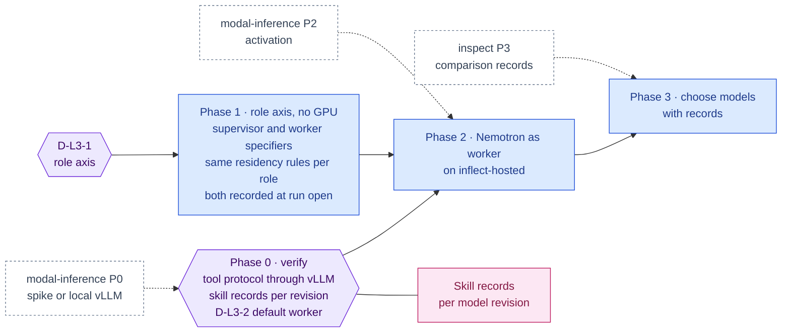

inflect · ai architecture · nemotron reasoning · roadmap v1 · 2026-10-29

# NVIDIA Nemotron as the worker model — the supervisor/worker split, Layer 3

> **Status: living design** — the integration roadmap for open-weight
> Nemotron as the *worker* reasoning model, and for the supervisor/worker role
> split the target architecture draws in Layer 3 ("NVIDIA Nemotron — reason,
> plan, act" beside "Supervisor Agent & Worker Runtime" and the "Claude Agent
> SDK"). The **Current state** section is true today (main 3.338.0,
> `a1c2f05c`). The **Roadmap** section is the plan. This is a child of
> [`docs/ai-architecture-roadmap.md`](../ai-architecture-roadmap.md): read that
> first for the target map, the global rules **G1–G12**, and the sequencing.
> If the code contradicts a fact here, the code wins and the pull request that
> finds it corrects this document.

## Where it sits in the master roadmap

| | |
| --- | --- |
| Layer · box | 3 — Cognitive & reasoning · "NVIDIA Nemotron (Super/Ultra) — reason, plan, act" + "Supervisor Agent & Worker Runtime" |
| Wave | 2, with [`modal-inference.md`](./modal-inference.md); Phase 1 (the role axis) can land in Wave 1 because it needs no GPU |
| Depends on | [`modal-inference.md`](./modal-inference.md) Phase 1 for the hosted arm; nothing for the role axis |
| Unblocks | cheaper subagent fan-out; sovereign-ish workers; [`inspect.md`](./inspect.md) Phase 3 |
| Owner decisions | **D-L3-1** (the supervisor/worker role axis in model selection), **D-L3-2** (Nemotron as the default worker when hosted or local is configured) |

## At a glance

Purple hexagon: the Phase 0 decision. Blue: a phase not yet on `main`; it turns green (`done`) in the pull request that meets its "done when". Dashed: another roadmap this one waits on or unblocks. Pink: the evaluation record. Grey dashed: an outcome that ends the roadmap.



## Current state (true today)

- **Two engines, one model per run, and the model is chosen by residency.**
  Flue (`DRIVER_IMPLEMENTED.flue = true`) and the Claude Tool Runner
  (`'tool-runner': false` — Step 2c flips it). `resolveFlueModel` yields one
  specifier per run: `inflect-external/${AGENT_FLUE_MODEL}` for `EXTERNAL`
  tenants, `inflect-local/${AI_LOCAL_MODEL}` for `LOCAL_ONLY` (or a refusal).
  There is no notion of *role* in the selection: a subagent uses the same
  specifier as its parent.
- **The supervisor/worker shape already exists as subagents.**
  `flue/subagents/`, `subagent-fanout.ts` + `subagent-fanout-policy.ts`,
  `delegation-gate.ts`, `delegation-spans.ts` (Flue Phase 3 shipped since the
  2026-10-09 audit). The parent run is the supervisor in the diagram's sense;
  subagents are the workers; fan-out depth and count are capped; subagent
  tokens are charged to the parent run (`flue-per-turn-accounting`).
- **The "Claude Agent SDK (TypeScript client)" box is partly present.**
  `@anthropic-ai/sdk 1.3.0` powers the Tool Runner engine
  (`src/lib/agentic/tool-runner/`); the Agent SDK proper is designed, not
  built (`docs/claude-agent-sdk-design.md`, living, #4135). The supervisor on
  the external route is Claude today (`ANTHROPIC_MODEL` defaults to
  `claude-haiku-4-5` for posture; `AGENT_FLUE_MODEL` for runs).
- **Thinking and tool-calling shapes are per provider.**
  `flue/thinking-shape.ts` (adaptive thinking for Anthropic),
  `tool-decision.ts`, `json-schema-to-valibot.ts` (tool schemas for pi-ai).
  An OpenAI-compatible worker must present tool calls the way these expect.
- **No Nemotron weights, no vLLM, no GPU** ([`modal-inference.md`](./modal-inference.md)).

## Fit, and what is deliberately not adopted

**Adopted.**

1. *A role axis in model selection*: `role: 'supervisor' | 'worker'` on the
   selection input; the parent run's model is the supervisor's, subagents get
   the worker's; both roles obey the tenant's residency identically (G1).
2. *Nemotron 3 (Super, or Nano as the fallback) as the worker model* on the
   hosted route (Modal) or the local route (a perimeter vLLM), reached through
   `openAICompletionsApi` exactly as `inflect-local` is today. Tool calling
   through vLLM's OpenAI-compatible parser for the model; thinking toggled
   per the model's convention and recorded in `thinking-shape.ts`.
3. *Supervisor validates worker output as untrusted*: subagent output
   re-enters the parent context through `guardUntrustedInput` — already the
   rule for tool results, applied to delegation.

**Not adopted, with the reason.**

- *Nemotron as the supervisor by default.* The supervisor plans, validates
  and synthesises under a policy card; the external frontier model is kept
  there until an Inspect comparison record says otherwise
  ([`inspect.md`](./inspect.md) Phase 3). "Model quality is a decision with
  a record" is the house rule for skills; it applies to models.
- *A second orchestration layer for workers* (the blueprint's "Worker
  Runtime" as a separate service). Workers are subagents in the engine that
  already runs them; a separate runtime would be a third engine outside the
  funnel (G3).
- *Qwen as a sibling default* (blueprint §2). Any open model is reachable
  through the same route by setting `AI_HOSTED_MODEL`; defaults are decided by
  records, and this roadmap records only the Nemotron path.

## Roadmap (future direction)

### Phase 0 — Verify Nemotron serves the engine's tool protocol

**Sub-phases.**
- [ ] 0.1 Against the Modal spike ([`modal-inference.md`](./modal-inference.md)
      Phase 0.5) or a local vLLM: run `tests/flue`'s tool round-trip shape
      through `openAICompletionsApi` with Nemotron; record whether tool calls,
      parallel tool calls, JSON-structured outputs and the thinking toggle
      arrive in the shape `tool-decision.ts` expects.
- [ ] 0.2 Record the vLLM flags (tool-call parser, reasoning parser) in the
      note; they become part of `deploy/modal/nemotron.py`.
- [ ] 0.3 Run the ten skills' evaluation sets with Nemotron as the model
      revision; commit the records (G11) — this is the first number on
      "is Nemotron good enough as a worker".
- [ ] 0.4 D-L3-2 initialled, with the skill records in front of the owner.
      D-L3-1 (the role axis) needs none of this verification and can be
      initialled on its own — which is what lets Phase 1 run in Wave 1,
      before any GPU exists.

**Prompt.**
```text
Context (main 3.338.0): Flue reaches models through pi-ai (anthropicMessagesApi /
openAICompletionsApi) registered in flue/providers.ts; tool calls are mapped in
flue/tool-decision.ts and schemas in json-schema-to-valibot.ts; thinking shape per
provider in flue/thinking-shape.ts; the ten skills under flue/skills/ carry evaluation
sets and records are recomputed from raw answers. A Modal vLLM spike (or a local vLLM)
serves Nemotron 3.

Task: verify Nemotron against the engine's protocol. (1) A scratch harness (not under
src/) that drives the tests/flue tool round-trip shape through openAICompletionsApi at
the vLLM endpoint: single tool call, parallel calls, JSON-structured output, thinking
on/off; record what arrives and what tool-decision.ts would do with it. (2) The vLLM
flags needed (tool-call parser, reasoning parser) recorded in an implementation note and
in deploy/modal/nemotron.py. (3) Run every skill's evaluation set with Nemotron as the
model revision and commit the records under the skills' record locations. (4) Recommend
D-L3-2 (Nemotron as default worker) with the pass rates in front of the owner. D-L3-1
(the role axis) is decided separately and does not wait for this.

Constraints: seed data only; no src/ change; records committed by PR.

Done when: the note answers the four protocol questions, the skill records exist for the
Nemotron revision, and D-L3-2 is initialled.
```

**Hardening.** G11 (the first thing a new model produces is records), G5
(flags and versions pinned in deploy code).

### Phase 1 — The role axis (no GPU needed)

**Gate.** D-L3-1 only. This phase does not wait for Phase 0's verification.

**Sub-phases.**
- [ ] 1.1 `model-selection.ts`: `FlueModelSelection.role`; `resolveFlueModel`
      resolves per role: supervisor → `AGENT_FLUE_MODEL` on the tenant's
      permitted route; worker → `AI_HOSTED_MODEL` on `inflect-hosted` if
      registered, else `AI_LOCAL_MODEL` on `inflect-local` if the tenant may,
      else the supervisor's choice with a `worker_fallback` reason.
      `LOCAL_ONLY` tenants: both roles local or refused — identical rules.
- [ ] 1.2 `subagent-fanout.ts` / `flue/subagents/`: subagents request
      `role: 'worker'`; the parent requests `supervisor`; the run records
      both specifiers in its opening audit entry (the way it records
      `driver` and `policyCardVersion`).
- [ ] 1.3 Subagent output enters the parent through `guardUntrustedInput`
      (assert in a test named for it, if not already).
- [ ] 1.4 Per-turn accounting labels tokens by role; the monthly budget and
      run caps are unchanged (already charged to the parent).
- [ ] 1.5 Tests: "a LOCAL_ONLY tenant's worker never resolves off the local
      route", "worker fallback is recorded with its reason", "a run's
      opening entry carries both specifiers".

**Prompt.**
```text
Context (main 3.338.0 + D-L3-1): resolveFlueModel returns one specifier per run by
residency; subagents (flue/subagents/, subagent-fanout.ts, delegation-gate.ts) share the
parent's specifier; per-turn accounting charges subagent tokens to the parent; the run's
opening audit entry records driver and policyCardVersion. The inflect-hosted id may or may
not exist yet (modal-inference Phase 1).

Task: the supervisor/worker role axis. (1) FlueModelSelection.role: 'supervisor' |
'worker'; resolveFlueModel per role: supervisor → AGENT_FLUE_MODEL on the permitted
route; worker → AI_HOSTED_MODEL on inflect-hosted if registered, else AI_LOCAL_MODEL on
inflect-local if permitted, else the supervisor's choice with reason worker_fallback.
LOCAL_ONLY: both roles local or refused, same rules. (2) Subagents request worker; the
parent supervisor; both specifiers recorded in the opening audit entry. (3) Assert (or
add) guardUntrustedInput on subagent output entering the parent. (4) Token accounting
labelled by role. (5) Tests: "LOCAL_ONLY worker never leaves the local route", "worker
fallback recorded with reason", "opening entry carries both specifiers".

Constraints: no new provider in this phase; the socket re-check (turn-provider.ts,
tool-runner/client.ts) must still refuse a mismatched specifier for either role. The
Tool Runner engine gets the same role resolution through its own clientForRun.

Done when: a Flue run with fan-out shows two specifiers in its ledger and the three
tests are green on a deployment with no hosted route (fallback path) and with one.
```

**Hardening.** G1 (per role, same rules), G4 (delegation output is
untrusted), the opening-entry rule (a hash-chained row cannot be corrected,
so both answers are written before the walk).

### Phase 2 — Nemotron as the worker on the hosted route

**Sub-phases.**
- [ ] 2.1 Depends on [`modal-inference.md`](./modal-inference.md) Phase 2
      (activated) and D-L3-2.
- [ ] 2.2 `AI_HOSTED_MODEL` = the pinned Nemotron revision; `thinking-shape.ts`
      and `tool-decision.ts` carry the Nemotron conventions from Phase 0.
- [ ] 2.3 The decision-log row records the worker specifier per model call
      (already records the model — verify the field carries the hosted id).
- [ ] 2.4 The sub-processor row for Modal names the worker's data category
      (subagent prompts: the delegated task, read-tool output for the task).

**Hardening.** G2 (data category precise to the role), G11 (the skill records
from Phase 0 are the admission evidence).

### Phase 3 — Choose models with records

Inspect's standard evals and the ten product tasks run against candidate
workers (Nemotron 3 Super vs Nano vs the external model) and candidate
supervisors; the comparison record is what changes a default
([`inspect.md`](./inspect.md) Phase 3). Until a record exists, the defaults
above stand.

## Evals for this framework

| What | How | Record |
| --- | --- | --- |
| Protocol fidelity | tool round-trip shapes through vLLM (Phase 0) | note |
| Worker quality | all skills' evaluation sets per model revision | skills records (G11) |
| Role rules | residency tests per role; Inspect "LOCAL_ONLY opens no external socket" | CI + Inspect record |
| Model choice | Inspect comparison across candidates (Phase 3) | comparison record |

## Updating the master

Flip the row on the master [Status board](../ai-architecture-roadmap.md#status-board)
per phase; D-L3-1 / D-L3-2 in the decision table; the model revision in force
is recorded beside the Layer 5 activation in the master.
