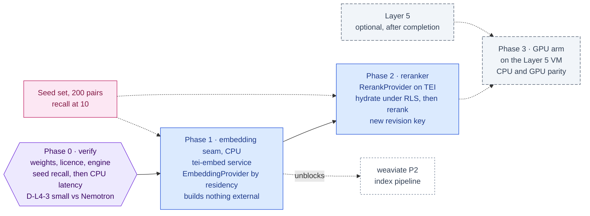

inflect · ai architecture · nemotron retriever · roadmap v1 · 2026-10-29

# NVIDIA Nemotron Retriever — embeddings and reranking, Layer 4

> **Status: living design** — the integration roadmap for the Nemotron
> retriever models (embedding + reranking), named by the target architecture
> for Layer 4 as "NIM embeddings & reranking". The **Current state** section
> is true today (main 3.338.0, `a1c2f05c`). The **Roadmap** section is the
> plan. This is a child of
> [`docs/ai-architecture-roadmap.md`](../ai-architecture-roadmap.md): read that
> first for the target map, the global rules **G1–G13** every phase here
> inherits, and the sequencing. If the code contradicts a fact here, the code
> wins and the pull request that finds it corrects this document.

## Where it sits in the master roadmap

| | |
| --- | --- |
| Layer · box | 4 — Knowledge & deep RAG · "NVIDIA Nemotron Retriever (NIM embeddings & reranking)" |
| Wave | 1 for the CPU embedding and rerank arms (Phases 0–2, zero-GPU). The GPU arm (Phase 3) is optional Layer 5 work, after every other roadmap is complete |
| Depends on | nothing for Phases 0–2; Layer 5 ([`modal-inference.md`](./modal-inference.md)), optional and last, for Phase 3 |
| Unblocks | [`weaviate.md`](./weaviate.md) Phase 2 (nothing to index without a vector), [`ragas.md`](./ragas.md) |
| Owner decisions | **D-L4-3** (**decided 2026-11-11**, owner: benchmark the Nemotron 1B embed and rerank models against a small open model on CPU and keep the smaller unless recall@10 drops by more than an agreed margin; open weights on an open engine, never the NIM container), **D-L4-1** (**decided 2026-11-11**, owner: pgvector first, in the existing Postgres under RLS), **D-L5-1** (decided 2026-10-31: no self-hosting now; Layer 5 optional and last). The margin itself is proposed in the Phase 0 note and not yet agreed |
| Complete at | Phase 2: embeddings and rerank on CPU, in the deployment. Phase 3 is optional Layer 5 work |

## At a glance

Purple hexagon: the Phase 0 decision. Blue: a phase not yet on `main`; it turns green (`done`) in the pull request that meets its "done when". Slate dashed: optional Layer 5 work, which starts only after every other roadmap is complete. Dashed white: another roadmap this one waits on or unblocks. Pink: the evaluation record.



## Current state (true today)

- **No embedding model, no embedding provider, no vector.** See
  [`weaviate.md`](./weaviate.md) § Current state.
- **The model-provider seam already routes by residency, and that is the seam
  an embedding provider must copy.** `src/lib/agentic/flue/model-selection.ts`
  owns the decision: provider ids name a residency (`inflect-external`,
  `inflect-local`), never a vendor; `resolveFlueModel` never builds an external
  route for a `LOCAL_ONLY` tenant; a deployment with no external credential
  registers no external provider at all; the socket boundary re-checks the
  specifier (`assistant/turn-provider.ts`). The local route is
  `AI_LOCAL_BASE_URL` / `AI_LOCAL_MODEL` / `AI_LOCAL_API_KEY` — an
  OpenAI-compatible endpoint "(Ollama / vLLM / …)" inside the operator's
  perimeter. A tenant's stored `aiLocalBaseUrl` is honoured only when it is
  that same address, and refused otherwise (#4545).
- **The sub-processor register lists two model vendors** (OpenRouter, Anthropic)
  and no embedding vendor (`docs/sub-processors.md`). Adding one is the
  four-step process (G2) — which is why the pilot arm below is CPU-local.
- **No NVIDIA software or model is a dependency.** `@flue/runtime`,
  `@earendil-works/pi-ai`, `@anthropic-ai/sdk` are the AI-adjacent packages
  (`package.json`). The OpenShell gateway integration
  (`src/lib/agentic/openshell/`) is a sandbox transport, not a model.

## Fit, and what is deliberately not adopted

**Adopted (D-L4-3, decided 2026-11-11).** Open-weight retriever models served
by an open engine on CPU in the deployment — Hugging Face **Text Embeddings
Inference** (TEI, Apache-2.0) wherever it serves the chosen model — and a GPU arm
only as optional Layer 5 work. Which models is a measurement, not a preference:
the current Nemotron 1B models (*Nemotron 3 Embed 1B* for embedding,
*Llama Nemotron Rerank 1B v2* for reranking, as of 2026-11-11) are benchmarked
against small open multilingual models (BGE / E5 / GTE class, MIT or
Apache-2.0), and **the smaller is kept unless its recall@10 is lower by more than
an agreed margin**. Vectors go to **pgvector** in the existing Postgres, under RLS
(D-L4-1). A single `EmbeddingProvider` seam in `src/lib/ai/embeddings/` that is
residency-routed exactly like `model-selection.ts`.

Phase 0's desk research
([`2026-11-11-retriever-phase0-facts.md`](../implementation-notes/2026-11-11-retriever-phase0-facts.md))
found that TEI's native CPU backend refuses Llama- and Mistral-family models at
start-up, so no current Nemotron retriever model runs on TEI's CPU build without
an ONNX export (untested); the small candidates run on it natively. That is why
the benchmark measures quality first and asks the engine question for a Nemotron
model only if it wins on quality.

**Not adopted, with the reason.**

- *The NIM container.* Production use is NVIDIA AI Enterprise licensing
  (blueprint §3). The weights are open; the container is not free. D-L4-3.
- *Cloud embedding APIs for the pilot* (OpenAI / Cohere / Voyage), which the
  blueprint's pilot phase suggests. Each is a sub-processor receiving business
  content, so each is a 30-day notice before the first vector; a 1B embedding
  model runs on the VM's CPU today with no notice at all. The pilot is
  sovereign because it is cheaper to be.
- *Dense-only.* Hybrid search (full-text + vector) is the store's — Postgres
  full-text beside pgvector under D-L4-1, Weaviate's BM25 only if the store
  moves; the reranker is the second stage over hybrid hits. A dense-only
  pipeline would re-derive what the store already does.

## Roadmap (future direction)

### Phase 0 — Verify the models, the licence and the engine

**Goal.** Facts, not assumptions: which weights, under which licence, on which
engine, how well they retrieve against a small open model (D-L4-3), and at what
latency on this VM's CPU.

**Sub-phases.** The desk research is recorded in
[`2026-11-11-retriever-phase0-facts.md`](../implementation-notes/2026-11-11-retriever-phase0-facts.md);
the measurements are still to run.
- [x] 0.1 Identify the current open-weight Nemotron embed + rerank models and
      their licence; record whether the terms permit multi-tenant SaaS use.
      Done 2026-11-11: Nemotron 3 Embed 1B (OpenMDW-1.1, quoted: SaaS use
      permitted) and Llama Nemotron Rerank 1B v2, the only current 1B Nemotron
      reranker. The Llama-based models carry the Llama 3.2 terms, including a
      "Built with Llama" display obligation.
- [ ] 0.1b Read the licence files in the model repositories themselves before
      any weights enter `deploy/` (G5). Hugging Face was unreachable from the
      session, so Llama Nemotron Rerank 1B v2's own licence is unverified and
      Nemotron 3 Embed's is quoted from NVIDIA's GitHub, not the model card.
- [x] 0.2 Which engine serves which model on CPU. Done 2026-11-11 from TEI's
      source: TEI's native CPU backend refuses Llama- and Mistral-family models,
      so no current Nemotron retriever model runs on TEI's CPU build without an
      ONNX export (untested); the small multilingual candidates (E5, Arctic
      Embed v2 / GTE, BGE-M3, BGE and GTE rerankers) run on it natively, fp32.
- [ ] 0.3 Quality (Q1, engine-independent, in CI): recall@10 and nDCG@10 for
      each embedder alone, then each reranker on a fixed top-50 pool, against
      the 200-pair seed set, with a paired bootstrap interval. The decision rule
      is D-L4-3's; **the margin is proposed, not agreed**: 0.03 absolute
      overall and 0.05 on the Bulgarian slice. Nemotron displaces a small model
      only when the interval's lower bound clears the margin; a suggestive but
      unproven drop grows the set once, to 400, and that verdict is final. The
      record states the smallest drop the set could have shown.
- [ ] 0.4 The 200-pair seed set: seeded questionnaire questions and authored
      questions → chunks of the content the product ships (policy templates,
      control and framework texts), 150 EN, 25 BG → BG, 25 BG → EN; seed data
      only, committed under `tests/fixtures/rag/` with a content hash.
- [ ] 0.5 CPU latency and memory (Q2) on the production VM for the candidates
      Q1 keeps — a Nemotron model only if it won Q1 — through a dispatch-only
      workflow modelled on `VM capacity`: a temporary TEI container at 1.0 CPU,
      p50/p95 for a 20-token query, 32 × 512-token passages and a 1 × 50
      rerank, plus `memory.peak` and the host CPU's flags. Proposed budgets
      (not agreed): query p95 ≤ 250 ms, rerank p95 ≤ 2 s.
- [ ] 0.6 Dependency governance: TEI is a runtime image (digest), the model
      weights are a volume (`deploy/` volume + a checksum of the snapshot
      recorded in the note); no Python enters the app image.
- [ ] 0.7 The vector's shape suits pgvector (D-L4-1): `vector` indexes up to
      2,000 dimensions and `halfvec` up to 4,000, so a 2048-dimension winner
      needs `halfvec`; every small candidate (384–1024) fits `vector`.

**Prompt.**
```text
Context: no embedding model exists. Model routing is residency-based in
src/lib/agentic/flue/model-selection.ts (inflect-external / inflect-local; LOCAL_ONLY
tenants never reach an external route). Runtime images are digest-pinned
(docs/dependency-governance.md). D-L4-3 (decided 2026-11-11): benchmark the Nemotron 1B
embed and rerank models against small open multilingual models on CPU and keep the
smaller unless recall@10 drops by more than the agreed margin. D-L4-1: pgvector first.
docs/implementation-notes/2026-11-11-retriever-phase0-facts.md holds the models,
licences, engine facts and the protocol.

Task: (1) Author the 200-pair seed set described in that note and commit it under
tests/fixtures/rag/ with a SHA-256 of its canonical JSON. (2) Run Q1 in a pinned CI image
(reference implementations, each model's documented query/passage treatment):
recall@10 and nDCG@10 per embedder, then per reranker on the winner's fixed top-50,
with a paired bootstrap 95% interval. (3) Run Q2 on the production VM through a
dispatch-only workflow modelled on vm-capacity.yml, for the candidates Q1 keeps.
(4) Record every number, digest and weights checksum in a new implementation note.

Constraints: no production change beyond the temporary benchmark container, no
dependency added to the app. Apply the note's decision rule as written: the larger
model wins only when its paired interval's lower bound clears the margin; grow the set
at most once, to 400 pairs, and treat that verdict as final; record the smallest drop
each slice could have shown. Read each kept model's licence file in its repository before recording it.

Done when: the record answers 0.3-0.5 with numbers and the seed set is in the repo with
a content hash.
```

**Hardening.** G5 (digests and licence recorded before adoption), G11 (the
seed set is authored now, tied by content hash, so Phase 1 ships with its
evaluation set rather than promising one).

**Done when.** The measurements are on `main` with numbers, the owner has agreed
the margin, and the D-L4-3 rule has picked the embedder and the reranker.
D-L4-3 itself was initialled on 2026-11-11.

### Phase 1 — The embedding seam, CPU-local

**Goal.** One `EmbeddingProvider` interface, residency-routed, with a TEI-on-CPU
backend inside the perimeter and a stub for tests; no sub-processor touched.

**Sub-phases.**
- [ ] 1.1 `deploy/docker-compose.prod.yml`: `tei-embed` service (TEI CPU image,
      digest-pinned, model volume, no published port, `app`/`worker` network
      only). Applied with `deploy/apply.sh`.
- [ ] 1.2 `src/env.ts`: `AI_EMBED_LOCAL_BASE_URL`, `AI_EMBED_LOCAL_MODEL`
      (optional; absent = no local embedding provider constructed).
- [ ] 1.3 `src/lib/ai/embeddings/`: `types.ts` (`EmbeddingProvider.embed(texts,
      { inputType: 'query' | 'passage' })` returning vectors + `model` +
      `dimensions`), `select.ts` (residency routing copied from
      `model-selection.ts`: `inflect-local/<model>` only for now; a
      `LOCAL_ONLY` tenant with no local embed route is **refused**, never
      routed elsewhere), `tei-provider.ts` (OpenAI-compatible `/v1/embeddings`
      through `safeFetch`), `stub-provider.ts` (deterministic hashed vectors
      for tests).
- [ ] 1.4 The factory returns before constructing anything external
      (residency is structural — the `identity-match/index.ts` pattern); the
      residency guard's constructor pin gains the new set.
- [ ] 1.5 Outcome metric `embeddings.requests{provider,outcome}` and a duration
      histogram.

**Prompt.**
```text
Context (main 3.338.0): routing is residency-based (flue/model-selection.ts); the
identity-match provider factory returns BEFORE constructing an external provider and
tests/guards/ai-residency-enforcement.test.ts pins the constructor set; outbound calls go
through safeFetch and new hosts join tests/guards/ssrf-egress-coverage.test.ts's
population; the Compose file is repo-canonical and images are digest-pinned. Phase 0
recorded the model, digest and benchmark.

Task: add the embedding seam. (1) A `tei-embed` service (TEI CPU, digest-pinned, model
volume, no published port). (2) AI_EMBED_LOCAL_BASE_URL / AI_EMBED_LOCAL_MODEL in
src/env.ts, optional. (3) src/lib/ai/embeddings/: types.ts, select.ts (residency routing
— inflect-local only; a LOCAL_ONLY tenant with no local route is refused with a named
reason), tei-provider.ts (POST /v1/embeddings via safeFetch, inputType mapped to the
model's query/passage prefixes, batch ≤ 64, abort on timeout, degrade rather than throw),
stub-provider.ts (deterministic). (4) Factory that returns before constructing anything
external; extend the residency guard's pinned constructor set in the same diff. (5)
Metric embeddings.requests{provider,outcome} + duration histogram.

Constraints: no cloud embedding API. The base URL is operator config, never tenant-
writable. A per-tenant override, if added, follows aiLocalBaseUrl's rule: honoured only
when it is the deployment's own address (#4545). Name tests for invariants: "a LOCAL_ONLY tenant with no local embed route is
refused", "embed() never sends a specifier addressed to another provider", "the factory
constructs nothing external for LOCAL_ONLY".

Done when: typecheck/lint green, the residency guard green with the new set, the SSRF
egress guard sees the new sink, and the two-tenant job test in weaviate.md Phase 2 passes
against the real provider in the integration project.
```

**Hardening.** G1 (residency first, structural), G6 (`safeFetch`, egress
population), G5 (image + volume, no Python in the app image), G9 (absent
config = no provider), checklist §3/§4 (runtime wiring, outcome metric). The
`inputType` mapping is not cosmetic: asymmetric retrieval models score query
and passage differently, and mixing them silently degrades recall.

**Done when.** `knowledge-index` ([`weaviate.md`](./weaviate.md) Phase 2)
produces vectors from the CPU TEI service for a seeded tenant, and the
recall@10 on the Phase 0 seed set matches Phase 0's number within noise.

### Phase 2 — The reranker (second stage)

**Goal.** Top-k hybrid hits re-ordered by the cross-encoder; a revision change
the mount gate can see.

**Sub-phases.**
- [ ] 2.1 `RerankProvider.rerank(query, passages, { topN })` beside the embedding
      seam, same residency routing, TEI `/rerank` backend on the same service
      (second model on the same container or a sibling `tei-rerank`).
- [ ] 2.2 `VectorRepository.search` gains `rerank: true` → hybrid top-50 then
      rerank to k; the revision key for the mount gate includes the rerank
      model id.
- [ ] 2.3 Text hydration happens **before** rerank (the cross-encoder needs the
      passage) and **under RLS** — never from the vector store.
- [ ] 2.4 Seed-set eval re-run; the record is refreshed or the gate refuses.

**Prompt.**
```text
Context (main 3.338.0): the embedding seam (Phase 1) and VectorRepository.search (weaviate
Phase 3) exist; the search_knowledge mount gate consumes a RAG evaluation record keyed by
(embeddingModel, chunker, k, alpha). Chunk text is hydrated from Postgres under RLS, never
from any store outside Postgres (vectors-only rule D-L4-2, adopted 2026-11-11).

Task: add reranking. (1) RerankProvider in src/lib/ai/embeddings/ (TEI /rerank backend,
same residency routing and factory rules as the embedding provider, stub for tests). (2)
VectorRepository.search({ rerank: true }): hybrid top-50 → hydrate text under RLS →
rerank → top-k. (3) Extend the mount-gate revision key with rerankModel so the existing
record no longer satisfies it. (4) Re-run the seed-set eval and commit the new record.

Constraints: hydration before rerank, under RLS, through the repositories. Passage
count sent to the reranker is bounded (≤ 50). A reranker failure degrades to the hybrid
order with a WARN and an outcome label, never to an empty result. Tests: "rerank never
receives a passage the tenant cannot read", "a reranker outage returns hybrid order".

Done when: recall@10 with rerank meets or beats Phase 0's number, the gate refuses
until the new record lands, and the degradation test is green.
```

**Hardening.** G7 (hydration under RLS is the isolation boundary for the
cross-encoder), G11 (a new model in the chain is a new revision, and a new
revision has no record until one is produced), G4 unchanged (results are
scanned at the tool boundary, after rerank).

**Done when.** The nightly RAG eval shows the rerank gain and the gate is on.

### Phase 3 — The GPU arm (optional, Layer 5)

**Goal.** The same two providers served on the Layer 5 GPU VM, for a
deployment that takes Layer 5 up after every other roadmap is complete.

**Sub-phases.**
- [ ] 3.1 Depends on a production local route
      ([`modal-inference.md`](./modal-inference.md) Phase 2).
- [ ] 3.2 TEI's GPU image on the Layer 5 VM, exposing `/v1/embeddings` and
      `/rerank`, deployed from the Layer 5 scripts — Python and drivers stay
      on the VM, never in the app.
- [ ] 3.3 `select.ts` routes to the GPU arm through the local route for the
      tenants who may use it. A VM in the operator's own Google Cloud project
      is local, so `LOCAL_ONLY` tenants may use it too.
- [ ] 3.4 Same model, same dimensions, same revision key: a vector produced on
      CPU and on GPU must be interchangeable, proven by a test that embeds the
      seed set on both and compares cosine ≥ 0.999.

**Prompt.**
```text
Context (main + Layer 5 taken up): the embedding + rerank seam (Phases 1–2) runs on CPU
in the deployment and routes by residency; a production local route exists on the
Layer 5 GPU VM (modal-inference.md Phase 2), reached through AI_LOCAL_* style operator
configuration.

Task: add the GPU arm. (1) TEI's GPU image for the pinned embed + rerank models on the
Layer 5 VM, weights on the VM's disk, behind the same operator-held token as the local
model route. (2) select.ts: route to the GPU arm through the local route when it is
configured; fall back to the CPU arm when it is not. (3) A parity test: the seed set
embedded on the CPU and the GPU arm agree (cosine ≥ 0.999) — the revision key must NOT
change between arms. (4) Metric label provider=local-gpu.

Constraints: the GPU arm's address is operator config, never tenant-writable; the token
is a secret in the environment file (never echoed). Nothing external is reached.

Done when: the parity test is green against the deployed GPU arm, the residency tests are
green, and the embeddings metric shows both arms.
```

**Hardening.** G1 (the arm is chosen by residency, re-checked at the socket),
G9 (an unconfigured GPU arm registers nothing and the CPU arm serves). Parity
is the eval: two arms that disagree are two models, and two models are two
revisions.

**Done when.** A deployment with the GPU arm configured embeds on it; one
without it is byte-identical to Phase 2.

## Evals for this framework

| What | How | Record |
| --- | --- | --- |
| Retrieval quality | recall@10 on the 200-pair seed set, with and without rerank (Phase 0, re-run per revision) | evaluation record (G11) consumed by the `search_knowledge` mount gate |
| Cross-arm parity | CPU vs GPU cosine ≥ 0.999 on the seed set (Phase 3, optional) | CI, when the GPU arm is configured |
| Latency | p50/p95 per provider | `embeddings.requests` histogram |
| Residency | "LOCAL_ONLY never reaches an external provider" | unit + guard, every phase |

## Updating the master

Flip the row on the master [Status board](../ai-architecture-roadmap.md#status-board)
per phase; D-L4-3 and the model/revision in force are recorded in the master's
decision table and in the Phase 0 note. If Phase 3 lands, the master's
"Layer 5 is optional by construction" section lists the retriever's GPU arm.
