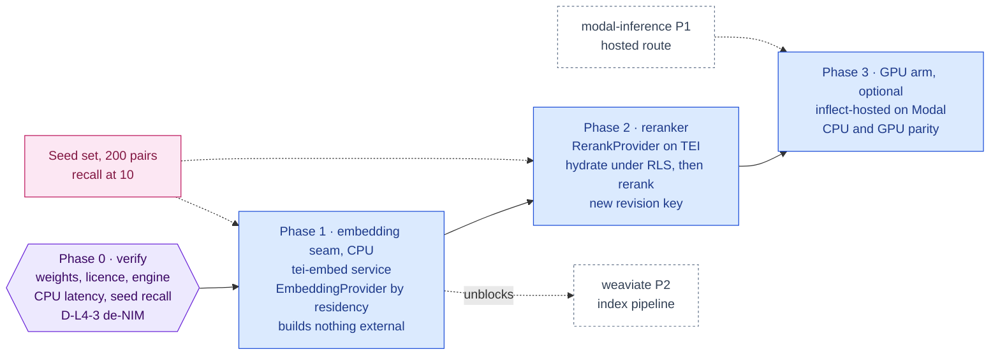

inflect · ai architecture · nemotron retriever · roadmap v1 · 2026-10-29

# NVIDIA Nemotron Retriever — embeddings and reranking, Layer 4

> **Status: living design** — the integration roadmap for the Nemotron
> retriever models (embedding + reranking), named by the target architecture
> for Layer 4 as "NIM embeddings & reranking". The **Current state** section
> is true today (main 3.338.0, `a1c2f05c`). The **Roadmap** section is the
> plan. This is a child of
> [`docs/ai-architecture-roadmap.md`](../ai-architecture-roadmap.md): read that
> first for the target map, the global rules **G1–G12** every phase here
> inherits, and the sequencing. If the code contradicts a fact here, the code
> wins and the pull request that finds it corrects this document.

## Where it sits in the master roadmap

| | |
| --- | --- |
| Layer · box | 4 — Knowledge & deep RAG · "NVIDIA Nemotron Retriever (NIM embeddings & reranking)" |
| Wave | 1 for the CPU embedding arm (zero-GPU); 2 for the GPU arm on Modal |
| Depends on | nothing for Phase 1; [`modal-inference.md`](./modal-inference.md) for Phase 3 |
| Unblocks | [`weaviate.md`](./weaviate.md) Phase 2 (nothing to index without a vector), [`ragas.md`](./ragas.md) |
| Owner decisions | **D-L4-3** (de-NIM: open weights on TEI/vLLM, never the NIM container), **D-L5-1** (the hosted route exists at all) |

## At a glance

Purple hexagon: the Phase 0 decision. Blue: a phase not yet on `main`; it turns green (`done`) in the pull request that meets its "done when". Dashed: another roadmap this one waits on or unblocks. Pink: the evaluation record. Grey dashed: an outcome that ends the roadmap.



## Current state (true today)

- **No embedding model, no embedding provider, no vector.** See
  [`weaviate.md`](./weaviate.md) § Current state.
- **The model-provider seam already routes by residency, and that is the seam
  an embedding provider must copy.** `src/lib/agentic/flue/model-selection.ts`
  owns the decision: provider ids name a residency (`inflect-external`,
  `inflect-local`), never a vendor; `resolveFlueModel` never builds an external
  route for a `LOCAL_ONLY` tenant; a deployment with no external credential
  registers no external provider at all; the socket boundary re-checks the
  specifier (`assistant/turn-provider.ts`). The local route is
  `AI_LOCAL_BASE_URL` / `AI_LOCAL_MODEL` / `AI_LOCAL_API_KEY` — an
  OpenAI-compatible endpoint "(Ollama / vLLM / …)" inside the operator's
  perimeter, with a per-tenant `aiLocalBaseUrl` override.
- **The sub-processor register lists two model vendors** (OpenRouter, Anthropic)
  and no embedding vendor (`docs/sub-processors.md`). Adding one is the
  four-step process (G2) — which is why the pilot arm below is CPU-local.
- **No NVIDIA software or model is a dependency.** `@flue/runtime`,
  `@earendil-works/pi-ai`, `@anthropic-ai/sdk` are the AI-adjacent packages
  (`package.json`). The OpenShell gateway integration
  (`src/lib/agentic/openshell/`) is a sandbox transport, not a model.

## Fit, and what is deliberately not adopted

**Adopted.** The open-weight Nemotron retriever models — at the time of writing
the *Llama-Nemotron Embed 1B v2* and *Llama-Nemotron Rerank 1B v2* family, or
their current successors — served by an open engine: Hugging Face **Text
Embeddings Inference** (TEI, Apache-2.0) on CPU for the pilot, TEI or vLLM on a
Modal GPU for production. A single `EmbeddingProvider` seam in
`src/lib/ai/embeddings/` that is residency-routed exactly like
`model-selection.ts`.

**Not adopted, with the reason.**

- *The NIM container.* Production use is NVIDIA AI Enterprise licensing
  (blueprint §3). The weights are open; the container is not free. D-L4-3.
- *Cloud embedding APIs for the pilot* (OpenAI / Cohere / Voyage), which the
  blueprint's pilot phase suggests. Each is a sub-processor receiving business
  content, so each is a 30-day notice before the first vector; a 1B embedding
  model runs on the VM's CPU today with no notice at all. The pilot is
  sovereign because it is cheaper to be.
- *Dense-only.* Hybrid search (BM25 + vector) is Weaviate's; the reranker is
  the second stage over hybrid hits. A dense-only pipeline would re-derive what
  the store already does.

## Roadmap (future direction)

### Phase 0 — Verify the models, the licence and the engine

**Goal.** Facts, not assumptions: which weights, under which licence, on which
engine, at what latency on this VM's CPU.

**Sub-phases.**
- [ ] 0.1 Identify the current open-weight Nemotron embed + rerank models and
      their licence text (NVIDIA Open Model License); record that the terms
      permit multi-tenant SaaS use — if they do not, this roadmap stops here.
- [ ] 0.2 Confirm TEI serves both (embedding; reranker via the `/rerank`
      route) on CPU; record dimensions, max sequence length, pooling.
- [ ] 0.3 Benchmark on the VM's CPU: p50/p95 for a 512-token passage and a
      20-token query, batch 32 — this decides whether Phase 1 ships or Phase 3
      comes first.
- [ ] 0.4 Retrieval quality on a 200-pair seed set (questions from the
      questionnaire answer library → the policy/evidence chunk that answers
      them): recall@10 for the embed model alone, then with the reranker.
- [ ] 0.5 Dependency governance: TEI is a runtime image (digest), the model
      weights are a volume (`deploy/` volume + a checksum of the snapshot
      recorded in the note); no Python enters the app image.

**Prompt.**
```text
Context (main 3.338.0): no embedding model exists. Model routing is residency-based in
src/lib/agentic/flue/model-selection.ts (inflect-external / inflect-local; LOCAL_ONLY
tenants never reach an external route). The local route is AI_LOCAL_BASE_URL (OpenAI-
compatible). Runtime images are digest-pinned (docs/dependency-governance.md). The target
names the Nemotron Retriever; the blueprint says de-NIM (open weights on open engines).

Task: a verification note, docs/implementation-notes/2026-MM-DD-nemotron-retriever-
verification.md. (1) Name the current open-weight Nemotron embed and rerank models and
quote the licence terms on multi-tenant commercial use. (2) Stand up TEI (CPU) locally
with both, record dimensions/max length/pooling and the exact image digest. (3) Benchmark
p50/p95 on a 512-token passage and a 20-token query at batch 32 on hardware comparable
to the production VM. (4) Build a 200-pair seed set from the questionnaire answer library
(question → the policy/evidence chunk that answers it) and report recall@10 with and
without the reranker. Commit the set under tests/fixtures/rag/ (seed data only, no
customer content).

Constraints: no production change, no dependency added. If the licence forbids SaaS use,
say so first and stop. Pin every version and digest you touched.

Done when: the note answers the five sub-phases with numbers and the seed set is in
the repo with a content hash.
```

**Hardening.** G5 (digests and licence recorded before adoption), G11 (the
seed set is authored now, tied by content hash, so Phase 1 ships with its
evaluation set rather than promising one).

**Done when.** The note is on `main` with numbers, and the owner has initialled
D-L4-3.

### Phase 1 — The embedding seam, CPU-local

**Goal.** One `EmbeddingProvider` interface, residency-routed, with a TEI-on-CPU
backend inside the perimeter and a stub for tests; no sub-processor touched.

**Sub-phases.**
- [ ] 1.1 `deploy/docker-compose.prod.yml`: `tei-embed` service (TEI CPU image,
      digest-pinned, model volume, no published port, `app`/`worker` network
      only). Applied with `deploy/apply.sh`.
- [ ] 1.2 `src/env.ts`: `AI_EMBED_LOCAL_BASE_URL`, `AI_EMBED_LOCAL_MODEL`
      (optional; absent = no local embedding provider constructed).
- [ ] 1.3 `src/lib/ai/embeddings/`: `types.ts` (`EmbeddingProvider.embed(texts,
      { inputType: 'query' | 'passage' })` returning vectors + `model` +
      `dimensions`), `select.ts` (residency routing copied from
      `model-selection.ts`: `inflect-local/<model>` only for now; a
      `LOCAL_ONLY` tenant with no local embed route is **refused**, never
      routed elsewhere), `tei-provider.ts` (OpenAI-compatible `/v1/embeddings`
      through `safeFetch`), `stub-provider.ts` (deterministic hashed vectors
      for tests).
- [ ] 1.4 The factory returns before constructing anything external
      (residency is structural — the `identity-match/index.ts` pattern); the
      residency guard's constructor pin gains the new set.
- [ ] 1.5 Outcome metric `embeddings.requests{provider,outcome}` and a duration
      histogram.

**Prompt.**
```text
Context (main 3.338.0): routing is residency-based (flue/model-selection.ts); the
identity-match provider factory returns BEFORE constructing an external provider and
tests/guards/ai-residency-enforcement.test.ts pins the constructor set; outbound calls go
through safeFetch and new hosts join tests/guards/ssrf-egress-coverage.test.ts's
population; the Compose file is repo-canonical and images are digest-pinned. Phase 0
recorded the model, digest and benchmark.

Task: add the embedding seam. (1) A `tei-embed` service (TEI CPU, digest-pinned, model
volume, no published port). (2) AI_EMBED_LOCAL_BASE_URL / AI_EMBED_LOCAL_MODEL in
src/env.ts, optional. (3) src/lib/ai/embeddings/: types.ts, select.ts (residency routing
— inflect-local only; a LOCAL_ONLY tenant with no local route is refused with a named
reason), tei-provider.ts (POST /v1/embeddings via safeFetch, inputType mapped to the
model's query/passage prefixes, batch ≤ 64, abort on timeout, degrade rather than throw),
stub-provider.ts (deterministic). (4) Factory that returns before constructing anything
external; extend the residency guard's pinned constructor set in the same diff. (5)
Metric embeddings.requests{provider,outcome} + duration histogram.

Constraints: no cloud embedding API. The base URL is operator config, never tenant-
writable (a per-tenant override, if added, follows aiLocalBaseUrl's existing shape and
checks). Name tests for invariants: "a LOCAL_ONLY tenant with no local embed route is
refused", "embed() never sends a specifier addressed to another provider", "the factory
constructs nothing external for LOCAL_ONLY".

Done when: typecheck/lint green, the residency guard green with the new set, the SSRF
egress guard sees the new sink, and the two-tenant job test in weaviate.md Phase 2 passes
against the real provider in the integration project.
```

**Hardening.** G1 (residency first, structural), G6 (`safeFetch`, egress
population), G5 (image + volume, no Python in the app image), G9 (absent
config = no provider), checklist §3/§4 (runtime wiring, outcome metric). The
`inputType` mapping is not cosmetic: asymmetric retrieval models score query
and passage differently, and mixing them silently degrades recall.

**Done when.** `knowledge-index` ([`weaviate.md`](./weaviate.md) Phase 2)
produces vectors from the CPU TEI service for a seeded tenant, and the
recall@10 on the Phase 0 seed set matches Phase 0's number within noise.

### Phase 2 — The reranker (second stage)

**Goal.** Top-k hybrid hits re-ordered by the cross-encoder; a revision change
the mount gate can see.

**Sub-phases.**
- [ ] 2.1 `RerankProvider.rerank(query, passages, { topN })` beside the embedding
      seam, same residency routing, TEI `/rerank` backend on the same service
      (second model on the same container or a sibling `tei-rerank`).
- [ ] 2.2 `VectorRepository.search` gains `rerank: true` → hybrid top-50 then
      rerank to k; the revision key for the mount gate includes the rerank
      model id.
- [ ] 2.3 Text hydration happens **before** rerank (the cross-encoder needs the
      passage) and **under RLS** — never from the vector store.
- [ ] 2.4 Seed-set eval re-run; the record is refreshed or the gate refuses.

**Prompt.**
```text
Context (main 3.338.0): the embedding seam (Phase 1) and VectorRepository.search (weaviate
Phase 3) exist; the search_knowledge mount gate consumes a RAG evaluation record keyed by
(embeddingModel, chunker, k, alpha). Chunk text is hydrated from Postgres under RLS, never
from Weaviate (vectors-only rule D-L4-2).

Task: add reranking. (1) RerankProvider in src/lib/ai/embeddings/ (TEI /rerank backend,
same residency routing and factory rules as the embedding provider, stub for tests). (2)
VectorRepository.search({ rerank: true }): hybrid top-50 → hydrate text under RLS →
rerank → top-k. (3) Extend the mount-gate revision key with rerankModel so the existing
record no longer satisfies it. (4) Re-run the seed-set eval and commit the new record.

Constraints: hydration before rerank, under RLS, through the repositories. Passage
count sent to the reranker is bounded (≤ 50). A reranker failure degrades to the hybrid
order with a WARN and an outcome label, never to an empty result. Tests: "rerank never
receives a passage the tenant cannot read", "a reranker outage returns hybrid order".

Done when: recall@10 with rerank meets or beats Phase 0's number, the gate refuses
until the new record lands, and the degradation test is green.
```

**Hardening.** G7 (hydration under RLS is the isolation boundary for the
cross-encoder), G11 (a new model in the chain is a new revision, and a new
revision has no record until one is produced), G4 unchanged (results are
scanned at the tool boundary, after rerank).

**Done when.** The nightly RAG eval shows the rerank gain and the gate is on.

### Phase 3 — The GPU arm on Modal (optional Layer 5)

**Goal.** The same two providers behind a `inflect-hosted/<model>` specifier,
served by TEI or vLLM on a Modal GPU, for deployments that opted into Layer 5.

**Sub-phases.**
- [ ] 3.1 Depends on [`modal-inference.md`](./modal-inference.md) Phase 1 (the
      hosted route, the sub-processor row, the `AI_HOSTED_*` env).
- [ ] 3.2 A Modal function `embed` (TEI GPU image, model volume, scale-to-zero,
      proxy-auth token) exposing `/v1/embeddings` and `/rerank`; deployed from
      `deploy/modal/retriever.py` — Python stays in `deploy/`.
- [ ] 3.3 `select.ts` routes `EXTERNAL` tenants to `inflect-hosted` when
      configured, `LOCAL_ONLY` tenants to `inflect-local` only — the hosted
      route is **not** local (master § Layer 5 is optional by construction).
- [ ] 3.4 Same model, same dimensions, same revision key: a vector produced on
      CPU and on GPU must be interchangeable, proven by a test that embeds the
      seed set on both and compares cosine ≥ 0.999.

**Prompt.**
```text
Context (main 3.338.0 + modal-inference Phase 1): the hosted route `inflect-hosted` exists
with AI_HOSTED_BASE_URL / AI_HOSTED_API_KEY, Modal is on the sub-processor register, and
Python deployment code lives under deploy/modal/. The embedding + rerank seam (Phases 1–2)
routes by residency.

Task: add the GPU arm. (1) deploy/modal/retriever.py: a Modal app with one GPU function
serving TEI (or vLLM embeddings) for the pinned embed + rerank models, model weights on a
Modal Volume, scaledown to zero, proxy-auth token, region pinned per the modal-inference
Phase 0 decision. (2) select.ts: EXTERNAL tenants may route to inflect-hosted/<model>
when configured; LOCAL_ONLY never does. (3) A parity test: the seed set embedded on the
CPU and the hosted arm agree (cosine ≥ 0.999) — the revision key must NOT change between
arms. (4) Metric label provider=hosted.

Constraints: the hosted base URL is operator config; the token is a secret in .env.prod
(never echoed). A LOCAL_ONLY tenant must be unable to reach the hosted arm by any
specifier — add that to the socket-boundary re-check. No Python outside deploy/.

Done when: the parity test is green against a deployed Modal function, the residency
tests are green, and the embeddings metric shows both providers.
```

**Hardening.** G1 (hosted ≠ local — the whole point of the third id), G2
(Modal's row is a precondition, not a follow-up), G12 (absent `AI_HOSTED_*` =
nothing deployed, nothing registered). Parity is the eval: two arms that
disagree are two models, and two models are two revisions.

**Done when.** A deployment with `AI_HOSTED_*` set embeds on Modal; one without
it is byte-identical to Phase 2.

## Evals for this framework

| What | How | Record |
| --- | --- | --- |
| Retrieval quality | recall@10 on the 200-pair seed set, with and without rerank (Phase 0, re-run per revision) | evaluation record (G11) consumed by the `search_knowledge` mount gate |
| Cross-arm parity | CPU vs hosted cosine ≥ 0.999 on the seed set (Phase 3) | CI, when the hosted arm is configured |
| Latency | p50/p95 per provider | `embeddings.requests` histogram |
| Residency | "LOCAL_ONLY never reaches hosted/external" | unit + guard, every phase |

## Updating the master

Flip the row on the master [Status board](../ai-architecture-roadmap.md#status-board)
per phase; D-L4-3 and the model/revision in force are recorded in the master's
decision table and in the Phase 0 note. When Phase 3 lands, the master's
"Layer 5 is optional by construction" section lists the retriever among the
hosted functions.
