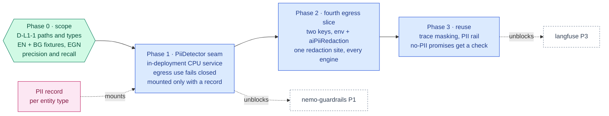

inflect · ai architecture · presidio · roadmap v1 · 2026-10-29

# Microsoft Presidio — PII detection and redaction, Layer 1

> **Status: living design** — the integration roadmap for Microsoft Presidio,
> named by the target architecture for Layer 1 as "PII redaction". The
> **Current state** section is true today (main 3.338.0, `a1c2f05c`, plus
> Phase 0 of 2026-11-11). The **Roadmap** section is the plan. This is a child
> of [`docs/ai-architecture-roadmap.md`](../ai-architecture-roadmap.md): read that
> first for the target map, the global rules **G1–G13**, and the sequencing.
> If the code contradicts a fact here, the code wins and the pull request that
> finds it corrects this document.

## Where it sits in the master roadmap

| | |
| --- | --- |
| Layer · box | 1 — Security, guards & alignment · "Microsoft Presidio (PII redaction)" |
| Wave | 3 — first of the Layer 1 additions, because [`langfuse.md`](./langfuse.md) capture-on and [`nemo-guardrails.md`](./nemo-guardrails.md) PII rails both wait on it |
| Depends on | nothing (CPU, in-deployment) |
| Unblocks | content capture in tracing; PII rails; an enforced "no PII" on sub-processor rows that currently promise it by construction |
| Owner decisions | **D-L1-1** (redaction scope) — decided 2026-11-11: external model routes only; PERSON, EMAIL, PHONE, IBAN, ЕГН; EN + BG; `LOCAL_ONLY` local route not redacted. Recorded in [`2026-11-11-pii-redaction-decision.md`](../implementation-notes/2026-11-11-pii-redaction-decision.md) |
| Complete at | Phase 3 |

## At a glance

Purple hexagon: the Phase 0 decision. Blue: a phase not yet on `main`; it turns green (`done`) in the pull request that meets its "done when". Dashed: another roadmap this one waits on or unblocks. Pink: the evaluation record. Grey dashed: an outcome that ends the roadmap.



## Current state (true today)

- **PII is protected by encryption and by not sending it, not by detecting
  it.** Business content is encrypted at rest (Epic B manifest); several
  sub-processor rows promise "no PII" *by construction* — the posture summary
  sends "aggregate metrics only (counts + percentages — no PII, no entity
  text)"; the audit stream drops free-text `details`; the withdrawn TypeSafe
  row excluded email domains and employee numbers by field selection. Nothing
  *checks* a payload for PII before it leaves; the promise holds as long as
  the field selection does.
- **The egress scanner looks for secrets, not persons.**
  `guard/egress-scanner.ts` + `patterns.ts` catch API keys and credential
  shapes (the `pass|pwd|hash|salt|secret|token|pin|ssn|egn|ЕГН|national.?id|iban|card`
  never-request denylist in the legacy-access usecase is a *column-name*
  check). The one `pii` mention in the guard is incidental.
- **Content that leaves to a model vendor today** (per `docs/sub-processors.md`):
  risk titles/descriptions, asset names, agent-run prompts including read-tool
  output and, for `discovered-agent-review`, a person reference
  (`DiscoveredAgent.ownerRef`). Questionnaire grounding ships evidence titles
  only — a design choice made *because* there was no redactor.
- **Legacy-access data is neutralised by hand-written rules** (names
  neutralised, email local part only — the reconciliation engine's own
  normalisers), not by a general PII detector.
- **No Presidio, no NER model, no Python** in the app (G5). Phase 0 (2026-11-11)
  added the detector's *image source* only: `guards/presidio/` holds the
  analyzer configuration (five entity types, EN + BG), the custom recognisers
  (ЕГН by date and checksum, Bulgarian and UK phones, Bulgarian names in both
  scripts, an e-mail recogniser that makes no network call) and their pytest
  suite, behind a digest-pinned `Dockerfile` with no entrypoint, in no Compose
  file and built by no CI job yet. Its `test` stage builds from the repository
  root with its own context (`Dockerfile.dockerignore`, an allowlist, because
  the root one excludes `tests/`) and runs the pytest suite. Nothing calls it.
- **D-L1-1 is decided and is code.** `src/lib/ai/pii/scope.ts` holds the five
  types (`PERSON`, `EMAIL_ADDRESS`, `PHONE_NUMBER`, `IBAN_CODE`, `BG_EGN`), the
  two locales and `LOCAL_ROUTE_REDACTED = false`.
- **A fixture corpus and a first record exist.** `tests/fixtures/pii/` is 85
  generated EN + BG cases with ground-truth spans in all four case kinds; a
  Jest test regenerates it and refuses a hand edit.
  `src/lib/ai/pii/evaluation-record.ts` recomputes per-type, per-locale
  precision and recall from a record's raw spans, and
  `evals/pii/records/` holds one record for the current configuration hash
  (CI fails when a recogniser changes without a new one). Its figures are a
  development-set measure — the recognisers were corrected against the same
  corpus — and are not yet a mount condition.

## Fit, and what is deliberately not adopted

**Adopted.** Presidio (MIT) — `presidio-analyzer` (recognisers: regex,
checksum, NER via spaCy/transformers) and `presidio-anonymizer` — as a
**CPU service inside the deployment**, reached over HTTP by a `PiiDetector`
seam, for three jobs in this order:

1. *Egress redaction* — a fourth slice beside the three in
   `tools-adapter.ts`: text bound for an **external** provider is redacted
   (replace / hash / mask per entity type) and the redaction count is recorded
   on the decision-log row. Not for `LOCAL_ONLY` tenants' local route, where
   nothing leaves the perimeter (unless the tenant asks).
2. *Trace masking* — the Langfuse `mask` hook ([`langfuse.md`](./langfuse.md)
   Phase 3) and any future content capture.
3. *Turning "no PII" promises into checks* — the posture summary and audit
   stream payloads pass an assertion in tests and a counter in production.

**Locales.** The product is EN + BG (next-intl parity enforced). Recognisers
for Bulgarian **ЕГН** (10 digits, checksum), IBAN, EU phone formats, and
Bulgarian/Cyrillic person names are custom recognisers Presidio does not ship;
they are the first Phase 1 deliverable and the reason a fixture set matters.

**Not adopted, with the reason.**

- *A cloud PII API* (Azure AI Language PII, etc.). A sub-processor that
  receives every payload in order to decide what another sub-processor may
  receive — the wrong direction. Presidio on CPU, in the deployment.
- *Redacting at rest.* Encryption already protects storage; redaction at rest
  would destroy evidence the product exists to keep. Redaction is a property
  of a *path*, applied at egress.
- *Redaction as the only control.* NER misses; the field-selection promises
  stay, and Presidio is the check behind them, not a licence to send more.

## Roadmap (future direction)

### Phase 0 — Scope, fixtures, recognisers

**Sub-phases.**
- [x] 0.1 D-L1-1 (owner, initialled 2026-11-11): external model routes only;
      PERSON, EMAIL, PHONE, IBAN, ЕГН — LOCATION and ORG are out of scope, not
      flag-only; EN + BG; `LOCAL_ONLY` tenants' local route is not redacted.
      The action per type was not part of the decision; the recorded default
      is a numbered typed placeholder (`<PERSON_1>`) for all five, which
      Phase 1's `policy.ts` encodes.
- [x] 0.2 `tests/fixtures/pii/`: `generate.ts` (seeded) → `corpus.json` +
      `corpus.sha256`; 85 cases, task / refusal / injection / missing-input in
      both locales; Latin and Cyrillic names (with patronymics), computed ЕГН
      and IBAN check digits, BG and Ofcom-drama UK phones, reserved e-mail
      domains, unlabelled addresses and organisations. Offsets are UTF-16 and
      the corpus stays in the BMP, so they equal Python's.
- [x] 0.3 `guards/presidio/inflect_pii/`: `BgEgnRecognizer` (date and
      checksum), `BgPhoneRecognizer` (libphonenumber, regions BG + GB — under
      the default regions every ЕГН is also a phone number — and no written
      dates), `BulgarianNameRecognizer` (morphology, both scripts,
      case-sensitive), `OfflineEmailRecognizer` (the stock one asks
      publicsuffix.org and refuses private TLDs: 0 of 17 fixture e-mails
      found). NER models: `en_core_web_sm` (EN) and `xx_ent_wiki_sm` (BG; no
      spaCy pipeline is trained on Bulgarian), pinned by sha256.
- [x] 0.4 `evals/pii/records/e6ff3ad0d4d33dba.json`, scored by
      `scorePiiRecord`: recall 1.0 for every type in both locales; precision
      1.0 except PERSON (EN 0.71, BG 0.96, all NER false positives). A
      development-set figure: a held-out corpus (different templates and
      pools) comes before any record is a mount condition (Phase 1.4).

**Prompt.**
```text
Context (main 3.338.0): PII protection is encryption at rest plus field selection
("no PII by construction" on several sub-processor rows); the egress scanner detects
secrets, not persons; product locales are EN + BG; legacy-access data is neutralised by
hand-written rules; Python runs in images only. The target names Microsoft Presidio for
PII redaction.

Task: scope and fixtures. (1) docs/implementation-notes/2026-MM-DD-pii-redaction-
decision.md recording D-L1-1: egress paths (external model providers first), entity
types (PERSON, EMAIL, PHONE, IBAN, EGN/ЕГН, LOCATION; ORG as flag-only), action per
type, LOCAL_ONLY handling (off by default). (2) tests/fixtures/pii/ — a generated
EN + BG set with ground-truth spans: Latin and Cyrillic names, valid-checksum ЕГН,
IBANs, BG/EU phones, emails, addresses; hash file. (3) guards/presidio/ — the service's
config with custom recognisers (ЕГН checksum, BG phone, Cyrillic NER model choice) and
their Python unit tests, built into a digest-pinned image. (4) Precision/recall per type
on the fixtures, written as an evaluation record under evals/pii/records/.

Constraints: generated data only; no real names; no cloud PII API. The service image
is the only place Python lives.

Done when: the record shows per-type P/R, the fixtures validate, and D-L1-1 is
initialled.
```

**Hardening.** G11 (P/R is a record from day one; a detector without a
number is an assumption), G5 (service image), locale parity (BG recognisers
are not optional in a BG product).

### Phase 1 — The service and the `PiiDetector` seam

**Sub-phases.**
- [ ] 1.1 Compose service `presidio` (analyzer + anonymizer, one image with
      the config from Phase 0, digest), app/worker network only, no published
      port; `AI_PII_BASE_URL` optional (absent = no detector, G9).
- [ ] 1.2 `src/lib/ai/pii/`: `types.ts` (`PiiDetector.analyze(text, locale)` →
      spans; `redact(text, spans, policy)` → `{ text, redactions }`),
      `presidio-provider.ts` (`safeFetch`, byte cap, deadline), `stub-provider.ts`
      (fixture-driven), `policy.ts` (per-type action from D-L1-1).
- [ ] 1.3 Outage policy: for the *egress* use, an unavailable detector
      **blocks** egress to an external provider with reason
      `PII_DETECTOR_UNAVAILABLE` for tenants that have redaction on (fail
      closed — the alternative is sending unredacted text), and is a no-op
      for tenants that have it off.
- [ ] 1.4 The record from Phase 0 is the mount condition: the provider is
      registered only if a record exists for the current config hash (the
      skills mount-gate pattern).

**Prompt.**
```text
Context (main 3.338.0 + Phase 0): recognisers, fixtures and a P/R record exist; outbound
calls use safeFetch with byte caps and deadlines; absent config = feature off; the skills
mount gate refuses without an evaluation record.

Task: the PiiDetector seam. (1) Compose service `presidio` (digest-pinned image from
guards/presidio/), internal network only. (2) AI_PII_BASE_URL optional in src/env.ts.
(3) src/lib/ai/pii/{types,presidio-provider,stub-provider,policy}.ts: analyze → spans;
redact(text, spans, policy) → {text, redactions[{type, action}]}; per-type actions from
D-L1-1. (4) Outage policy per use: egress use fails CLOSED (block with
PII_DETECTOR_UNAVAILABLE) for tenants with redaction on. (5) Registration requires a
record for the config hash. (6) Tests: fixture P/R reproduced through the seam;
"outage blocks egress when redaction is on"; "a redaction never changes text outside a
span" (property test over fixtures).

Constraints: no product path uses it yet (Phase 2 wires it); the service holds nothing.

Done when: the seam reproduces the Phase 0 record through HTTP and the three tests are
green.
```

**Hardening.** G6, G9, G11 (mount condition), fail-closed on the egress
use — the one place where "degrade" would mean "leak".

### Phase 2 — Egress redaction as the fourth slice

**Sub-phases.**
- [ ] 2.1 `TenantSecuritySettings.aiPiiRedaction: OFF | FLAG | REDACT`
      (default `OFF`), plus the deployment switch `AI_PII_BASE_URL` — two
      keys (G9). `FLAG` records would-be redactions without changing text.
- [ ] 2.2 In the egress path for **external-class** providers
      (`inflect-external`, the default route for model usage): after
      `guardEgress` (secrets),
      before the socket, `redact()` the outbound text; the decision-log row
      records `piiRedactions: n` by type; the assistant and both engines go
      through the same function (it lives beside `guardEgress`, not in an
      engine).
- [ ] 2.3 Tool-result text entering a *hosted/external* model's context is
      redacted on the way in; text returning from the model is **not**
      un-redacted (placeholders stay — the model never saw the value, so the
      answer cannot depend on it; a UI note explains `<PERSON_1>`).
- [ ] 2.4 The sub-processor rows gain "subject to PII redaction when the
      tenant enables it" and the counter `pii.redactions{type,provider}`.
- [ ] 2.5 Tests: two keys; a fixture payload leaves redacted; a `LOCAL_ONLY`
      tenant's local route is untouched; the garak `leakreplay` family shows
      the delta.

**Prompt.**
```text
Context (main 3.338.0 + Phase 1): the PiiDetector seam exists; egress to external
providers passes guardEgress in flue/tools-adapter.ts and the assistant's turn provider;
the decision log records per-call guard verdicts; TenantSecuritySettings carries per-
tenant AI settings (aiResidency, agentDriver); the two-key pattern is AGENT_DRIVER_FLUE +
agentDriver.

Task: egress redaction. (1) aiPiiRedaction OFF|FLAG|REDACT on TenantSecuritySettings
(migration; default OFF) + an admin PUT with z.enum; absent AI_PII_BASE_URL = OFF for
everyone. (2) A single redactForEgress(ctx, text) beside guardEgress, called for external-
class providers after the secrets scan and before the socket, by the assistant and both
engines (no engine-local copy). (3) Decision-log rows record piiRedactions by type;
metric pii.redactions{type,provider}. (4) Placeholders are not reversed on the way back;
a UI note explains them. (5) Sub-processor rows updated. (6) Tests: two keys; fixture
payload leaves redacted; LOCAL_ONLY local route untouched; FLAG records without
changing text.

Constraints: redaction never applies at rest; it never applies to the local route
unless D-L1-1 says so; the function is the only redaction site (a guard asserts no
other module imports the detector).

Done when: an EXTERNAL tenant with REDACT shows redaction counts in its decision-log
rows and the garak leakreplay delta is visible on the nightly.
```

**Hardening.** G9 (two keys), G4 (a fourth slice at the same boundary, by
the same function for every engine — the "engine-local copy" is the drift the
engine-neutral tool core exists to prevent), G2 (rows updated), G10 (single
import site guard).

### Phase 3 — Masking and neutralisation reuse

- [ ] 3.1 Langfuse `mask` hook uses `redact()` ([`langfuse.md`](./langfuse.md)
      Phase 3).
- [ ] 3.2 NeMo PII input rail reads the same service
      ([`nemo-guardrails.md`](./nemo-guardrails.md) Phase 1).
- [ ] 3.3 The posture-summary and audit-stream "no PII" promises gain a test
      that runs their real payload builders over the fixture tenant through
      `analyze()` and asserts zero spans — a promise with a check behind it.
- [ ] 3.4 Legacy-access neutralisation keeps its deterministic rules
      (invariant 2 and 3 are about *linking*, not redaction) and gains
      `analyze()` as a second check that nothing beyond the declared fields
      reaches a model.

## Evals for this framework

| What | How | Record |
| --- | --- | --- |
| Detection quality | P/R per entity type, EN + BG, on `tests/fixtures/pii/` | `evals/pii/records/` (G11), mount condition |
| Leakage delta | garak `leakreplay` before/after | garak record |
| Fail-closed | outage blocks egress test | CI |
| Promise-with-check | zero spans on posture/audit payloads | CI |

## Updating the master

Flip the row on the master [Status board](../ai-architecture-roadmap.md#status-board)
per phase; D-L1-1 in the decision table. When Phase 2 lands, the master's
Layer 1 current-state paragraph changes from "by construction" to "by
construction and by check", with the PR linked.
