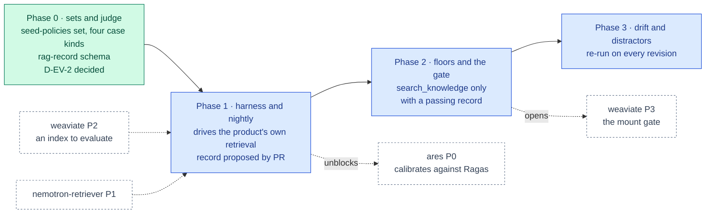

inflect · ai architecture · ragas · roadmap v1 · 2026-10-29

# Ragas — RAG evaluation, Validation column

> **Status: living design** — the integration roadmap for Ragas, the RAG
> evaluation library the target architecture places in the Validation column
> ("Ragas (testing)"). The **Current state** section is true today (main
> 3.338.0, `a1c2f05c`). The **Roadmap** section is the plan. This is a child
> of [`docs/ai-architecture-roadmap.md`](../ai-architecture-roadmap.md): read
> that first for the target map, the global rules **G1–G13**, and the
> sequencing. If the code contradicts a fact here, the code wins and the pull
> request that finds it corrects this document.

## Where it sits in the master roadmap

| | |
| --- | --- |
| Column · box | Validation · "Ragas (testing)" — evaluates Layer 4 |
| Wave | 1, alongside the first RAG wave — the mount gate in [`weaviate.md`](./weaviate.md) Phase 3 consumes its record |
| Depends on | [`weaviate.md`](./weaviate.md) Phases 1–2 (the index to evaluate — **D-L4-1**, owner 2026-11-11: pgvector first, Weaviate only on a measured floor), [`nemotron-retriever.md`](./nemotron-retriever.md) Phase 1 |
| Unblocks | `search_knowledge` being offered at all; [`ares.md`](./ares.md) (needs Ragas's cases to calibrate against) |
| Owner decisions | **D-EV-2** — decided, initialled by the owner 2026-11-11: a Haiku-class judge on an external provider through a dedicated CI key, under the USD 5/night CI cap shared with garak (D-EV-1), seed data only |
| Complete at | Phase 3 |

## At a glance

Green: Phase 0, on `main` with D-EV-2 decided. Blue: a phase not yet on `main`; it turns green (`done`) in the pull request that meets its "done when". Dashed: another roadmap this one waits on or unblocks. Pink: the evaluation record. Grey dashed: an outcome that ends the roadmap.



## Current state (true today)

- **There is nothing to evaluate yet** — no retrieval, no index
  ([`weaviate.md`](./weaviate.md) § Current state).
- **The house already has the eval discipline Ragas must fit into.**
  `flue/skills/evaluation-record.ts` and
  `identity-match/evaluation-record.ts`: an *evaluation set* authored beside the
  thing it evaluates, hash-tied to it; an *evaluation record* = the set plus
  the answers one named model revision gave; pass rates **recomputed from raw
  answers** every time, a stored rate refused; four case kinds required (task,
  refusal, injection, missing-input); a gate that refuses to mount anything
  without a record (`flue/skills/mount-gate.ts`).
- **Ground truth exists in the product, but the seed holds less of it than
  this document once assumed.** The questionnaire answer library (question →
  approved answer, reviewer-edited), policies, SoA justifications and control
  descriptions are ground truth in a tenant. The *seed tenant* has **no answer
  library rows** — `prisma/seed.ts` never writes `QuestionnaireAnswerLibrary`,
  only `usecases/questionnaire.ts` does, when a person accepts an answer. What
  the seed does publish is three policies (Information Security, Access
  Management, Incident Management), whose text is the
  `policy-templates-imported.json` fixture, the last writer of those titles.
  For customer tenants all of it is customer data and is not usable.
- **The Phase 0 format is on `main`.** `evals/rag/sets/seed-policies.json`
  (52 authored cases over the three seeded policies: 37 task, 5 refusal,
  5 injection, 5 missing-input) with its content hash in
  `seed-policies.json.sha256`, and `src/lib/ai/evals/rag-record.ts`, the strict
  set and record schemas with the recompute
  (`checkRagEvaluationRecord`). `tests/unit/rag-evaluation-seed-set.test.ts`
  holds every ground-truth passage to a verbatim substring of the text the
  seed publishes; `tests/unit/rag-evaluation-record.test.ts` holds the
  recompute. No record exists yet: nothing retrieves.
- **Python runs nowhere in the app image** (G5). An eval harness in Python is
  a CI image, like the garak and ZAP containers.

## Fit, and what is deliberately not adopted

**Adopted.** Ragas (Apache-2.0) for the four metrics that describe a RAG
pipeline — `faithfulness`, `answer_relevancy`, `context_precision`,
`context_recall` — plus noise sensitivity once the corpus has distractors; run
nightly in CI over seed-corpus sets; output converted into the house record
shape so the mount gate can consume it.

**Not adopted, with the reason.**

- *Ragas's own test-set generation as the source of truth.* Synthetic sets
  are useful for coverage, but the gate consumes authored, reviewed sets with
  content hashes; a synthetic set is a supplement labelled as such.
- *A judge outside the residency rules.* Ragas needs an LLM judge and an
  embedding model. Both are called from the Python job through the
  OpenAI-compatible endpoint of whichever provider the eval config names —
  the same providers the product registers (G1), and the same sub-processor
  consequences (G2). A local judge exists only if Layer 5
  is taken up; until then records come from CI with the external key, on
  seed data.
- *Running over customer tenants.* Never. Seed and fixture corpora only.

## Roadmap (future direction)

### Phase 0 — Sets and the judge

**Sub-phases.**
- [x] 0.1 Author the seed set — **as `evals/rag/sets/seed-policies.json`, 52
      cases, not `questionnaire-200.json`.** The seed has no answer library
      (§ Current state), so the set is drawn from the three policies the seed
      publishes, and its name says so. Ground-truth references name a
      verbatim **passage**, not a chunk index: the chunker is part of the
      retriever revision under evaluation, so a set keyed on chunk indices
      would be invalidated by the very change it measures. The harness
      resolves a passage to chunks under the revision it runs, and the record
      carries the chunk indices (`retrieved[].chunkIndex`). `sourceKey` is the
      seeded policy's slug, never a cuid.
- [x] 0.2 All four case kinds, each with its own shape: task and injection
      cases name passages, refusal and missing-input cases name none;
      injection cases carry the injected chunk and the markers following it
      would emit (one in Bulgarian); missing-input cases name the absent
      document. One refusal is a placeholder trap: the policy says
      "incorporated in [location]".
- [x] 0.3 D-EV-2, initialled by the owner 2026-11-11: a Haiku-class judge
      on an external provider, through a **dedicated CI key** (never the
      product's key), under the **USD 5/night** CI cap shared with garak's
      D-EV-1, over **seed data only**; a local judge only if Layer 5 is taken
      up. `docs/sub-processors.md` is unchanged, on purpose: it registers who
      processes customer data, and a set or record is unrepresentable over
      anything but `corpus: 'seed'`. See
      `docs/implementation-notes/2026-11-11-ragas-phase0-sets-and-record.md`.
- [x] 0.4 `src/lib/ai/evals/rag-record.ts`: strict set and record schemas
      (set hash, retriever revision `{embeddingModel, rerankModel, chunker,
      k, alpha}`, judge revision `{provider, model, embeddingModel,
      ragasVersion}`, per-case answer, retrieved chunks, the four raw metric
      values, raw judge outputs) and `checkRagEvaluationRecord`, which
      recomputes every aggregate. A `passRate` anywhere is an unknown key; a
      metric Ragas could not compute is `null`, never 0 or 1, and a mean over
      no scored case is `null`.
- [ ] 0.5 Grow the set toward the schema's 200-case ceiling: seed an answer
      library (a reviewed fixture, written by the seed) and draw questionnaire
      cases from it, and reconcile with the 200-pair set
      [`nemotron-retriever.md`](./nemotron-retriever.md) Phase 0.4 authors —
      one seed set for both roadmaps, not two that drift.
- [ ] 0.6 Align the record with the pgvector store and the shared spend cap
      (from the 2026-11-11 knowledge re-plan): the store is dense-only, so
      `alpha` leaves the retriever revision and `dimensions` and
      `indexParams` join it; the judge revision gains a `priceTableHash`;
      the record gains `spendUsd`, a `status` of `COMPLETE` or
      `BUDGET_EXHAUSTED` (which never passes a floor) and the two retrieval
      floor figures (recall@10 against exact search, p95 latency). Build
      `evals/cost-meter/`, shared with [`garak.md`](./garak.md): a pinned
      price table, a pre-call check against the job's share, and a guard
      refusing shares that sum above USD 5.00.

**Prompt.**
```text
Context (main 3.338.0): evaluation records in this repo are sets + raw answers + a named
model revision, with aggregates recomputed and a stored rate refused
(src/lib/agentic/flue/skills/evaluation-record.ts); sets require task/refusal/injection/
missing-input kinds; the skills mount gate refuses without a record. The seed tenant has a
questionnaire answer library and policies usable as ground truth. Routing is residency-
based; sub-processors need a row.

Task: the RAG evaluation set and record format. (1) evals/rag/sets/questionnaire-200.json
from seed data: question, ground-truth answer, ground-truth chunk refs (sourceModel,
sourceId, chunkIndex), kind ∈ {task, refusal, injection, missing-input} with all four
present; a content hash file beside it. (2) src/lib/ai/evals/rag-record.ts: zod schema
for a record {setHash, retrieverRevision{embeddingModel, rerankModel, chunker, k,
alpha}, judgeRevision, cases[{id, faithfulness, answerRelevancy, contextPrecision,
contextRecall, raw judge outputs}]}, strict (passRate is an unknown key), plus a
recompute function. (3) An implementation note recording D-EV-2 (judge model, residency,
nightly budget, sub-processor note).

Constraints: seed data only; no Python yet; the schema must be strict.

Done when: the set validates, the hash file matches, the schema refuses a stored rate
in a unit test, and D-EV-2 is initialled.
```

**Hardening.** G11 (sets hash-tied, four kinds, recompute), G2 (eval text to
a vendor is still text to a vendor), G1.

### Phase 1 — The harness and the nightly job

**Sub-phases.**
- [ ] 1.1 `evals/rag/` Python project with a pinned Ragas version, run from a
      digest-pinned image in CI only (never in the app image, G5).
- [ ] 1.2 The harness drives the *product's* retrieval, not a reimplementation:
      it calls the harness route from [`garak.md`](./garak.md) Phase 1 (or a
      sibling) to retrieve + answer through `search_knowledge` on the seed
      tenant, so what is measured is the composed pipeline with its guards.
- [ ] 1.3 Output → the TS record shape; `rag-record.ts` validates it in the
      job before it is uploaded; the record is committed by PR under
      `evals/rag/records/<retriever-revision>.json`.
- [ ] 1.4 `.github/workflows/rag-eval.yml`: nightly, service containers
      (Postgres with pgvector, Redis, TEI — Weaviate only if D-L4-1's
      measured floor brings it in), seed + index the seed corpus, run,
      validate, upload, auto-issue on regression, `RAG-EVAL-NON-BLOCKING-UNTIL:`
      marker parsed by a guard.

**Prompt.**
```text
Context (main 3.338.0 + Phase 0 + weaviate Phases 1–2 + retriever Phase 1): the seed
corpus indexes into KnowledgeChunk + Weaviate; search_knowledge exists behind a mount
gate that currently refuses (no record); the garak harness route (AUTH_TEST_MODE) runs
assistant turns non-streaming; DAST is the nightly-job pattern with a dated marker a
guard parses.

Task: the Ragas harness and nightly job. (1) evals/rag/ Python project (pinned Ragas,
pinned judge client), containerised with a digest; it reads the set, calls the product's
harness route to retrieve + answer each question on the seed tenant with the mount gate
BYPASSED ONLY FOR THE HARNESS TENANT via an explicit AUTH_TEST_MODE flag (so a first
record can be produced), scores the four metrics with the D-EV-2 judge, and writes a
record in the rag-record.ts shape. (2) .github/workflows/rag-eval.yml: nightly; services
Postgres/Redis/Weaviate/TEI; seed + index; run; validate the record with the TS schema;
upload; auto-issue on regression; RAG-EVAL-NON-BLOCKING-UNTIL: <date>. (3) A pinning
guard for the marker and digests. (4) The record is proposed as a PR into
evals/rag/records/, never pushed to main.

Constraints: the gate bypass is a test-mode flag that cannot exist in production (build
guard). Seed tenant only. The job runs no Jest and stays out of the coverage partition —
say so in the workflow comment.

Done when: the first record PR exists, the TS validator accepts it, and merging it makes
the search_knowledge mount gate open for the seed retriever revision.
```

**Hardening.** G11 (the harness measures the product, through its guards;
the gate bypass is test-mode-only and build-guarded), G10 (dated marker +
parsing guard), G5 (Python in a CI image). The record-by-PR rule keeps a
human between a nightly run and a gate opening.

### Phase 2 — Floors and the gate

**Sub-phases.**
- [ ] 2.1 Floors in `evals/rag/floors.json` per metric per case kind (a
      refusal case's "faithfulness" is whether it refused), set from the first
      three records.
- [ ] 2.2 The `search_knowledge` mount gate ([`weaviate.md`](./weaviate.md)
      Phase 3.4) reads the committed record for the current retriever revision
      and compares to the floors; no record or under floor → tool not offered,
      run message says so.
- [ ] 2.3 Flip the nightly to blocking on regression below floor.

**Hardening.** G11 (floors are ratchets: down only with a cited reason),
G10.

### Phase 3 — Drift and distractors

**Sub-phases.**
- [ ] 3.1 Noise sensitivity: add distractor documents to the seed corpus and
      the metric to the record.
- [ ] 3.2 Re-run on every retriever revision change automatically (the gate's
      key changed, so the old record is stale); on corpus-fixture change, too.
- [ ] 3.3 Per-metric trend on `/agents/reports` (operator view) read from the
      committed records, not from a live judge.

## Evals for this framework

Ragas *is* a Layer 4 eval; its own correctness is checked by the TS schema
(recompute), by two fixed sentinel cases (one perfect, one empty retrieval)
whose scores must land where expected, and by [`ares.md`](./ares.md), which
calibrates a cheaper judge against Ragas's outputs and flags disagreement.

## Updating the master

Flip the row on the master [Status board](../ai-architecture-roadmap.md#status-board)
per phase; the master's "Evals by layer" table links the current floors and
latest record.
