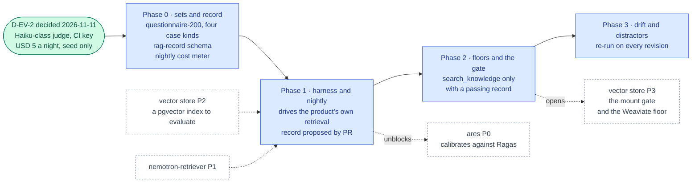

inflect · ai architecture · ragas · roadmap v2 · 2026-11-11

# Ragas — RAG evaluation, Validation column

> **Status: living design** — the integration roadmap for Ragas, the RAG
> evaluation library the target architecture places in the Validation column
> ("Ragas (testing)"). The owner decided its judge on 2026-11-11 (D-EV-2): a
> Haiku-class external model through a dedicated CI key, hard-capped at USD 5
> a night, on seed and fixture data only. The **Current state** section is
> true today (main 3.365.0, `8733323f5`). The **Roadmap** section is the plan. This is a child
> of [`docs/ai-architecture-roadmap.md`](../ai-architecture-roadmap.md): read
> that first for the target map, the global rules **G1–G13**, and the
> sequencing. If the code contradicts a fact here, the code wins and the pull
> request that finds it corrects this document.

## Where it sits in the master roadmap

| | |
| --- | --- |
| Column · box | Validation · "Ragas (testing)" — evaluates Layer 4 |
| Wave | 1, alongside the first RAG wave — the mount gate in [`weaviate.md`](./weaviate.md) Phase 3 (pgvector) consumes its record |
| Depends on | [`weaviate.md`](./weaviate.md) Phases 1–2 (the pgvector store), [`nemotron-retriever.md`](./nemotron-retriever.md) Phase 1 |
| Unblocks | `search_knowledge` being offered at all; the measured floor that decides whether Weaviate is ever brought in ([`weaviate.md`](./weaviate.md) Phase 3.6); [`ares.md`](./ares.md) (needs Ragas's cases to calibrate against) |
| Owner decisions | **D-EV-2** decided 2026-11-11 (owner): a Haiku-class external model judges, through a dedicated CI key, hard-capped at USD 5 a night, on seed and fixture data only. Open, raised here: whether the USD 5 is per job or shared with [`garak.md`](./garak.md)'s nightly run (§ Fit reads it as shared until the owner says otherwise) |
| Complete at | Phase 3 |

## At a glance

Green: decided, or on `main`. Blue: a phase not yet on `main`; it turns green (`done`) in the pull request that meets its "done when". Dashed: another roadmap this one waits on or unblocks. Pink: the evaluation record. Grey dashed: an outcome that ends the roadmap.



## Current state (true today)

- **There is nothing to evaluate yet** — no retrieval, no index
  ([`weaviate.md`](./weaviate.md) § Current state).
- **The house already has the eval discipline Ragas must fit into.**
  `flue/skills/evaluation-record.ts` and
  `identity-match/evaluation-record.ts`: an *evaluation set* authored beside the
  thing it evaluates, hash-tied to it; an *evaluation record* = the set plus
  the answers one named model revision gave; pass rates **recomputed from raw
  answers** every time, a stored rate refused; four case kinds required (task,
  refusal, injection, missing-input); a gate that refuses to mount anything
  without a record (`flue/skills/mount-gate.ts`).
- **Ground truth exists in the product.** The questionnaire answer library
  (question → approved answer, reviewer-edited), policies, SoA justifications,
  control descriptions. For the *seed tenant* this is usable as an evaluation
  set; for customer tenants it is customer data and is not.
- **Python runs nowhere in the app image** (G5). An eval harness in Python is
  a CI image, like the garak and ZAP containers.
- **The product already speaks to a Haiku-class model.** `ANTHROPIC_MODEL`
  defaults to `claude-haiku-4-5` (`src/env.ts`). Anthropic's current Haiku is
  `claude-haiku-5-5`; its list price is USD 0.10 per million input tokens and
  USD 0.50 per million output tokens (prompts up to 100K tokens), against
  USD 1 and USD 5 for `claude-haiku-4-5` (Anthropic's published table, read
  2026-11-11). Every Anthropic request can name its workspace
  (`src/lib/ai/anthropic-workspace.ts`, `ANTHROPIC_WORKSPACE_ID`), so a
  dedicated CI key can live in a workspace of its own.
- **Spend limits exist in the product, in tokens, not dollars.** A ceiling per
  assistant turn (`assistant/spend-ceiling.ts`) and a monthly token budget per
  tenant, checked before a run starts (`agentMonthlyTokenBudget`,
  `monthly-budget-policy.ts`). Nothing converts tokens to US dollars or
  stops on a nightly amount.
- **Anthropic has no embeddings endpoint.** A judge from Anthropic covers the
  LLM half of Ragas; the embedding half (`answer_relevancy` compares
  embeddings) has to come from somewhere else.

## Fit, and what is deliberately not adopted

**Adopted.** Ragas (Apache-2.0) for the four metrics that describe a RAG
pipeline — `faithfulness`, `answer_relevancy`, `context_precision`,
`context_recall` — plus noise sensitivity once the corpus has distractors; run
nightly in CI over seed-corpus sets; output converted into the house record
shape so the mount gate can consume it.

**Not adopted, with the reason.**

- *Ragas's own test-set generation as the source of truth.* Synthetic sets
  are useful for coverage, but the gate consumes authored, reviewed sets with
  content hashes; a synthetic set is a supplement labelled as such.
- *A judge outside the residency rules, or one chosen job by job.* D-EV-2
  (2026-11-11) fixes it: a **Haiku-class external model**, through a
  **dedicated CI key** used for nothing else, **hard-capped at USD 5 a
  night**, reading **seed and fixture data only**. It is called through the
  provider's native API (the Anthropic Messages API), never an
  OpenAI-compatible shim, from the same provider the product registers (G1),
  with the same sub-processor consequence written on its row (G2). The
  embedding Ragas needs comes from the product's own embedding seam
  ([`nemotron-retriever.md`](./nemotron-retriever.md)) running in the CI job,
  so no second vendor is involved. A local judge exists only if Layer 5 is
  taken up.
- *A cap that is only a wish.* "Hard-capped" means the run stops before a call
  that could cross the amount, not that an invoice is read afterwards. Three
  layers, the first one binding: (1) the harness meters every call — before
  each request it adds the request's counted input tokens and its `max_tokens`
  at the model's list price to the night's spend so far, and refuses the call
  if the sum would pass the cap; the run then ends `BUDGET_EXHAUSTED` with the
  cases it scored, and a partial record never opens the gate; (2) the CI
  tenant's monthly token budget stops the product's own answer generation
  before a run starts, as it does for any tenant; (3) the key's workspace
  carries a spend limit where the account offers one (Anthropic lists spend
  limits as an early-access preview for Console organisations), as a monthly
  backstop only. The price table the meter reads is a pinned file whose model
  ids must match the configured judge, so a model change cannot leave the
  meter pricing the old model.
- *Reading the cap as per job.* Garak's nightly run uses the same kind of key
  under the same cap (D-EV-1). Until the owner says otherwise, USD 5 is the
  night's total for the dedicated key: each job has a configured share
  (default USD 2.50 each), and a guard refuses shares that sum above 5.00.
- *A judge model the cap cannot afford.* An estimate, labelled as one: the
  200-case set at about 14 judge calls a case (faithfulness, the generated
  questions of `answer_relevancy`, one `context_precision` call per retrieved
  chunk at `k = 10`, `context_recall`) is about 2,800 calls, roughly 7 million
  input and 0.85 million output tokens, plus the product's own 200 answers.
  On `claude-haiku-5-5` that is about USD 1.30 a night; on `claude-haiku-4-5`
  it is about USD 13, which no share of the cap covers. So the CI key runs
  the current Haiku, or the set is sampled, and the record names which.
- *Running over customer tenants.* Never. Seed and fixture corpora only.

## Roadmap (future direction)

### Phase 0 — Sets, the record, and the cost meter

**Sub-phases.**
- [ ] 0.1 Author `evals/rag/sets/questionnaire-200.json`: 200 question →
      ground-truth answer → ground-truth chunk refs, from the seed tenant's
      answer library and policies (reuse the retriever Phase 0 seed set).
- [ ] 0.2 Add the four required case kinds the house format demands: task
      (answerable), refusal (out of corpus — the right answer is "not in the
      corpus"), injection (a chunk carrying instructions), missing-input
      (question needs a document the corpus lacks).
- [x] 0.3 D-EV-2 decided by the owner on 2026-11-11: a Haiku-class external
      model judges, through a dedicated CI key, hard-capped at USD 5 a night,
      on seed and fixture data only (§ Fit).
- [ ] 0.4 `src/lib/ai/evals/rag-record.ts`: the TS schema for a RAG evaluation
      record (set hash, retriever revision `{embeddingModel, dimensions,
      rerankModel, chunker, k, indexParams}` — no `alpha`: the pgvector store
      is dense-only, [`weaviate.md`](./weaviate.md) § Fit — judge revision
      `{model, priceTableHash}`, the night's metered spend, a `status` of
      `COMPLETE` or `BUDGET_EXHAUSTED`, per-case raw metric values, and the two
      retrieval floor figures, recall@10 against exact search and p95
      latency), aggregates recomputed, `passRate` key refused — mirroring
      `skills/evaluation-record.ts`. A `BUDGET_EXHAUSTED` record validates
      and never passes a floor.
- [ ] 0.5 The cost meter, `evals/cost-meter/` (shared with
      [`garak.md`](./garak.md)): a pinned price table keyed by model id; a
      pre-call check (spend so far + counted input tokens + `max_tokens`, at
      list price, must not pass the job's share); the shares file (Ragas and
      garak, default USD 2.50 each) and a guard that refuses shares summing
      above USD 5.00 or a price table missing the configured model.
- [ ] 0.6 The sub-processor row for Anthropic notes the CI key: seed and
      fixture text only, no customer data, a key used for nothing else, in a
      workspace of its own.

**Prompt.**
```text
Context (main 3.365.0): evaluation records in this repo are sets + raw answers + a named
model revision, with aggregates recomputed and a stored rate refused
(src/lib/agentic/flue/skills/evaluation-record.ts); sets require task/refusal/injection/
missing-input kinds; the skills mount gate refuses without a record. The seed tenant has a
questionnaire answer library and policies usable as ground truth. Routing is residency-
based; sub-processors need a row.

Task: the RAG evaluation set and record format. (1) evals/rag/sets/questionnaire-200.json
from seed data: question, ground-truth answer, ground-truth chunk refs (sourceModel,
sourceId, chunkIndex), kind ∈ {task, refusal, injection, missing-input} with all four
present; a content hash file beside it. (2) src/lib/ai/evals/rag-record.ts: zod schema
for a record {setHash, retrieverRevision{embeddingModel, dimensions, rerankModel, chunker,
k, indexParams}, judgeRevision{model, priceTableHash}, spendUsd, status COMPLETE |
BUDGET_EXHAUSTED, retrievalFloors{recallAt10VsExact, p95LatencyMs}, cases[{id,
faithfulness, answerRelevancy, contextPrecision, contextRecall, raw judge outputs}]},
strict (passRate is an unknown key), plus a recompute function; a BUDGET_EXHAUSTED record
never passes. (3) evals/cost-meter/: a pinned price table, a pre-call check that refuses a
call whose counted input plus max_tokens at list price would pass the job's share, and a
shares file (Ragas, garak; default USD 2.50 each) with a guard refusing shares above
USD 5.00 in total. Decision D-EV-2 (2026-11-11): a Haiku-class external model judges through
a dedicated CI key, hard-capped at USD 5 a night, seed and fixture data only.

Constraints: seed data only; no Python yet; the schema must be strict. The meter refuses
BEFORE a call, never after reading a bill.

Done when: the set validates, the hash file matches, the schema refuses a stored rate and
lets no BUDGET_EXHAUSTED record pass in unit tests, and the shares guard refuses a sum
above 5.00.
```

**Hardening.** G11 (sets hash-tied, four kinds, recompute), G2 (eval text to
a vendor is still text to a vendor), G1. The cap is enforced before the call,
in code the job cannot skip; a workspace limit on the vendor's side is only the
backstop, because it is monthly and the decision is nightly.

### Phase 1 — The harness and the nightly job

**Sub-phases.**
- [ ] 1.1 `evals/rag/` Python project with a pinned Ragas version, run from a
      digest-pinned image in CI only (never in the app image, G5).
- [ ] 1.2 The harness drives the *product's* retrieval, not a reimplementation:
      it calls the harness route from [`garak.md`](./garak.md) Phase 1 (or a
      sibling) to retrieve + answer through `search_knowledge` on the seed
      tenant, so what is measured is the composed pipeline with its guards.
      The CI tenant's model is the D-EV-2 Haiku-class model on the dedicated
      key, and every call the job makes, the product's answers included, goes
      through the cost meter.
- [ ] 1.3 Output → the TS record shape; `rag-record.ts` validates it in the
      job before it is uploaded; the record is committed by PR under
      `evals/rag/records/<retriever-revision>.json`.
- [ ] 1.4 `.github/workflows/rag-eval.yml`: nightly, service containers
      (Postgres from the pgvector image of [`weaviate.md`](./weaviate.md)
      Phase 1.1, Redis, TEI), seed + index the seed corpus, run, validate,
      upload, auto-issue on regression, `RAG-EVAL-NON-BLOCKING-UNTIL:` marker
      parsed by a guard. The nightly spend and the stop reason are printed in
      the job summary.

**Prompt.**
```text
Context (main 3.365.0 + Phase 0 + vector store Phases 1–2 + retriever Phase 1): the seed
corpus indexes into KnowledgeChunk + KnowledgeChunkEmbedding (pgvector, in Postgres);
evals/cost-meter/ enforces the D-EV-2 cap (Haiku-class judge, dedicated CI key, USD 5 a
night shared with garak); search_knowledge exists behind a mount
gate that currently refuses (no record); the garak harness route (AUTH_TEST_MODE) runs
assistant turns non-streaming; DAST is the nightly-job pattern with a dated marker a
guard parses.

Task: the Ragas harness and nightly job. (1) evals/rag/ Python project (pinned Ragas,
pinned judge client), containerised with a digest; it reads the set, calls the product's
harness route to retrieve + answer each question on the seed tenant with the mount gate
BYPASSED ONLY FOR THE HARNESS TENANT via an explicit AUTH_TEST_MODE flag (so a first
record can be produced), scores the four metrics with the D-EV-2 judge through the
Anthropic Messages API (no OpenAI-compatible shim) and embeddings from the product's TEI
seam, routes every call through the cost meter, and writes a record in the rag-record.ts
shape (status BUDGET_EXHAUSTED when the meter stops it). (2) .github/workflows/rag-eval.yml:
nightly; services Postgres (the pgvector image) / Redis / TEI; seed + index; run; validate
the record with the TS schema;
upload; auto-issue on regression; RAG-EVAL-NON-BLOCKING-UNTIL: <date>. (3) A pinning
guard for the marker and digests. (4) The record is proposed as a PR into
evals/rag/records/, never pushed to main.

Constraints: the gate bypass is a test-mode flag that cannot exist in production (build
guard). Seed tenant only. The CI key is a CI secret used by no other job. The job runs no Jest and stays out of the coverage partition —
say so in the workflow comment.

Done when: the first record PR exists, the TS validator accepts it, and merging it makes
the search_knowledge mount gate open for the seed retriever revision.
```

**Hardening.** G11 (the harness measures the product, through its guards;
the gate bypass is test-mode-only and build-guarded), G10 (dated marker +
parsing guard), G5 (Python in a CI image). The record-by-PR rule keeps a
human between a nightly run and a gate opening.

### Phase 2 — Floors and the gate

**Sub-phases.**
- [ ] 2.1 Floors in `evals/rag/floors.json` per metric per case kind (a
      refusal case's "faithfulness" is whether it refused), set from the first
      three records.
- [ ] 2.2 The `search_knowledge` mount gate ([`weaviate.md`](./weaviate.md)
      Phase 3.5) reads the committed record for the current retriever revision
      and compares to the floors; no record or under floor → tool not offered,
      run message says so.
- [ ] 2.3 Flip the nightly to blocking on regression below floor. A
      `BUDGET_EXHAUSTED` night is red, not skipped: a cap that is hit every
      night is a finding about the set's size or the model, not noise.
- [ ] 2.4 The retrieval floor figures (recall@10 against exact search, p95
      latency) are compared with the floors the owner confirms in
      [`weaviate.md`](./weaviate.md) Phase 3.6; two consecutive misses open
      that roadmap's conditional Weaviate phase.

**Hardening.** G11 (floors are ratchets: down only with a cited reason),
G10.

### Phase 3 — Drift and distractors

**Sub-phases.**
- [ ] 3.1 Noise sensitivity: add distractor documents to the seed corpus and
      the metric to the record.
- [ ] 3.2 Re-run on every retriever revision change automatically (the gate's
      key changed, so the old record is stale); on corpus-fixture change, too.
- [ ] 3.3 Per-metric trend on `/agents/reports` (operator view) read from the
      committed records, not from a live judge.

## Evals for this framework

Ragas *is* a Layer 4 eval; its own correctness is checked by the TS schema
(recompute), by two fixed sentinel cases (one perfect, one empty retrieval)
whose scores must land where expected, and by [`ares.md`](./ares.md), which
calibrates a cheaper judge against Ragas's outputs and flags disagreement.

## Updating the master

Flip the row on the master [Status board](../ai-architecture-roadmap.md#status-board)
per phase; the master's "Evals by layer" table links the current floors and
latest record.
