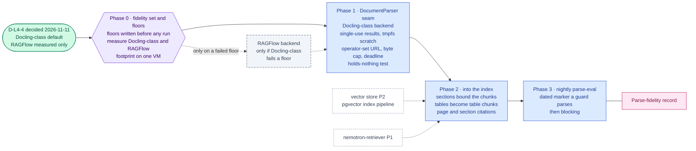

inflect · ai architecture · document parsing · roadmap v2 · 2026-11-11

# Document parsing: a Docling-class parsing service, RAGFlow measured only, Layer 4

> **Status: living design** — the integration roadmap for Layer 4's "document
> parsing & chunking for enterprise SAP/ERP data" box, which the target
> architecture fills with RAGFlow. The owner decided on 2026-11-11 (D-L4-4)
> that the default backend is a **parsing-only service of the Docling class**
> (MIT), not RAGFlow's full stack. RAGFlow is measured beside it on the same
> fidelity set and is adopted only if the Docling-class backend fails that
> evaluation. The **Current state** section is true today (main 3.365.0,
> `8733323f5`). The **Roadmap** section is the plan. This is a child of
> [`docs/ai-architecture-roadmap.md`](../ai-architecture-roadmap.md): read that
> first for the target map, the global rules **G1–G13**, and the sequencing.
> The filename keeps the box's name so links into it stay stable (the
> [`langflow.md`](./langflow.md) precedent). If the code contradicts a fact
> here, the code wins and the pull request that finds it corrects this
> document.

## Where it sits in the master roadmap

| | |
| --- | --- |
| Layer · box | 4 — Knowledge & deep RAG · "RAGFlow (document parsing & chunking)" |
| Wave | 1, after the vector store's Phase 2 (there must be somewhere for chunks to go) |
| Depends on | [`weaviate.md`](./weaviate.md) Phase 2 (the pgvector index pipeline), [`nemotron-retriever.md`](./nemotron-retriever.md) Phase 1 |
| Unblocks | evidence-file and policy-document grounding; the table-aware part of [`ragas.md`](./ragas.md) |
| Owner decisions | **D-L4-4** decided 2026-11-11 (owner): a parsing-only service (Docling-class, MIT) is the default backend, not RAGFlow's full stack; RAGFlow is measured only, and adopted only if the Docling-class backend fails the fidelity evaluation |
| Complete at | Phase 3 |

## At a glance

Green: decided, or on `main`. Purple hexagon: a decision still to be taken on
measured numbers. Blue: a phase not yet on `main`; it turns green (`done`) in
the pull request that meets its "done when". Dashed white: another roadmap this
one waits on or unblocks. Pink: the evaluation record. Slate dashed: the
measured alternative, taken only on a failed evaluation.



## Current state (true today)

- **Uploads exist, parsing does not.** Evidence files are `FileRecord` rows
  scanned by ClamAV before storage (`docs/cloud-storage.md`); policies carry
  `PolicyVersion.contentText` (encrypted); vendor documents have an AI feature
  of their own (`src/app-layer/ai/vendor-doc/`); PDFs are *produced* by the
  product (audit packs, exports — `tests/pdf/`). No module extracts layout,
  tables or OCR text from an uploaded document, and `tests/fixtures/` holds no
  parse-fidelity set.
- **No chunker.** [`weaviate.md`](./weaviate.md) Phase 2 introduces a plain
  paragraph chunker as a placeholder precisely so the parser is an upgrade of
  one seam rather than a prerequisite for the index.
- **Operational weight is a single VM** running eight services
  (`deploy/docker-compose.prod.yml`), and the master's capacity budget already
  does not close at the planned additions (master § Capacity, D-CAP-1).
- **The Docling-class candidate is one container.** `docling-serve` (MIT,
  maintained by the Docling project) is an HTTP server over the Docling
  library. Its CPU-only image, `docling-serve-cpu`, is listed at about 4.4 GB
  and ships the layout and table model weights inside it, so it needs no
  egress at run time. It listens on port 5001, takes an API key
  (`DOCLING_SERVE_API_KEY`, sent as `X-Api-Key`), keeps converted results in a
  scratch directory, and by default lets a result be read once
  (`DOCLING_SERVE_SINGLE_USE_RESULTS=true`) and removes it after a delay
  (`DOCLING_SERVE_RESULT_REMOVAL_DELAY`, 300 s). Remote pipeline components
  are off by default (`DOCLING_SERVE_ENABLE_REMOTE_SERVICES=false`); optional
  S3 and Azure artifact storage exists and is off unless configured. (Read
  from the project's README and configuration reference on 2026-11-11.)
- **RAGFlow's reference deployment is a Compose stack of its own** — the
  server plus Elasticsearch (or Infinity), MySQL, MinIO and Redis. That is
  roughly a second product's worth of infrastructure, most of which this
  roadmap would refuse to use (§ Fit).
- **Legacy data, documents and questionnaire answers are untrusted input** by
  standing rule (legacy-access invariant 3; the guard sandwich G4). A parser
  output is more untrusted than its input, because it is text a model will
  read that no human wrote.

## Fit, and what is deliberately not adopted

**Adopted (D-L4-4, 2026-11-11).** A parsing-only service of the Docling class —
layout analysis, table structure, OCR — behind a `DocumentParser` seam, run as
a *stateless parsing service*: a document goes in, structured sections and
tables come out, nothing stays. `docling-serve-cpu` is the expected first
backend; Phase 0 confirms it on the fidelity set before anything is deployed.

**Measured, not adopted.** RAGFlow's DeepDoc parsing, through its HTTP API,
measured in Phase 0 on the same fixtures and floors. It becomes the backend
only if the Docling-class backend fails a floor, and even then only its parsing
API, under every restriction below.

**Not adopted, with the reason.**

- *RAGFlow's full stack* — knowledge bases, retrieval, chat, UI, its own
  search engine and object store. Each is a second multi-tenant store with its
  own users, API keys and no RLS, holding tenant documents outside every
  isolation and encryption boundary the product has (G7). RAGFlow retrieval
  would also be a second funnel: a model reading from it would bypass
  `runGuardedTool` (G3). And it would break the vectors-only rule (D-L4-2): no
  chunk text outside Postgres.
- *Any parser-side embedding or model call.* The retriever seam is the one
  place embeddings come from ([`nemotron-retriever.md`](./nemotron-retriever.md)),
  so residency is decided once (G1). For Docling-class services that means
  remote services stay off and no vision-language model is configured through
  an external API.
- *Letting documents or results persist in the parser.* Results are read once
  and removed; the scratch directory is a `tmpfs` with no volume; no artifact
  bucket is configured; the server's own task queue, if it has one, is not
  pointed at the product's Redis. A test proves the service holds nothing
  after a job.
- *Choosing the floors after seeing the numbers.* Phase 0 writes the fidelity
  floors before either backend runs, so "fails the fidelity eval" is a fact
  about a threshold set in advance, not a preference expressed afterwards.

## Roadmap (future direction)

### Phase 0 — The fidelity set, the floors, and the measurements

**Goal.** A parse-fidelity set with floors fixed in advance, and measured
numbers for the Docling-class backend and for RAGFlow, so the D-L4-4 condition
("adopt RAGFlow only if Docling fails") can be read off a record.

**Sub-phases.**
- [ ] 0.1 Author a parse-fidelity fixture set under `tests/fixtures/parse/`:
      ten documents of the kinds the product actually holds — a policy PDF, an
      SoA table export, a vendor SOC 2 report excerpt (public sample), an
      ISO 27001 clause list, a scanned page for OCR, a questionnaire export,
      and four more of the same families — each with the expected tables and
      section headings as JSON. Public or synthetic content only.
- [ ] 0.2 Write the floors **before any run**, in the fixture set's own file:
      table-cell recall and heading recall, overall and per document family
      (the scanned page is scored on its own, so a strong layout score cannot
      hide a failed OCR).
- [ ] 0.3 Stand the Docling-class service up locally (`docling-serve-cpu`, by
      digest, UI off, remote services off); record memory and CPU at idle and
      during a parse, the image digest and size, and the per-document parse
      time.
- [ ] 0.4 Stand RAGFlow up the same way (its parsing API only, the smallest
      image that serves it); the same measurements, plus its container count.
- [ ] 0.5 Run both over the fixture set; score against the floors; write the
      memo (implementation note) and the dependency-governance entry for the
      backend that is adopted. If the Docling-class backend meets every floor,
      RAGFlow's numbers stay in the memo as the record of what was measured,
      and nothing of RAGFlow is deployed.

**Prompt.**
```text
Context (main 3.365.0): inflect-compliance uploads evidence files (FileRecord, ClamAV-
scanned) and holds policy text (PolicyVersion.contentText, encrypted) but has no document
parser; the vector store's Phase 2 (docs/ai-architecture/weaviate.md) chunks with a plain
paragraph splitter. The production stack is one VM with eight Compose services. Decision
D-L4-4 (2026-11-11): a Docling-class parsing-only service (MIT) is the default backend;
RAGFlow is measured only and adopted only if the Docling-class backend fails the fidelity
evaluation.

Task: a fidelity set and a measurement note, docs/implementation-notes/2026-MM-DD-document-
parser-measurement.md. (1) tests/fixtures/parse/ with ten representative documents and
expected tables/headings as JSON (public or synthetic only). (2) Floors for table-cell and
heading recall, overall and per family, committed BEFORE any backend runs. (3) Run
docling-serve-cpu (digest, UI off, remote services off) and RAGFlow's parsing API locally;
record containers, image sizes and digests, idle and parse-time memory/CPU, parse time per
document. (4) Score both against the floors; state which backend D-L4-4's rule selects and
what it costs on the VM.

Constraints: no production change, no app dependency. Treat every parser output as untrusted
text. No customer content in any fixture.

Done when: the fixture set and its floors are committed in a commit that precedes the
measurement commit, and the note has the two measurement tables and the fidelity scores.
```

**Hardening.** G5 (digests before adoption; Python stays in images), G11 (the
fidelity set is the parser's evaluation set from day one, hash-tied to the
backend version that produced the numbers). The floors-first ordering is
visible in the history, which is what makes the adoption rule checkable.

**Done when.** The memo names the backend D-L4-4's rule selects, and the
master's capacity line for parsing carries the measured figure in place of the
estimate.

### Phase 1 — The `DocumentParser` seam

**Goal.** One interface, the backend Phase 0 selected, one stub; the backend
runs on the VM, reachable only from `worker`, and keeps nothing.

**Sub-phases.**
- [ ] 1.1 `src/lib/ai/parsing/`: `types.ts` (`DocumentParser.parse(bytes, {
      mime, filename }) → { sections, tables, text, pages }`), the selected
      backend (`docling-provider.ts`; `ragflow-provider.ts` only if Phase 0
      selected RAGFlow), `stub-provider.ts`.
- [ ] 1.2 The Docling-class backend: one synchronous convert call per document,
      the result read once, with a byte-capped streaming read (the MCP
      client's rule: never `res.json()` then measure), bounded by a deadline.
      **Not through `safeFetch`.** The parser is an in-deployment service at
      an address like `http://docling:5001`, which resolves to the Compose
      bridge (a private address) over plain http, and `assertPublicAddress`
      refuses both the scheme and the address
      (`src/app-layer/automation/webhook-safety.ts`); the self-hosted
      private-range allowlist does not apply on hosted Inflect
      (`src/lib/security/egress-allowlist.ts`). `src/lib/ai/local-gateway.ts`
      records the same finding for the local AI gateway: putting an
      in-deployment endpoint behind the public-address check "would delete"
      it. The house pattern for this case is the defence upstream of the dial:
      the URL is the operator's `DOC_PARSER_BASE_URL` and nothing else, no
      tenant value reaches it, and one module reads it (a guard fails on a
      second reader, as `local-gateway.ts`'s does for `AI_LOCAL_BASE_URL`).
      The request still carries a deadline (`AbortSignal`) and the capped
      stream above; only the public-address check is left out. This departs from the master's G6 wording ("egress
      is `safeFetch`"), which is written for hosts outside the deployment; the
      coordinator is asked to carve the in-deployment case out of G6. (Were
      RAGFlow selected: create dataset → upload → parse → read chunks →
      **delete dataset**, the delete attempted on every failure path.)
- [ ] 1.3 A Compose service for the backend, digest-pinned, on the worker's
      network only, no published port, an API key from the operator's
      secrets, single-use results, the shortest removal delay the server
      accepts, scratch on `tmpfs`, no artifact storage, UI and remote services
      off, and a memory limit and CPU cap set from Phase 0's measured peak
      (master § Capacity: a batch-shaped service is capped at 1.0 CPU).
- [ ] 1.4 `src/env.ts`: `DOC_PARSER_BASE_URL`, `DOC_PARSER_API_KEY` (optional;
      absent = stub, i.e. the plain chunker keeps working). **Absent and
      broken are different outcomes.** With the URL unset the stub is the
      design; with the URL set, every parse that falls back to the stub is a
      counted `doc_parser.requests{outcome="FALLBACK_<reason>"}` (checklist
      §4), so a parser that is configured but never answers shows up as a
      rate, not only as WARN lines, and the alert keys on that rate.
- [ ] 1.5 Inventory row in `docs/sub-processors.md` in the "not a sub-processor
      — runs inside the deployment" style the `legacy-mcp` row uses, so the
      register is complete.
- [ ] 1.6 The "holds nothing" test: after a parse job, the job's result can no
      longer be fetched from the service and the scratch directory is empty.

**Prompt.**
```text
Context (main 3.365.0): tenant-controlled outbound URLs go through safeFetch, which refuses
http and every private address, so it cannot reach an in-deployment service; the house pattern
for an in-deployment endpoint is an operator-set URL read by one module
(src/lib/ai/local-gateway.ts says why); the MCP client (src/lib/mcp/client/) is the house pattern for a
byte-capped, deadline-bounded HTTP read of an untrusted service; the Compose file is
repo-canonical and images are digest-pinned; docs/sub-processors.md is the register of every
external connection, including in-deployment services. Phase 0 selected the backend (expected:
docling-serve-cpu).

Task: add the DocumentParser seam. (1) src/lib/ai/parsing/{types,docling-provider,
stub-provider}.ts. (2) One synchronous convert per document, the result read once, streamed
and byte-capped, under one deadline, dialling the operator's DOC_PARSER_BASE_URL (an http URL
on the Compose network) directly, NOT through safeFetch; one module reads that variable and a
guard fails on a second reader. (3) A Compose service, digest-pinned,
worker network only, no published port, API key, single-use results, minimal removal delay,
tmpfs scratch, no artifact storage, UI and remote services off, memory limit and CPU cap from
the measured peak. (4) DOC_PARSER_BASE_URL / _API_KEY in src/env.ts, optional; absent = stub; set but
failing = stub plus a counted doc_parser.requests outcome. (5) A register row in docs/sub-processors.md in the "not a sub-processor — in-deployment"
style. (6) Tests: "a parse leaves no result behind", "a parser response over the byte cap is
refused, not truncated", "a parser outage returns the stub chunking and counts a fallback
outcome", and "an http URL on a private address is dialled, not refused" (it fails if the call
is moved behind safeFetch).

Constraints: the parser is only ever called from the worker (knowledge-index job). No
tenant-writable URL. Parser output is untrusted and is never logged row by row.

Done when: lint/typecheck green, the single-reader guard holds DOC_PARSER_BASE_URL to one
module, the tests pass in the integration project against the real service on its Compose
address, and check-drift reports clean.
```

**Hardening.** G6's operator-config half (the URL is the operator's, never
tenant-writable, read by one module; byte cap; deadline) without its
`safeFetch` half, which cannot reach an in-deployment address (1.2), G8
(worker only), G9 (absent = stub), G5 (digests), G2's register (complete even
for in-deployment services). The keep-nothing configuration is the isolation
property; the test for it is the one that must never be weakened. The
fallback counter (1.4) is what keeps "configured but unreachable" from looking
healthy.

**Done when.** `knowledge-index` can call `parse()` for a `FileRecord`, and the
"holds nothing" test is green.

### Phase 2 — Wire parsing into the index pipeline

**Goal.** Evidence files and policy documents enter the knowledge index as
layout-aware chunks; tables survive as tables.

**Sub-phases.**
- [ ] 2.1 `knowledge-index` ([`weaviate.md`](./weaviate.md) Phase 2) calls
      `parse()` for `FileRecord` sources (after ClamAV, from storage) and uses
      the returned sections as chunk boundaries; tables become one chunk each
      with a Markdown rendering in `KnowledgeChunk.text` — which stays the
      only place chunk text lives (D-L4-2).
- [ ] 2.2 Chunk metadata: `page`, `sectionPath`, `kind: 'text' | 'table'` on
      `KnowledgeChunk`, so a citation can say "page 4, table 2".
- [ ] 2.3 The chunker revision (parser backend + version + chunk policy) joins
      the mount-gate revision key.
- [ ] 2.4 Re-index on `FileRecord` replacement; delete chunks on file purge.

**Prompt.**
```text
Context (main 3.365.0 + Phase 1): the knowledge-index job chunks text with a plain splitter
and the DocumentParser seam exists. KnowledgeChunk is the Postgres system of record (text
encrypted); KnowledgeChunkEmbedding holds the pgvector embedding and no text. The
search_knowledge mount gate is keyed by a revision that includes the chunker.

Task: route FileRecord sources through parse(). (1) In knowledge-index, for FileRecord sources
read the stored bytes (post-ClamAV), call parse(), chunk by returned sections, render tables
as Markdown chunks with kind='table'. (2) Add page, sectionPath, kind to KnowledgeChunk
(migration, RLS unchanged). (3) Include parser backend+version+chunk policy in the mount-gate
revision key. (4) Re-index on file replacement; delete on purge.

Constraints: a parse failure falls back to the plain chunker with an outcome label, never to
an unindexed file nobody notices. Bound chunk count per document. Tests: "a table in the
fixture set becomes one table chunk with its cells", "replacing a file replaces its chunks",
"purging a file removes its chunks and embeddings".

Done when: the fixture set indexes with table chunks, citations in the assistant show page
and section, and the gate refuses until a new RAG record lands.
```

**Hardening.** G11 (chunker change = revision change), G8, G7 (unchanged
boundaries). The fallback-with-label rule matters: a silent parse failure is
an invisible hole in a tenant's knowledge.

**Done when.** A tenant's evidence PDF is cited by page in an assistant answer.

### Phase 3 — Table-aware grounding and the fidelity eval in CI

**Goal.** The fidelity set runs nightly against the live backend version and
produces a record; a regression below a Phase 0 floor is the one event that
reopens the RAGFlow measurement.

**Sub-phases.**
- [ ] 3.1 Nightly job `parse-fidelity` (workflow shape copied from `dast.yml`:
      boot the backend as a service container, run the fixture set, upload the
      report, auto-issue on regression, dated `PARSE-EVAL-NON-BLOCKING-UNTIL:`
      marker parsed by a guard — then blocking).
- [ ] 3.2 Record format shared with [`ragas.md`](./ragas.md): set + raw per-case
      scores + backend version, aggregates recomputed.
- [ ] 3.3 Table-aware answers: the assistant/agents receive table chunks as
      Markdown with the source reference; `guardUntrustedInput` scans them like
      any result (G4).

**Prompt.**
```text
Context (main 3.365.0 + Phases 1–2): the parse-fidelity fixture set and its floors exist under
tests/fixtures/parse/; the DAST workflow (.github/workflows/dast.yml) is the house pattern for
a nightly service-backed check with a dated non-blocking marker that
tests/guardrails/dast-workflow-pinning.test.ts parses; evaluation records recompute aggregates
from raw answers (flue/skills/evaluation-record.ts).

Task: a nightly parse-fidelity job. (1) .github/workflows/parse-eval.yml: start the parser
backend as a service container (digest-pinned), run the fixture set through the DocumentParser
seam, write a record {set hash, backend version, per-case cell/heading recall}, upload it,
open/update an auto-issue on a floor miss. (2) A guard that parses a
PARSE-EVAL-NON-BLOCKING-UNTIL: <date> marker and fails once the date passes. (3) A TS
validator src/lib/ai/evals/parse-record.ts that recomputes aggregates and refuses a stored
passRate key.

Constraints: no customer data; seed fixtures only. The job uploads a coverage-shard artifact
only if it runs Jest — if it does not, keep it out of the coverage partition and say so in
the workflow comment (tests/guardrails/coverage-gate-population.test.ts pins that partition).

Done when: the job runs green on a schedule, the marker guard is green with a date in the
future, and the record validator rejects a stored rate.
```

**Hardening.** G11 (records, recomputed), G10 (dated deferral the guard parses
— the DAST lesson: a marker nobody parses never turns red).

**Done when.** The first nightly record is committed and the marker date is
set.

## Evals for this framework

| What | How | Record |
| --- | --- | --- |
| Parse fidelity | table-cell and heading recall over `tests/fixtures/parse/`, against floors fixed before the first run | Phase 0 memo, then the nightly `parse-eval` record (Phase 3) |
| Holds-nothing | no result retrievable and an empty scratch after every job | integration test (Phase 1) |
| Grounding quality with tables | Ragas context precision on table questions | [`ragas.md`](./ragas.md) |
| Footprint | idle/parse memory and CPU | Phase 0 note; the Compose limit; alert on the VM |

## Updating the master

Flip the row on the master [Status board](../ai-architecture-roadmap.md#status-board)
per phase. The row's name follows D-L4-4: "Document parsing (Docling-class;
RAGFlow measured)". If Phase 0 or a later floor miss selects RAGFlow, the row
says so and this document records why — the seam and phases are unchanged.
