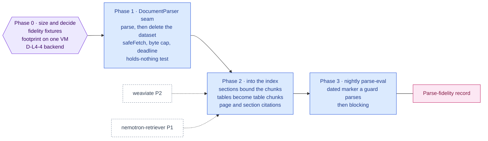

inflect · ai architecture · ragflow · roadmap v1 · 2026-10-29

# RAGFlow — layout-aware document parsing, Layer 4

> **Status: living design** — the integration roadmap for RAGFlow, named by
> the target architecture for Layer 4 as "document parsing & chunking for
> enterprise SAP/ERP data". The **Current state** section is true today
> (main 3.338.0, `a1c2f05c`). The **Roadmap** section is the plan. This is a
> child of [`docs/ai-architecture-roadmap.md`](../ai-architecture-roadmap.md):
> read that first for the target map, the global rules **G1–G13**, and the
> sequencing. If the code contradicts a fact here, the code wins and the pull
> request that finds it corrects this document.

## Where it sits in the master roadmap

| | |
| --- | --- |
| Layer · box | 4 — Knowledge & deep RAG · "RAGFlow (document parsing & chunking)" |
| Wave | 1, after Weaviate Phase 2 (there must be somewhere for chunks to go) |
| Depends on | [`weaviate.md`](./weaviate.md) Phase 2, [`nemotron-retriever.md`](./nemotron-retriever.md) Phase 1 |
| Unblocks | evidence-file and policy-document grounding; the table-aware part of [`ragas.md`](./ragas.md) |
| Owner decisions | **D-L4-4** (RAGFlow as a parsing service only — or a lighter parser) |
| Complete at | Phase 3 |

## At a glance

Purple hexagon: the Phase 0 decision. Blue: a phase not yet on `main`; it turns green (`done`) in the pull request that meets its "done when". Dashed: another roadmap this one waits on or unblocks. Pink: the evaluation record. Grey dashed: an outcome that ends the roadmap.



## Current state (true today)

- **Uploads exist, parsing does not.** Evidence files are `FileRecord` rows
  scanned by ClamAV before storage (`docs/cloud-storage.md`); policies carry
  `PolicyVersion.contentText` (encrypted); vendor documents have an AI feature
  of their own (`src/app-layer/ai/vendor-doc/`); PDFs are *produced* by the
  product (audit packs, exports — `tests/pdf/`). No module extracts layout,
  tables or OCR text from an uploaded document.
- **No chunker.** [`weaviate.md`](./weaviate.md) Phase 2 introduces a plain
  paragraph chunker as a placeholder precisely so RAGFlow is an upgrade of one
  seam rather than a prerequisite for the index.
- **Operational weight is a single VM** running eight services
  (`deploy/docker-compose.prod.yml`). RAGFlow's reference deployment is itself
  a Compose stack — the server plus Elasticsearch (or Infinity), MySQL, MinIO
  and Redis. That is roughly a second product's worth of infrastructure.
- **Legacy data, documents and questionnaire answers are untrusted input** by
  standing rule (legacy-access invariant 3; the guard sandwich G4). A parser
  output is more untrusted than its input, because it is text a model will
  read that no human wrote.

## Fit, and what is deliberately not adopted

**Adopted.** RAGFlow's **DeepDoc** parsing — layout analysis, table extraction,
OCR — through its HTTP API, as a *stateless parsing service*: a document goes
in, structured chunks come out, nothing stays. RAGFlow becomes one backend of
a `DocumentParser` seam.

**Not adopted, with the reason.**

- *RAGFlow's knowledge bases, retrieval, chat and UI.* Each is a second
  multi-tenant store with its own users, API keys and no RLS, holding tenant
  documents outside every isolation and encryption boundary the product has
  (G7). RAGFlow retrieval would also be a second funnel: a model reading from
  it would bypass `runGuardedTool` (G3).
- *RAGFlow's embedding models.* The retriever seam is the one place
  embeddings come from ([`nemotron-retriever.md`](./nemotron-retriever.md)),
  so residency is decided once (G1).
- *Letting documents persist in RAGFlow.* A dataset is created per parse job
  and deleted when the job completes, and a test proves RAGFlow holds nothing
  afterwards. RAGFlow's own storage (MinIO, Elasticsearch) therefore never
  holds tenant data at rest for longer than a job.

**The decision (D-L4-4).** The full RAGFlow stack is heavy for one VM and most
of it is refused above. Phase 0 sizes the *slim* image against the
alternative of a parsing-only service (IBM Docling, MIT, is the obvious
candidate) behind the same seam. The seam is the deliverable either way; the
backend is the owner's choice with the numbers in front of them.

## Roadmap (future direction)

### Phase 0 — Size it, and decide the backend

**Goal.** A parse-fidelity set and a measured footprint, so D-L4-4 is a
decision rather than a preference.

**Sub-phases.**
- [ ] 0.1 Author a parse-fidelity fixture set under `tests/fixtures/parse/`:
      ten documents of the kinds the product actually holds — a policy PDF, an
      SoA table export, a vendor SOC 2 report excerpt (public sample), an
      ISO 27001 clause list, a scanned page for OCR, a questionnaire export —
      each with the expected tables and section headings as JSON.
- [ ] 0.2 Stand RAGFlow (slim image) up locally with its reference Compose;
      record memory/CPU at idle and during a parse, image digests, and the
      number of containers.
- [ ] 0.3 Stand a parsing-only alternative up the same way; same measurements.
- [ ] 0.4 Run both over the fixture set; score table-cell recall and heading
      recall.
- [ ] 0.5 Write the D-L4-4 memo (implementation note) and the dependency
      governance entries for whichever images survive (digest-pinned, G5).

**Prompt.**
```text
Context (main 3.338.0): inflect-compliance uploads evidence files (FileRecord, ClamAV-
scanned) and holds policy text (PolicyVersion.contentText, encrypted) but has no document
parser; weaviate.md Phase 2 chunks with a plain paragraph splitter. The production stack
is one VM with eight Compose services. The target names RAGFlow for layout-aware parsing.

Task: a sizing and fidelity note, docs/implementation-notes/2026-MM-DD-document-parser-
decision.md. (1) Create tests/fixtures/parse/ with ten representative documents and
expected tables/headings as JSON (public samples only). (2) Run RAGFlow slim via its
reference Compose and one parsing-only alternative (e.g. Docling) locally; record
containers, idle and parse-time memory/CPU, and every image digest. (3) Score both on
table-cell recall and heading recall over the fixtures. (4) Recommend a backend for the
DocumentParser seam in one paragraph, naming what the recommendation costs on the VM.

Constraints: no production change, no app dependency. Treat every parser output as
untrusted text. Fixtures must contain no customer content.

Done when: the note has the two measurement tables and the fidelity scores, and the
fixture set is committed with expected outputs.
```

**Hardening.** G5 (digests before adoption; Python stays in images), G11 (the
fidelity set is the parser's evaluation set from day one, hash-tied to the
backend version that produced the numbers).

**Done when.** Owner initials D-L4-4 in the master's decision table.

### Phase 1 — The `DocumentParser` seam

**Goal.** One interface, one backend chosen in Phase 0, one stub; the backend
runs on the VM, reachable only from `worker`.

**Sub-phases.**
- [ ] 1.1 `src/lib/ai/parsing/`: `types.ts` (`DocumentParser.parse(bytes, {
      mime, filename }) → { sections, tables, text, pages }`), the chosen
      backend (`ragflow-provider.ts` or `docling-provider.ts`), `stub-provider.ts`.
- [ ] 1.2 The RAGFlow backend: create dataset → upload → parse → read chunks →
      **delete dataset**, every step via `safeFetch`, byte-capped streaming
      reads (the MCP client's rule: never `res.json()` then measure), bounded
      by a deadline.
- [ ] 1.3 Compose services for the backend, digest-pinned, worker-network only,
      no published ports; secrets in `.env.prod`.
- [ ] 1.4 `src/env.ts`: `DOC_PARSER_BASE_URL`, `DOC_PARSER_API_KEY` (optional;
      absent = stub, i.e. the plain chunker keeps working).
- [ ] 1.5 Inventory row in `docs/sub-processors.md` in the "not a sub-processor
      — runs inside the deployment" style the `legacy-mcp` row uses, so the
      register is complete.
- [ ] 1.6 The "holds nothing" test: after a parse job, the backend's dataset
      list for the job's namespace is empty.

**Prompt.**
```text
Context (main 3.338.0): outbound calls go through safeFetch and every new sink joins the
SSRF egress guard's population; the MCP client (src/lib/mcp/client/) is the house pattern
for a byte-capped, deadline-bounded HTTP read of an untrusted service; the Compose file is
repo-canonical and images are digest-pinned; docs/sub-processors.md is the register of
every external connection, including in-deployment services. Phase 0 chose the backend.

Task: add the DocumentParser seam. (1) src/lib/ai/parsing/{types,ragflow-provider|
docling-provider,stub-provider}.ts. (2) For RAGFlow: dataset create → upload → parse →
read chunks → delete dataset, all via safeFetch, streamed and byte-capped, under one
deadline; a failure at any step still attempts the delete. (3) Compose services, digest-
pinned, worker-network only, no published ports. (4) DOC_PARSER_BASE_URL / _API_KEY in
src/env.ts, optional; absent = stub. (5) A register row in docs/sub-processors.md in the
"not a sub-processor — in-deployment" style. (6) Tests: "a parse leaves no dataset
behind", "a parser response over the byte cap is refused, not truncated", "a parser
outage returns the stub chunking with a WARN".

Constraints: the parser is only ever called from the worker (knowledge-index job). No
tenant-writable URL. Parser output is untrusted and is never logged row by row.

Done when: lint/typecheck green, the SSRF guard sees the sink, the three tests pass in
the integration project against the real service, and check-drift reports clean.
```

**Hardening.** G6 (`safeFetch`, egress population, byte cap, deadline), G8
(worker only), G9 (absent = stub), G5 (digests), G2's register (complete even
for in-deployment services). The delete-after-parse is the isolation
property; the test for it is the one that must never be weakened.

**Done when.** `knowledge-index` can call `parse()` for a `FileRecord`, and the
"holds nothing" test is green.

### Phase 2 — Wire parsing into the index pipeline

**Goal.** Evidence files and policy documents enter the knowledge index as
layout-aware chunks; tables survive as tables.

**Sub-phases.**
- [ ] 2.1 `knowledge-index` ([`weaviate.md`](./weaviate.md) Phase 2) calls
      `parse()` for `FileRecord` sources (after ClamAV, from storage) and uses
      the returned sections as chunk boundaries; tables become one chunk each
      with a Markdown rendering in `KnowledgeChunk.text`.
- [ ] 2.2 Chunk metadata: `page`, `sectionPath`, `kind: 'text' | 'table'` on
      `KnowledgeChunk`, so a citation can say "page 4, table 2".
- [ ] 2.3 The chunker revision (parser backend + version + chunk policy) joins
      the mount-gate revision key.
- [ ] 2.4 Re-index on `FileRecord` replacement; delete chunks on file purge.

**Prompt.**
```text
Context (main 3.338.0 + Phases 1): the knowledge-index job chunks text with a plain
splitter and the DocumentParser seam exists. KnowledgeChunk is the Postgres system of
record (text encrypted), Weaviate holds vectors only. The search_knowledge mount gate is
keyed by a revision that includes the chunker.

Task: route FileRecord sources through parse(). (1) In knowledge-index, for FileRecord
sources read the stored bytes (post-ClamAV), call parse(), chunk by returned sections,
render tables as Markdown chunks with kind='table'. (2) Add page, sectionPath, kind to
KnowledgeChunk (migration, RLS unchanged). (3) Include parser backend+version+chunk
policy in the mount-gate revision key. (4) Re-index on file replacement; delete on purge.

Constraints: a parse failure falls back to the plain chunker with an outcome label,
never to an unindexed file nobody notices. Bound chunk count per document. Tests:
"a table in the fixture set becomes one table chunk with its cells", "replacing a file
replaces its chunks", "purging a file removes its chunks and objects".

Done when: the fixture set indexes with table chunks, citations in the assistant show
page and section, and the gate refuses until a new RAG record lands.
```

**Hardening.** G11 (chunker change = revision change), G8, G7 (unchanged
boundaries). The fallback-with-label rule matters: a silent parse failure is
an invisible hole in a tenant's knowledge.

**Done when.** A tenant's evidence PDF is cited by page in an assistant answer.

### Phase 3 — Table-aware grounding and the fidelity eval in CI

**Goal.** The fidelity set runs nightly against the live backend version and
produces a record.

**Sub-phases.**
- [ ] 3.1 Nightly job `parse-fidelity` (workflow shape copied from `dast.yml`:
      boot the backend as a service container, run the fixture set, upload the
      report, auto-issue on regression, dated `PARSE-EVAL-NON-BLOCKING-UNTIL:`
      marker parsed by a guard — then blocking).
- [ ] 3.2 Record format shared with [`ragas.md`](./ragas.md): set + raw per-case
      scores + backend version, aggregates recomputed.
- [ ] 3.3 Table-aware answers: the assistant/agents receive table chunks as
      Markdown with the source reference; `guardUntrustedInput` scans them like
      any result (G4).

**Prompt.**
```text
Context (main 3.338.0 + Phases 1–2): the parse-fidelity fixture set exists under
tests/fixtures/parse/ with expected outputs; the DAST workflow (.github/workflows/dast.yml)
is the house pattern for a nightly service-backed check with a dated non-blocking marker
that tests/guardrails/dast-workflow-pinning.test.ts parses; evaluation records recompute
aggregates from raw answers (flue/skills/evaluation-record.ts).

Task: a nightly parse-fidelity job. (1) .github/workflows/parse-eval.yml: start the
parser backend as a service container (digest-pinned), run the fixture set through the
DocumentParser seam, write a record {set hash, backend version, per-case cell/heading
recall}, upload it, open/update an auto-issue on regression. (2) A guard that parses a
PARSE-EVAL-NON-BLOCKING-UNTIL: <date> marker and fails once the date passes. (3) A TS
validator src/lib/ai/evals/parse-record.ts that recomputes aggregates and refuses a
stored passRate key.

Constraints: no customer data; seed fixtures only. The job uploads a coverage-shard
artifact only if it runs Jest — if it does not, keep it out of the coverage partition
and say so in the workflow comment (tests/guardrails/coverage-gate-population.test.ts
pins that partition).

Done when: the job runs green on a schedule, the marker guard is green with a date in
the future, and the record validator rejects a stored rate.
```

**Hardening.** G11 (records, recomputed), G10 (dated deferral the guard parses
— the DAST lesson: a marker nobody parses never turns red).

**Done when.** The first nightly record is committed and the marker date is
set.

## Evals for this framework

| What | How | Record |
| --- | --- | --- |
| Parse fidelity | table-cell and heading recall over `tests/fixtures/parse/` | nightly `parse-eval` record (Phase 3) |
| Holds-nothing | dataset list empty after every job | integration test (Phase 1) |
| Grounding quality with tables | Ragas context precision on table questions | [`ragas.md`](./ragas.md) |
| Footprint | idle/parse memory and CPU | Phase 0 note; alert on the VM |

## Updating the master

Flip the row on the master [Status board](../ai-architecture-roadmap.md#status-board)
per phase. If D-L4-4 chooses a backend other than RAGFlow, rename this file's
row in the master to the chosen backend and keep this document as the record
of why — the seam and phases are unchanged.
