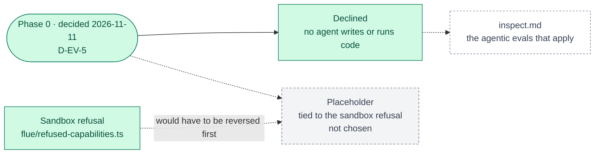

inflect · ai architecture · swe-bench · roadmap v1 · 2026-10-29

# SWE-bench — a coding benchmark with no surface here, Validation column

> **Status: living design** — the integration roadmap for SWE-bench, which
> the target architecture places in the Validation column as "testing".
> **Phase 0's decision is taken: declined (D-EV-5, decided by the owner
> 2026-11-11).** The roadmap is complete once the master's decision table and
> status board record it; that edit is the coordinator's and is outstanding
> (§ Updating the master). The **Current state** section is true today (re-verified
> 2026-11-11 at main 3.365.0, `8733323f`). The **Roadmap** section records the
> decision, because the benchmark measures a capability this product does not
> have and has decided not to have. This is a child of
> [`docs/ai-architecture-roadmap.md`](../ai-architecture-roadmap.md). If the
> code contradicts a fact here, the code wins and the pull request that finds
> it corrects this document.

## Where it sits in the master roadmap

| | |
| --- | --- |
| Column · box | Validation · "SWE-bench (testing)" |
| Wave | none (decision only) |
| Depends on | — |
| Unblocks | — |
| Owner decisions | **D-EV-5** decided by the owner 2026-11-11: declined (no capability to measure); the master's decision table does not record it yet |
| Complete at | Phase 0's recorded decision — decided 2026-11-11 (declined); complete when the master records it |

## At a glance

Green: decided or on `main`. Dashed: another roadmap this one points at. Grey dashed: an outcome not taken.



## Current state (true today)

- **SWE-bench measures whether an agent can resolve real GitHub issues by
  editing a repository and passing its tests.** It is a coding-agent
  benchmark; it needs an agent that reads code, edits files and runs a test
  suite in a sandbox.
- **No Inflect agent writes code, edits files or runs anything.** The engines
  reach tools only through `runGuardedTool`; the offered tools are the MCP
  read tools and the `propose_*` tools (`src/lib/mcp/tools/`); every write is
  a proposal a human approves. Flue's `useSandbox`, the bash tool and the
  sandbox filesystem tools are refused by import
  (`flue/refused-capabilities.ts`, 23 exports: 16 sandbox and shell, 5
  filesystem, 2 channel; held by `tests/guards/flue-refused-capabilities.test.ts`). The one sandbox in the
  product — OpenShell, `src/lib/agentic/openshell/` — confines Inflect's *own*
  collector binaries (Powerpipe), not model-written code.
- **The harness scanner reads customers' code and never executes it**
  (Step 3b: "code can show a control is missing, never that one works").

So the capability SWE-bench evaluates is doubly absent: not built, and refused
in code.

## Fit, and what is deliberately not adopted

There is no fit today, and this document says so rather than inventing one.
The nearest things that *are* relevant are already covered elsewhere:

- *Agentic tool-use evaluation* — [`inspect.md`](./inspect.md), whose first
  ten tasks are the product's own invariants.
- *Code-reading accuracy of the harness scanner* (does it recognise an Agent
  SDK agent correctly?) — a fixture-based test of the scanner, which belongs
  with the agentic IAM roadmap (`docs/agentic-iam-roadmap.md`), not with a
  coding benchmark.

**The one path that would make SWE-bench relevant** is a product decision to
let a model write and run code — a reversal of the sandbox refusal, which the
Flue roadmap's risk section called "the largest new attack surface available".
If that reversal is ever made, it is made in `refused-capabilities.ts` with a
written reason, through the OpenShell confinement, and SWE-bench-style tasks
would then be a *capability* eval run through Inspect (`inspect_evals` carries
an implementation). That is three decisions away and none of them is this
roadmap's to take.

## Roadmap (future direction)

### Phase 0 — Decide, and record (decided 2026-11-11; master record outstanding)

**The record.** D-EV-5 was decided by the owner on 2026-11-11 (relayed to this
change by the coordinating session; the owner's initials go in the master's
decision table, which this change does not edit):
**declined — no capability to measure.** SWE-bench scores an agent that edits
a repository and runs its tests. No Inflect agent writes or executes code, and
that is a decision held in code (`flue/refused-capabilities.ts` and its guard),
not a gap waiting to be filled. A placeholder tied to the refusal was the other
option; it was not taken, because a box that cannot start until three other
decisions reverse reads as an unstarted task, which is what this document
exists to prevent. The reasoning, and the three decisions that would have to
change before the benchmark became relevant, are in
`docs/implementation-notes/2026-11-11-ai-roadmap-decision-completions.md`.

**Sub-phases.**
- [x] 0.1 D-EV-5: retire the box from the target diagram's Validation column,
      or keep it as a placeholder tied to the sandbox refusal. *Declined,
      2026-11-11: the box is answered "declined — no capability to measure".*
- [ ] 0.2 Record the decision in the master's decision table and mark this
      framework "declined — no capability to measure" or "placeholder".
      *Outstanding. Recorded here and in the implementation note only. The
      master is the coordinator's to edit, and at this writing its D-EV-5 row
      still shows "declined" only as the default-if-undecided, with no date,
      and its status-board row has no decision. § Updating the master gives
      the text to write.*

**Prompt.**
```text
Context (main 3.338.0): no Inflect agent writes or executes code; model-driven sandboxes
are refused by import (src/lib/agentic/flue/refused-capabilities.ts); OpenShell confines
the product's own collector binaries only; the harness scanner reads customer code and
never runs it. SWE-bench is a coding-agent benchmark. The target diagram lists it under
Validation.

Task: a one-page implementation note, docs/implementation-notes/2026-MM-DD-swe-bench-
decision.md, stating why SWE-bench measures an absent and refused capability, what the
nearest relevant evals are (inspect.md tasks; scanner fixture accuracy), and the three
decisions that would have to change before it became relevant. Recommend "declined" or
"placeholder" for D-EV-5.

Constraints: no code. Do not propose enabling code execution.

Done when: D-EV-5 is initialled and the master's status board row reads accordingly.
```

**Hardening.** None to add — the refusal already has its guard
(`tests/guards/flue-refused-capabilities.test.ts`). This document exists so
that nobody reads the diagram's box as an unstarted task.

## Evals for this framework

Not applicable.

## Updating the master

Outstanding, and the coordinator's to do (this change does not edit the
master). Write:

- **Status board**, SWE-bench row, current-state column: "declined — no
  capability to measure (D-EV-5, 2026-11-11)", linking the implementation note.
- **Decisions for the owner**, D-EV-5: "**decided 2026-11-11** (owner):
  declined", in place of the default-if-undecided text.

Once both read so, tick 0.2 and the roadmap is complete. Nothing further unless
the sandbox refusal is reversed, which reopens this document from its Fit
section.
