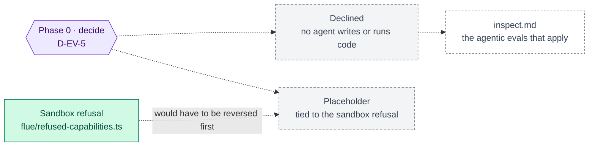

inflect · ai architecture · swe-bench · roadmap v1 · 2026-10-29

# SWE-bench — a coding benchmark with no surface here, Validation column

> **Status: living design** — the integration roadmap for SWE-bench, which
> the target architecture places in the Validation column as "testing". The
> **Current state** section is true today (main 3.338.0, `a1c2f05c`). The
> **Roadmap** section is the plan — and the plan is a decision, because the
> benchmark measures a capability this product does not have and has decided
> not to have. This is a child of
> [`docs/ai-architecture-roadmap.md`](../ai-architecture-roadmap.md). If the
> code contradicts a fact here, the code wins and the pull request that finds
> it corrects this document.

## Where it sits in the master roadmap

| | |
| --- | --- |
| Column · box | Validation · "SWE-bench (testing)" |
| Wave | none (decision only) |
| Depends on | — |
| Unblocks | — |
| Owner decisions | **D-EV-5** (keep the box or retire it) |
| Complete at | Phase 0's recorded decision (expected: declined) |

## At a glance

Purple hexagon: the Phase 0 decision. Blue: a phase not yet on `main`; it turns green (`done`) in the pull request that meets its "done when". Dashed: another roadmap this one waits on or unblocks. Pink: the evaluation record. Grey dashed: an outcome that ends the roadmap.



## Current state (true today)

- **SWE-bench measures whether an agent can resolve real GitHub issues by
  editing a repository and passing its tests.** It is a coding-agent
  benchmark; it needs an agent that reads code, edits files and runs a test
  suite in a sandbox.
- **No Inflect agent writes code, edits files or runs anything.** The engines
  reach tools only through `runGuardedTool`; the offered tools are the MCP
  read tools and the `propose_*` tools (`src/lib/mcp/tools/`); every write is
  a proposal a human approves. Flue's `useSandbox`, the bash tool and the
  sandbox filesystem tools are refused by import
  (`flue/refused-capabilities.ts`, 23 exports). The one sandbox in the
  product — OpenShell, `src/lib/agentic/openshell/` — confines Inflect's *own*
  collector binaries (Powerpipe), not model-written code.
- **The harness scanner reads customers' code and never executes it**
  (Step 3b: "code can show a control is missing, never that one works").

So the capability SWE-bench evaluates is doubly absent: not built, and refused
in code.

## Fit, and what is deliberately not adopted

There is no fit today, and this document says so rather than inventing one.
The nearest things that *are* relevant are already covered elsewhere:

- *Agentic tool-use evaluation* — [`inspect.md`](./inspect.md), whose first
  ten tasks are the product's own invariants.
- *Code-reading accuracy of the harness scanner* (does it recognise an Agent
  SDK agent correctly?) — a fixture-based test of the scanner, which belongs
  with the agentic IAM roadmap (`docs/agentic-iam-roadmap.md`), not with a
  coding benchmark.

**The one path that would make SWE-bench relevant** is a product decision to
let a model write and run code — a reversal of the sandbox refusal, which the
Flue roadmap's risk section called "the largest new attack surface available".
If that reversal is ever made, it is made in `refused-capabilities.ts` with a
written reason, through the OpenShell confinement, and SWE-bench-style tasks
would then be a *capability* eval run through Inspect (`inspect_evals` carries
an implementation). That is three decisions away and none of them is this
roadmap's to take.

## Roadmap (future direction)

### Phase 0 — Decide, and record

**Sub-phases.**
- [ ] 0.1 D-EV-5: retire the box from the target diagram's Validation column,
      or keep it as a placeholder tied to the sandbox refusal.
- [ ] 0.2 Record the decision in the master's decision table and mark this
      framework "declined — no capability to measure" or "placeholder".

**Prompt.**
```text
Context (main 3.338.0): no Inflect agent writes or executes code; model-driven sandboxes
are refused by import (src/lib/agentic/flue/refused-capabilities.ts); OpenShell confines
the product's own collector binaries only; the harness scanner reads customer code and
never runs it. SWE-bench is a coding-agent benchmark. The target diagram lists it under
Validation.

Task: a one-page implementation note, docs/implementation-notes/2026-MM-DD-swe-bench-
decision.md, stating why SWE-bench measures an absent and refused capability, what the
nearest relevant evals are (inspect.md tasks; scanner fixture accuracy), and the three
decisions that would have to change before it became relevant. Recommend "declined" or
"placeholder" for D-EV-5.

Constraints: no code. Do not propose enabling code execution.

Done when: D-EV-5 is initialled and the master's status board row reads accordingly.
```

**Hardening.** None to add — the refusal already has its guard
(`tests/guards/flue-refused-capabilities.test.ts`). This document exists so
that nobody reads the diagram's box as an unstarted task.

## Evals for this framework

Not applicable.

## Updating the master

After Phase 0, the master's row for SWE-bench reads "declined" or
"placeholder (gated on the sandbox refusal)". Nothing further unless the
refusal is reversed, which reopens this document from its Fit section.
