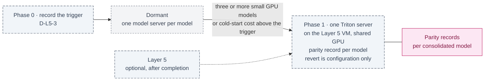

inflect · ai architecture · triton · roadmap v1 · 2026-10-29

# NVIDIA Triton Inference Server — consolidation, deferred, Layer 5

> **Status: living design** — the integration roadmap for Triton, which the
> target architecture names for Layer 5 as "optimised multi-tenant model
> serving, dynamic batching". The **Current state** section is true today
> (main 3.338.0, `a1c2f05c`). The **Roadmap** section is the plan, and the
> plan is to defer until there is something to consolidate. This is a child
> of [`docs/ai-architecture-roadmap.md`](../ai-architecture-roadmap.md). If
> the code contradicts a fact here, the code wins and the pull request that
> finds it corrects this document.

## Where it sits in the master roadmap

| | |
| --- | --- |
| Layer · box | 5 — Runtime & infrastructure · "NVIDIA Triton Inference Server" |
| Wave | Optional, after completion: Layer 5 work, taken up only after every other roadmap is complete |
| Depends on | Layer 5 taken up ([`modal-inference.md`](./modal-inference.md) Phase 2) and at least three GPU-served small models |
| Unblocks | lower GPU cost per model when several share a card |
| Owner decisions | **D-L5-3** (consolidate on Triton, or keep one model server per model), deferred with Layer 5 |
| Complete at | Not part of completeness: optional Layer 5 work |

## At a glance

Purple hexagon: the Phase 0 decision. Blue: a phase not yet on `main`; it turns green (`done`) in the pull request that meets its "done when". Slate dashed: optional Layer 5 work, which starts only after every other roadmap is complete. Dashed white: another roadmap this one waits on or unblocks. Pink: the evaluation record. Grey dashed: an outcome that ends the roadmap.



## Current state (true today)

- No GPU, no model server, no Triton ([`modal-inference.md`](./modal-inference.md)
  § Current state). Model usage is through LLM API keys, and Layer 5 is
  optional and last (D-L5-1): if it is taken up, it is a GPU VM in the
  operator's own Google Cloud project.
- The blueprint's reason for Triton (§4 Phase 2: "host OCR, layout extraction,
  embedding and guardrails on Triton on shared GPUs, minimising CPU-GPU
  roundtrips") assumes an always-on GPU whose idle capacity is worth filling.
  That argument returns only if Layer 5 is taken up: several small models
  sharing one GPU VM is exactly the case Triton serves.

## Fit, and what is deliberately not adopted

**Adopted (conditionally).** Triton (BSD-3) with its vLLM and Python backends
as a *single* server on the Layer 5 GPU VM serving several small models — embedding, rerank,
a guardrail classifier, a PII NER model — with dynamic batching, **if** three
or more such models exist and their combined cold-start cost or GPU count
exceeds one shared instance's. Everything here is optional Layer 5 work.

**Not adopted, with the reason.**

- *Triton for the generative worker model.* vLLM standalone serves it; Triton's
  vLLM backend adds a layer for no gain at one model.
- *Triton before the models exist.* An inference server with nothing to
  serve is the "never-called checker" the Flue refusal note warns about.
- *NIM-backed Triton ensembles.* De-NIM applies (blueprint §3).

## Roadmap (future direction)

### Phase 0 — The consolidation trigger

**Sub-phases.**
- [ ] 0.1 Record the trigger in the master: "three GPU-served small models on
      the Layer 5 VM, or a second GPU needed to hold them" — measured against
      the Layer 5 cost figures ([`modal-inference.md`](./modal-inference.md) Phase 0).
- [ ] 0.2 Until the trigger fires, this roadmap is dormant; the master's row
      says so.

**Prompt.**
```text
Context (main + Layer 5 taken up): Layer 5 is a GPU VM in the operator's own Google Cloud
project, serving one model server per model. Triton consolidates several models on a
shared GPU with dynamic batching. The target lists Triton.

Task: a half-page implementation note recording decision D-L5-3's trigger: the model
count and the GPU memory above which consolidating on one Triton server on the Layer 5
VM pays; where that figure comes from (the Layer 5 cost figures); and that until then
one server per model stands. Add the trigger to the master's decision
table.

Constraints: no code, no dependency.

Done when: the trigger is written down and the master's row reads "dormant until
<trigger>".
```

### Phase 1 — One Triton server (if the trigger fires)

**Sub-phases.**
- [ ] 1.1 In the Layer 5 deployment scripts: the Triton image (digest), a
      model repository on the VM's disk with the pinned small models, vLLM and
      Python backends, dynamic batching configured per model; one
      operator-held token.
- [ ] 1.2 The per-model routes in the product (`AI_EMBED_*`, guardrail, PII)
      point at the Triton server's OpenAI-compatible or KServe endpoints —
      the product's seams do not change; only base URLs do.
- [ ] 1.3 Parity records: each model's eval set re-run on Triton matches its
      standalone record (cosine for embeddings, agreement for classifiers).
- [ ] 1.4 Cost before/after in the note; revert is "point the base URLs back".

**Hardening.** G5 (digests and model hashes), G12 (still optional), G11
(parity records per model), reversible by configuration alone.

## Evals for this framework

Parity records per consolidated model; the cost before/after figure.

## Updating the master

The master's row reads "dormant until <trigger>" after Phase 0; it flips
when the trigger fires and Phase 1 lands.
