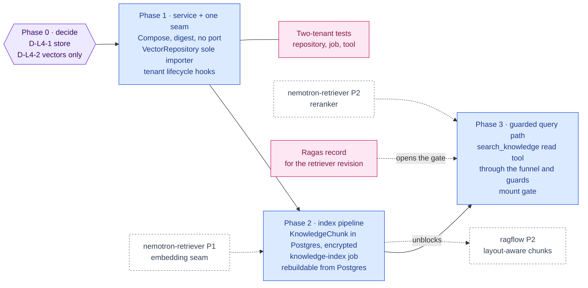

inflect · ai architecture · weaviate · roadmap v1 · 2026-10-29

# Weaviate — the vector index, Layer 4

> **Status: living design** — the integration roadmap for Weaviate, the
> vector store the target architecture names for Layer 4 ("vector DB &
> multi-tenant isolation"). The **Current state** section is true today
> (main 3.338.0, `a1c2f05c`). The **Roadmap** section is the plan. This is a
> child of [`docs/ai-architecture-roadmap.md`](../ai-architecture-roadmap.md):
> read that first for the target map, the global rules **G1–G13** every phase
> here inherits, and the sequencing that says when this framework's turn comes.
> If the code contradicts a fact here, the code wins and the pull request that
> finds it corrects this document.

## Where it sits in the master roadmap

| | |
| --- | --- |
| Layer · box | 4 — Knowledge & deep RAG · "Weaviate (vector DB & multi-tenant isolation)" |
| Wave | 1 (the first Layer 4 wave, zero-GPU) — see master § Sequencing |
| Depends on | nothing to deploy; **an embedding provider to be useful** → [`nemotron-retriever.md`](./nemotron-retriever.md) |
| Unblocks | [`ragflow.md`](./ragflow.md) (somewhere for parsed chunks to go), [`ragas.md`](./ragas.md) / [`ares.md`](./ares.md) (something to evaluate), the assistant's `search_knowledge` tool |
| Owner decisions | master § Decisions for the owner, **D-L4-1** (pgvector first or Weaviate first) and **D-L4-2** (vectors-only rule) |
| Complete at | Phase 3 |

## At a glance

Purple hexagon: the Phase 0 decision. Blue: a phase not yet on `main`; it turns green (`done`) in the pull request that meets its "done when". Dashed: another roadmap this one waits on or unblocks. Pink: the evaluation record. Grey dashed: an outcome that ends the roadmap.



## Current state (true today)

- **There is no vector store and no embedding anywhere.** `weaviate`, `pgvector`
  and `vector(` return nothing under `src/`; the 18 files matching `embedding`
  use the word in its prompt/UI sense (`risk-assessment/prompt-builder.ts`,
  `EvidenceGallery.tsx`). The database is PostgreSQL 16 behind PgBouncer, and
  the production stack (`deploy/docker-compose.prod.yml`, repo-canonical since
  #2849) runs `postgres`, `pgbouncer`, `redis`, `clamav`, `app`, `worker`,
  `watchtower`, `caddy` — nothing else.
- **Retrieval today is tool-shaped, not vector-shaped.** The assistant
  (`src/app-layer/ai/assistant/`) runs a tool loop over the product's own data
  through `runGuardedTool`; the questionnaire feature grounds answers from the
  answer library and ships evidence *titles* only. Agents read through the
  audited MCP read tools (`src/lib/mcp/tools/`). None of this needs a vector.
- **Two isolation layers protect every tenant row, and both are in Postgres.**
  RLS with `FORCE ROW LEVEL SECURITY` on every tenant table plus the
  application-layer `tenantId` filter in every repository
  (`tests/guardrails/rls-coverage.test.ts`,
  `tests/unit/tenant-isolation-structural.test.ts`). A store outside Postgres
  has neither.
- **Business content is encrypted at rest by a manifest.** `Finding.description`,
  `Risk.treatmentNotes`, `PolicyVersion.contentText`, `TaskComment.body` and the
  rest of `src/lib/security/encrypted-fields.ts` are ciphertext in the database
  and decrypted on read. A chunk of that text copied into another store in the
  clear is a plaintext derivative the manifest does not know about.
- **Tenant lifecycle has one seam.** `createTenantWithDek` mints the tenant and
  its DEK; deletion is gated `admin.tenant_lifecycle` (OWNER-only); the
  `data-lifecycle` job purges soft-deletes after 90 days
  (`docs/data-retention.md`). Anything that holds tenant data must hang off
  those three events or it outlives the tenant.

## Fit, and what is deliberately not adopted

**Adopted.** Weaviate as a *rebuildable index*: native multi-tenancy (one shard
per tenant, `multiTenancyConfig.enabled`, `autoTenantCreation: false`), hybrid
BM25 + vector search, bring-your-own vectors (`vectorizer: none`) so the
embedding comes from the retriever seam and never from a Weaviate module, the
TypeScript `weaviate-client` v3.

**Not adopted, with the reason.**

- *Weaviate's vectorizer and generative modules* (`text2vec-openai`,
  `text2vec-cohere`, `generative-*`). Each is an outbound call to a vendor made
  from inside the database — a sub-processor nobody wrote a row for (G2), on a
  route the residency decision in `model-selection.ts` never saw (G1).
- *Weaviate Cloud.* A sub-processor holding vectors of business content, with
  the four-step notice before a byte moves. Self-hosted on the VM only, unless
  the owner opens that step.
- *Storing chunk text in Weaviate.* The **vectors-only rule** (D-L4-2): an
  object in Weaviate carries `tenantId`, a source reference
  (`sourceModel`, `sourceId`, `chunkIndex`), a `contentHash`, the embedding model
  id and the vector — **never the text**. Text lives in a Postgres
  `KnowledgeChunk` row under the encryption manifest and is hydrated at query
  time through the repository, under RLS. Losing Weaviate then loses nothing;
  a Weaviate backup leaks only vectors. Vectors are still classified as
  business content (embedding inversion is real), which is why the store stays
  inside the perimeter.

**The decision that precedes everything (D-L4-1).** `pgvector` would put the
vectors *inside* RLS, inside the same backups, inside the same encryption story,
with no new service and no new isolation argument — and it has no native hybrid
search and scales less far. Weaviate is the target the owner named and brings
hybrid search and per-tenant shards, at the price of a second store whose
isolation is a property of application code alone. The roadmap below is written
for Weaviate; Phase 0 records the choice and the reasons, and if the answer is
pgvector-first, Phases 1–3 apply with the repository's backend swapped and the
"tenant lifecycle" sub-phase deleted.

## Roadmap (future direction)

### Phase 0 — Decide the store and the rule

**Goal.** Two decisions recorded before any dependency is added: the store, and
the vectors-only rule.

**Sub-phases.**
- [ ] 0.1 Write the D-L4-1 decision memo as an implementation note: pgvector vs
      Weaviate, against the five questions that matter here — isolation layers,
      backup/restore, encryption boundary, hybrid search, operational weight on
      one VM.
- [ ] 0.2 Adopt the vectors-only rule (D-L4-2) in the same note and name the
      Postgres model that will be the system of record (`KnowledgeChunk`, in a
      new `prisma/schema/knowledge.prisma`).
- [ ] 0.3 Classify `KnowledgeChunk` (and the Weaviate shard) in
      `docs/data-retention.md` — business record, purged with its source row and
      with the tenant — so `retention-policy-coverage.test.ts` is green before
      the model exists.
- [ ] 0.4 Dependency governance: `weaviate-client` is a runtime dependency
      (`dependencies`), the server is a runtime image pinned by digest (G5).

**Prompt.**
```text
Context (main 3.338.0): inflect-compliance has no vector store. Retrieval is a tool loop
(src/app-layer/ai/assistant/) and audited MCP read tools (src/lib/mcp/tools/). Tenant
isolation is Postgres RLS + repository tenantId filters; business content is encrypted by
the manifest in src/lib/security/encrypted-fields.ts. The target architecture names
Weaviate for Layer 4 (docs/ai-architecture-roadmap.md).

Task: write docs/implementation-notes/2026-MM-DD-vector-store-decision.md recording
decision D-L4-1 (pgvector vs Weaviate) and D-L4-2 (vectors-only: Weaviate holds
tenantId, sourceModel, sourceId, chunkIndex, contentHash, embeddingModel and the vector —
never text; text lives in a Postgres KnowledgeChunk row under the encryption manifest).
Compare on: isolation layers, backup/restore, encryption boundary, hybrid search,
operational weight on a single VM. Add the KnowledgeChunk classification to
docs/data-retention.md. Do not add code or dependencies yet.

Constraints: implementation notes need NO doc-classification.json entry. State which
option the note recommends and why, in one paragraph the owner can accept or reverse.

Done when: the note exists, docs/data-retention.md has the row, and
tests/guardrails/retention-policy-coverage.test.ts and docs-accuracy.test.ts pass.
```

**Hardening.** G5 (classification before code), G10 (an implementation note,
no `counts`, no classification entry). Nothing executable ships in this phase,
which is the point: the isolation argument is written before the store exists.

**Done when.** The note is on `main` and the owner has initialled D-L4-1 and
D-L4-2 in the master roadmap's decision table.

### Phase 1 — The service and the single seam

**Goal.** Weaviate runs on the VM, reachable only from `app` and `worker`, and
exactly one module in the codebase can talk to it.

**Sub-phases.**
- [ ] 1.1 `deploy/docker-compose.prod.yml`: a `weaviate` service pinned by
      digest, `ENABLE_MODULES` empty, `AUTHENTICATION_ANONYMOUS_ACCESS_ENABLED=false`
      with an API key from `.env.prod`, a named volume, **no published port** —
      `caddy` does not route to it. Applied with `deploy/apply.sh` (`CONFIRM=1`),
      drift checked with `deploy/check-drift.sh`.
- [ ] 1.2 `src/env.ts`: `WEAVIATE_URL`, `WEAVIATE_API_KEY`, both optional; absent
      means the feature is off and no client is constructed (G9).
- [ ] 1.3 `src/app-layer/repositories/VectorRepository.ts` — the **only**
      importer of `weaviate-client`. Every method takes `ctx: RequestContext`
      and calls `.withTenant(ctx.tenantId)`; there is no method that takes a
      tenant id as a plain argument. An ESLint `no-restricted-imports` entry
      refuses `weaviate-client` everywhere else (G10: a structural rule is an
      ESLint rule).
- [ ] 1.4 Collection `TenantChunk` created by a migration-style bootstrap script
      (`scripts/weaviate-bootstrap.ts`, idempotent): multi-tenancy on,
      auto-tenant-creation off, `vectorizer: none`, properties per the
      vectors-only rule.
- [ ] 1.5 Tenant lifecycle: `createTenantWithDek` → create the Weaviate tenant;
      tenant deletion → delete the Weaviate tenant; both inside the existing
      usecases, both idempotent, both audited through `logEvent`.
- [ ] 1.6 The two-tenant behavioural test (G7, checklist §2): insert under A,
      query under B, expect nothing; query under A with B's object id, expect
      nothing; delete tenant A, expect the shard gone.
- [ ] 1.7 `/api/readyz` does NOT gate on Weaviate; an outcome metric
      `vector_index.requests` with `outcome` label (checklist §4) does the
      alerting.

**Prompt.**
```text
Context (main 3.338.0): decision D-L4-1 chose Weaviate (see the Phase 0 note). The
production Compose file is repo-canonical (deploy/docker-compose.prod.yml, applied by
deploy/apply.sh). Runtime images are pinned by digest (docs/dependency-governance.md,
"Runtime images — the fifth pillar"). Repositories take RequestContext and filter by
tenantId; the vectors-only rule D-L4-2 applies.

Task: add Weaviate behind one seam. (1) A `weaviate` service in
deploy/docker-compose.prod.yml, digest-pinned, no modules, API-key auth, named volume, no
published port. (2) WEAVIATE_URL / WEAVIATE_API_KEY in src/env.ts, optional; absent = no
client constructed. (3) src/app-layer/repositories/VectorRepository.ts as the ONLY importer
of weaviate-client — every method takes ctx and uses .withTenant(ctx.tenantId); add an
ESLint no-restricted-imports rule for weaviate-client outside that file. (4)
scripts/weaviate-bootstrap.ts creating collection TenantChunk (multi-tenancy on,
autoTenantCreation off, vectorizer none, properties: sourceModel, sourceId, chunkIndex,
contentHash, embeddingModel). (5) Tenant create/delete hooks in the existing tenant
lifecycle usecases, idempotent, audited via logEvent.

Constraints: no text property on the collection. readyz must not gate on Weaviate.
Add a two-tenant behavioural test (tests/integration/vector-tenant-isolation.test.ts):
A inserts, B sees nothing, A's object id under B returns nothing, deleting tenant A
removes the shard. Add an outcome metric with an `outcome` label. Name tests for the
invariant, not the phase. Write an implementation note.

Done when: typecheck, lint, the new integration test and the existing ratchets
(rls-coverage, no-direct-prisma allowlists, retention-policy-coverage, docs-accuracy)
are green; deploy/check-drift.sh reports no drift after apply.
```

**Hardening.** G5 (digest pin, runtime dep), G6 (`WEAVIATE_URL` is operator
config, never tenant-writable; the client is the only socket), G7 (two-tenant
test, no plain-tenant-id method), G9 (absent config = feature off), checklist
§4 (outcome metric). The ESLint import ban is the structural guard; the
behavioural test is the conduct guard — both, per the checklist's "shape and
conduct".

**Done when.** Service applied on the VM, the two-tenant test green in the
`test` shards, and `VectorRepository.ts` is the sole `weaviate-client` importer
by lint.

### Phase 2 — The index pipeline (write side)

**Goal.** Postgres is the system of record; Weaviate is rebuilt from it; nothing
reaches Weaviate except through the worker.

**Sub-phases.**
- [ ] 2.1 `prisma/schema/knowledge.prisma`: `KnowledgeChunk` (tenantId,
      sourceModel, sourceId, chunkIndex, `text` **in the encryption manifest**,
      contentHash, embeddingModel, dimensions, `indexedAt`), RLS policies in the
      migration, `@@index([tenantId, sourceModel, sourceId])`, listed in the
      index-coverage guard's maps.
- [ ] 2.2 A BullMQ job `knowledge-index` (G8) that takes `(tenantId, sourceModel,
      sourceId)`, reads the source row under `runInTenantContext`, chunks it
      (plain paragraph chunker now; RAGFlow output later), embeds through the
      retriever seam, upserts `KnowledgeChunk` rows and Weaviate objects keyed by
      `contentHash` so re-runs are no-ops.
- [ ] 2.3 Triggers: the audit emitters for the source models (`logEvent` after
      create/update) enqueue the job; soft-delete purge in `data-lifecycle`
      deletes chunks and objects; tenant deletion deletes the shard (Phase 1.5).
- [ ] 2.4 `scripts/knowledge-reindex.ts`: rebuild a tenant's shard from its
      `KnowledgeChunk` rows — the proof that Weaviate is rebuildable, run in a
      test.
- [ ] 2.5 First sources, in this order: `PolicyVersion.contentText` (approved
      versions only), evidence file text (post-ClamAV, via the parser seam),
      control descriptions, the questionnaire answer library.

**Prompt.**
```text
Context (main 3.338.0): VectorRepository.ts (Phase 1) is the only Weaviate seam. Business
content is encrypted by src/lib/security/encrypted-fields.ts. Background jobs live in
src/app-layer/jobs/ and wrap in runJob(); the executor registry is executor-registry.ts.
Soft-deletes are purged by the data-lifecycle job. Prisma schema is a folder; new models
go in a domain file with tenantId-leading indexes (tests/guardrails/schema-index-coverage).

Task: add the write side of the knowledge index. (1) prisma/schema/knowledge.prisma with
KnowledgeChunk — tenantId, sourceModel, sourceId, chunkIndex, text (ADD to the encryption
manifest), contentHash, embeddingModel, dimensions, indexedAt — plus RLS policies in the
migration. (2) Job `knowledge-index` keyed (tenantId, sourceModel, sourceId): read under
runInTenantContext, chunk, embed via the EmbeddingProvider seam (nemotron-retriever
Phase 1; use the stub if it has not landed), upsert chunks + Weaviate objects by
contentHash. (3) Enqueue from the audit emitters of PolicyVersion (approved only) and
evidence file text; delete chunks + objects in the data-lifecycle purge. (4)
scripts/knowledge-reindex.ts rebuilding a tenant shard from Postgres, exercised by a test.

Constraints: the job never runs on the web tier; readiness of the index is advisory; a
chunk whose source row is encrypted is itself an encrypted column. Keep every findMany
bounded (take:) or carry the guardrail-allow comment with a reason. Classify
KnowledgeChunk in docs/data-retention.md (Phase 0 did; verify). Write the two-tenant
test for the job: indexing A's policy creates nothing B can query.

Done when: migration applies on a fresh DB (the CI "fresh-DB schema drift" gate), the
reindex test proves rebuild, the index-coverage and query-shape guardrails are green,
and the sanitize-rich-text-coverage ratchet classifies KnowledgeChunk.text.
```

**Hardening.** G7 (RLS on the Postgres twin; the Weaviate shard is downstream
of it), G8 (worker only, `runJob`, resumable), G4 is NOT yet in play — nothing
reads from the index into a model in this phase, by design. The encryption
manifest entry is the single most important line in the diff: it is what makes
the index a derivative the platform already governs.

**Done when.** A policy approved in a tenant appears as chunks and objects
within one job run; deleting the tenant leaves no shard; the reindex script
reproduces the shard byte-for-byte on vector identity.

### Phase 3 — The query path (read side), guarded

**Goal.** Hybrid search is a read tool like any other: offered through the
allowlist and ceiling, executed through the funnel, its results scanned on the
way into model context, and evaluated before it is offered at all.

**Sub-phases.**
- [ ] 3.1 `VectorRepository.search(ctx, query, { k, alpha })` — hybrid, tenant
      shard only, returns source references and scores; hydration of text goes
      through the normal Prisma repositories under RLS (decrypting via the
      manifest).
- [ ] 3.2 An MCP read tool `search_knowledge` in `src/lib/mcp/tools/`, so Flue,
      the Tool Runner and external MCP clients all get it through
      `runGuardedTool → runReadTool` (G3), subject to the agent's allowlist and
      ceiling, with `resourceScope` set.
- [ ] 3.3 The assistant offers the same tool from `assistant/tools.ts`; result
      text passes `guardUntrustedInput` before entering context and
      `guardEgress` before leaving to an external provider (G4) — the existing
      three-slice sandwich in `tools-adapter.ts` applies unchanged because the
      tool is a read tool.
- [ ] 3.4 The mount gate: `search_knowledge` is offered only when a RAG
      evaluation record (G11, [`ragas.md`](./ragas.md)) exists for the current
      `(embeddingModel, chunker, k, alpha)` revision and passes the floors —
      the same shape as the skills mount gate in `flue/skills/mount-gate.ts`.
- [ ] 3.5 Reranking (second stage) arrives with
      [`nemotron-retriever.md`](./nemotron-retriever.md) Phase 2 and changes
      the revision key, which forces a new record.

**Prompt.**
```text
Context (main 3.338.0): every engine's tool call goes through runGuardedTool →
runReadTool / runProposeTool (src/lib/agentic/engine-tools/); MCP read tools live in
src/lib/mcp/tools/ with name, description, inputSchema, resourceScope; the assistant's
tools are in src/app-layer/ai/assistant/tools.ts; tool results are scanned by
guardUntrustedInput and guardEgress in flue/tools-adapter.ts. Skills are mounted only with
an evaluation record (flue/skills/mount-gate.ts). KnowledgeChunk + Weaviate index exist
(Phases 1–2).

Task: add the read side. (1) VectorRepository.search(ctx, query, {k, alpha}) — hybrid,
tenant shard only, returns {sourceModel, sourceId, chunkIndex, score}; hydrate text via
the existing repositories under RLS. (2) A read tool `search_knowledge` in
src/lib/mcp/tools/ (resourceScope set, argsSchema validated, bounded k ≤ 20) so every
engine and MCP client reaches it through the funnel. (3) Offer it from the assistant's
tool list. (4) A mount gate: the tool is offered only when a RAG evaluation record for
the current (embeddingModel, chunker, k, alpha) revision exists and passes floors — same
shape as the skills mount gate; without a record the tool is absent and the run message
says so (see flue/empty-toolset-message.ts for the pattern).

Constraints: no new permission check, usecase or Prisma call inside the tool module —
the funnel decides. Results are untrusted input. Write: a unit test that B's chunks never
appear in A's results through the tool; a test that a flagged result halts the step
(reuse the review-latch); a guard that the tool module imports nothing from
repositories except VectorRepository. Update docs/sub-processors.md Anthropic/OpenRouter
rows' "data shared" to include retrieved chunk text when the tenant's residency is
EXTERNAL.

Done when: the tool appears on /agents/[agentId] Tools tab for an agent granted it,
the two-tenant and halt tests are green, and the mount gate refuses with no record.
```

**Hardening.** G3 (funnel only), G4 (three slices, unchanged), G2 (the
sub-processor rows gain a data category: retrieved chunk text now leaves to the
model vendor for EXTERNAL tenants), G11 (no record, no tool), G7 (the
two-tenant test at the tool layer, not only the repository layer). Bound `k`;
an unbounded retrieval is the N+1 of RAG.

**Done when.** A seeded tenant's agent, granted `search_knowledge`, answers a
posture question with cited chunks; the same question under a second tenant
cites none of them; the nightly Ragas job has produced the record the gate
consumed.

## Evals for this framework

| What | How | Record |
| --- | --- | --- |
| Isolation | two-tenant behavioural tests at repository, job and tool layers (Phases 1–3) | CI `test` shards |
| Retrieval quality | context precision / recall over the seed corpus — [`ragas.md`](./ragas.md); calibrated judges later — [`ares.md`](./ares.md) | evaluation record in the house shape (G11), consumed by the Phase 3 mount gate |
| Rebuildability | `knowledge-reindex` reproduces the shard (Phase 2.4) | CI |
| Operational | `vector_index.requests{outcome}` metric; latency histogram | alerts, not readyz |

## Updating the master

When a phase lands: flip this framework's row in the master
[Status board](../ai-architecture-roadmap.md#status-board), link the PR, and
move any fact that changed in **Current state** above into the present tense in
the same pull request. A phase that changes a decision (D-L4-1, D-L4-2) is
recorded in the master's decision table before the code merges.
