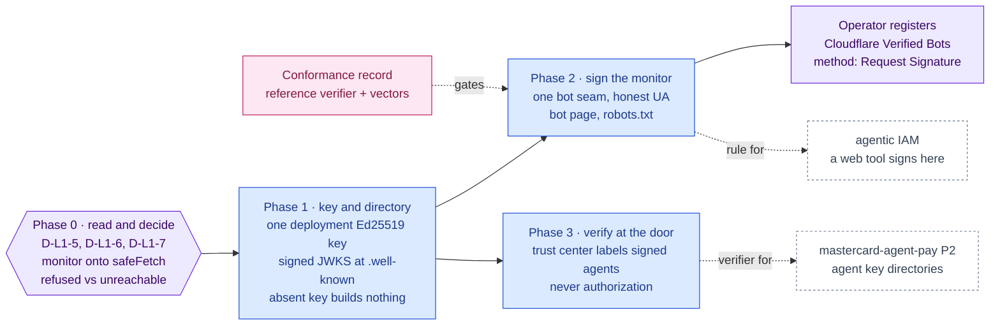

inflect · ai architecture · web bot auth · roadmap v1 · 2026-10-30

# Web Bot Auth — signed requests from Inflect's crawlers, verified agents at its door, Layer 1

> **Status: living design** — the integration roadmap for Cloudflare's Web Bot
> Auth (HTTP Message Signatures for automated traffic). It is an **addition to
> the v6 target**, requested by the owner on 2026-10-30: the blueprint names no
> such box. The **Current state** section is true today (main 3.340.0,
> `c08922f3c`). The **Roadmap** section is the plan. This is a child of
> [`docs/ai-architecture-roadmap.md`](../ai-architecture-roadmap.md): read that
> first for the target map, the global rules **G1–G12**, and the sequencing.
> If the code contradicts a fact here, the code wins and the pull request that
> finds it corrects this document.

## Where it sits in the master roadmap

| | |
| --- | --- |
| Layer · box | 1 — Security, guards & alignment · an added box, "Web Bot Auth" (agent identity at the HTTP boundary) |
| Wave | 1 for Phases 0–2 (no dependency, zero GPU, and it fixes a live blind spot in vendor monitoring); 3 for Phase 3 |
| Depends on | nothing for Phases 0–2; Phase 3 waits on Phase 1's verifier pieces |
| Unblocks | vendor monitoring that can tell "refused" from "unreachable"; registration as a verified bot; a signed-agent label on the public trust center; [`mastercard-agent-pay.md`](./mastercard-agent-pay.md) Phase 2, whose Know Your Agent check validates a customer agent's key directory with Phase 3's verifier |
| Owner decisions | **D-L1-5** (the signing identity is the deployment, never a tenant), **D-L1-6** (outbound conduct: honest User-Agent, bot page, robots.txt, Cloudflare registration), **D-L1-7** (inbound verification: label only, never authorization) |

## At a glance

Purple hexagon: the Phase 0 decision. Blue: a phase not yet on `main`; it turns green (`done`) in the pull request that meets its "done when". Purple box: an act by the operator, outside the code. Pink: the evaluation record. Dashed: another roadmap this one feeds.



## Current state (true today)

### The protocol, as read on 2026-10-30

Read from public sources through search; the two primary pages (the IETF
datatracker and Cloudflare's developer docs) were outside this session's
network allowlist, so **Phase 0.1 re-reads both before any code is written**.

- **What it is.** A bot or agent signs each HTTP request with an Ed25519 key
  under HTTP Message Signatures (RFC 9421) and publishes its public keys, so a
  site can tell who operates the client instead of guessing from IP ranges
  and User-Agent strings. Three request headers carry it: `Signature-Input`
  (the covered components and the parameters `created`, `expires`, `keyid`
  and `tag="web-bot-auth"`), `Signature`, and `Signature-Agent`, which points
  at the operator's key directory. `keyid` is the key's JWK SHA-256
  thumbprint (RFC 7638).
- **The key directory.** A JSON Web Key Set at
  `/.well-known/http-message-signatures-directory`, served as
  `application/http-message-signatures-directory+json`. Cloudflare requires
  the directory response itself to be signed, one signature per key, and
  accepts Ed25519 only.
- **Standardisation.** The IETF `webbotauth` working group's active document
  is `draft-ietf-webbotauth-httpsig-protocol` (revision -00, dated around
  2026-09-01), which absorbed the separate directory draft. It is an
  Internet-Draft, not an RFC, and its details are still moving.
- **One open conflict, to settle in 0.1.** Later drafts make
  `Signature-Agent` a Dictionary structured field (`agent1="https://…"`);
  a secondary source reports that Cloudflare's verifier, as documented on
  2026-07-01, still expected the earlier bare string. Which form to send is
  a Phase 0.1 finding, not a guess.
- **Cloudflare's programme.** Operators register a bot in the dashboard with
  verification method "Request Signature" and the directory URL; Cloudflare
  ships an `http-signature-directory` CLI that validates a directory. Since
  2026-07-01 "signed agents" are part of the Verified Bots programme,
  distinguished by a metadata field rather than a separate category.
- **Reference implementation.** Cloudflare's `web-bot-auth` on npm, 0.2.0
  (Apache-2.0, published 2026-08-31), depending on `http-message-sig` 0.3.0,
  `jsonwebkey-thumbprint` and `structured-headers` 2.0.3. Not a dependency of
  this repository.

### What Inflect sends to third-party websites today

- **One unattended crawler: the vendor-monitoring sweep** (`vendor-monitoring`,
  daily 02:00 UTC). Two of its providers fetch over the public web:
  - **The TLS / security-header grade** (`HeaderGradeTlsProvider`,
    `services/vendor-monitoring/tls-provider.ts`, provider `header-grade`)
    GETs `https://<vendor domain>` with User-Agent
    `InflectCompliance-VendorMonitor/1.0` and grades the response headers.
  - **The breach catalogue** (`HibpDomainBreachProvider`, provider
    `hibp-domain`) queries a fixed HIBP endpoint with the same User-Agent.
  Both default to `stub` (`VENDOR_MONITOR_TLS_PROVIDER`,
  `VENDOR_MONITOR_BREACH_PROVIDER`); whether production sets the real
  providers is not visible from the repository.
- **Both fetch through `fetchWithRetry`, not `safeFetch`.** The vendor domain
  is entered by a tenant, and `tls-provider.ts` is not in the `SINKS` of
  `tests/guards/ssrf-egress-coverage.test.ts`. That is a G6 gap independent
  of this roadmap, and Phase 0 closes it first.
- **A refusal is invisible.** `fetchWithRetry` retries a 403 ("Unauthorized"),
  a 429 and any 5xx, then throws; the TLS provider turns every throw into
  `grade: null`; and the sweep treats `null` as "nothing observed", leaving
  `tlsGrade` and `tlsCheckedAt` as they were and recording no event. A vendor
  that puts the monitor behind a bot wall keeps its last grade indefinitely,
  dated to when the site was last readable, and nothing says it refused us.
- **A second crawler exists but is unreachable.** `SimpleMetadataProvider`
  (`services/vendor-enrichment.ts`) would fetch homepages with a browser-like
  User-Agent (`Mozilla/5.0 (compatible; VendorEnrichment/1.0)`) and a bare
  `fetch`, but `vendor.ts` calls `getEnrichmentProvider()` with no name, which
  returns the test provider. Nothing selects it.
- **Everything else outbound is credentialed or already signed**, and out of
  scope: automation webhooks and the audit stream (HMAC
  `X-Inflect-Signature`), MCP connections (`wire-transport.ts`, per-connection
  credentials), A2A (per-tenant Ed25519 receipts to pinned peers), the OIDC
  client. **No agent engine has a web-fetch tool**: the Tool Runner's client
  sends Messages calls only, and Flue's tools are the funnel's.

### Ed25519 is already handled in-house

`src/lib/agentic/a2a/signing-key.ts` builds an Ed25519 key from a 32-byte
seed with `node:crypto` and derives its SPKI fingerprint; `TenantA2aSigningKey`
holds one key per tenant, encrypted under the tenant's DEK, and rotation
retires the old key while keeping its public half. Its rule is "no deployment
key", because an A2A receipt exists to name the tenant. This roadmap needs the
opposite rule, for the opposite reason (D-L1-5).

### What reaches Inflect's own door

- **The anonymous public surfaces** are the trust center page `/trust/<slug>`
  (edge rate limit `trust:<slug>` per IP through `checkApiReadRateLimit`,
  applied before the public allow), the anonymous `/api/trust/…` endpoints,
  and `/robots.txt`. No request signature is read anywhere; automated
  traffic is known only by IP and User-Agent.
- **`/api/mcp` and `/api/a2a` authenticate with credentials** (`iflk_`,
  `iflp_`); a signature would add identity, never authority, there.
- **There is no `/.well-known/http-message-signatures-directory`**, and no
  `/.well-known/` path is on the public allowlist in `src/lib/auth/guard.ts`.
- **Cloudflare is not in front of the app.** The repository mentions it only
  as an S3-compatible option (R2) and as one fallback header
  (`cf-connecting-ip`) in session tracking.

## Fit, and what is deliberately not adopted

**Adopted.** Web Bot Auth in both directions, in this order:

1. **Outbound: sign the product's own crawlers.** One deployment key, a
   signed directory on the operator's origin, and one fetch seam that every
   unattended request to a third-party website goes through. The vendor
   monitor is the first and only caller today.
2. **Inbound: label signed agents on the public surfaces.** Verify a signed
   request to the trust center and record which operator sent it. Nothing
   else changes.

**The identity is the deployment, never a tenant (D-L1-5).** A monitored
vendor must not learn which customer monitors it. A key per tenant would turn
every signed request into a disclosure of a customer relationship, readable
by the vendor and by its CDN. So the signature names Inflect's crawler and
nothing else: no tenant id, slug or name in the signature base, the headers,
the User-Agent or the directory. A test asserts it. The A2A rule "no
deployment key" stays right where it is, because an A2A receipt exists to
name the tenant. The two rules point in opposite directions on purpose, and
neither is to be "harmonised" into the other.

**Signing earns identifiability, not access.** A vendor's WAF may still
refuse a verified bot. The gain is that the site can choose, Cloudflare and
other verifiers can classify the monitor, and Phase 0's outcome taxonomy
makes a refusal visible either way.

**Not adopted, with the reason.**

- *Signing model calls.* Agent runs call a model vendor's API under an API
  key. Web Bot Auth identifies a client to a website, not to an API that
  already authenticates it.
- *Signing MCP, A2A, webhooks or the SIEM stream.* Each is credentialed or
  already signed to a party that pinned us. A second signature adds nothing.
- *A verified signature as authorization.* It proves who operates a client,
  not that the client may read anything. Gated trust-center documents keep
  their access-request token; no tenant setting turns a signature into a
  grant.
- *Crawling through Cloudflare's infrastructure* (Browser Rendering, a signing
  proxy). It would put a sub-processor between Inflect and the vendors and
  hand it the monitored-domain list. Inflect signs its own requests.
- *A browser-like User-Agent.* The unused enrichment provider's string is the
  pattern Web Bot Auth exists to replace; Phase 2 does not copy it, and
  Phase 0 decides whether that provider is deleted or moved onto the seam.
- *Agents that browse, now.* No engine has a web tool. If one ever gets one,
  it fetches through the Phase 2 seam and signs as the deployment; the
  [agentic IAM roadmap](../agentic-iam-roadmap.md) owns whether that is
  allowed at all.

## Roadmap (future direction)

### Phase 0 — Read the standard, decide, and make refusals visible

**Sub-phases.**
- [ ] 0.1 Read the primary texts: the current revision of
      `draft-ietf-webbotauth-httpsig-protocol` and Cloudflare's Web Bot Auth
      verifier documentation. Record, in the implementation note: the
      `Signature-Agent` form each accepts (string or Dictionary), the
      required covered components, the `created`/`expires` window limits,
      whether a `nonce` is required, the directory media type and response
      signing, and the `keyid` derivation. Where the two disagree, the
      verifiers in use win, and the note says which form is sent and why.
- [ ] 0.2 D-L1-5, D-L1-6 and D-L1-7 initialled (master decisions table).
- [ ] 0.3 Library decision, by risk review (G5): Cloudflare's `web-bot-auth`
      as a runtime dependency, or an in-house signer on `node:crypto` (the A2A
      precedent) with the reference library as a devDependency test oracle.
      Default: in-house for signing, which is a few dozen lines over code
      the repository already trusts; the inbound verifier's structured-field
      parser is attacker-facing, and is decided with Phase 3 on the same
      review.
- [ ] 0.4 Make the monitor's refusals visible **before** signing anything.
      The TLS provider returns an outcome: `GRADED`, `REFUSED` (403, a 429
      that outlasted the retries, or a recognised challenge response) or
      `UNREACHABLE` (network failure, timeout, 5xx). The sweep records the
      last outcome and its time on the monitor, emits
      `vendor_monitor.tls_fetch{outcome}`, and the vendor page shows a stale
      grade as stale. `REFUSED` before signing is the baseline Phase 2 is
      measured against.
- [ ] 0.5 Close the G6 gap: both vendor-monitor fetchers move onto
      `safeFetch` (byte cap, deadline, private-address and rebinding checks),
      and `tls-provider.ts` joins the SSRF guard's `SINKS`. The vendor domain
      is tenant-entered; until now nothing stopped it from naming a host
      inside the deployment's network.
- [ ] 0.6 The unreachable `SimpleMetadataProvider`: delete it, or keep it and
      move it onto the same `safeFetch` path in Phase 2. Default: delete
      (nothing selects it, and its User-Agent impersonates a browser).

**Prompt.**
```text
Context (main 3.340.0): the vendor-monitoring sweep (daily 02:00 UTC) is the product's
only unattended crawler of third-party websites: HeaderGradeTlsProvider GETs
https://<tenant-entered vendor domain> and HibpDomainBreachProvider queries a fixed HIBP
endpoint, both through fetchWithRetry (not safeFetch), User-Agent
InflectCompliance-VendorMonitor/1.0. fetchWithRetry retries 403/429/5xx then throws; the
TLS provider maps every throw to grade null; vendor-monitoring.ts treats null as "nothing
observed", so a refused fetch leaves the old grade and tlsCheckedAt with no event.
tls-provider.ts is not in tests/guards/ssrf-egress-coverage.test.ts SINKS.
SimpleMetadataProvider in services/vendor-enrichment.ts is unreachable (getEnrichment
Provider() is called with no name).

Task: Phase 0 of docs/ai-architecture/web-bot-auth.md. (1) Read the current
draft-ietf-webbotauth-httpsig-protocol and Cloudflare's Web Bot Auth verifier docs;
write docs/implementation-notes/2026-MM-DD-web-bot-auth-decisions.md recording the wire
format (Signature-Agent form, covered components, window, nonce, directory media type
and response signing, keyid derivation), D-L1-5/6/7 as initialled, and the library
decision from a G5 risk review. (2) TLS provider outcome taxonomy GRADED | REFUSED |
UNREACHABLE; persist the last outcome and its time on the monitor (migration);
metric vendor_monitor.tls_fetch{outcome}; the vendor page marks a stale grade stale.
(3) Both vendor-monitor fetchers on safeFetch with byte caps and deadlines; add
tls-provider.ts to SINKS. (4) Delete SimpleMetadataProvider unless D-L1-6 keeps it.
(5) Tests: a 403 and a challenge response record REFUSED, not null; a network error
records UNREACHABLE; a refused fetch leaves the grade and marks it stale; a vendor
domain resolving to a private address is refused before any request.

Constraints: nothing is signed in this phase; no new outbound host; the outcome
column carries no response body.

Done when: the outcome metric exists in production and the decisions are initialled.
```

**Hardening.** G6 (the SSRF gap closes before anything new is sent), G10
(the decisions live in a dated note, and the tests name the invariant
"a refusal is recorded, never read as no change"), G11 (the refused share
before signing is the baseline; a change without one is an anecdote).

### Phase 1 — The deployment key and the signed directory

**Sub-phases.**
- [ ] 1.1 `WEB_BOT_AUTH_SIGNING_KEY` (a 32-byte Ed25519 seed) and
      `WEB_BOT_AUTH_PREVIOUS_SIGNING_KEY` (rotation grace) in `src/env.ts`,
      both optional. Absent means no signer is constructed and the directory
      route answers 404 (G9). A malformed value fails startup in production,
      and so does a seed equal to `DATA_ENCRYPTION_KEY`, because a key reused
      across purposes is a key whose compromise spreads.
- [ ] 1.2 `src/lib/web-bot-auth/`, pure: `key.ts` (seed to key, public JWK,
      RFC 7638 thumbprint as `keyid`), `sign.ts` (`signRequest(request, key,
      now)` returns the three headers, covering the components 0.1 names,
      with `created`, `expires` inside 0.1's window and
      `tag="web-bot-auth"`), and `directory.ts` (the JWKS document, current
      key plus previous key during the grace).
- [ ] 1.3 `GET /.well-known/http-message-signatures-directory` on the
      operator's public origin: the media type from 0.1, the response signed
      once per published key, `Cache-Control` with a short max-age, added to
      `PUBLIC_PATH_EXACT` and to an edge rate limit. GET only.
- [ ] 1.4 Conformance as a record (G11): the reference verifier from 0.3
      verifies signatures made by `sign.ts` and the served directory;
      the draft's own examples reproduce byte for byte; Cloudflare's
      `http-signature-directory` validator passes against a CI-built
      instance. Committed under `evals/web-bot-auth/records/`.
- [ ] 1.5 The tenant-free assertion: a test signs requests under several
      tenant contexts and asserts the headers, the signature base and the
      directory are byte-identical across them.

**Prompt.**
```text
Context (main 3.340.0 + Phase 0): the wire format and library decision are recorded in
the Phase 0 note; Ed25519 keys are built from seeds with node:crypto in
src/lib/agentic/a2a/signing-key.ts; env vars are declared in src/env.ts; public paths
are listed in src/lib/auth/guard.ts and rate-limited at the edge in src/middleware.ts.

Task: Phase 1. (1) WEB_BOT_AUTH_SIGNING_KEY and WEB_BOT_AUTH_PREVIOUS_SIGNING_KEY in
src/env.ts, optional; production startup refuses a malformed seed or one equal to
DATA_ENCRYPTION_KEY. (2) src/lib/web-bot-auth/{key,sign,directory}.ts as pure modules
per the note's wire format; keyid is the RFC 7638 JWK thumbprint. (3)
src/app/.well-known/http-message-signatures-directory/route.ts: GET, the note's media
type, the response signed once per published key, short Cache-Control, 404 when no key
is configured; add the exact path to PUBLIC_PATH_EXACT and an edge rate limit. (4)
evals/web-bot-auth/: conformance cases (reference verifier accepts our requests and
directory; the draft's examples reproduce exactly; the directory validator passes) and
a committed record. (5) Tests: absent key builds no signer and serves 404; headers and
directory are byte-identical across tenant contexts; a request signed with the previous
key verifies only inside the grace.

Constraints: no caller signs anything yet (Phase 2 does); no tenant-derived value
reaches the signer; the seed is never logged.

Done when: the record is committed and the directory validates in CI.
```

**Hardening.** G9 (absent config constructs nothing, and serves nothing), G5
(the seed is a credential: env-held like the master KEK, never in the
database, never logged), G11 (conformance is a record, not a passing unit
test against our own parser), D-L1-5 (the tenant-free test).

### Phase 2 — Sign the vendor monitor, and say who it is

**Sub-phases.**
- [ ] 2.1 One seam, `botFetch(url, init)`: `safeFetch`, then `signRequest`,
      then the User-Agent from D-L1-6, which names the bot and links its
      page. The TLS and breach providers use it. An ESLint rule in
      `eslint-rules/` refuses a call to `signRequest`, or a bot User-Agent
      literal, outside the seam.
- [ ] 2.2 A public page describing the bot at a stable URL on the operator's
      origin: what it fetches (one homepage request per monitored vendor per
      day; the HIBP catalogue), when, from where, the directory URL, and how
      a site owner contacts the operator or opts out.
- [ ] 2.3 `robots.txt`, per D-L1-6: fetched once per domain per sweep through
      the same seam and honoured for the monitor's token. A disallowed site
      records `REFUSED` with reason `ROBOTS`, never a grade.
- [ ] 2.4 Operator act: register the directory with Cloudflare Verified Bots
      (verification method "Request Signature", the directory URL) and with
      any other verifier that asks. A runbook section in
      `docs/vendor-monitoring.md`; the registration is not code and not
      automated.
- [ ] 2.5 Measure: the `REFUSED` share for 14 days after registration against
      Phase 0's baseline, recorded in the phase's implementation note,
      whatever the result.

**Prompt.**
```text
Context (main 3.340.0 + Phases 0-1): the vendor monitor records GRADED/REFUSED/
UNREACHABLE and fetches through safeFetch; src/lib/web-bot-auth/ signs requests with
the deployment key and serves a signed directory; custom ESLint rules live in
eslint-rules/ (CommonJS, RuleTester beside each).

Task: Phase 2. (1) src/lib/web-bot-auth/bot-fetch.ts: botFetch(url, init) = safeFetch +
signRequest + the D-L1-6 User-Agent; the TLS and breach providers call it. (2)
eslint-rules/web-bot-auth-single-seam.js: refuse signRequest or a bot User-Agent literal
outside bot-fetch.ts, with a RuleTester test. (3) A public bot page on the operator's
origin (purpose, schedule, directory URL, contact, opt-out), added to the public path
allowlist. (4) robots.txt honoured per domain per sweep through botFetch; a disallowed
site records REFUSED with reason ROBOTS. (5) A runbook section in
docs/vendor-monitoring.md for registering with Cloudflare Verified Bots. (6) Tests: every
monitor request carries a signature the reference verifier accepts; robots disallow
yields REFUSED/ROBOTS and no homepage request; no tenant value appears in any header.

Constraints: one identity for the deployment; the bot page names no customer; the
registration is the operator's act.

Done when: the monitor's production requests are signed, the directory is registered,
and the 14-day REFUSED share is recorded beside the baseline.
```

**Hardening.** G6 (the seam is `safeFetch` underneath, so signing never
becomes a way around the SSRF checks), G10 (single seam held by an ESLint
rule, not a regex), D-L1-6 (honest User-Agent, a page, robots.txt — the
conduct a verifier's programme asks for), G9 (no key, no signature; the
monitor still works unsigned).

### Phase 3 — Verify signed agents at the public door

**Sub-phases.**
- [ ] 3.1 `verifySignedRequest(request)` in the Node runtime, for
      `/trust/<slug>` and the anonymous `/api/trust/…` endpoints. The cheap
      checks run first and fetch nothing: the headers parse under a strict
      structured-field parser, the tag is `web-bot-auth`, the window is
      current, and the covered components include the authority. An
      unsigned or malformed request costs no network call.
- [ ] 3.2 The directory named by `Signature-Agent` is a URL the requester
      chose, so fetching it is an SSRF and amplification surface. It is
      fetched through `safeFetch` (https only, byte cap, deadline), cached by
      URL with a TTL and a negative cache, and bounded per directory host.
      D-L1-7 decides between an open directory fetch under those bounds and
      an allowlist of known operators.
- [ ] 3.3 The result is a label and nothing else: `{ directoryOrigin, keyid }`
      or none, recorded on the trust-center visit count by operator origin.
      It grants nothing. Gated documents keep their access-request token,
      and no tenant setting turns a signature into access.
- [ ] 3.4 Rate limits stay as they are at first (IP at the edge). A separate
      per-verified-operator budget is considered only after measurement: the
      `/api/mcp` lesson is that hosted agents share egress addresses, so a
      verified agent may deserve its own bucket rather than its IP's.
- [ ] 3.5 The trust-center admin page shows signed-agent visits by operator
      (counts only). No blocking control until the counts justify one.

**Prompt.**
```text
Context (main 3.340.0 + Phases 0-2): src/lib/web-bot-auth/ signs and serves a directory;
/trust/<slug> is public and edge rate-limited per IP (src/middleware.ts); /api/trust/*
anonymous endpoints authenticate in-handler; safeFetch enforces https, private-address
and rebinding checks.

Task: Phase 3 per D-L1-7. (1) src/lib/web-bot-auth/verify.ts: strict parse of
Signature-Input / Signature / Signature-Agent; tag, window and covered-component checks
before any network call; directory fetch via safeFetch with byte cap and deadline,
cached by URL (TTL plus negative cache) and bounded per host, or an allowlist if D-L1-7
chose one; returns { directoryOrigin, keyid } | null. (2) Call it from the trust-center
page and /api/trust/* handlers; record visit counts by operator origin; grant nothing.
(3) Trust-center admin: signed-agent visit counts by operator. (4) Tests: an unsigned
request makes zero fetches; expired, wrong-authority, unknown-keyid and mismatched-
directory requests are unverified; a Signature-Agent naming a private address is refused
before resolution; a verified request reaches no gated document without its token.

Constraints: failure is "unverified", never "verified"; no new rate-limit bucket in
this phase; no per-request directory fetch without the cache.

Done when: the trust center labels the signed agents that visit it, and every negative
case above is a passing test.
```

**Hardening.** G6 (the requester-chosen directory URL is the risk this
phase exists to bound), G9 (verification failures fail to "unverified",
never to "verified"), G10 (negative vectors are tests; the zero-fetch test
names the invariant), D-L1-7 (a label is never authorization).

## Evals for this framework

| What | How | Record |
| --- | --- | --- |
| Signing conformance | reference verifier accepts our requests; draft examples reproduce byte for byte | `evals/web-bot-auth/records/` (G11), gates Phase 2 |
| Directory validity | Cloudflare's `http-signature-directory` validator against a CI-built instance | same record |
| Tenant-free identity | headers, signature base and directory identical across tenant contexts | CI |
| Effect on the monitor | `REFUSED` share, 14 days after registration against the Phase 0 baseline | the Phase 2 implementation note |
| Inbound safety | zero fetches for unsigned requests; the negative vectors; private-address directory refused | CI |

## Updating the master

Flip the row on the master [Status board](../ai-architecture-roadmap.md#status-board)
per phase; D-L1-5, D-L1-6 and D-L1-7 in the decision table. When Phase 0
lands, the master's Layer 1 current-state paragraph says the vendor monitor
records refusals; when Phase 2 lands, it says the monitor signs, and the
Web Bot Auth node in **The target, with status** turns green.

## Sources read

Read on 2026-10-30 through search, pending Phase 0.1's reading of the
primary texts:

- [IETF Web Bot Auth working group](https://datatracker.ietf.org/wg/webbotauth/)
  and [`draft-ietf-webbotauth-httpsig-protocol`](https://datatracker.ietf.org/doc/draft-ietf-webbotauth-httpsig-protocol/)
- [Cloudflare: Web Bot Auth](https://developers.cloudflare.com/bots/reference/bot-verification/web-bot-auth/)
  and [Verified Bots](https://developers.cloudflare.com/bots/concepts/bot/verified-bots/)
- [Cloudflare blog: signed agents](https://blog.cloudflare.com/signed-agents/)
  and [message signatures in the Verified Bots programme](https://blog.cloudflare.com/verified-bots-with-cryptography/)
- [`web-bot-auth` on npm](https://www.npmjs.com/package/web-bot-auth) (0.2.0)
